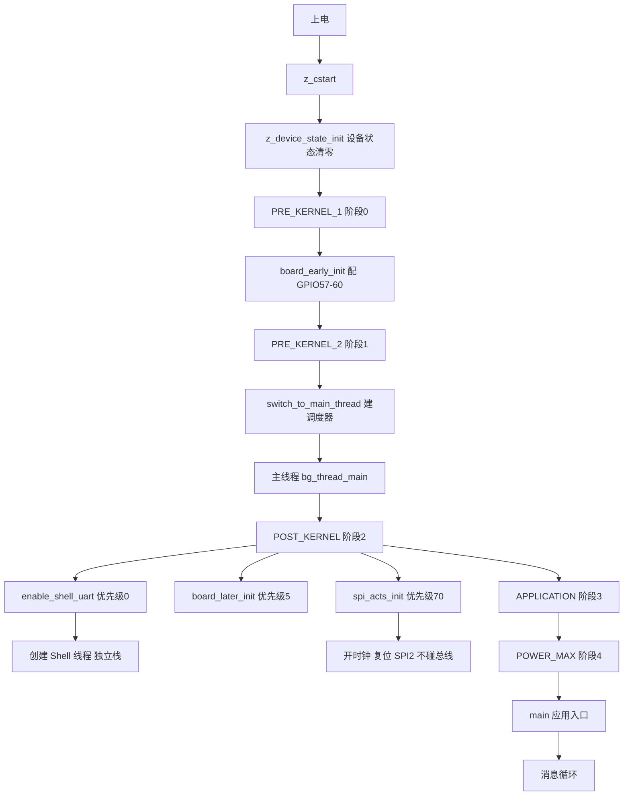

# ATS3085E 上电到 main() 启动流程导读

本文只讲一条路径：ATS3085E 从上电跑到应用 `main()` 之间发生了什么。起点是 `z_cstart()`，终点是 `application/bt_watch_no_psram/src/main/system_app_main.c` 的 `main()`。读者按 STM32 裸机的方式理解启动，所以每一步都给出对应的 STM32 概念。源码路径以 `TAG_ZS3085E_241230` 为根，行号均已核对。文中还纠正了一份常见网络总结里的一处错误引用，见第六节。

## 一、两套启动方式先对上号

STM32 上，初始化顺序是你在 `main()` 里手写的：`HAL_Init()` → `MX_GPIO_Init()` → `MX_SPI2_Init()` → `while(1)`。谁先谁后由代码行决定。

Zephyr 换了做法：没有任何人手工调用 `spi_acts_init()`。每个驱动在编译期把自己"报名"到一张启动表里，内核按阶段叫号执行。你在源码里搜不到调用点，原因见第六节。

| STM32 裸机 | ATS3085E（Zephyr） | 位置 |
|---|---|---|
| `Reset_Handler` / `SystemInit` 之后 | `z_cstart()` | `zephyr/kernel/init.c:462` |
| `MX_GPIO_Init()` | `board_early_init()` | `zephyr/boards/arm/ats3085e_dev_watch_ext_nor/board.c:328`，注册在 `board.c:677` |
| `MX_SPI2_Init()` | `spi_acts_init()` | `zephyr/drivers/spi/spi_acts.c:1443`，注册在 `spi_acts.c:1540` |
| `main()` 里的 `while(1)` | `main()` 与消息循环 | `application/bt_watch_no_psram/src/main/system_app_main.c:389` |
| 没有线程概念 | 主线程、Shell 独立线程 | `zephyr/kernel/init.c:353`、`zephyr/subsys/shell/shell.c:1586` |

一句话记：STM32 是你拿着清单挨个打电话；Zephyr 是建了一个群，大家按报到时间排队，内核当主持人按批次叫号。

## 二、核心机制：一条报名记录

看懂这一件事，后面的行号就全部能串起来。

**每个初始化函数在编译期生成一条只读记录**，结构定义在 `zephyr/include/init.h:36`：

```c
struct init_entry {
    int (*init)(const struct device *dev);   /* 要调的初始化函数 */
    const struct device *dev;                /* 关联设备，服务类项为 NULL */
};
```

**这条记录被放进指定的链接段**，由 `zephyr/include/init.h:64` 的宏完成，段名里带阶段和优先级：

```c
static const struct init_entry __init_##_entry_name __used    \
__attribute__((__section__(".z_init_" #_level STRINGIFY(_prio) "_"))) = { \
    .init = (_init_fn), .dev = (_device), };
```

三个关键点缺一个都读不通。

- **段名里带阶段和优先级。** 例如 `.z_init_POST_KERNEL_70_`。链接器按段名排序，所以"同阶段数字小的先跑"是链接器排的，不是代码排的。
- **`__used` 防止被优化掉。** 这条记录在 C 代码里没有任何引用，不加属性编译器会当垃圾删掉。
- **执行时走函数指针。** 内核拿到表项后调用 `entry->init(dev)`，所以 `grep spi_acts_init` 只能搜到"注册的那行"和"实现的那行"。

两种注册宏都只生成报名记录，区别在于有没有设备对象。

| 宏 | 用于 | `dev` 字段 | 本例 |
|---|---|---|---|
| `SYS_INIT(fn, level, prio)` | 纯服务，没有设备对象 | `NULL` | 串口 Shell：`zephyr/subsys/shell/shell_uart.c:544` |
| `DEVICE_DEFINE(...)` | 有设备对象的驱动 | 指向 `struct device` | SPI2：`zephyr/drivers/spi/spi_acts.c:1540` |

`DEVICE_DEFINE` 会**同时生成两样东西**：一个 `struct device` 设备对象（放进 `.z_device_...` 段），一条 `init_entry` 报名记录（`zephyr/include/device.h:485`）。所以设备和它的初始化函数是成对的。

## 三、按执行顺序走一遍

阶段索引定义在 `zephyr/include/init.h:21-31`，`zephyr/kernel/device.c:54` 的阶段表必须与它一致。

| 索引 | 阶段宏 | 运行环境 | 能不能用内核服务 |
|---|---|---|---|
| 0 | `_SYS_INIT_LEVEL_PRE_KERNEL_1` | 启动上下文，用中断栈 | 不能阻塞、不能建线程 |
| 1 | `_SYS_INIT_LEVEL_PRE_KERNEL_2` | 同上 | 同上 |
| 2 | `_SYS_INIT_LEVEL_POST_KERNEL` | 主线程 | 可以 |
| 3 | `_SYS_INIT_LEVEL_APPLICATION` | 主线程 | 可以 |
| 4 | `_SYS_INIT_LEVEL_POWER_MAX` | 主线程 | 可以，本项目自定义阶段 |

下面按时间顺序展开。

1. **进入 C 世界，把设备状态槽清零。**  
   `z_cstart()` 是能跑 C 代码的第一个位置，等价于你在 `SystemInit` 之后、`main` 之前的那段准备。  
   前提条件：栈已建立、BSS 已清零。  
   `z_device_state_init()` 遍历链接器收集的全部静态设备，逐个登记内核对象状态，必须在任何初始化之前完成，否则后面无法标记"初始化过、成功没成功"。  
   出处：`zephyr/kernel/init.c:462`、`zephyr/kernel/device.c:36`（由 `init.c:479` 调用）。

2. **在阶段 0 和阶段 1 完成早期硬件初始化。**  
   `z_sys_init_run_level(_SYS_INIT_LEVEL_PRE_KERNEL_1)` 与 `_PRE_KERNEL_2` 连续执行。  
   此时还没有调度器，所以这两个阶段里的函数只管写寄存器，不能 `k_sleep`、不能 `k_mutex_lock`。  
   出处：`zephyr/kernel/init.c:482-483`。

3. **板级引脚：在最早的阶段就把线接好。**  
   `board_early_init()` 就是你的 `MX_GPIO_Init()`，注册语句是 `SYS_INIT(board_early_init, PRE_KERNEL_1, 5)`。  
   函数体只做一件事：`acts_pinmux_setup_pins(board_pin_config, ARRAY_SIZE(board_pin_config))`，按一张静态表一次写完。  
   出处：`zephyr/boards/arm/ats3085e_dev_watch_ext_nor/board.c:677`、`board.c:331`，表定义在 `board.c:24`。

4. **SPI2 的四根线在这张表里，条件编译只看 `CONFIG_SPI_2`。**  
   `CS` 用 GPIO57，`SCLK` 用 GPIO58，`MISO` 用 GPIO59，`MOSI` 用 GPIO60。  
   GPIO57 原本与振动电机 PWM 复用，所以 `board_pwm_config[]` 被清空，把脚让给硬件片选。  
   引脚在阶段 0 就接好，而 SPI 驱动要到阶段 2 才跑，等于先通线后上电。  
   出处：`board.c:152-162`、`board.c:248-250`。

5. **建调度环境，切进主线程。**  
   `switch_to_main_thread(prepare_multithreading())` 是裸机与多线程的分界线，这句之前是单条执行流，这句之后系统有了就绪队列和多个线程。  
   `z_sched_init()` 初始化调度队列，`z_setup_new_thread()` 给主线程分配独立栈和控制块，入口函数是 `bg_thread_main`，**不是你的 `main()`**。  
   本芯片走架构专用入口 `arch_switch_to_main_thread()`。  
   出处：`zephyr/kernel/init.c:500`、`init.c:341`、`init.c:353`、`init.c:381-384`。

6. **接受一个反直觉的事实：`main()` 也是线程。**  
   你的应用 `main()` 就在这个主线程里运行。  
   Zephyr 里 `main` 本身就是一个线程，不是"线程之外的东西"，与 STM32 的 `main` 身份完全不同。

7. **主线程里跑阶段 2。**  
   `bg_thread_main()` 先置 `z_sys_post_kernel = true`，标记后续初始化已运行在可用的线程环境里，然后调用 `z_sys_init_run_level(_SYS_INIT_LEVEL_POST_KERNEL)`。  
   SPI 驱动、串口 Shell 都在这一阶段报到。  
   必须切到线程之后才跑，是因为这里会调 `k_sem_init`、`device_get_binding`、`k_thread_create`，在阶段 0/1 调这些会直接崩。  
   出处：`zephyr/kernel/init.c:239`、`init.c:241`。

   打个比方：阶段 0 是毛坯房通水电，只能碰硬件；阶段 2 是房子能住人了才搬家具，可以创建内核对象、可以阻塞。

8. **阶段表按段边界扫一遍，逐条调用。**  
   `levels[]` 里放的是链接器提供的段边界符号，如 `__init_POST_KERNEL_start`。  
   因为每个阶段一个段、段内已按优先级排好，所以从本阶段起点扫到下一阶段起点，就是按优先级顺序执行。  
   循环体里 `int rc = entry->init(dev);` 才是真正的执行点，就是 `spi_acts_init()` 被间接调用的地方。  
   返回值非 0 时缩成 8 位存进 `dev->state->init_res`，之后 `device_get_binding()` 会拒绝这个设备；返回 0 则把 `dev->state->initialized` 置 true。  
   出处：`zephyr/kernel/device.c:52-68`、`device.c:78-91`，段边界声明在 `device.c:13-19`。

9. **SPI2 的报名记录在编译期产生。**  
   `SPI_ACTS_DEVICE_INIT(2)` 出现在 `zephyr/drivers/spi/spi_acts.c:1550`，整体展开成 `spi_acts.c:1533` 那个多行宏，宏体里真正的注册语句是 `DEVICE_DEFINE`，位于 `spi_acts.c:1540`。  
   这一步全是编译期文本替换，没有运行时代码。

   ```c
   DEVICE_DEFINE(spi_acts_2, CONFIG_SPI_2_NAME,
                 &spi_acts_init, NULL, &spi_acts_dev_data_2,
                 &spi_acts_config_2, POST_KERNEL,
                 CONFIG_SPI_INIT_PRIORITY, &spi_acts_driver_api);
   ```

10. **四组参数分清谁给谁用。**  
    设备名给应用查设备，初始化函数给启动表，data 和 config 给驱动自己，api 给应用调用时跳转。

    | 参数 | 内容 | 谁使用 |
    |---|---|---|
    | `CONFIG_SPI_2_NAME` | 字符串 `"SPI_2"` | 应用 `device_get_binding()` 按名字查找 |
    | `&spi_acts_init` | 初始化函数 | 阶段 2 遍历时被调用 |
    | `&spi_acts_dev_data_2` | 运行时数据（信号量等） | 驱动内部 |
    | `&spi_acts_config_2` | 静态配置（基址、时钟号、复位号） | 驱动内部 |
    | `&spi_acts_driver_api` | 函数指针表（`transceive`/`release`） | 应用调 `spi_transceive()` 时跳进来 |

    这条链的落点是 `DEVICE_DEFINE` → `Z_DEVICE_DEFINE` 生成设备对象 → `Z_INIT_ENTRY_DEFINE` 生成报名记录，最终落到 `.z_init_POST_KERNEL_70_` 段。  
    出处：`zephyr/include/device.h:469-486`。

11. **`spi_acts_init()` 真正做的四步硬件动作。**  
    先 `k_sem_init` 建 DMA 完成信号量，再按 `flag_use_dma` 决定要不要申请 DMA 通道。  
    然后 `acts_clock_peripheral_enable()` 开时钟门控，`acts_reset_peripheral()` 复位外设。  
    最后 `spi_context_unlock_unconditionally()` 释放初始锁，**初始化期间不发送任何数据**。  
    本板 `CONFIG_SPI_2_USE_DMA` 为 0，所以跳过 DMA 申请。  
    出处：`zephyr/drivers/spi/spi_acts.c:1443-1482`，DMA 开关在 `zephyr/boards/arm/ats3085e_dev_watch_ext_nor/board_cfg.h:195`。

12. **Shell 串口是同一阶段的另一个报名项，优先级更靠前。**  
    `SYS_INIT(enable_shell_uart, POST_KERNEL, CONFIG_SHELL_BACKEND_SERIAL_INIT_PRIORITY)`，当前配置值是 0。  
    它先用 `device_get_binding(CONFIG_UART_SHELL_ON_DEV_NAME)` 取到 `UART_0`，`device_is_ready()` 不通过就返回 `-ENODEV`。  
    出处：`zephyr/subsys/shell/shell_uart.c:544`、`shell_uart.c:519-541`。

13. **`shell_init()` 在这里创建一条独立线程。**  
    `k_thread_create(shell->thread, shell->stack, CONFIG_SHELL_STACK_SIZE, shell_thread, ...)`，传 `K_NO_WAIT` 表示可立即调度。  
    所以串口命令（包括后面敲的 SPI 测试命令）跑在 Shell 线程里，与主线程的应用逻辑并行。  
    STM32 裸机没有这个：串口命令要么放中断，要么在 `while(1)` 里轮询。  
    出处：`zephyr/subsys/shell/shell.c:1569-1596`，创建在 `shell.c:1586`。

14. **`bg_thread_main()` 收尾，然后调用 `main()`。**  
    `_SYS_INIT_LEVEL_APPLICATION` 跑应用阶段，`z_init_static_threads()` 建立构建期声明的静态线程，`_SYS_INIT_LEVEL_POWER_MAX` 带 `soc_pmu_lowpower_check()` 条件，低功耗启动时跳过。  
    `main()` 返回后会清掉 `K_ESSENTIAL` 标志，允许主线程正常结束。  
    出处：`zephyr/kernel/init.c:253-267`、`init.c:273-278`。

15. **应用 `main()` 才是你熟悉的世界。**  
    先读重启原因 `system_power_get_reboot_reason()`，再 `mem_manager_init()`、`system_input_handle_init()`、`system_init()`、UI 初始化，最后进消息循环。  
    出处：`application/bt_watch_no_psram/src/main/system_app_main.c:389-416`。

## 四、当前配置下的实际执行顺序

配置值取自 `application/bt_watch_no_psram/outdir/ats3085e_dev_watch_ext_nor/zephyr/.config`。

| 阶段 2 报名项 | 优先级 | 依据 |
|---|---|---|
| `enable_shell_uart()` | 0 | `CONFIG_SHELL_BACKEND_SERIAL_INIT_PRIORITY=0`，`.config:1873` |
| `board_later_init()` | 5 | `board.c:679` 写死 |
| `spi_acts_init()` | 70 | `CONFIG_SPI_INIT_PRIORITY=70`，`.config:1412`，Kconfig 默认值 |

这三条可以确定相对顺序：**Shell 后端 → 板级晚期打印 → SPI2 初始化**。中间还夹着哪些 UART、GPIO 驱动的报名项，要看实机日志，不能凭配置表推断。

这里有个容易踩的坑：Shell 后端优先级是 0，而 `shell_uart.c` 的注释要求"必须大于所用串口设备的初始化优先级"。UART 驱动若排在 0 之后，`device_is_ready()` 会失败并返回 `-ENODEV`，表现为串口无反应但系统照常运行。遇到这个现象先查 UART 驱动所在的阶段和优先级。

## 五、一张图收束整条路径



## 六、三个容易卡住的地方

1. **外部总结把注册点写错了。**  
   常见版本说"板级通过 `board.c:674`"。  
   674 行是 `board_lcd_resume()` 的右花括号，与板级初始化注册无关。  
   真正的注册点是 `board.c:677` 的 `SYS_INIT(board_early_init, PRE_KERNEL_1, 5)`。  
   照着错行号看，逻辑链会断在 LCD 恢复函数上。

2. **`spi_acts_init` 搜不到调用点。**  
   它没有显式调用语句，只有 `entry->init(dev)` 这一次函数指针调用。  
   地址在编译期就填进 `init_entry`，不是运行时按字符串查找。  
   所以"源码搜索只找到注册和实现"是正常现象，不是代码被藏起来了。

3. **`CONFIG_SPI_2` 在 `.config` 里搜不到。**  
   本项目这个开关不是 Kconfig 变量，而是板级头文件里的宏：`board_cfg.h:78` 直接写 `#define CONFIG_SPI_2 1`。  
   所以 `grep CONFIG_SPI_2` 在 `zephyr/.config` 里命中 0 条，并不代表 SPI2 没编进去。  
   同理 `CONFIG_SPI_2_NAME`、`CONFIG_SPI_2_USE_DMA`、`CONFIG_SPI_2_DMA_ID` 都在 `board_cfg.h:78-198`，改这些值不用动 Kconfig。

## 七、在实机上验证这条路径

1. **确认设备调试输出是开的。**  
   当前配置已带 `CONFIG_DEVICE_DEBUG=y`，`.config:1203`。  
   所以 `z_sys_init_run_level()` 会为每个报名项打印一行。

2. **抓启动日志，核对设备名和函数地址。**  
   设备项打印成 `z_sys_init dev(UART_0) func:...`、`z_sys_init dev(SPI_2) func:...`。  
   设备名来自 `dev->name`，函数地址来自 `entry->init`，打印位置在 `zephyr/kernel/device.c:73`。  
   服务类报名项没有设备对象，打印成 `z_sys_init entry(...) func:...`，例如 Shell 后端。

3. **用日志核对三件事。**  
   SPI2 是否真的出现在阶段 2 的列表里。  
   它的位置是否在 Shell 后端之后，对应优先级 70 对 0。  
   它前面是否已经有 UART 驱动打印，用来解释 Shell 绑定 UART 的成败。

4. **再看驱动自己那行诊断输出。**  
   `spi_acts_init()` 里的 `printk("spi:clkreg=0x%x, dma=%d")` 会给出基址和 DMA 开关，本板应为 `dma=0`。  
   出处：`zephyr/drivers/spi/spi_acts.c:1471`。

## 八、把它翻译成 STM32 的写法

概念上等价于下面这样，方便对照记忆：

```c
/* STM32：顺序写在代码里 */
int main(void) {
    HAL_Init();
    MX_GPIO_Init();        /* 谁先谁后，你说了算 */
    MX_SPI2_Init();
    while (1) { ... }
}

/* Zephyr：顺序由链接器按段名和优先级排好 */
/* spi_acts.c 里一行：我，POST_KERNEL，优先级 70，报到 */
/* board.c    里一行：我，PRE_KERNEL_1，优先级 5，报到 */
/* 内核启动后拿表从头扫到尾，逐条 entry->init(dev) */
/* 你的 main 只是最后被叫到的那个"应用" */
```

记住三张表就不会乱：**阶段索引表**（`zephyr/kernel/device.c:54`）、**报名记录表**（`init_entry`，散落在各驱动源文件里）、**设备表**（`struct device`，带 `driver_api` 指针表）。其余所有细节都是这三张表之间的指针关系。
