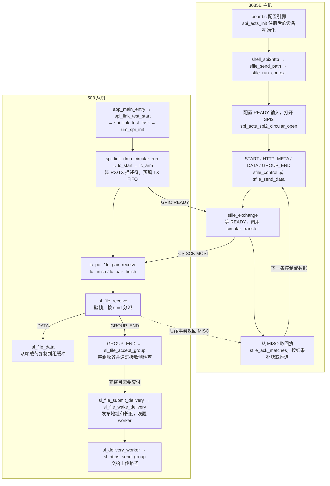
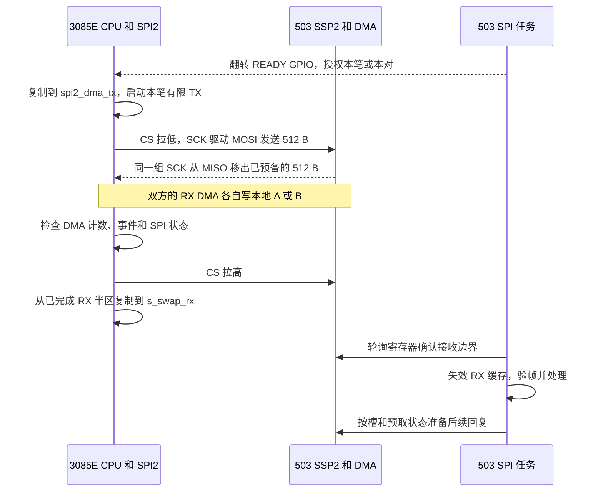
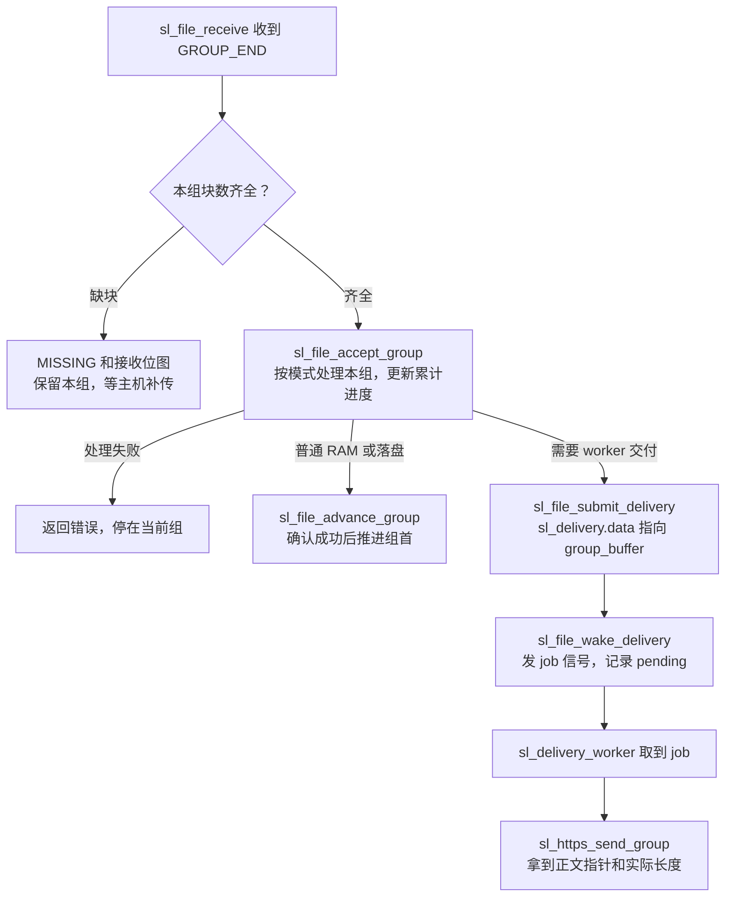

# ATS3085E 与 UMA503 的 SPI 调用图

从上电配置 SPI 开始，到 503 验完并把一组正文交给上传任务为止。主线选 `app spi2http`，因为它同时包含配对传输、请求描述和分组交付。`app spi2file` 可以用来对照同一条 SPI 路径的落盘分支。

3085E 用 `D:/ats3085e` 的当前工作区，503 用 `D:/UMA503/UMA503-V7_OPENCPU_OC_2025.03.14_1644` 的开发工程。图中用函数名做定位，点链接后可以顺着你已有的注释读。跨板的箭头表示 GPIO 或 SPI 通信。同一板内的箭头表示调用、任务启动或数据交接，具体动作写在箭头旁。

## 跟着调用点逐步读代码

先点 [3085E 应用 main()](/D:/ats3085e/TAG_ZS3085E_241230/application/bt_watch_no_psram/src/main/system_app_main.c:389)，再点 [内核调用 main() 的那一行](/D:/ats3085e/TAG_ZS3085E_241230/zephyr/kernel/init.c:275)，向上看同一个 `bg_thread_main()`。**SPI 驱动上电初始化在应用 `main()` 之前，发送则由之后的串口命令触发。**

每步的链接尽量落在**调用语句**。标签写「实现」或「定义」时，才是跳到被调用的一侧。

### A. 3085E 上电到 main()

1. **先配置板级引脚。**  
   从 [z_cstart() 执行 PRE_KERNEL_1](/D:/ats3085e/TAG_ZS3085E_241230/zephyr/kernel/init.c:482)进入系统初始化表。  
   板级通过 [SYS_INIT 登记 board_early_init](/D:/ats3085e/TAG_ZS3085E_241230/zephyr/boards/arm/ats3085e_dev_watch_ext_nor/board.c:674)，由内核运行 [board_early_init() 的 pinmux 设置](/D:/ats3085e/TAG_ZS3085E_241230/zephyr/boards/arm/ats3085e_dev_watch_ext_nor/board.c:331)。

2. **切进 Zephyr 主线程并运行 POST_KERNEL。**  
   [z_cstart() 切进主线程](/D:/ats3085e/TAG_ZS3085E_241230/zephyr/kernel/init.c:500)，主线程入口是 [bg_thread_main()](/D:/ats3085e/TAG_ZS3085E_241230/zephyr/kernel/init.c:229)。  
   [POST_KERNEL 的调用点](/D:/ats3085e/TAG_ZS3085E_241230/zephyr/kernel/init.c:241)执行 [z_sys_init_run_level()](/D:/ats3085e/TAG_ZS3085E_241230/zephyr/kernel/device.c:52)，遍历本阶段的初始化表。

3. **找到真正执行 spi_acts_init() 的那一行。**  
   启用 SPI2 后，[SPI_ACTS_DEVICE_INIT(2)](/D:/ats3085e/TAG_ZS3085E_241230/zephyr/drivers/spi/spi_acts.c:1550)展开成 [SPI2 的 DEVICE_DEFINE 注册项](/D:/ats3085e/TAG_ZS3085E_241230/zephyr/drivers/spi/spi_acts.c:1540)。这里写入的是 `&spi_acts_init`，阶段是 `POST_KERNEL`。  
   [DEVICE_DEFINE 生成初始化表项](/D:/ats3085e/TAG_ZS3085E_241230/zephyr/include/device.h:485)，[表项的 .init 保存回调地址](/D:/ats3085e/TAG_ZS3085E_241230/zephyr/include/init.h:64)。  
   内核遍历到 SPI2 对应项时，通过 [entry->init(dev)](/D:/ats3085e/TAG_ZS3085E_241230/zephyr/kernel/device.c:78) 调用 [spi_acts_init() 实现](/D:/ats3085e/TAG_ZS3085E_241230/zephyr/drivers/spi/spi_acts.c:1443)。源码搜索 `spi_acts_init` 找到的是注册处和实现，真正执行处用的是表项字段名。

4. **核对 Shell 线程的启动，再进入应用 main()。**  
   串口 Shell 同样在 [POST_KERNEL 登记初始化](/D:/ats3085e/TAG_ZS3085E_241230/zephyr/subsys/shell/shell_uart.c:544)。[UART 后端调用 shell_init()](/D:/ats3085e/TAG_ZS3085E_241230/zephyr/subsys/shell/shell_uart.c:539)，由 [k_thread_create()](/D:/ats3085e/TAG_ZS3085E_241230/zephyr/subsys/shell/shell.c:1586)建立独立的 Shell 线程。  
   内核跑完应用前的初始化后，[bg_thread_main() 调用 main()](/D:/ats3085e/TAG_ZS3085E_241230/zephyr/kernel/init.c:275)，进入 [system_app_main.c 的 main()](/D:/ats3085e/TAG_ZS3085E_241230/application/bt_watch_no_psram/src/main/system_app_main.c:389)。串口命令由 Shell 线程执行。

### B. 串口命令进 3085E 并打开 SPI2

1. **UART 收字节并通知 Shell。**  
   [UART 回调调用 uart_rx_handle()](/D:/ats3085e/TAG_ZS3085E_241230/zephyr/subsys/shell/shell_uart.c:247)，在 [uart_fifo_read()](/D:/ats3085e/TAG_ZS3085E_241230/zephyr/subsys/shell/shell_uart.c:96) 从 FIFO 取数据。  
   [UART 后端发 RX_RDY](/D:/ats3085e/TAG_ZS3085E_241230/zephyr/subsys/shell/shell_uart.c:145)，Shell 的 [transport_evt_handler()](/D:/ats3085e/TAG_ZS3085E_241230/zephyr/subsys/shell/shell.c:1313)唤醒等待者。

2. **Shell 线程收完一行并查表。**  
   [shell_thread() 经信号分派调用 shell_process()](/D:/ats3085e/TAG_ZS3085E_241230/zephyr/subsys/shell/shell.c:1550) → [shell_process() 调 state_collect()](/D:/ats3085e/TAG_ZS3085E_241230/zephyr/subsys/shell/shell.c:1700) → [识别行结束后调用 execute()](/D:/ats3085e/TAG_ZS3085E_241230/zephyr/subsys/shell/shell.c:1164)。  
   [execute() 调 z_shell_find_cmd()](/D:/ats3085e/TAG_ZS3085E_241230/zephyr/subsys/shell/shell.c:867)，先匹配根命令 `app`，再在子表里匹配 `spi2http`。对应 [根命令注册项](/D:/ats3085e/TAG_ZS3085E_241230/application/bt_watch_no_psram/src/main/system_app_shell.c:2115) 和 [spi2http 子命令表项](/D:/ats3085e/TAG_ZS3085E_241230/application/bt_watch_no_psram/src/main/system_app_shell.c:2055)。

3. **通过函数指针进入命令处理函数。**  
   [execute() 调 exec_cmd()](/D:/ats3085e/TAG_ZS3085E_241230/zephyr/subsys/shell/shell.c:922) → [active_cmd.handler(...) 的实际调用](/D:/ats3085e/TAG_ZS3085E_241230/zephyr/subsys/shell/shell.c:705) → [shell_spi2http() 实现](/D:/ats3085e/TAG_ZS3085E_241230/application/bt_watch_no_psram/src/main/spi_link_file_host.h:1156)。  
   例如在串口输入 `app spi2http <spec> <body> <offset> <bytes> <new-result>` 时，把占位符换成实际参数。处理函数核对参数和文件后才往下走。

4. **把文件参数传进 SPI 会话。**  
   [shell_spi2http() 调 sfile_send_path()](/D:/ats3085e/TAG_ZS3085E_241230/application/bt_watch_no_psram/src/main/spi_link_file_host.h:1193) → [sfile_send_path() 调 sfile_run()](/D:/ats3085e/TAG_ZS3085E_241230/application/bt_watch_no_psram/src/main/spi_link_file_host.h:1104) → [sfile_run() 调 sfile_run_context()](/D:/ats3085e/TAG_ZS3085E_241230/application/bt_watch_no_psram/src/main/spi_link_file_host.h:1065)。  
   [sfile_run_context() 绑定 SPI_2](/D:/ats3085e/TAG_ZS3085E_241230/application/bt_watch_no_psram/src/main/spi_link_file_host.h:834)，准备 READY 和本次参数，再 [调用 spi_acts_spi2_circular_open()](/D:/ats3085e/TAG_ZS3085E_241230/application/bt_watch_no_psram/src/main/spi_link_file_host.h:884)。

5. **设置 SPI 寄存器并启动整个 RX 环。**  
   在 `open()` 内看 [调用 spi_acts_configure()](/D:/ats3085e/TAG_ZS3085E_241230/zephyr/drivers/spi/spi_acts_spi2_circular.h:112) → [spi_acts_configure() 实现](/D:/ats3085e/TAG_ZS3085E_241230/zephyr/drivers/spi/spi_acts.c:902)。  
   返回 `open()` 后，看 [RXDAT、1024 B 和重载的配置](/D:/ats3085e/TAG_ZS3085E_241230/zephyr/drivers/spi/spi_acts_spi2_circular.h:119) → [底层写 PDMA 源地址、目的地址和块长](/D:/ats3085e/TAG_ZS3085E_241230/zephyr/drivers/dma/pdma_acts.c:247) → [启动 RX 通道](/D:/ats3085e/TAG_ZS3085E_241230/zephyr/drivers/spi/spi_acts_spi2_circular.h:140)。

### C. 503 应用入口到 READY

1. **OpenCPU 应用创建 SPI 任务。**  
   [app_main_entry() 调 spi_link_test_start()](/D:/UMA503/UMA503-V7_OPENCPU_OC_2025.03.14_1644/startup/app_release/app_main/app_main.c:96) → [OSATaskCreate() 提交 spi_link_test_task](/D:/UMA503/UMA503-V7_OPENCPU_OC_2025.03.14_1644/startup/app_release/demo/demo_spi.c:985)。  
   调度器运行 [spi_link_test_task()](/D:/UMA503/UMA503-V7_OPENCPU_OC_2025.03.14_1644/startup/app_release/demo/demo_spi.c:498)，它 [调用 um_spi_init() 配置 SSP2](/D:/UMA503/UMA503-V7_OPENCPU_OC_2025.03.14_1644/startup/app_release/demo/demo_spi.c:525)，随后按现有编译分支 [调用 spi_link_dma_circular_run()](/D:/UMA503/UMA503-V7_OPENCPU_OC_2025.03.14_1644/startup/app_release/demo/demo_spi.c:535)。

2. **建好 A/B 描述符并开放 SSP2。**  
   [循环任务调用 lc_start()](/D:/UMA503/UMA503-V7_OPENCPU_OC_2025.03.14_1644/startup/app_release/demo/spi_link_dma_circular.h:1270) → [填 RX/TX 的 A/B 描述符](/D:/UMA503/UMA503-V7_OPENCPU_OC_2025.03.14_1644/startup/app_release/demo/spi_link_dma_circular.h:424) → [lc_start() 返回 lc_arm(0) 的结果](/D:/UMA503/UMA503-V7_OPENCPU_OC_2025.03.14_1644/startup/app_release/demo/spi_link_dma_circular.h:440)。  
   [lc_arm() 调 lc_load() 装 RX 和 TX](/D:/UMA503/UMA503-V7_OPENCPU_OC_2025.03.14_1644/startup/app_release/demo/spi_link_dma_circular.h:364) → [lc_load() 写 DDADR 和 RUN](/D:/UMA503/UMA503-V7_OPENCPU_OC_2025.03.14_1644/startup/app_release/demo/spi_link_dma_circular.h:222)。回到 `lc_arm()`，再 [开放 DMA 请求并使能 SSP2](/D:/UMA503/UMA503-V7_OPENCPU_OC_2025.03.14_1644/startup/app_release/demo/spi_link_dma_circular.h:370)。

3. **TX 预填且接收边界稳定时授权。**  
   [lc_arm() 调用 ld_ready_publish()](/D:/UMA503/UMA503-V7_OPENCPU_OC_2025.03.14_1644/startup/app_release/demo/spi_link_dma_circular.h:391) → [503 翻转 GPIO50](/D:/UMA503/UMA503-V7_OPENCPU_OC_2025.03.14_1644/startup/app_release/demo/spi_link_ready.h:36)。  
   这一步跨过的是 GPIO 连线。3085E 从 [swap_ready_wait_timeout()](/D:/ats3085e/TAG_ZS3085E_241230/application/bt_watch_no_psram/src/main/spi_link_ready.h:175)读取 GPIO61 的授权电平。

### D. 跟一笔 DATA 从 3085E 走到 503

正文前先看 [3085E 发送 START](/D:/ats3085e/TAG_ZS3085E_241230/application/bt_watch_no_psram/src/main/spi_link_file_host.h:940) → [503 调用 sl_file_start()](/D:/UMA503/UMA503-V7_OPENCPU_OC_2025.03.14_1644/startup/app_release/demo/spi_link_file_slave.h:1001)。  
走 `spi2http` 时再看 [3085E 调用 sfile_send_http_spec()](/D:/ats3085e/TAG_ZS3085E_241230/application/bt_watch_no_psram/src/main/spi_link_file_host.h:947) → [503 接收 HTTP_META](/D:/UMA503/UMA503-V7_OPENCPU_OC_2025.03.14_1644/startup/app_release/demo/spi_link_file_slave.h:1005)。这两类控制帧和接下来的 DATA 共用同一个 SPI 交换入口。

1. **从正文读取一块并装帧。**  
   START 和需要的 HTTP_META 确认后，[sfile_run_context() 调 sfile_send_body()](/D:/ats3085e/TAG_ZS3085E_241230/application/bt_watch_no_psram/src/main/spi_link_file_host.h:948) → [组循环调用 sfile_send_data()](/D:/ats3085e/TAG_ZS3085E_241230/application/bt_watch_no_psram/src/main/spi_link_file_host.h:687)。  
   在 `sfile_send_data()` 里，[函数指针 x->read_block 读取载荷](/D:/ats3085e/TAG_ZS3085E_241230/application/bt_watch_no_psram/src/main/spi_link_file_host.h:658)。文件路径上的实际实现是 [sfile_read_file()](/D:/ats3085e/TAG_ZS3085E_241230/application/bt_watch_no_psram/src/main/spi_link_file_host.h:630)。  
   读完后 [调用 sfile_frame() 装头和 CRC16](/D:/ats3085e/TAG_ZS3085E_241230/application/bt_watch_no_psram/src/main/spi_link_file_host.h:663)，再 [调用 sfile_exchange()](/D:/ats3085e/TAG_ZS3085E_241230/application/bt_watch_no_psram/src/main/spi_link_file_host.h:666)。

2. **等待授权，再开始这一笔 512 B 收发。**  
   [sfile_exchange() 检查 READY 和半对状态](/D:/ats3085e/TAG_ZS3085E_241230/application/bt_watch_no_psram/src/main/spi_link_file_host.h:173) → [调用 spi_acts_spi2_circular_transfer()](/D:/ats3085e/TAG_ZS3085E_241230/application/bt_watch_no_psram/src/main/spi_link_file_host.h:213)。  
   驱动 [复制本笔 TX 并配置有限 DMA](/D:/ats3085e/TAG_ZS3085E_241230/zephyr/drivers/spi/spi_acts_spi2_circular.h:195) → [启动 TX DMA](/D:/ats3085e/TAG_ZS3085E_241230/zephyr/drivers/spi/spi_acts_spi2_circular.h:208) → [拉低 CS 并开启全双工](/D:/ats3085e/TAG_ZS3085E_241230/zephyr/drivers/spi/spi_acts_spi2_circular.h:211)。  
   MOSI 把 DATA 送向 503。同一组 SCK 下，MISO 把 503 已准备的内容送回 3085E。

3. **3085E 确认本笔完成并交付 MISO。**  
   [transfer() 轮询 DMA 和 SPI 完成条件](/D:/ats3085e/TAG_ZS3085E_241230/zephyr/drivers/spi/spi_acts_spi2_circular.h:249)，核对 RX 半环或整环事件、计数、TX 停止和 FIFO 状态。  
   [释放 CS](/D:/ats3085e/TAG_ZS3085E_241230/zephyr/drivers/spi/spi_acts_spi2_circular.h:264) → [复制 RX 半区到调用者的 s_swap_rx](/D:/ats3085e/TAG_ZS3085E_241230/zephyr/drivers/spi/spi_acts_spi2_circular.h:269) → `transfer()` 返回 `sfile_exchange()`。这是**一笔物理交换完成**。

4. **503 确认接收槽并处理 DATA。**  
   503 循环任务在 [接收分派点](/D:/UMA503/UMA503-V7_OPENCPU_OC_2025.03.14_1644/startup/app_release/demo/spi_link_dma_circular.h:1305)选择单槽的 [lc_poll()](/D:/UMA503/UMA503-V7_OPENCPU_OC_2025.03.14_1644/startup/app_release/demo/spi_link_dma_circular.h:448)，或双槽的 [lc_pair_receive()](/D:/UMA503/UMA503-V7_OPENCPU_OC_2025.03.14_1644/startup/app_release/demo/spi_link_dma_circular.h:744)。  
   [收完后进入校验和回收分派](/D:/UMA503/UMA503-V7_OPENCPU_OC_2025.03.14_1644/startup/app_release/demo/spi_link_dma_circular.h:1340)。单槽看 [失效 RX 缓存](/D:/UMA503/UMA503-V7_OPENCPU_OC_2025.03.14_1644/startup/app_release/demo/spi_link_dma_circular.h:1140) → [调用 sl_file_receive()](/D:/UMA503/UMA503-V7_OPENCPU_OC_2025.03.14_1644/startup/app_release/demo/spi_link_dma_circular.h:1153)。双槽看 [失效 RX 缓存](/D:/UMA503/UMA503-V7_OPENCPU_OC_2025.03.14_1644/startup/app_release/demo/spi_link_dma_circular.h:990) → [调用 sl_file_receive()](/D:/UMA503/UMA503-V7_OPENCPU_OC_2025.03.14_1644/startup/app_release/demo/spi_link_dma_circular.h:993)，首个符合条件的 DATA 也可能在配对轮询中提前处理。  
   [sl_file_receive() 验帧后调用 sl_file_data()](/D:/UMA503/UMA503-V7_OPENCPU_OC_2025.03.14_1644/startup/app_release/demo/spi_link_file_slave.h:952)。[sl_file_data() 实现](/D:/UMA503/UMA503-V7_OPENCPU_OC_2025.03.14_1644/startup/app_release/demo/spi_link_file_slave.h:605)按组内位置复制有效载荷，再记录这一块已收。

### E. 跟一组确认、交付和整次会话的结束

1. **主机发 GROUP_END 并查结果。**  
   [组循环调 sfile_control(GROUP_END)](/D:/ats3085e/TAG_ZS3085E_241230/application/bt_watch_no_psram/src/main/spi_link_file_host.h:696) → [sfile_control() 发原请求或 QUERY](/D:/ats3085e/TAG_ZS3085E_241230/application/bt_watch_no_psram/src/main/spi_link_file_host.h:352) → [再次走同一个 sfile_exchange()](/D:/ats3085e/TAG_ZS3085E_241230/application/bt_watch_no_psram/src/main/spi_link_file_host.h:381)。  
   503 在 [GROUP_END 的处理分支](/D:/UMA503/UMA503-V7_OPENCPU_OC_2025.03.14_1644/startup/app_release/demo/spi_link_file_slave.h:1027)检查本组。缺块时准备位图，主机在 [按位图补发处](/D:/ats3085e/TAG_ZS3085E_241230/application/bt_watch_no_psram/src/main/spi_link_file_host.h:700)决定重发哪些 DATA。

2. **齐组后把正文借给上传任务。**  
   [组完整时调用 sl_file_submit_delivery()](/D:/UMA503/UMA503-V7_OPENCPU_OC_2025.03.14_1644/startup/app_release/demo/spi_link_file_slave.h:1039) → [交出地址与长度](/D:/UMA503/UMA503-V7_OPENCPU_OC_2025.03.14_1644/startup/app_release/demo/spi_link_file_slave.h:731) → [发布 worker 作业信号量](/D:/UMA503/UMA503-V7_OPENCPU_OC_2025.03.14_1644/startup/app_release/demo/spi_link_file_slave.h:712)。  
   [worker 取到 job](/D:/UMA503/UMA503-V7_OPENCPU_OC_2025.03.14_1644/startup/app_release/demo/spi_link_file_slave.h:263) → [调用 sl_https_send_group()](/D:/UMA503/UMA503-V7_OPENCPU_OC_2025.03.14_1644/startup/app_release/demo/spi_link_file_slave.h:274)。这里是本调用图的上传交界。

3. **取回 BUSY 或 OK，决定能否写下一组。**  
   [503 QUERY 路径接回 worker 结果](/D:/UMA503/UMA503-V7_OPENCPU_OC_2025.03.14_1644/startup/app_release/demo/spi_link_file_slave.h:958)，由 [sl_file_poll_delivery() 取 done](/D:/UMA503/UMA503-V7_OPENCPU_OC_2025.03.14_1644/startup/app_release/demo/spi_link_file_slave.h:751)。成功时才推进组首。  
   [503 组装 ACK](/D:/UMA503/UMA503-V7_OPENCPU_OC_2025.03.14_1644/startup/app_release/demo/spi_link_file_slave.h:868)，随后通过 MISO 回传。主机 [核对 ACK 的身份](/D:/ats3085e/TAG_ZS3085E_241230/application/bt_watch_no_psram/src/main/spi_link_file_host.h:283)，收到本组 OK 才继续下一组。

4. **所有组结束后收尾。**  
   [3085E 发送 FINISH](/D:/ats3085e/TAG_ZS3085E_241230/application/bt_watch_no_psram/src/main/spi_link_file_host.h:954) → [503 分派到 sl_file_finish()](/D:/UMA503/UMA503-V7_OPENCPU_OC_2025.03.14_1644/startup/app_release/demo/spi_link_file_slave.h:1043) → [sl_file_finish() 实现](/D:/UMA503/UMA503-V7_OPENCPU_OC_2025.03.14_1644/startup/app_release/demo/spi_link_file_slave.h:777)，检查全长和整份 CRC32。  
   [3085E 关闭本地循环会话](/D:/ats3085e/TAG_ZS3085E_241230/application/bt_watch_no_psram/src/main/spi_link_file_host.h:991) → [停止并归还本地通道](/D:/ats3085e/TAG_ZS3085E_241230/zephyr/drivers/spi/spi_acts_spi2_circular.h:34)。503 的 SPI 任务继续在它自己的收发循环中等待后续会话。

## 总图

## 1. 两边怎样把 SPI 配好

### 3085E 主机

1. **开机配置引脚和设备。** 
    先看板级 `board_cfg.h` 的 `CONFIG_SPI_2`、注册名 `SPI_2` 和 DMA 请求号。
   再看 `board.c` 的 pinmux 配置，以及 SPI 驱动的 `DEVICE_DEFINE` 和 `spi_acts_init()`。
   这是 STM32 里“给引脚选复用功能，再初始化外设”对应的位置。 [板级 SPI2 定义](/D:/ats3085e/TAG_ZS3085E_241230/zephyr/boards/arm/ats3085e_dev_watch_ext_nor/board_cfg.h:78) · [板级引脚初始化](/D:/ats3085e/TAG_ZS3085E_241230/zephyr/boards/arm/ats3085e_dev_watch_ext_nor/board.c:331) · [驱动初始化](/D:/ats3085e/TAG_ZS3085E_241230/zephyr/drivers/spi/spi_acts.c:1443)
2. **命令运行时设定本次总线参数。** 
   从 Shell 子命令表跳到 `shell_spi2http()`，再跟 `sfile_send_path()` → `sfile_run()` → `sfile_run_context()`。
   这里绑定 `SPI_2` 设备，构造主机模式、SPI Mode 3、8 位字宽的 `spi_config`，频率来自入口传入的 `hz`。
   网络路径按自己的时钟配置。 [Shell 命令表](/D:/ats3085e/TAG_ZS3085E_241230/application/bt_watch_no_psram/src/main/system_app_shell.c:2055) · [文件源入口](/D:/ats3085e/TAG_ZS3085E_241230/application/bt_watch_no_psram/src/main/spi_link_file_host.h:1080) · [会话配置](/D:/ats3085e/TAG_ZS3085E_241230/application/bt_watch_no_psram/src/main/spi_link_file_host.h:804)
   
3. **打开本次 DMA 会话。** 
   在 READY 初始化或启动信标探测后，`spi_acts_spi2_circular_open()` 持有 SPI 设备锁、申请 DMA 通道，
   并调用 `spi_acts_configure()` 写 SPI 配置。
   RX DMA 设为 `SPI2 RXDAT → spi2_dma_rx`，一个连续的 1024 B 区域开启硬件重载。
   TX 留到每笔交换时配置。板级 `CONFIG_SPI_2_USE_DMA=0` 针对普通 SPI API，这条文件路径使用专门的循环驱动入口。
    [打开会话与配置 DMA](/D:/ats3085e/TAG_ZS3085E_241230/zephyr/drivers/spi/spi_acts_spi2_circular.h:71) · [SPI 配置如何落到寄存器](/D:/ats3085e/TAG_ZS3085E_241230/zephyr/drivers/spi/spi_acts.c:902) · [普通 SPI 的 DMA 配置](/D:/ats3085e/TAG_ZS3085E_241230/zephyr/boards/arm/ats3085e_dev_watch_ext_nor/board_cfg.h:195)

   

### 503 从机

1. **应用启动 SPI 任务。** 
   `app_main_entry()` → `spi_link_test_start()` → `OSATaskCreate(..., spi_link_test_task, ...)`。
   任务先填厂商 SDK 的 `UM_SPI_CONFIG_S`，调用 `um_spi_init(UM_SPI_ID_2, &cfg)`。
   之后在当前 DMA 配置下进入 `spi_link_dma_circular_run()`。 [应用入口](/D:/UMA503/UMA503-V7_OPENCPU_OC_2025.03.14_1644/startup/app_release/app_main/app_main.c:96) · [创建任务](/D:/UMA503/UMA503-V7_OPENCPU_OC_2025.03.14_1644/startup/app_release/demo/demo_spi.c:981) · [SDK 配置与入口选择](/D:/UMA503/UMA503-V7_OPENCPU_OC_2025.03.14_1644/startup/app_release/demo/demo_spi.c:510)
2. **任务建立持续收发能力。** 
   `spi_link_dma_circular_run()` 初始化 READY，设定 SSP2 从机配置，检查 DMA 可访问内存，申请通道并自检。
   随后 `lc_start()` 建好 RX 和 TX 各自的 A → B → A 描述符链，再进入 `lc_arm()`。 [从机初始化顺序](/D:/UMA503/UMA503-V7_OPENCPU_OC_2025.03.14_1644/startup/app_release/demo/spi_link_dma_circular.h:1225) · [填写描述符](/D:/UMA503/UMA503-V7_OPENCPU_OC_2025.03.14_1644/startup/app_release/demo/spi_link_dma_circular.h:402)
3. **硬件准备好后才授权。** 
   `lc_arm()` → `lc_load()`，分别把首描述符地址写进 RX、TX 的 `DDADR`，置 `RUN`。
   随后打开 SSP2 的 DMA 请求并置 `SSE`。
   检查 RX 尚未收数据、TX 已预填后，才进入启动授权逻辑。
    [DDADR 和 RUN](/D:/UMA503/UMA503-V7_OPENCPU_OC_2025.03.14_1644/startup/app_release/demo/spi_link_dma_circular.h:221) · [SSP2 启用和 TX 预填检查](/D:/UMA503/UMA503-V7_OPENCPU_OC_2025.03.14_1644/startup/app_release/demo/spi_link_dma_circular.h:357)

   

## 2. READY 怎样把两边接起来

503 的 GPIO50 是输出，连接到 3085E 的 GPIO61。
503 发布授权时改变并保持电平。3085E 的 GPIO 边沿可以唤醒等待任务，`swap_ready_wait_timeout()` 还会读取当前电平，确认它是这次期望的授权。
主机调用 `swap_ready_consume()` 后，下次等另一个电平。
 [503 READY 输出](/D:/UMA503/UMA503-V7_OPENCPU_OC_2025.03.14_1644/startup/app_release/demo/spi_link_ready.h:36) · [3085E 读电平和等待](/D:/ats3085e/TAG_ZS3085E_241230/application/bt_watch_no_psram/src/main/spi_link_ready.h:175)

- **单槽阶段**每次 READY 放行一笔 512 B 事务。若启用了启动同步且发现新信标，主机先走 `sfile_boot_sync()`。
- **配对阶段**由协议协商。会话要求配对且当前还未配对时走 `sfile_pair_begin()`。
                  配对有效后，`sfile_exchange()` 只在一对的第一笔消费 READY。第二笔沿用这次授权。
- **凑齐槽对**时，`sfile_end_pair()` 可以发送 `IDLE`。这样一对内仍有两笔 SPI 事务。每笔各有一个 CS 区间。

[启动同步](/D:/ats3085e/TAG_ZS3085E_241230/application/bt_watch_no_psram/src/main/spi_link_file_host.h:550) · [配对协商](/D:/ats3085e/TAG_ZS3085E_241230/application/bt_watch_no_psram/src/main/spi_link_file_host.h:313) · [配对内的 READY 判断](/D:/ats3085e/TAG_ZS3085E_241230/application/bt_watch_no_psram/src/main/spi_link_file_host.h:173) · [补齐第二槽](/D:/ats3085e/TAG_ZS3085E_241230/application/bt_watch_no_psram/src/main/spi_link_file_host.h:587)

## 3. 一笔 SPI 事务怎样交换

3085E 的 `spi_acts_spi2_circular_transfer()` 每笔只对 TX 配置 512 B。
TX DMA 写 `TXDAT`，RX DMA 从 `RXDAT` 读。
驱动清 `SPI_CTL_SS` 拉低片选，开启 TX 请求和全双工模式。
RX 在第一笔写前半，到 `HF` 且剩余 512。第二笔写后半，到 `TC` 且计数重载到 1024。
驱动同时核对 TX 已停、控制器空闲及 FIFO 状态，然后释放 CS，把该半区复制给应用。
 [TX 与 RX 数据口](/D:/ats3085e/TAG_ZS3085E_241230/zephyr/drivers/spi/spi_acts_spi2_dma.h:47) · [一笔 SPI 的控制与完成检查](/D:/ats3085e/TAG_ZS3085E_241230/zephyr/drivers/spi/spi_acts_spi2_circular.h:160)

503 的 `spi_link_dma_circular_run()` 在单槽走 `lc_poll()` → `lc_finish()`，在双槽走 `lc_pair_receive()` → `lc_pair_finish()`。
单槽看 DMA 后继描述符、当前地址、剩余量和 SSP 状态。
双槽还检查成对边界和帧尾见证标记。相关路径在 CPU 读数据前对 RX 缓冲做 invalidate。
然后用 `sl_file_receive()` 处理协议帧。双槽路径允许提前处理符合条件的首个 DATA，最终收尾会跳过已处理的首帧。
 [单槽边界判定](/D:/UMA503/UMA503-V7_OPENCPU_OC_2025.03.14_1644/startup/app_release/demo/spi_link_dma_circular.h:134) · [双槽接收](/D:/UMA503/UMA503-V7_OPENCPU_OC_2025.03.14_1644/startup/app_release/demo/spi_link_dma_circular.h:671) · [双槽解析与回收](/D:/UMA503/UMA503-V7_OPENCPU_OC_2025.03.14_1644/startup/app_release/demo/spi_link_dma_circular.h:956) · [单槽解析与回收](/D:/UMA503/UMA503-V7_OPENCPU_OC_2025.03.14_1644/startup/app_release/demo/spi_link_dma_circular.h:1127)

## 4. 从文件字节到 503 组缓冲

| 阶段 | 3085E 的调用 | 503 的调用和结果 |
|---|---|---|
| 建传输会话 | `sfile_run_context()` 选择 START 类型。通过 `sfile_pair_begin()` 或 `sfile_control()` 发送总正文长度等参数 | `sl_file_receive()` → `sl_file_start()`，记录会话和块数。按实际大小分配最多 48,000 B 的组缓冲 |
| 传请求描述 | `spi2http` 路径调用 `sfile_send_http_spec()`，以 `HTTP_META` 发分段配置 | `sl_file_receive()` 按偏移收齐元数据，调用 `spi_https_prepare_request()` 准备请求配置。简单 `spi2putfile` 的 URL 随 START 到达，走 `spi_https_prepare()` |
| 按块读文件 | `sfile_send_body()` → `sfile_send_data()` → `x->read_block`，文件路径绑定到 `sfile_read_file()`。按块号和源文件范围定位，读入 `s_swap_tx + 16` | 等待 DATA |
| 装帧和交换 | `sfile_frame()` 写入 16 B 头、有效载荷长度与帧尾 CRC16 → `sfile_exchange()` | `sl_file_receive()` 先验帧 → `sl_file_data()` 检查会话、块号和长度。按 `(index - first) × 480` 复制有效载荷，更新位图 |
| 查本组结果 | `sfile_control(GROUP_END)` 发组尾和 QUERY，`sfile_ack_matches()` 校验 ACK 的 `tid/index/request`、回显命令及帧校验 | `sl_file_receive()` 的 GROUP_END 分支检查本组实际应收块数。缺块时返回 MISSING 和位图，齐全时调用 `sl_file_accept_group()` |
| 补缺块 | `sfile_send_body()` 复制 ACK 位图，对仍为 0 的位置调用 `sfile_send_data(..., true)`，然后用新的请求号再查本组 | 同一全局块号补到同一组内偏移。已经接收的块跳过，补发也不会在主机的整份 CRC32 中重复累计 |

[3085E 会话命令顺序](/D:/ats3085e/TAG_ZS3085E_241230/application/bt_watch_no_psram/src/main/spi_link_file_host.h:940) · [文件读、DATA 装帧与组循环](/D:/ats3085e/TAG_ZS3085E_241230/application/bt_watch_no_psram/src/main/spi_link_file_host.h:630) · [控制请求和 QUERY](/D:/ats3085e/TAG_ZS3085E_241230/application/bt_watch_no_psram/src/main/spi_link_file_host.h:352) · [ACK 匹配](/D:/ats3085e/TAG_ZS3085E_241230/application/bt_watch_no_psram/src/main/spi_link_file_host.h:283) · [503 START 和分配组缓冲](/D:/UMA503/UMA503-V7_OPENCPU_OC_2025.03.14_1644/startup/app_release/demo/spi_link_file_slave.h:402) · [503 DATA 的组内偏移](/D:/UMA503/UMA503-V7_OPENCPU_OC_2025.03.14_1644/startup/app_release/demo/spi_link_file_slave.h:602) · [503 META、组结束和 FINISH 分派](/D:/UMA503/UMA503-V7_OPENCPU_OC_2025.03.14_1644/startup/app_release/demo/spi_link_file_slave.h:999)

**读 ACK 时记住两次事务之间的关系。** 当主机在 MOSI 发这一条控制帧时，MISO 同时移出的可以是前面已经准备或预取的内容。503 处理完才用 `sl_file_reply()` 把结果装进回复槽。3085E 通过后续交换取回执，靠请求身份确认拿到的是这一条操作的结果。 [503 构造回执](/D:/UMA503/UMA503-V7_OPENCPU_OC_2025.03.14_1644/startup/app_release/demo/spi_link_file_slave.h:862)

## 5. 503 验完一组后，怎样准备交给上传任务

到 `sl_https_send_group()` 入口时，**组里的文件字节已经按顺序排好，实际字节数已经确定，请求配置也已准备好**。
最重要的交接是 `sl_delivery.data = sl_file.group_buffer` 和 `sl_delivery.len = sl_file.extent - previous_extent`。
worker 借用同一块内存。在这里停下读源码即可，下一行进入上传路径。 [组验收](/D:/UMA503/UMA503-V7_OPENCPU_OC_2025.03.14_1644/startup/app_release/demo/spi_link_file_slave.h:653) · [组地址与长度交接](/D:/UMA503/UMA503-V7_OPENCPU_OC_2025.03.14_1644/startup/app_release/demo/spi_link_file_slave.h:723) · [worker 分派](/D:/UMA503/UMA503-V7_OPENCPU_OC_2025.03.14_1644/startup/app_release/demo/spi_link_file_slave.h:255) · [上传交界](/D:/UMA503/UMA503-V7_OPENCPU_OC_2025.03.14_1644/startup/app_release/demo/spi_link_file_slave.h:203)

回过头看 **SPI 什么时候能发下一组**。交付期间 `delivery_pending` 保护组缓冲。仍在处理时会报 `BUSY`，部分网络交付路径也会暂缓发布 READY。
503 收到 worker 的 done 且结果成功，才推进组首并清位图。3085E 拿到本组匹配的 `OK` 才发下一组。
因而上传可以从第一组就开始，后续组依次复用同一个组缓冲。 [等待 worker 归还](/D:/UMA503/UMA503-V7_OPENCPU_OC_2025.03.14_1644/startup/app_release/demo/spi_link_file_slave.h:743) · [503 暂停授权等待交付](/D:/UMA503/UMA503-V7_OPENCPU_OC_2025.03.14_1644/startup/app_release/demo/spi_link_dma_circular.h:899) · [主机等待本组 OK](/D:/ats3085e/TAG_ZS3085E_241230/application/bt_watch_no_psram/src/main/spi_link_file_host.h:695)

最后一组确认后，主机会发 `FINISH` 携带整份 CRC32。
503 通过 `sl_file_finish()` 核对完整接收条件、长度和整份校验，再按模式收尾。
遇到错误时，主机侧的会话收尾还可能尝试 `ABORT`，最后调用 `spi_acts_spi2_circular_close()` 停止本地环并归还通道。
这些位置适合在主线读通后回看。 [主机 FINISH、ABORT 和关闭](/D:/ats3085e/TAG_ZS3085E_241230/application/bt_watch_no_psram/src/main/spi_link_file_host.h:948) · [503 处理 FINISH](/D:/UMA503/UMA503-V7_OPENCPU_OC_2025.03.14_1644/startup/app_release/demo/spi_link_file_slave.h:771)

## 从哪个函数开始看注释

1. **先打通一笔。** 3085E 从 `sfile_exchange` 跳到 `spi_acts_spi2_circular_transfer`。找出哪一行拉低 CS、哪一行等完成、哪一行复制 RX。
2. **再跟到 503 的一帧。** `spi_link_dma_circular_run` → `lc_poll/lc_pair_receive` → `lc_finish/lc_pair_finish` → `sl_file_receive`。找出确认 DMA 完成、缓存失效、验帧各发生在哪里。
3. **再跟完一组。** 3085E 看 `sfile_send_body`，503 看 `sl_file_data` 和 GROUP_END 分支。用块号 17 验证它总写到首组缓冲的偏移 `17 × 480`，即使补发时换了 DMA 槽。
4. **读到上传交接。** 跟 `sl_file_submit_delivery` → `sl_file_wake_delivery` → `sl_delivery_worker` → `sl_https_send_group`，确认 worker 读的是哪一个地址和多少字节。

如果从已有的 `p4upload` 验证命令进来，可以从它的 `p4_spi_request()` 跳到 `sfile_run_context()`。到了这里，SPI、READY、DMA 和分组依旧沿上面的公共调用路径。 [P4 调用 SPI 公共路径](/D:/ats3085e/TAG_ZS3085E_241230/application/bt_watch_no_psram/src/main/spi_link_p4.h:124)
