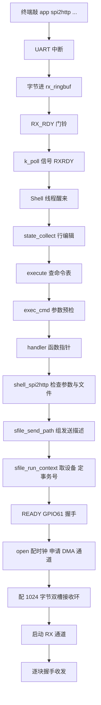

# ATS3085E 串口命令到 SPI2 启动导读

本文只讲一条路径：在串口里敲一行 `app spi2http ...`，到 SPI2 的接收 DMA 环开始常驻运转、函数返回为止。起点是 UART 接收中断，终点是 `spi_acts_spi2_circular_open()` 返回 0。读者按 STM32 裸机的方式理解这套代码，所以每一步都给出对应的 STM32 概念。源码路径以 `TAG_ZS3085E_241230` 为根，行号均已核对；外部总结里有五处行号对不上，核对结果见第六节。

先记住一件事：**这条串口命令只负责"把哪个文件、用哪个请求、发到哪去"说清楚，真正的字节搬运不走 CPU，走 SPI2 的 DMA 环。** 命令跑完就返回，后面逐块收发由驱动和协议层接管。

本文与《ATS3085E 上电到 main() 启动流程导读》配套阅读：那一篇讲到 `main()` 与 Shell 线程创建为止，本篇接着讲"Shell 线程收到命令之后"。协议侧的 QUERY、背压、worker 属于再下一层，不在这条路径里展开。

## 一、先和 STM32 对上号

STM32 上处理一条串口命令，你大概会写：中断里收字节进缓冲区 → 主循环判断收到回车 → 一串 `strcmp` 找到命令 → 调对应函数。ATS3085E 做的是同一件事，只是每一段都被拆成了框架组件，名字不熟而已。

| STM32 裸机写法 | ATS3085E（Zephyr） | 位置 |
|---|---|---|
| `HAL_UART_IRQHandler` 判 RXNE、读 `DR` | `uart_callback()` 判 `uart_irq_rx_ready()` | `zephyr/subsys/shell/shell_uart.c:235`、`shell_uart.c:246` |
| 中断里往环形缓冲区塞字节 | `ring_buf_put_claim()` + `uart_fifo_read()` + `ring_buf_put_finish()` | `shell_uart.c:93`、`shell_uart.c:96`、`shell_uart.c:119` |
| `xSemaphoreGiveFromISR()` | `handler(SHELL_TRANSPORT_EVT_RX_RDY, ...)` → `k_poll_signal_raise()` | `shell_uart.c:145`、`zephyr/subsys/shell/shell.c:1322` |
| 任务里 `osSemaphoreWait()` | Shell 线程阻塞在 `k_poll()` | `shell.c:1531` |
| 主循环里判断回车、切分参数 | `state_collect()` 行编辑 + `execute()` 查表 | `shell.c:1119`、`shell.c:774` |
| 一串 `if (strcmp(cmd,"x")) {...}` | 静态命令表 + 逐层查表 + 函数指针 | `application/bt_watch_no_psram/src/main/system_app_shell.c:2115` |
| `typedef void (*fn)(int, char **);` 命令表 | `struct shell_static_entry` 的 `handler` 字段 | `zephyr/include/shell/shell.h`（表项结构） |
| 全局 `hspi2` 句柄 | `device_get_binding(CONFIG_SPI_2_NAME)` | `application/bt_watch_no_psram/src/main/spi_link_file_host.h:834` |
| `__HAL_LOCK(hspi)`，用完解锁 | `spi_context_lock()`，**持锁到 close** | `zephyr/drivers/spi/spi_acts_spi2_circular.h:94` |
| DMA 通道写死（如 `DMA1_Channel5`） | `dma_request()` 从公共池动态申请 | `spi_acts_spi2_circular.h:107`、`:109` |
| 配 `CR1` 的 CPOL/CPHA/BR | `spi_acts_configure()` 选分频档并回读实际频率 | `zephyr/drivers/spi/spi_acts.c:902`、`:929`、`:935` |
| 配 `DMA_CPAR / DMA_CMAR / DMA_CNDTR` | 写 `saddr0 / daddr0 / bc` | `zephyr/drivers/dma/pdma_acts.c:247-249` |
| DMA 循环模式 `CIRC=1` | `dest_reload_en = 1` 并回读 bit18 确认 | `spi_acts_spi2_circular.h:124`、`:137` |
| `HAL_SPI_TransmitReceive_DMA`，一次一锤子 | RX **只启动一次永久跑**，TX 每次才短暂开 | `spi_acts_spi2_circular.h:143`、`:146` |

一句话记：STM32 是你写 `if-else` 挨个判断、每次传输重新起一次 DMA；这里是**中断只敲铃、线程查表执行、硬件常驻收环**。

## 二、这条链的整体走向

前面 B 到 I 跑在**中断和 Shell 线程**里，J 之后进的是**应用自己的命令函数**，O 之后进的是**驱动**。三段分属三种执行环境，这是整条链最容易看糊涂的地方。

## 三、按执行顺序走一遍

### 串口收字节，只到"敲铃"为止

1. **UART 中断进来，先判断是哪一类事件。**  
   `uart_callback()` 是初始化时用 `uart_irq_callback_user_data_set()` 挂上的回调，等价于你的 `HAL_UART_IRQHandler`。  
   先 `uart_irq_update()` 刷新中断状态，再判 `uart_irq_rx_ready()` 为真，才去收数据。  
   同一函数里还会判 `uart_irq_tx_ready()`，收发两个方向在一次中断里分别处理。  
   出处：`zephyr/subsys/shell/shell_uart.c:235-252`，回调注册在 `shell_uart.c:272`。

2. **认领一段环形缓冲空间，再把硬件 FIFO 里的字节搬进去。**  
   `ring_buf_put_claim()` 先向软件队列申请一段连续可写区，返回实际能写的长度。  
   `uart_fifo_read()` 直接从硬件 FIFO 读，读数可能少于申请长度，以实际读到的为准。  
   `ring_buf_put_finish()` 只提交上一步真实读到的字节数。  
   这三步合起来，等于你在中断里 `buf[wr++] = huart->Instance->DR;`，区别是"能写多少"交给库算，避免写越界。  
   出处：`shell_uart.c:93`、`shell_uart.c:96`、`shell_uart.c:119-120`。

3. **队列满了也不能卡住中断。**  
   `ring_buf_put_claim()` 返回 0 表示没空间，这时仍从 FIFO 取走一个字节丢掉，防止 FIFO 溢出把后续数据全堵住。  
   这一步只在 Shell 线程长时间没被调度时才会发生，属于兜底。  
   出处：`shell_uart.c:123-129`。

4. **只敲一次铃，铃里不带数据。**  
   本轮只要真收到字节，就调 `ctrl_blk->handler(SHELL_TRANSPORT_EVT_RX_RDY, context)`。  
   事件本身不携带任何字节，字节已经在队列里；它的作用是"告诉上层有货了"。  
   收到多个字节也只敲一次，减少唤醒次数。  
   出处：`shell_uart.c:144-147`。

5. **门铃翻译成内核信号。**  
   `transport_evt_handler()` 把 `RX_RDY` 映射到 `SHELL_SIGNAL_RXRDY` 这个 `k_poll_signal`，用 `k_poll_signal_raise()` 置位。  
   到这里中断结束，**一行命令还没有被解析**，这是有意的设计：中断里不做业务。  
   出处：`zephyr/subsys/shell/shell.c:1313-1322`。

6. **Shell 线程从阻塞里醒来。**  
   `shell_thread()` 平时停在 `k_poll(events, SHELL_SIGNAL_TXDONE, K_FOREVER)` 上，空闲时完全不占 CPU。  
   醒来后先拿终端写锁 `wr_mtx`，再按信号顺序分派：`KILL` 处理退出，`RXRDY` 掉 `shell_process`。  
   这条线程是在启动阶段由 `shell_init()` 用 `k_thread_create()` 建的，有自己的栈，和主线程并行。  
   出处：`shell.c:1503-1557`，分派在 `shell.c:1549-1550`。

### 收完一行，查表找到命令

7. **行编辑状态机把字节拼成一条命令。**  
   `shell_process()` 从后端取字节，交给 `state_collect()` 逐字节处理。  
   普通字符入编辑缓冲、退格删一个、方向键移动光标，这些都不产生"执行"。  
   只有识别到行结束（回车），才调 `execute()`。  
   出处：`shell.c:1686`、`shell.c:1119`、执行调用在 `shell.c:1164`。

8. **执行时逐层查表，不是字符串堆。**  
   `execute()` 先在命令缓冲里逐词切出 `argv`（`argvp` 依次写入指针，空格和引号都在这一步处理），再调 `z_shell_find_cmd()`。  
   第一次在根表里匹配 `app`，拿到 `app` 挂的子表指针 `acts_app_cmds`；第二次在这张子表里匹配 `spi2http`。  
   匹配上的表项被复制成 `active_cmd`，里面存着这一层的 `handler`、参数个数上下限和帮助文本。  
   出处：`shell.c:774`、`shell.c:867`、根命令注册在 `system_app_shell.c:2115`。

9. **命令表是一张 const 数组，每行一个命令。**  
   `SHELL_CMD(spi2http, NULL, "503 HTTPS <spec> <body> <offset> <bytes> <new-result>", shell_spi2http)`。  
   第二个参数是子命令表（这里为 `NULL`），第三个是语法提示（Tab 补全和 `help` 用的就是它），第四个是处理函数指针。  
   所以"新增一条命令"等于"表里加一行"，不用改任何分派逻辑。  
   出处：`system_app_shell.c:2055`，同表里还有 `spi2file`、`spi2ram`、`spi2putfile` 等，见 `:2049-2061`。

10. **参数个数先由框架验一遍。**  
    `exec_cmd()` 读表项里的 `args.mandatory / args.optional`，算出允许的 `argc` 范围，不在范围直接返回 `-EINVAL`，处理函数根本不被调用。  
    这一步替掉了每个命令开头那句 `if (argc != 6) return -EINVAL;` 的一半工作。  
    出处：`shell.c:687-695`。

11. **回调前先放锁，回调后再拿回来。**  
    调用 `active_cmd.handler()` 之前 `k_mutex_unlock(&wr_mtx)`，返回后重新 `k_mutex_lock()`。  
    原因很实际：处理函数里要打印输出，打印还要拿这把锁，持锁调用就自己把自己锁死了。  
    出处：`shell.c:704-707`。

12. **一次函数指针调用，进到你的命令函数。**  
    真正的执行点是 `ret_val = shell->ctx->active_cmd.handler(shell, argc, argv)`。  
    等价于你写 `cmd_table[i].fn(argc, argv);`。  
    这里落到 `shell_spi2http()`。  
    出处：`shell.c:705`、`application/bt_watch_no_psram/src/main/spi_link_file_host.h:1156`。

### 命令函数做检查，再组"发送描述"

13. **参数怎么数：`argv[0]` 是命令名本身。**  
    Zephyr 的约定是 `argv` 从**最深那一级命令名**开始截取，所以 `app` 不出现在 `argv` 里。  
    因此 `argc == 6` 对应的实际输入是下面这一行，五个实参依次落在 `argv[1]` 到 `argv[5]`。

    | 位置 | 内容 | 在函数里对应 |
    |---|---|---|
    | `argv[0]` | `spi2http` | 命令名，不参与业务 |
    | `argv[1]` | 规格文件路径 | `http.spec` |
    | `argv[2]` | 正文源文件路径 | 交给 `sfile_send_path()` |
    | `argv[3]` | 正文起始偏移 | `offset` |
    | `argv[4]` | 正文长度（字节） | `length` |
    | `argv[5]` | 响应结果文件路径 | `http.result` |

14. **三道检查，任何一道不过就不碰总线。**  
    先 `fs_stat(argv[5])` 确认结果文件**不存在**，已存在直接 `-EEXIST`，避免覆盖上一次的响应。  
    再只读打开规格文件，`fs_seek(0, END)` + `fs_tell` 量长度，校验非空且不超过 `SFILE_HTTP_META_MAX`。  
    偏移和长度用 `strtoul` 全量解析，`*end` 非零或超 `SFILE_MAX_SIZE` 一律拒绝，不接受负号。  
    出处：`spi_link_file_host.h:1165-1188`。

15. **把文件包装成一份"发送描述"，而不是直接碰 SPI。**  
    `sfile_send_path()` 造两个结构：`sfile_file_source` 记录起点和游标，`sfile_sender` 记录"下一块怎么取"。  
    关键是 `read_block = sfile_read_file` 这个函数指针：后面所有传输逻辑只认它，不认文件。  
    所以同一套传输代码既能发真实文件，也能发内存里现造的数据（`sfile_read_generated`）。  
    出处：`spi_link_file_host.h:1085-1087`。

16. **打开文件、量大小、核对范围、定位到起点。**  
    `fs_open(path, FS_O_READ)` 只读打开，`fs_seek(0, END)` 到末尾再用 `fs_tell()` 取长度。  
    范围判断写成 `length > size - offset` 而不是 `offset + length > size`，避免无符号相加回绕。  
    校验通过后 `fs_seek(offset, SET)` 回到起点，才调 `sfile_run()`。  
    出处：`spi_link_file_host.h:1093-1104`。

### 进入 SPI 会话：取设备、定事务号、握手

17. **`sfile_run()` 只是按值转交，真正逻辑在 `sfile_run_context()`。**  
    按值传 `struct sfile_sender` 是为了把整份描述搬进被调函数的栈，调用方不必担心生命周期。  
    出处：`spi_link_file_host.h:1062-1065`、`sfile_run_context()` 定义在 `:804`。

18. **会话开始前先立三样东西：设备、事务号、内存与唤醒锁。**  
    `device_get_binding(CONFIG_SPI_2_NAME)` 按名字取到 SPI2 设备对象，就是你的 `hspi2`，拿不到返回 `-ENODEV`。  
    `tid` 用 `k_cycle_get_32()` 做种子递增，非零，本次所有控制帧和数据帧共用它，用来区分传输。  
    `k_heap_alloc()` 取一块控制载荷，`sys_wake_lock(FULL_WAKE_LOCK)` 在整个会话期间挡住低功耗切换——**引脚一睡就断，这一步不能省**。  
    出处：`spi_link_file_host.h:834`、`:837-839`、`:842`、`:847`。

19. **先做 READY 握手，确认从机那头准备好了。**  
    `swap_ready_begin()` 借用一根独立 GPIO（本项目是 GPIO61）与 UMA503 交换"我准备好了"的令牌。  
    它**不是 SPI 的 NSS**，也不参与数据传输，只负责在帧与帧之间告诉主机"这一块我收下了"。  
    握手没通过就直接返回，一个 SPI 时钟都不发。  
    出处：`spi_link_file_host.h:877`，引脚定义在 `spi_link_ready.h:5`。

20. **READY 通过后才打开驱动会话。**  
    `spi_acts_spi2_circular_open()` 在下一节展开，调用点在 `spi_link_file_host.h:884`。  
    打开失败走 READY 收尾，不会去关一个没打开的会话。  
    出处：`spi_link_file_host.h:884-887`。

### 配寄存器、搭环形缓冲、启动 RX

21. **固定格式先验一遍，配错就不用往下走。**  
    要求主机模式、Mode 3（`SPI_MODE_CPOL | SPI_MODE_CPHA` 同时置位）、8 位字宽、硬件片选、频率 100 kHz～8 MHz。  
    和你在 STM32 里写 `hspi.Init.CLKPolarity = HIGH; CLKPhase = 2EDGE;` 是一回事，区别是不符直接 `-EINVAL`。  
    出处：`zephyr/drivers/spi/spi_acts_spi2_circular.h:81-84`。

22. **拿总线锁，并且一直拿到 close。**  
    `spi_context_lock(&data->ctx, false, NULL)` 取得所有权，期间其他路径不能走 FIFO 或普通 DMA。  
    和 `__HAL_LOCK()` 的差别在生命周期：这里锁覆盖整个文件会话，不是一次传输。  
    出处：`spi_acts_spi2_circular.h:94`。

23. **从公共池申请两个 DMA 通道。**  
    `dma_request()` 先要 RX，再要 TX，编号传 `0xff` 表示任意可用通道。  
    TX 申请失败会把已拿到的 RX 归还，走统一清理。  
    STM32 的 DMA 通道是固定的，这里是动态分配，所以"通道号"是运行期才确定的。  
    出处：`spi_acts_spi2_circular.h:107-110`。

24. **配 SPI 时钟和模式，并回读实际频率。**  
    `spi_acts_configure()` 选分频档（`spi_acts_set_clk()`），SPI2 保留 Hz 精度，其他实例按 kHz 取整。  
    配完用 `clk_get_rate()` 回读真实频率，为零或超过请求值就返回 `-EIO`。  
    这一步你 STM32 上通常只算 `BaudRatePrescaler`，不会验硬件到底跑多少。  
    出处：`zephyr/drivers/spi/spi_acts.c:902`、`:929`、`:934-935`。

25. **配寄存器期间先"静音"：掐掉收发请求，片选拉无效。**  
    `ctrl` 里清 `RX_DRQ_EN / TX_DRQ_EN` 和读写模式位，同时置 `SS` 让片选无效。  
    目的很直接：只要"要数据"的请求不开，配寄存器过程就不会产生 SPI 时钟，从机不会被打扰。  
    出处：`spi_acts_spi2_circular.h:105-106`、`:115-118`。

26. **把接收区配成 1024 字节的双槽环。**  
    源地址固定为 `&spi->rxdat`，等价于 `&SPI2->DR`；目的地址是片内 1024 字节 SRAM。  
    `block_size = 1024` 正好等于两个 512 字节槽，`dest_reload_en = 1` 让搬完自动重载地址和计数。  
    效果等于 STM32 的 **DMA 循环模式**：写到 B 槽末尾后回到 A 槽开头继续收，中间没有空档。  
    出处：`spi_acts_spi2_circular.h:5-6`、`:121-124`。

27. **底层真正写的是三个寄存器。**  
    `cregs->saddr0` 写源地址，`cregs->daddr0` 写目的地址，`cregs->bc` 写块长。  
    控制字按方向拼：RX 是 `PERIPHERAL_TO_MEMORY`，`SAM_CONSTANT` 表示源地址恒定，目的端递增。  
    出处：`zephyr/drivers/dma/pdma_acts.c:247-249`、`:258-261`。

28. **配完回读，确认重载位真的生效。**  
    读通道控制字第 18 位，没置上就返回 `-EIO`，不允许在"假循环"状态下跑业务。  
    这一手很值得抄回 STM32：**写完寄存器不假设成功，回读校验。**  
    出处：`spi_acts_spi2_circular.h:9`、`:137-139`。

29. **启动 RX，只启动这一次。**  
    先开 `RX_FIFO_EN | TX_FIFO_EN`，再 `dma_start(rxch)`，最后只放开 `RX_DRQ_EN`。  
    `TX_DRQ_EN` 故意不开：SPI 是全双工，主机要收就必须有时钟，RX 请求一开，时钟自然就出来；发送侧等每次 `transfer` 才临时开有限的 512 字节 TX。  
    成功后打印一行诊断，`rx_reload=1 ring=1024 tx_finite=512` 就是这套结构的身份证。  
    出处：`spi_acts_spi2_circular.h:142-147`。

30. **函数返回时，环已经在转了。**  
    `open()` 返回后 `sfile_run_context()` 才开始发控制帧，逐块与从机握手。  
    从这一刻起 CPU 只在帧边界参与，中间 512 字节的搬运全由 DMA 完成。  
    出处：`spi_link_file_host.h:884` 之后、`spi_acts_spi2_circular.h:163` 的 `transfer()`。

## 四、四个和 STM32 最不一样的地方

1. **中断只干"搬字节 + 敲铃"，一行命令都不解析。**  
   两层缓冲（硬件 FIFO → `rx_ringbuf`）加一个 `k_poll` 信号，把"收"和"解"彻底分开。  
   好处是波特率再高也不会因为解析慢而丢字节，代价是要理解"事件不带数据"这个约定。

2. **命令是查表，不是 `strcmp` 链。**  
   表项自带语法、帮助、参数范围和处理函数，新增命令只加一行，不用改分派代码。  
   代价是搜 `shell_spi2http` 只能搜到"表里那一行"和"函数实现"，调用点是不可见的函数指针。

3. **RX 常驻环，TX 有限突发。**  
   接收通道开机启动一次、永久循环，1024 字节双槽让"处理上一块"和"接收下一块"并行；发送每次只在片选有效期内推 512 字节。  
   这跟 `HAL_SPI_TransmitReceive_DMA` 的"一次一锤子"是两种模型，也是本项目能跑到 8 MHz 的前提。

4. **配置写完要回读。**  
   时钟频率回读（`spi_acts.c:935`）、DMA 重载位回读（`spi_acts_spi2_circular.h:137`）。  
   失败就报错退出，不留"看起来配好了其实没配好"的隐患。

## 五、一条块里到底装多少字节

| 概念 | 数值 | 含义 |
|---|---|---|
| 一次片选交换 | 512 字节 | MOSI/MISO 同时走，`SPI2_CIRC_BYTES` |
| 接收环容量 | 1024 字节 | 两个 512 槽，`SPI2_CIRC_RING_BYTES` |
| 单块有效正文 | 480 字节 | 剩下 32 字节放协议头，`SFILE_DATA_BYTES` |

所以"文件 480 字节一块"不是随便定的：每 512 字节的物理块里要留出协议头的位置，`480 + 32 = 512` 正好对齐一次片选。

## 六、外部总结里的行号核对

那份总结给的行号大多是**调用点**，不是**函数定义**，照着找容易在函数体里原地打转。核对结果如下。

| 总结里的说法 | 实际位置 | 说明 |
|---|---|---|
| `shell_thread()` 在 `shell.c:1550` | 定义在 `shell.c:1503` | 1550 是线程里把 `RXRDY` 分派给 `shell_process` 的那一行 |
| `shell_process()` 在 `shell.c:1700` | 定义在 `shell.c:1686` | 1700 落在函数体内部 |
| `execute()` 在 `shell.c:1164` | 定义在 `shell.c:774` | 1164 是 `state_collect()` 里调用 `execute()` 的位置 |
| `exec_cmd()` 在 `shell.c:922` | 定义在 `shell.c:663` | 922 是 `execute()` 里调用 `exec_cmd()` 的位置 |
| `sfile_run_context()` 在 `spi_link_file_host.h:1065` | 定义在 `:804` | 1065 是 `sfile_run()` 里的转交调用 |
| 其余（`uart_rx_handle:79`、`z_shell_find_cmd` 调用 `:867`、`handler` 调用 `:705`、`spi_acts_configure:902`、`pdma_acts.c:247`） | 一致 | 这几处本来就指的是定义或真实执行点 |

## 七、在实机上验证这条路径

1. **确认命令注册进去了。**  
   串口里敲 `app` 回车，帮助列表里应能看到 `spi2http` 这一行，语法提示来自表项字符串 `503 HTTPS <spec> <body> <offset> <bytes> <new-result>`。  
   看不到说明这个构建没开文件系统或 Shell 对应分支。

2. **跑一次真实命令，抓三行输出。**  
   先出现 `SPI11 DMA open rx_reload=1 ring=1024 tx_finite=512 rxch=N txch=M`，证明 RX 环已建立且重载生效。  
   结束时有 `SPI FILE groups=... crc32=... PASS`，证明对端收全且校验通过。  
   若超时会打印 `SPI FILE READY timeout after_type=... after_index=...`，先用它判断卡在哪一块。  
   出处：`spi_acts_spi2_circular.h:147`、`spi_link_file_host.h:1022`、`:1042`。

3. **卡住时按顺序查四件事。**  
   READY 有没有翻转（GPIO61），这是最外层闸门。  
   `open()` 有没有返回非零，返回 `-EBUSY` 说明上次会话没关干净。  
   `rx_reload` 是不是 1，为 0 说明 DMA 没进循环模式。  
   `after_type/after_index` 指到哪一类帧，据此判断是控制帧还是数据帧的问题。

4. **对照两端日志的 `tid`。**  
   主机每次会话用递增的 `tid` 标识整条传输，从机日志里的 `tid` 应与主机一致。  
   对不上说明是从机重启过，旧任务身份已失效，需要重跑同一条命令而不是接着来。  
   出处：`spi_link_file_host.h:837-839`。
