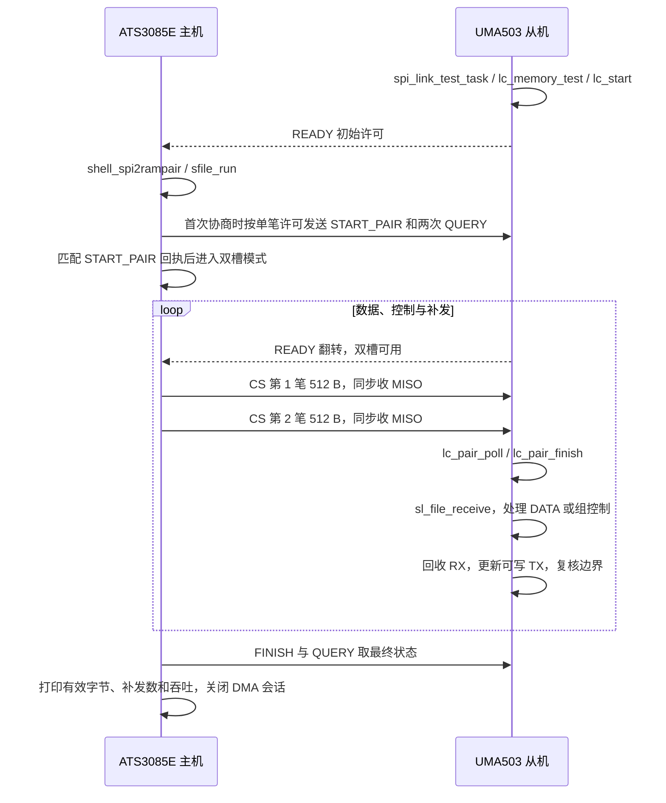

# ATS3085E 与 UMA503-V7 SPI 调试复盘｜2026-11-16 至 11-19

本文面向第一次接手 ATS3085E 与 UMA503-V7 SPI 的开发者，覆盖 2026 年 11 月 16 日晚到 19 日。先确认双端角色、接线和验证范围，再按需要读故障、源码或上板步骤。时间均按北京时间记录，kB/s 按每秒 1,000 个有效载荷字节计算。

- **第一次接板**，先读第 1、2 章，按第 8、9 章核对固件和跑测试。
- **第一次读这份工程**，先看第 24 章的双端时序，再按第 5、6 章追代码和读协议。只熟悉 STM32 例程时，可连读第 13–23 章。
- **正在定位现场故障**，从第 4 章的症状表进入，对照第 7 章的寄存器和第 10 章的证据索引。

## 目录

1. [先看结果与实测范围](#result)
2. [硬件接线与 SPI 基础](#wiring)
3. [开发阶段和版本关系](#history)
4. [逐项 BUG 复盘](#bugs)
5. [新人阅读代码的顺序](#reading)
6. [512 B 协议、组 ACK 与统计判据](#protocol)
7. [503 SSP2、DMA 寄存器与错误码](#registers)
8. [构建、打包与烧录](#build)
9. [如何复现验证、采集波形](#validation)
10. [证据索引与结论边界](#evidence)
11. [提交 Git 前的文件整理、注释约定与回退](#git)
12. [接手后的开发顺序](#next)
13. [从 STM32 例程重新认识这次任务](#stm32-start)
14. [FIFO 容量、门限、访问宽度和帧长](#fifo-lesson)
15. [把 STM32 初始化映射到两套 SDK](#sdk-translation)
16. [第一步：准备 ATS 板级资源](#ats-init-lesson)
17. [第二步：从 SwapByte 到 512 B 收发缓冲](#buffer-lesson)
18. [第三步：沿调用链读 ATS 主机驱动](#ats-driver-lesson)
19. [第四步：读 UMA503 的从机任务与双槽](#uma-slave-lesson)
20. [第五步：从 W25Q64 指令升级到双端协议](#protocol-lesson)
21. [补课：任务、锁、DMA 与 cache](#extra-lesson)
22. [接手时还要看板级资源和内存](#companion-lesson)
23. [用一轮注错验收阅读成果](#learning-review)
24. [两端执行流程、函数调用与 STM32 对照](#execution-flow)

## 1. 先看结果与实测范围

这份交接记录从 2026-11-16 晚上的 256 B 角色互换基线写起。ATS3085E 提交为 `b05dbd4`，UMA503-V7 为 `7075901`。从这个起点开始，由 **ATS3085E 驱动 CS、SCK，UMA503-V7 在 SSP2 上作为从机**。旧《SPI 开发全程复盘》中的 16 B 例程使用了相反的主从角色。阅读那份材料时可沿用 FIFO、超时和双端校验的思路，接线方向、READY 和命令则以下文为准。

| 项目 | 11 月 19 日实测配置 |
|---|---|
| 电气与协议 | 双端共地，READY 逻辑电平 1.8 V。SPI Mode 3，8 位字，每次 CS 有效期间固定收发 512 B |
| 搬运方式 | ATS RX 环形 DMA、TX 定长 DMA。503 RX/TX 双描述符硬件环 |
| 流控与容量 | 一次 READY 翻转许可两笔 CS。每个 DATA 块最多 480 B，每组最多 100 块 |
| 完整性 | 单块 CRC16，组位图定位坏块或缺块，整份数据用 CRC32 校验 |
| 接收终点 | 503 RAM，组缓冲 48,000 B。主机发的是可复算的生成图案 |
| 4 MHz 正常长测 | 29 轮 × 3,000 块，41.76 MB，零重传，中位吞吐约 331.0 kB/s |
| 8 MHz 注错 | 连续 10 轮只补预设坏块一次，整份 CRC32 一致 |
| 8 MHz 正常长测 | 24 轮 × 3,000 块，720 组，34.56 MB，零重传，中位 521.6 kB/s |

这里的吞吐按 **通过校验的有效载荷 ÷ 整轮耗时**计算。时钟、位图查询、空槽填充和控制应答都会消耗时间。8 MHz 的结论对应约 5 cm 接线和当时的 RAM 路径。录音实时负载、SD、蜂窝上传以及更长线缆都还需要各自验收。

## 2. 硬件接线与 SPI 基础

### 接线表

| ATS3085E 一侧 | UMA503-V7 模组一侧 | 方向和用途 |
|---|---|---|
| GPIO57 / SPI2_SS | PCM_SYNC，焊盘 31 | ATS → UMA，从机片选 CS，低有效 |
| GPIO58 / SPI2_CLK | PCM_CLK，焊盘 30 | ATS → UMA，串行时钟 SCK |
| GPIO59 / SPI2_MISO | PCM_DOUT，焊盘 33 | UMA → ATS，从机发送，回传应答 |
| GPIO60 / SPI2_MOSI | PCM_DIN，焊盘 32 | ATS → UMA，主机发送，携带正文和控制命令 |
| GPIO61 / READY 输入 | I2C_SDA，焊盘 66 / GPIO50 | UMA → ATS，1.8 V，从机归还发送许可 |
| 分析仪通道 D1（19 日抓包） | MAIN_RTS，焊盘 23 / GPIO53 | UMA → 分析仪，GPIO 性能探针 |
| GND | GND | 两板及分析仪共地 |

焊盘号按《UMA503-V 硬件开发手册 V1.2》表 13 和现场接线记录使用。开发板排针编号需查板卡原理图或用通断档确认。PCM_DIN 和 PCM_DOUT 以 503 为参照。连接后先查 CS 空闲为高、Mode 3 的 SCK 空闲为高，再检查 503 上电后 READY 电平是否翻转。GPIO57 曾分给振动电机 PWM，检查当前板级复用时也要查占用。接探头前确认输入门限适合 1.8 V。

### 图 1　当前 SPI 链路结构

~~~mermaid
flowchart LR
    subgraph ATS["ATS3085E 主机"]
        direction TB
        A0["spi2rampair 组帧、补发和校验"]
        A1["SPI2 TX 定长 512 B / RX 两个 512 B 半区"]
        A0 --> A1
    end
    subgraph UMA["UMA503-V7 从机"]
        direction TB
        U1["SSP2 RX30 / TX29 各用双描述符环"]
        U0["RAM 组缓冲 单块 CRC16 / 位图 / 整份 CRC32"]
        U1 --> U0
    end
    A1 -->|"CS · GPIO57 → PCM_SYNC 31"| U1
    A1 -->|"SCK · GPIO58 → PCM_CLK 30"| U1
    A1 -->|"MOSI · GPIO60 → PCM_DIN 32"| U1
    U1 -->|"MISO · PCM_DOUT 33 → GPIO59"| A1
    U0 -->|"READY · I2C_SDA 66 → GPIO61"| A0
~~~

两板共地。Mode 3 下 SCK 空闲为高。READY 由 503 发给 ATS，GPIO53/MAIN_RTS 则用于分析仪标记。双槽工作时，一次许可下有两笔 512 B，每笔都独立拉低 CS。主机的 1,024 B RX 环容量等于两笔之和。

### 先看一笔传输

`CS↓ → 同时在 MOSI/MISO 移位 → 第 4,096 个采样时钟 → CS↑` 是最终版的一笔。Mode 3 的 SCK 空闲为高，下降沿移出，上升沿采样。双方共用同一组时钟，所以从机在主机拉低 CS 前须把应答备好。首个收到的 MISO 块可能是较早生成的应答。

**READY 与 CS 各管一件事。** CS 标出线上事务边界，READY 的翻转给出下一次可用的容量。最终版消耗一次许可后可发送两笔，仍要各自拉低和释放一次 CS。把 READY 当作固定高有效电平使用会重复消费已经用掉的许可。

**FIFO、PIO、DMA 各管一件事。** FIFO 在外设旁缓冲样本。PIO 由 CPU 读写 FIFO，DMA 由硬件请求搬运。503 即使已把值写入 TX 内存，如果 DMA 没在 FIFO 耗尽前供数，MISO 仍可能在帧中间插入填充值。SPI 收发方向独立，这时 MOSI 可能继续正确。一次 512 B 在 8 MHz 的纯线时为 512 µs，两笔合计 1,024 µs，其余耗时要从 CS 与 READY 间隙查。

## 3. 开发阶段和版本关系

| 阶段 | 主机和从机怎么配合 | 实测或改变下一步的证据 |
|---|---|---|
| 11 月 16 日基线 | 3085E 供时钟，503 PIO，256 B | 200 kHz 千次确认通过，提频开始出现应答错误 |
| 11 月 17 日 GPIO / 硬件分段 | 先用慢时钟暴露首错，再用硬件分段控制 CPU 服务窗口 | 抓到 MISO 插入 00。12 B 分段工作点通过十轮千次 |
| V1–V4 | 保持 256 B，先验证 503 RX/TX DMA | 早期 RX 停在 253 B。V4 两端确认数与实际事务数闭合 |
| V5–V6 | ATS 也上 DMA，取消分段，固定间隔 | 4 MHz 曾通过长测，随后复现整帧漏收及重装前溢出 |
| V7–V9A | 移到 READY 翻转，随后拆分等待和诊断 | 4 MHz 有效吞吐由 24.1 提至 49.9 kB/s |
| V10–V11B | 512 B 合块，再做硬件环 | 相同 2.4 MB 提至 91.8 kB/s。主机 RX 回卷和从机预取需要独立检查 |
| 11 月 18 日晚文件 / RAM | 100 块组确认，双槽许可，顺序累计 CRC32 | 落盘 39.8 kB/s。RAM 双槽加快速 CRC 达 110.4 kB/s |
| 11 月 19 日最后一版 | CRC 和 DMA 热点迁往 PSRAM，8 MHz 提早 TX 补给 | 8 MHz 注错与 24 轮正常测试通过 |

Git 提交号定位源码起点，V4/V11A 等是构建和上板版本。检查某次失败时，把主机版本、从机版本、启动时间和命令一起记下来。只按哪份 ZIP 最后生成排序，容易把装进设备的旧版本认成新版本。

## 4. 逐项 BUG 复盘

### 按现场症状查找

| 现场首先看到什么 | 从哪一项开始 |
|---|---|
| 时钟频率与吞吐对不上，或 MISO 中间插入 00 | 01～02，先区分帧内打钟、FIFO 见底与帧间停顿 |
| 重启前全 FF，首次 EOR 还剩 3 字节 | 03～05，逐笔比对线上数据、DMA 地址与缓存交接 |
| 千帧通过后整帧消失、收到上一帧应答，或根本没有 READY | 06～09，核实烧录版本、重装窗口与初始化阶段 |
| 短测过、长测报 -5，或第一块就出现 FFFF | 10～13，按 DMA 驱动、ACK 解码与环回卷分别查 |
| 坏块已补，整组失败或组尾卡顿 | 14～16，查文件偏移、位图、接收槽和有序 CRC |
| 逻辑分析仪标记对不上或 8 MHz 只在个别笔欠载 | 17～19，先校准探头，再数时钟并核对错误方向 |

### 11 月 16 日晚至 17 日｜先把首个坏字节找出来

**起点问题是“当前频率多少，为什么跑得这么慢？”** 旧 PIO 版在 200 kHz 下，1,000 次确认耗时 23.021 s、零重发。按每帧全部 256 B 折算约 11.1 kB/s。400 kHz 有重发，812.5 kHz 连续测试在首帧脱链。先查 3085E 的收尾等待，发现从收发返回后重新计时可能额外等待一个理论帧长。200 kHz 打完 256 B 正好需要 10.24 ms。这里同时有三个量要测：请求的时钟、分频器实际输出的时钟，以及两次 CS 之间的空档。

**“先用 GPIO 模拟慢时钟，再换硬件 SPI，最后开 DMA，可不可以？”** GPIO 慢速档让每个故障都能用双端日志和原始波形重放。主机打印 sid（会话号）、seq（序号）、第一个差异位置。从机在 FIFO 供数不足时打计数，再把空闲的 UART_RTS 临时用作分析仪标记。先开采集，再发命令。一次采集只拍到 seq 0～223，故障在窗口外。另一次虽捕获见底脉冲，应答 CRC 仍正确。直到 sid=28 第 720 帧，才在同一笔事务上看到 MISO 插入一个 00、后续字节整体后移。这个对照解释了为什么一条“见底”打印不足以判定哪一帧坏了。

**“能靠 FIFO 打包或分段时钟继续跑吗？”** 503 打包 PIO 将一次寄存器访问搬运量提高到两个 8 位样本，预装从 14 B 提到 28 B，350 kHz 档仍偶发欠载。改用硬件 SPI 后，段内 SCK 回读 2.286 MHz，连续发一整帧会同时触发 503 TX 欠载和 RX 溢出。于是保持整帧 CS 有效，只在段与段之间暂停 SCK 给 CPU 服务 FIFO。5 ms 帧间隔、300 µs 段间停顿、12 B/段通过 10 轮千帧零重试，约 13 s/千帧。14 B 和 16 B 虽有单轮通过，长跑分别出现重试。分段证明了供数窗口影响结果，也解释了为什么 MHz 提高后应用吞吐依然低。

**“手册明明支持 DMA，之前卡在哪里？”** 先分清 DMA 请求号和物理通道。503 的 SSP2 接收请求 60 映射 RX30，发送请求 61 映射 TX29。实机审计检查初始化前后有无占用，再查地址、对齐、缓存所有权、超时后停止和解绑。步骤依次是只读审计、内存自检、与外设真实交换。V1～V3 遇到的关键现象是 TX 已搬完 256 B，RX 只推进到 253 B。EOR 标志和剩余三字节不能告诉我们数据到底留在哪一级，直接补三个字节会破坏内容校验。V4 按 ASR1605 手册和 SDK 实际库修正从机配置，复核非 packed、TRAIL、FIFO 阈值及 DMA 配置。一次同时调整了多个参数，旧故障的唯一触发项仍未隔离。

**判读首次故障要从重启开始。** 用户看到主机连续收到 FF，追问为什么还测 GPIO 模拟。对齐 COM6 后发现，从机在前一轮 19:19:53 已报 `SPI DMA STOP ret=-210`，后来重发时任务已经停了。重启后从第一笔开始抓，首帧 MOSI 和预装 MISO 都逐字节正确，503 却没有完成本地首帧验收，下一笔才出现欠载。这把排查点从接线收窄到 RX DMA 收尾和下一帧重装。V4 验收时，SCK 已由 3085E 硬件 SPI2 产生，两端搬运方式仍不同：503 用 TX29/RX30 双向 DMA，3085E 的 `dma=0` 表示 CPU 服务硬件 FIFO。

#### 01｜256 B 收发成功，却要花两个帧长

**现象**　同一套 PIO 固件在 200 kHz 下完成 1,000 次确认用了 23.021 s。有人把 200 kHz ÷ 8 当成应用每秒已收到的字节数，这个估算漏掉了事务之间的等待。

**目标与定位**　把一次 CS 内的时间、驱动返回前的收尾、下一次 CS 前的空档分开。先保证最后一个时钟完整，再看是否可以提前返回。

**根因与排查**　沿主机应用实际链接的 leopard `spi_acts.c` 和 `soc_clock.c` 查传输完成条件和时钟配置。256 × 8 ÷ 200,000 = 10.24 ms；旧收尾路径在收发返回后重新起算最短时间，前面已经过去的线时可能再算一次。请求频率也要经控制器分频，不能从命令参数推定线上频率。

**改动**　把理论最短线时放回整笔事务的时间轴，检查硬件忙闲和尾部条件；`soc_clock.c` 的 SPI2 路径枚举 HOSC 的整数 ÷1～÷14 和特殊 ÷1.5、÷2.5 档，取不超过请求值的最快可用档；低于硬件下限时报告不支持，写 `CMU_SPI2CLK` 后读回源和分频。慢速 GPIO 测试可独立设置位时序。后面所有速度表同时报告块长、确认数和整轮耗时。

**为什么这样改**　只缩短重复等待仍保留末位发送完成的条件。直接提前抬 CS 可能截掉末字节，单看函数返回会把这种损坏算作成功。

**验证与边界**　200 kHz 千帧零重发是旧基线。400 kHz 已有重发，812.5 kHz 连续测首帧脱链；不能用它们给收尾修改单独计算加速比。

#### 02｜MISO 中间多出 00，下一字节开始整体错位

**现象**　主机报 ACK/CRC 错；第一次触发只录到 seq 0～223，另一次 RTS 已标出 FIFO 见底，应答却仍完整。

**目标与定位**　要找到同一 sid、同一片选内第一个错字节，以及从机此时是否仍在送数据。记录整段原始信号，保留触发前的数据。

**根因与排查**　将主机已知图案与 MISO 原始字节逐位对齐。sid=28 第 720 帧首次同时具备插入 00、随后整体右移的字节证据和供数窗口证据。FIFO 在帧末自然排空也能触发标记，仅从标记计数无法区分二者。

**改动**　慢速 GPIO 时钟用于重放；503 在关键点用 RTS 标记，避免热路径打印。尝试 packed PIO，每次寄存器访问送两个 8 位样本，将预装从 14 B 增至 28 B。再改回硬件 SPI，在同一 CS 内按段打时钟。

**为什么这样改**　预装增加从机能承受的调度延迟；段间只停 SCK，既给 CPU 留出填 TX、取 RX 的机会，也保持协议的一帧只有一个 CS。

**验证与边界**　350 kHz packed PIO 仍偶发欠载；2.286 MHz 连续时钟见 TX 欠载和 RX 溢出。12 B/段、300 µs 段间、5 ms 帧间通过 10 × 1,000；14、16 B 各有长跑重试。这个测试确定了当时 PIO 可用的保守工作点。

#### 03｜重发全 FF，重启后的首帧却在线上完全正确

**现象**　COM6 先报 `SPI DMA STOP ret=-210`，COM4 随后连续取不到 ACK。重启后的 `1951.bin` 中六笔事务各有 2,048 个时钟，sid=67 首笔双向各 256 B 和 CRC 都正确，第二笔才丢 ACK。

**目标与定位**　区分从机任务已停止、MISO 线路无驱动和首帧在线上正确却没被本地软件验收。必须以同一次启动的 READY 作为两端日志起点。

**根因与排查**　503 在验收并发布下一应答前停机，主机后续重试面对的是这个故障状态。首笔正确排除了该笔缺时钟或整帧 MISO 断线。RX DMA 还有 3 B、TX 已完成，调查转到收尾。

**改动**　503 加入首次 EOR、首次故障和清理前后快照；记录 DMA 源/目的地址、剩余长度、RUN、SSP 状态和请求映射。主机记录 good、事务数、首差位置。出现 STOP 后先保存双端日志，共同重启再单测。

**为什么这样改**　清理会停通道并解绑；只看清理后的寄存器会误认为发生故障时映射已经丢失。重启前连发十次也不能提供十个独立样本。

**验证与边界**　首帧正确只证明线上传输。以 `app spi2swap 1 100 2300000 20 8` 单次验收还需下一笔取回 ACK，查主机 good=1、从机新增 2 帧。下条记录说明为什么 RX 当时没能验收。

#### 04｜RX 停在 253/256，V2 的补尾入口始终进不去

**现象**　sid=68 的首次 EOR 中，`rxcmd=60014003`，`rxdst=7E040F3D`，缓冲起点 `7E040E40`。地址推进 253 B，TX 已推进 256 B；`tail_frames=0`。稍后的故障快照才有 TX 欠载。

**目标与定位**　确认剩余 3 B 能否从 FIFO 真实读出，或者 DMA 在 STOP 前后是否仍会提交数据。先冻结首错，再查数据所有权。

**根因与排查**　首次 EOR 时 SSP 已空闲，RX FIFO 非空位为 0，映射 60/61 仍为 `9E/9D`。V2 要求 RX FIFO 非空，入口条件漏掉了实测状态。清理前地址后来又走了 3 B，但这一快照无法说明它们属于哪笔事务。

**改动**　V2 仅对剩余 1～7 B、TX 已完、线端空闲的短尾尝试收实际字节。V3 放宽 RX FIFO 非空的入口条件，先关请求、停 RX、确认 STOP，再读剩余长度与地址。CPU 接手前 invalidate，实际补写后 clean；缺字节、多字节、地址异常或 STOP 超时均报错。

**为什么这样改**　DMA 和 CPU 同时持有同一缓冲会重复计算最后一个 beat；补零或改长度能使计数看似完成，却会掩盖丢数。保留保护区、序号和整帧 CRC，能拒绝这种假完成。

**验证与边界**　V2 单次 good=0/1，之后挂起状态下的 sid=69 不算新测试。模型覆盖 STOP 时推进和尾字节损坏；3 B 究竟滞留在 PDMA、外设接口还是其他环节，现场未能唯一确定。

#### 05｜V4 从 Motorola SPI 从机配置重新验收双 DMA

**现象**　原来 `TRAIL` 已置位，简单重复开 TRAIL 无法解释短尾。手册部分章节沿用 SSCRx 旧布局，FIFO 深度描述也有差异。

**目标与定位**　逐项对齐协议要求、当前 SDK 的实际位号以及库真正写入的值，然后用原来的频率、间隔和数据验证。

**根因与排查**　ASR1605 §17.4.4 对时钟/帧从机要求 SCFR=1，Motorola SPI 要求 TTELP=0。当前 TOP 位号以 SDK `xllp_SSP.h` 为准；库的 `spi_with_dma_cfg` 使用 DMA 门限和 timeout，旧路径用了 PIO 派生门限。

**改动**　503 在 `spi_link_dma_slave.h` 按新布局把 TOP 从 `00062CF9` 调为 `00032CF9`，保留 TTE、TRAIL，使用非 packed 模式；按 SDK 核对 FIFO、门限 15/15、timeout `0x400`，回读四个引脚复用。维持 RX 请求 60→通道 30、TX 请求 61→通道 29。ATS 仍用硬件 SPI2 配 CPU 搬运。

**为什么这样改**　非 packed 模式使 8 位样本与 DMA 搬运单位一致；TRAIL/timeout 负责门限以下的数据。先在 100 ms 帧间隔取得闭合计数，再缩间隔，能把帧内收尾和帧间调度分开。

**验证与边界**　按 1、10、1,000 次逐档，主机确认 1,011，503 收到 1,014，千次耗时 103.002 s。多出的三笔分别用于三个会话的末次 ACK。V4 组合配置通过，几项同时修改，单项因果没有做消融验证。

### 11 月 18 日上午｜从定时等待改为从机发许可

| 版本与现场问题 | 当时的改法和验收结果 | 为什么继续改 |
|---|---|---|
| V4，DMA 实际传对了吗 | 请求 2.3 MHz，首次回读 2,285,714 Hz，每 8 B 停 20 µs、帧间隔 100 ms。1、10、1,000 次都通过，主机共确认 1,011 次，503 累计 1,014 帧。延迟确认每个会话要多发一帧取回末次应答 | 帧间等待太长，可作为功能对照 |
| V5，取消分段后缩短固定间隔 | 4 MHz、10 ms，1,000 次耗时 11 s，21,818 B/s。随后四轮各缺整帧，主机事务比从机有效计数多 1。请求 5 MHz 回读 4.571 MHz，另两轮在 620、179 次确认后失败 | 从机只统计已收帧，bad=0 也可能整帧漏收。重启后通过 25,000 次仍需保留重启前失败 |
| V6，先修从机重装 | 主机 V5 配从机 V6，首批 19 轮、37,252 次确认通过。09:51 再现溢出，RX 缓冲已是 seq=204，TX 仍是 203 的旧应答 | 固定延时无法保证从机已经准备好下一笔 |
| V7，加 READY 翻转握手 | 503 装好 RX/TX、预装 FIFO 后翻转 GPIO50，3085E GPIO61 收到新令牌才打下一串时钟。4 MHz、额外间隔 0，10,000 次耗时 99.560 s、24,106 B/s。前四轮计数闭合，第五轮日志只有开头 | 消除了盲发，下一步测等待发生在哪里 |
| V8，双端唤醒 | 同批九轮通过，主机长测 45,833～46,160 B/s | 分析 503 时间源时发现计数随定时回调累加，打印字段标 µs 仍需核实 |
| V9 → V9A，先修诊断再谈性能 | V9 从机在 WAKE_INIT 退出，还没开始传输。V9A 去掉启动对旧计时的依赖，继续配 3085E V9。四轮通过，10,000 次长测 49,923 B/s | READY 回调后主机恢复只占几微秒，重点转到 503 发 READY 前的工作 |

**引脚怎么接？** 这套角色下，3085E GPIO57/58/59/60 分别为 CS/SCK/MISO/MOSI。确认 503 接收端接 MOSI、发送端接 MISO，两板共地。新增 READY 是 **503 焊盘 66（I2C_SDA，GPIO50）→ 3085E GPIO61**，两侧 1.8 V。RTS 标记是 503 焊盘 23（MAIN_RTS，GPIO53），只接分析仪观察。它和 READY 是两根用途不同的线。分析仪软件里的 D0～D5 只是通道名，换夹子后要重新记录对应关系。

**用户追问“每帧都在等，这个等待是需要的吗？”** V5 的主机日志已经出现 RX4/TX3 DMA 完成、双侧剩余量为零，可与 V4 的主机 PIO 对照。V7 再把时序拆开看：10,000 次确认用时 99.560 s，其中等 READY 共 93.38 s，占 93.8%，单帧驱动平均约 554 µs。503 空闲时有 `OSATaskSleep(1)`，3085E 等待时也有 `k_msleep(1)`。只看主机总等待时间，无法分摊两端各自的调度延迟。因此 V8 在主机用 READY 双边沿中断唤醒，在从机用定时通知任务检查 DMA 完成，保留收帧、CRC 和序号判据。用户同时明确最终业务是录音上传，这一轮先优化 SPI，网络草案已撤回。

**扩帧前还查了一次内存。** 503 开机日志的 `H:` 反映堆余量。审核当时的 map 显示 APP 静态用量为 7,776 B，其中 SPI 栈占 4,096 B；历史快照、坏帧副本和诊断变量合计约有 1 KiB 的精简空间。CP 为 APP 固定预留的 512 KiB 又是另一层布局。将其缩至 64 KiB、理论上回收 448 KiB 是当时的评估方案，收益未经板上验证。对后续 48,000 B 组缓冲，应另外核对运行堆的分配结果和最低余量。

#### 06｜V5 单轮千帧通过，随后整笔漏收

**现象**　4 MHz、10 ms 间隔下千次通过。随后 sid 14～17 主机实际事务数各比从机有效接收增量多一，已收帧的 bad 可以一直为零。

**目标与定位**　先核对两端事务总数，再决定查单帧 CRC、整笔漏收或时钟上限。以会话边界做差，避免比较跨重启的累计数。

**根因与排查**　整笔没有进入接收统计时自然没有坏帧可计。V5 从机完成本帧后有检查、处理和下一帧重装窗口，主机固定等 10 ms，无法观测这个窗口是否关闭。仅凭 V5 日志还不能定位丢在哪个指令。

**改动**　V5 主机启用 RX4/TX3 DMA，去掉段间暂停；V6 移除成功路径中通用 `ld_stop()` 的提前关 SSP；在准备缓冲前和短临界区内各做一次 `ld_arm_check()`。锁内只关请求、编程、先启 RX 再启 TX 并恢复 SSP，CRC、cache、打印和等待均移到锁外。先同频重测。曾选到旧烧录包，板上仍打印 V5；随后核对固定包、包内 app 和重启版本标记。

**为什么这样改**　更换源码或打包成功均不能说明板上运行版本。让同一主机分别配真实的 V5、V6，才能判断从机修改的影响。

**验证与边界**　V5 重启后一度通过 25,000 次；请求 5 MHz 时实际 4.571 MHz，两轮分别在 620、179 次确认后失败。真实 V6 初批 19 轮 37,252 次确认、37,271 笔事务闭合，后一批出现下条故障。

#### 07｜V6 在 seq=204 前后溢出，主机仍收到 seq=203 的应答

**现象**　09:51 的 sid=20 在 4 MHz、10 ms 间隔下，确认 204 次、发出 206 笔即停；之后四次命令均在首笔失败。

**目标与定位**　辨认故障发生在 RX 数据进入、应答生成，还是下一次装载之前；分别查看 RXBUF、TXBUF 和 ROR。

**根因与排查**　503 的 RX 已出现 204、TX 仍是 203 的应答，并在重装前见 SSP 溢出。主机在从机未恢复接收能力时仍能发时钟；增大固定延时只能改变触发概率。

**改动**　V7 由 503 在 RX/TX 就位并预装后翻转 GPIO50；3085E 在 GPIO61 观察到新的电平变化才开始下一笔。一次令牌只能消费一次；超时保留诊断并停止发时钟。

**为什么这样改**　电平翻转会保持到下一次许可，主机稍晚观察仍能看到。短脉冲可能完全落在调度空档内。令牌的位置必须在装载完成之后，否则会重新打开同一竞态窗口。

**验证与边界**　前四轮 11,011 次确认对应 11,015 笔，额外间隔降为零；第五轮日志只覆盖开头，不能登记通过。后续 4 MHz 的主机等待占比很高，继续拆解握手耗时。

#### 08｜READY 已可靠，10,000 次仍耗时近 100 秒

**现象**　V7 全程 99.560 s，主机约 93.38 s 花在 READY 等待；单次 SPI 调用约 554 µs，与 256 B 在 4 MHz 的 512 µs 线时接近。

**目标与定位**　把“从机何时发许可”和“主机看见许可后多久恢复”分开，确定该优化哪一端。

**根因与排查**　单一等待总数混入从机校验、重装、事件探测和主机调度。503 定时回调产生的累加数还受调度影响；即使日志标 µs，也不能当作物理时间。

**改动**　V8 在主机给 GPIO61 注册双边沿中断，以容量为 1 的信号量唤醒原任务；任务醒来重读电平确认令牌。电平检查和进入阻塞之间保留已到达的通知。从机加入定时探测/唤醒；保留 READY 电平和完成检查。V9A 进一步拆开回调、恢复和处理段，对照 OSA tick 与外部波形。

**为什么这样改**　提高 SCK 只能缩短约半毫秒的打钟时间。先分段测量可以避免盲目提高 503 任务优先级，或用高频轮询换取表面上的响应。

**验证与边界**　V8 九轮通过，长测 45,833～46,160 B/s；V9A 的 READY 回调后主机恢复平均不足 5 µs。V9A 的 sid=4 减 sid=3 后，从机 `done_ready` 四段共 8,228 tick，其中校验和重装约占 90.6%；折算约 4.11 ms/笔，与主机约 4.20 ms/笔对应。503 的 5 ms tick 适合跨多次累加比较，小于一 tick 的单次路径需 GPIO 标记。

#### 09｜V9 还没传一帧就 STOP，报 WAKE_INIT -224

**现象**　启动能看到 MEMTEST PASS，大约 105 ms 后停在 `WAKE_INIT`，主机没有可用 READY。内存里仍是自测图案。

**目标与定位**　先检查首笔 CS 前的初始化。把同步对象、唤醒服务、诊断时间源和定时器的返回值拆开。

**根因与排查**　`ld_wake_init()` 多条失败分支共用 -224，其中一项要求启动期等 100 ms 后诊断计数必须变化。诊断异常被当成通信失败是确定的设计缺陷；旧日志没有分步返回值，不能锁定实际命中哪条分支。

**改动**　V9A 分开报告初始化步骤，解除旧诊断计数与链路启动的绑定，时间源受限时回退到明确标识的粗时间。保留通信必需对象失败时的停机。

**为什么这样改**　去掉全部启动检查会掩盖真实同步故障；只让可选测量降级，就能在维持通信约束的同时获得下一轮证据。

**验证与边界**　主机 V9 配从机 V9A，COM6 到达 `SPI DMA READY v9a`；1、10、1,000、10,000 次全部通过，最长 48.074 s、49,923 B/s。本轮没有复现原启动故障，吞吐变化不能全部归给一个诊断回调。

### 11 月 18 日下午｜合并事务，验证硬件循环 DMA

**“每次等 READY 都很贵，能不能一次多传？”** V10 在一个 CS 内发 512 B，含两个 256 B 逻辑帧。仍以 240 B/逻辑帧计算，V9A 与 V10 都传 2,400,000 B 有效载荷，耗时从 48.074 s 降到 40.715 s，吞吐由 49,923 提到 58,946 B/s。V10 要确认 5,000 块，主机实际发 5,001 笔。比较单块 READY 时间时，应先除以每块包含的逻辑帧数。

**“双 DMA 真成功了吗？”** V11 中，503 的收、发分别用两个描述符交替，3085E 接收端用 1,024 B 环分成两个半区，发送端每笔使用定长 512 B DMA 来限制时钟数。由于从机 TX 预取，应答延后两块，故 5,000 个有效块对应 5,002 个事务。初版 1、10 块通过，500 块在第 46 笔主机报 -5，此时从机收到 46 块、bad=0。另一次重启后首块 CRC 错，缺配套从机日志。V11A 在主机先读 DMA 完成事件，再读取 SPI 状态，修正模型中可复现的跨时刻采样竞态，并记录首次失败阶段。首块旧故障的原因仍待证实。

**上板怎么看环真的在转？** 3085E 查看 rx_starts=1、stop=0/0、good=N、事务=N+2。503 查看本轮块计数增量、starts=1、rearm=0、bad=0。V11A + V11，4 MHz 下六轮通过，两轮 5,000 块为 63,106 和 63,066 B/s。后续 V11A + V11B 长测到 91,757 B/s，5,000 块耗时 26.156 s，主从事务增量均为 5,002。带分段计时的 PERF 版为 90,874 B/s。PERF 当轮退回 5 ms tick，适合找大致热点；要拆开一次不足 5 ms 的 READY 空档，改用 GPIO 脉冲和波形。

**审核时作了哪些取舍？** V11-D 草案从当时的 NODESC 配置推断硬件能力，回查 ASR1605 §11.3.2 后改用硬件描述符环。以 CS 边沿中断替换探针轮询也是候选方案，涉及 CS 复用及影子 CS 引线。这条建议没有对应的提速验收值。V10 的 ATS 链接余量为 1,104 B，而把四个缓冲各扩大 512 B 需要额外 2,048 B。到 V11A，ATS SRAM 链接余量只有 592 B，继续扩缓冲前要查 map，同时区分链接余量与运行时栈水位。

**两个并行讨论中的“下一版”指不同方案。** V10 当时是每笔 DMA 完成后由软件重装。一条讨论提出将四个逻辑帧并成 1,024 B，复用主机缓冲，这份导出停在选案阶段。另一条讨论实现了上文实测的 V11 硬件循环，线上块仍为 512 B。核验 V11 时看从机是否自行切换到下一描述符、连续传输中 DMA 通道是否重装，以及主机每次 CS 是否恰好产生一块时钟。四帧合块的预期收益不能算入 V11 的实测。

#### 10｜每帧都完成 DMA，CPU 仍要逐块重装

**现象**　V9A 一帧只有 240 B 有效数据，主机打完时钟还需等下一次许可。V10 把两个逻辑帧放进同一个 CS 后仍需逐块启动 DMA。

**目标与定位**　按相同的有效载荷比较，先测合块能省多少，再检查 DMA 能否在另一块上继续工作时处理上一块。

**根因与排查**　旧实现设置 `LD_NODESC`，说明软件选了无描述符模式。ASR1605 §11.3.2 明确描述四个 32 位字、16 B 对齐的描述符，并给出 A→B→A 的例子，由此修正了 V11-D 草案对芯片能力的判断。

**改动**　V10 每笔 512 B 携带 480 B。V11 从机 RX、TX 分别建两个描述符成环，清 RUN 和 NODESCFETCH、设 DDADR 再置 RUN。描述符按 64 B 步长隔离 cache 行，数据区前后各留 64 B 守卫。CPU 只读完成的 RX 槽（先 invalidate），只写可归还的 TX 槽（写完 clean）。主机 RX 环 1,024 B，TX 每次有限 512 B。

**为什么这样改**　主机有限 TX 确定 CS 内时钟数；从机 TX FIFO 可预取下一槽，已经交给硬件的应答不能再改写，流水确认相应延后。EOR 只能提示边界，还要查半传输/全传输事件、地址、剩余量及 SSP 空闲。

**验证与边界**　V10 用 5,001 笔确认 5,000 块，2.4 MB 耗时 40.715 s。V11 同一目标需 5,002 笔；`starts=1/rearm=0` 结合块数、CRC、守卫才构成环运行证据。V11A 时 ATS SRAM 链接余量仅 592 B，不能直接再申请两个大缓冲。

#### 11｜V11 第 46 笔主机报 -5，从机 46 块都收对

**现象**　1、10 块通过，500 块测到 good=43、tx_blocks=46 时停机。503 bad=0，描述符环仍在运行。随后 5,000 块命令遇到错误锁定，没有开始。

**目标与定位**　查主机驱动怎样组合读取 SPI FIFO 与 DMA 完成状态。故障时、停止收发后各存一份现场，避免把恢复后的值当作首错。

**根因与排查**　模型能复现旧读取顺序的竞态：先采到 RX FIFO 尚有数据，最后一次 DMA 搬走数据后再采到完成事件，把两个时刻的值拼在一起就会误报。缺少第 46 笔原始寄存器时序，不能反推那笔必然命中了该分支。

**改动**　ATS 的 `spi_acts_spi2_circular.h` 先读 DMA 事件、剩余计数，再读 SPI 状态。命令层增加驱动 stage/sample/halted、ACK 错误的两个帧头和后续 BLOCKED 提示；保留超时、错误位和首错停机。

**为什么这样改**　改采样顺序可消除已复现的误报，同时留下区分真正多字节、错误事件、CRC 失败的证据。把 -5 一律忽略会让损坏半区继续被使用。

**验证与边界**　主机模型和回归通过后，两端共同重启，依次试 1、10、500、5,000 块。V11A 配 V11 的六轮实机通过，两次长测 63,106、63,066 B/s。晚间另有不同的 RX_STATE 快照，见第 13 项。

#### 12｜两端重启后首块 ACK CRC 失败，sid=FFFF

**现象**　14:51 的一次尝试已走完首块 DMA，但在 ACK CRC 检查返回 -1。与第 46 笔驱动检查失败的阶段不同。

**目标与定位**　先确定从机本轮是否完成自检、发布 READY，再查两个 256 B 逻辑帧头和首个坏字节。

**根因与排查**　当轮缺配套 COM6 启动日志。sid 仅占头部两个字节，`FFFF` 无法证明整条 MISO 都是 FF，也不足以区分未准备、旧应答或帧内损坏。

**改动**　命令增加双帧头打印；复测以 `SPI11 DESC_MEMTEST PASS`、`SPI DMA READY v11 circular` 和主机 `rev=11a` 为同一启动的三个识别点，没有把猜测写入协议容错。

**为什么这样改**　同步抓首个 CS 并对两端版本能区分启动条件与协议问题；自动重发会覆盖最有价值的第一笔。

**验证与边界**　配套固件后续六轮通过。当次首块错误仍属未决，复现时需要从重启开始的 COM4/COM6 和首笔双向原始波形。

### 11 月 18 日晚｜为什么组 ACK、双槽和 CRC 要分别测

| 当晚的问题 | 一次只改一项的结果 |
|---|---|
| 每 100 块确认一次，能否支持缺块补发？ | 文件测试先验证 101 块、故意破坏索引 17、仅补一次。300 块分三组落 503 Flash，144,000 B、39.8 kB/s、CRC32=c426c4fc。这里包含写入与读回 |
| 目标是 SPI 到 503 RAM，Flash 占了多少？ | 去掉落盘和读回，用生成数据走同一套单块 CRC16、组确认、整份 CRC32，300 块升至 80.4 kB/s。无 SD 也能测 |
| 组 ACK 已经减少，为什么仍逐块等待？ | ACK 表示数据收齐与校验，READY 表示可以占用接收槽。改成一次许可连发两块，两槽处理完成才归还额度。300 块升至 89.6 kB/s，160 对、320 次事务，坏块补发仍通过 |
| 豆包建议借鉴 ZS302A 的窗口，能推算收益吗？ | 转贴审核提出把通知、发送额度和组确认拆开。参考项目使用窗口背压。当前板实测的是固定双槽，动态归还单槽仍是设计选项。先保留相同流控测 CRC，才能归因 |
| 为什么组尾偶尔等很久？ | 503 顺序收块时边收边累计 CRC32，出现缺口时保留后续数据，补齐再续算。300 块升至 95.2 kB/s。再改 slicing-by-4，22:50 同工况达到 110.4 kB/s。组校验与补发继续保留 |

**豆包审核如何转成可验证的协议决策。** 对照 ZS302A 的发送与独立读回路径，转贴里提到的“518 B、每毫秒一片、下一片顺便解析 ACK”需要修正。审核时看到的宏定义是 **520 B 事务**，状态机配置为 **3 ms 一拍、每拍最多提交一片**。有效回包从独立读回路径解析；`win=0` 会抑制推片，代码中也有超时放行分支。最终借鉴的是流控、组确认、业务完成三个层次。审核提出的“两组共 4 KiB”是当时的小组缓冲候选，正文晚间实测用的是每组 100 × 480 B 的 RAM 路径。分清参考实现、候选设计和板上固件，才能解释同一晚为什么出现几种不同的块长和窗口。

#### 13｜环从第二个半区回卷时短暂读到 RX_STATE

**现象**　19:10:28 主机 `block=379 slot=1` 报 -5。首错采样 `pending=0 expect=10 rxrem=8 txrem=0`（事件值按日志十六进制）；停机快照却是 `rxrun=1 rxrc=1024`。

**目标与定位**　在环尾区分硬件完成到自动重载之间的过渡、真正停通道和错误的半区事件。

**根因与排查**　有限 TX 已耗尽，RX 从尾部 8 B 回到整环 1,024 B，前后寄存器是两个时刻。它提供了比笼统的 -5 更具体的回卷线索；与先采 RX_EMPTY 的问题需要分别验证。

**改动**　当前主机驱动只在 slot=1、TX 已耗尽、RX 位于规定回卷位置时允许限时复读 RUN，宽限 `SPI2_CIRC_RELOAD_GRACE_US=20`。意外事件、SPI 错误、错误位置和超时仍失败。

**为什么这样改**　永久忽略 RUN 会把真停机误作完成；只在可解释的环尾窗口复读，才能继续保护正在工作的另一半缓冲。

**验证与边界**　复测要跨越数百次环回卷，核对 `rx_starts=1` 和两端计数。晚间的长测提供运行覆盖，但没有逐周期跟踪能唯一还原 block=379 的硬件内部状态。

#### 14｜故意损坏块 17，组尾补发后返回等待超时

**现象**　19:30 的 100 块普通测试成功；101 块注错时发了 111 笔、resent=1，主机却报 `ret=-116`、Bps=0。随后测到索引 100 的一次 `fseek_end` 用了 81 个 5 ms tick，约 405 ms。

**目标与定位**　分清坏块检测、补发位置、补发后的文件游标和下一次 READY。记录 fwrite、seek、fill 在哪个索引花了多久。

**根因与排查**　缺 17 后，后续块需要保留正确的文件偏移；SDK 不能靠 seek 越过文件末尾自动扩展。回填 17 后再回到追加位置还可能有长延迟。一次超时只证明调用方没及时完成，不能据此断言 SPI 再丢了一帧。

**改动**　503 `sl_file_write()` 只对缺口补零扩展，真实接收另记位图；`sl_file_seek()` 维护 cursor/extent，回到末尾时核验 `ftell`，失败或位置不符改用绝对 `SEEK_SET`。主机对 READY 有有界等待。另一条路径用 48,000 B 暂存整组，齐组后一次顺序写入。

**为什么这样改**　零填充只为保留偏移，不能把空洞标为已收。检查写入返回长度、实际游标及最终读回 CRC，才能证明补发恢复了完整数据。组暂存降低频繁改写文件位置的成本，也引入实际堆分配需求。

**验证与边界**　19:37 的 101 块用 130 笔、只补一次、ret=0。19:56 同为 101 块时，正常轮 1.224 s，补发轮 1.754 s，约 530 ms 的差距中约 405 ms 来自定位。试用 SEEK_END 后仍有长定位，后来改为组内 RAM 暂存。这样消除了补发后的回跳，磁盘写入本身仍需计时。

#### 14a｜48,000 B 已经进 RAM，为什么报告存储错误

**现象**　20:18 普通轮完成两组，CRC32=83828970；同一固件注错轮显示 `bad_block=17 repaired=1`，紧接着却给出 `groups=0 status=4 ret=-5`。最慢 READY 为 65.4 ms，明显短于 2 s 超时。

**目标与定位**　从机日志已打印 `BUFFER mode=ram bytes=48000`。沿 `GROUP_END → sl_file_accept_group() → um_fs_fwrite()` 检查第一组写入，分别核查运行堆、LittleFS 可用空间和写入返回长度。

**根因与排查**　第一组需要将 48,000 B 写入暂存文件，写入未达到预期长度。启动记录显示 LittleFS 可用量依次为 442,368、393,216、245,760、147,456 B；每份成功测试文件约占 49,152 B。又留下三份后，20:33:41 的启动读数直接确认 `free size: 0`。503 有足够 RAM 接收这一组，持久存储已经耗尽。

**改动**　沿用同一组缓冲固件。该次启动日志逐项记录清理了 9 份旧 SPI 测试文件，返回值均为 0。保留校准与系统文件，再复查分区空间和组写入结果。此处记录的是当时设备上的操作。

**为什么这样改**　调高 SCK、增加 READY 超时或重新分配 RAM 都不能让满分区容纳新文件。定点回收测试产物既能验证容量归因，也避免整分区擦除破坏校准数据。

**验证与边界**　下一次启动测得 `free size: 442368`，即 432 KiB。处理下一项启动异常后，原注错工况两组落盘通过。正常轮最慢 READY 约 472 ms，与整组写盘约 470 ms 对应；空间恢复解决了失败，写盘延迟依然存在。

#### 14b｜空间已恢复，主机还没发 START，从机就进入 STOP

**现象**　20:40:02.640 从机先报 `STOP stage=RECEIVE ret=-216 cleanup=0`，完整块数为 0，RX 剩余 512 B，SSP 显示忙。到 20:40:15 主机才发送 START，随后等 READY 超时。

**目标与定位**　按 COM6、COM4 的绝对时间拼接同一次启动，判断失败发生在建立链路、处理坏块或组写入中的哪一步。

**根因与排查**　主机开始时接收任务已挂起，这是此次 READY 超时的直接原因。空闲期间为何出现 SSP 忙缺少对应 CS/SCK 波形；此处不能断言是接线毛刺或主机启动时钟。

**改动**　保持固件和接线，调整复测顺序：先让 3085E 到达 shell，再重启 503；确认本次 `group RAM trial`，观察 5 秒无新 STOP，才发 101 块并注错 17 的命令。

**为什么这样改**　只改变启动顺序，把启动期扰动和运行中存储异常分离。出现 -216 后继续向挂起的从机发命令，只会产生第二个超时。

**验证与边界**　20:46 轮主机 130 笔、从机新增 130 笔，`bad=0 starts=1 rearm=0`；两组、一次修复、CRC32=83828970。后续 300 块、144,000 B 分三组写盘，353 笔、3.621 s、约 39.8 kB/s，CRC32=c426c4fc。启动顺序是已测恢复办法，原空闲期硬件触发原因仍待捕获。

#### 15｜100 块才确认一次，主机仍在逐块等 READY

**现象**　去掉落盘与读回，300 块达 80.4 kB/s，却低于先前某些逐块测试。提问集中在“已经 100 块一组了，为什么还要等”。

**目标与定位**　数一组实际出现多少次 CS、多少个 READY，以及哪些事务是 DATA、QUERY、补发和填充。用同一数据源、块长与验证范围对比。

**根因与排查**　组 ACK 回答“这 100 块有哪些已验收”；READY 回答“下一槽现在能否写”。从机环只有两槽，如果一张许可就发满 100 块，第三块已可能覆盖第一块。早期 91,757 B/s 跑的是图案环，和组协议的事务构成不同。

**改动**　改成一次 READY 许可连续两笔，双槽均处理后再归还许可。主机用 QUERY 取匹配传输 ID、组首索引、请求号和命令的回执。奇数尾部或单块补发用 IDLE 占满一对；13 B 位图只重传缺块。

**为什么这样改**　以固定两槽绑定可写容量，既避免覆盖，又能减少通知。保留每块 CRC16，组首、组尾和传输结束仍可各自核对，迟到的旧应答不能被误认作当前控制结果。

**验证与边界**　300 块测到 160 对、320 笔、约 89.6 kB/s。用 101 块注错索引 17 同时覆盖跨组、补发、尾组；只有组数、补发数和整份 CRC32 都符合预期才算验收。

#### 16｜组尾 CRC 集中计算，整组收齐后 READY 迟迟不来

**现象**　双槽通过后提升仍有限。若在组尾才扫描全部 48,000 B，最后一对的等待会叠加整组计算。

**目标与定位**　把“收到的块数”和“可按文件顺序计入 CRC 的连续前缀”分开。确认坏块、重复块、尾块都不会让累计值多算或跳算。

**根因与排查**　CRC32 依赖字节顺序。收到 0～16 后若 17 损坏，即使 18～99 都已进 RAM，也不能直接把这段接到 16 后面。位图负责完整性，连续前缀负责校验顺序。

**改动**　`sl_file_data()` 随顺序块推进 CRC；有缺口时保留后续正文，`sl_file_accept_group()` 在组完整时只处理尚未累计的后缀，并按尾组实际字节数计算。再单独切换 slicing-by-4 的 CRC 实现。

**为什么这样改**　分摊工作可降低组尾停顿。先调整计算时机、再调整算法，用同一测试图案和同一最终 CRC 比较，能区分两项优化。

**验证与边界**　相同 300 块从 89.6 升到 95.2 kB/s，随后达到 110.4 kB/s。故意坏块与完整组均需通过；遇到第一个块损坏时，组尾仍可能有长后缀需要处理。

### 11 月 19 日｜用逻辑分析仪找出两个不同的瓶颈

1. **09:26～09:42，确认测量点。** 第二块 CS 结束后约 6.12 ms 才看到 READY。最初 0926.bin 中 D0 可解出有效应答，说明 D0 是 MISO，RTS 在 D1。确认 COM6 显示 GPIO53 已从 AF1 切为 GPIO 输出后，用 0941.bin 对齐 D1 标记、D2 CS、D5 READY。按 MOSI 帧头筛出 150 对纯数据块，约 72% 的对间空档落在 CRC16/CRC32 区间。
2. **10:01～10:37，迁移热点并回测。** 先把 CRC 函数及查表数据从 Flash 迁至 PSRAM，通过 ELF 和实机启动地址确认放置位置。4 MHz、300 块从带探针的 108,597 提至 247,848 B/s。再迁移 DMA 快照、边界判断和映射扫描路径，达到 317,880 B/s。随后 4 MHz 运行 29 × 3,000 块，共 41.76 MB、零重传，长测中位数约 331.0 kB/s。
3. **11:05～13:33，升频后保留失败。** 加入主机 --hz 参数，8 MHz 首轮长测 514.1 kB/s。随后注错测试在预设坏块之前就停机，503 报 tur=1。先在 503 端观察 SCK，50 MHz 数字采样每点间隔 20 ns，可数出 512 B 应有的 4,096 个上升沿。13:33 的故障波形中，第 109 笔已完成坏块补发，第 110 笔为补足双槽的 IDLE。其 SCK 数正确、MOSI CRC16 正确，但 MISO 前 256 B 后插入六个 00、末六字节被挤出，同轮从机报 TX 欠载。优先查 TX 供给。模拟振铃仍需示波器才能判断。（故障波形 `1333.bin`）
4. **13:39～14:10，只改 TX 请求门限。** 从 FIFO 剩 16 项开始补给改成剩 23 项即请求，8 MHz 下提前约 7 µs，DMA burst 仍为 8 B。先在 COM6 核对 tft=22、threshold=23、burst=8，再复跑最易触发故障的注错用例。连续 10 轮都只补一次。最后 24 × 3,000 块共 34.56 MB、720 组确认，零重传、零失败，各轮 CRC32=7eb2f066，吞吐范围 510.5～522.1 kB/s。此结论对应当时约 5 cm 接线和 RAM 消费方式。（主机长测 `COM4_2026_11_19.14.08.30.777.txt`） · （从机长测 `COM6_2026_11_19.14.08.31.964.txt`）

#### 17｜分析仪通道认错，第一次测不到 CRC 的时间

**现象**　`0926.bin` 的 D0 原先被当作 RTS，却能解出有正确 CRC 的 MISO 应答。另一次看到第二笔 CS 后约 6.12 ms 才出现 READY，仅凭两条边沿不知道耗在何处。

**目标与定位**　先证明每一个探头对应哪根线，再把“处理这一对数据”和控制查询、占位事务分开统计。

**根因与排查**　503 的 MAIN_RTS 焊盘还涉及引脚复用；只写 GPIO 数据不等于焊盘已经输出标记。若把正常 MISO 翻转当作探针，会得到与 CPU 工作无关的脉宽。

**改动**　核实 GPIO53 从 AF1 切为 GPIO 输出，启动时读回。按实际接线用 D0 验 MISO、D1 取 RTS、D2 定位 CS、D5 看 READY；由 MOSI 命令筛选相邻两笔纯 DATA，再对齐处理标记。

**为什么这样改**　总空档包括 CRC、DMA 检查和其他工作；探针标记特定代码段，可把一段等待分解到可修改的函数，保留原始采样还可以事后更正通道含义。

**验证与边界**　`0941.bin` 的 150 对纯数据中，约 72% 对间空档落在 CRC16/CRC32 段。50 MHz 数字采样的点距为 20 ns，软件缩放显示更细的时间刻度不能增加采样精度。

#### 18｜4 MHz 段内时钟正常，但 CPU 校验和检查拉长块间隔

**现象**　带探针 300 块仅 108,597 B/s。主机已经有可连续发送的两笔，瓶颈集中在归还下一对槽之前。

**目标与定位**　先验证程序和表实际从哪块存储运行，再只移动波形标出的热点。分别检查函数、数据表、DMA 缓冲三类地址。

**根因与排查**　CRC 循环及其查表数据原放在 Flash；有多个热点同时存在。把 CRC 移走后重新测量，余下的映射核对和 DMA 边界检查也占用块间时间。

**改动**　先调整 CRC16、CRC32 与表的放置，用 ELF/map 和启动打印 `crc16/crc32/table32` 地址核对；再迁移 DMA 快照、边界判定和映射检查热路径。保持协议、校验强度和检查项。

**为什么这样改**　同时迁移所有代码就无法归因；删除守卫更会把“性能提升”和“减少故障检测”混在一起。地址读回防止链接脚本没有把实际执行实例移到目标区。

**验证与边界**　同档 4 MHz、300 块依次测得 108,597 → 247,848 → 317,880 B/s。29 × 3,000 块传了 41.76 MB，零重传，长测中位约 331.0 kB/s。结论限于当时芯片布局、固件和 RAM 负载。

#### 19｜8 MHz 注错流程已修复坏块，下一笔 IDLE 的 MISO 却欠载

**现象**　普通长测先跑到 514.1 kB/s；后来 503 报 `tur=1`。抓到的 `1333.bin` 中，第 109 笔补的是块 17，第 110 笔是配对 IDLE，后者 MISO 前 256 B 正确，随后插入六个 00，末六字节被挤出。

**目标与定位**　查故障当笔到底缺时钟、MOSI 内容错误、槽位错用，还是从机已备好源缓冲但 FIFO 没有及时得到下一个 burst。

**根因与排查**　110 笔各有 4,096 个上升沿；故障笔 MOSI 的 CRC16 正确，MISO 在帧中间才开始移位，且同轮 TX underrun 计数增加。证据指向 TX 服务延迟，无法从数字采样确定模拟电气裕量或精确的总线仲裁延迟。

**改动**　只调 `spi_link_dma_circular.h` 中的 TX FIFO 请求门限，由剩 16 项发请求改为剩 23 项，寄存器 TFT 编码为门限减一，启动显示 `tft=22 threshold=23 burst=8`。仍留足一整个 burst 和一项余量，保留双槽和全部 CRC。

**为什么这样改**　8 MHz、8 位样本时每消耗一项约 1 µs，提前 7 项给 DMA 多约 7 µs 服务时间；更改 burst、协议或接线都会让这次验证失去单变量对照。

**验证与边界**　先重复 10 轮最易暴露问题的注错测试，每轮只补预定坏块一次。最终 24 × 3,000 块、720 组、34.56 MB、零重传，整份 CRC32 均为 7eb2f066。中位 521.6 kB/s，范围 510.5～522.1；只覆盖约 5 cm 接线及当时的 RAM 处理路径。

## 5. 新人阅读代码的顺序

以下路径相对于各自仓库。ATS 的 SDK 目录是 `TAG_ZS3085E_241230/`，应用源在该目录的 `application/bt_watch_no_psram/src/main/`。503 的 SPI 应用在 `startup/app_release/demo/`。

| 顺序 | 入口和搜索词 | 读完应能回答 |
|---|---|---|
| 1 | ATS `system_app_shell.c` 搜 `SHELL_CMD(spi2rampair`，再看 `spi_link_file_host.h` 的 `shell_spi2rampair()`、`sfile_run_generated()` | 命令怎样解析块数、注错索引、频率，数据来自哪里？ |
| 2 | 503 `demo_spi.c` 的 `spi_link_test_start()` 与 `spi_link_test_task()` | 谁在应用启动后创建任务，哪条编译分支进入 DMA 环，READY 在哪个阶段出现？原厂回环 demo 是另一个入口 |
| 3 | 两端 `spi_link_file_protocol.h` | 怎么从原始 512 B 解出方向、块号、长度、请求号和 CRC？ |
| 4 | ATS `spi_link_file_host.h` 的 `sfile_run()`，再找 `swap_ready_wait_timeout` 和 `spi_acts_spi2_circular_transfer` 的调用处 | 谁消耗 READY，什么条件下发送第二笔，组确认失败后怎么补发？ |
| 5 | ATS `zephyr/drivers/spi/spi_acts_spi2_circular.h` 的 open/transfer/close，再看 `zephyr/soc/arm/actions/leopard/soc_clock.c` | RX 为什么只启动一次，TX 如何限制时钟数，实际频率从哪里回读？ |
| 6 | 503 `spi_link_dma_circular.h` 的 `lc_memory_test()`、`lc_start()`、`lc_pair_poll()`、`lc_pair_finish()` | 哪一槽仍由 DMA/FIFO 持有，什么时候 CPU 才能读 RX 和填 TX？ |
| 7 | 503 `spi_link_file_slave.h` 的 `sl_file_receive()`、`sl_file_data()`、`sl_file_accept_group()` | CRC 坏时哪里拒收，位图和连续 CRC 前缀分别何时更新？ |
| 8 | 回查 `spi_link_dma_slave.h`、各自 SDK 的寄存器头文件、失败时的快照 | 遇到 `-210`、`-216` 或 `RX_STATE` 时先读哪组证据？ |

首次阅读用一个 101 块、注错索引 17 的会话贯穿两边。先在纸上圈出前两笔 DATA、第一组 GROUP_END、缺块位图、补发和下组的第 100 块，再追每次状态变化。若 IDE 跳到 bootloader 的同名 `spi.h`，用应用的编译依赖确认真正使用的 Zephyr 文件。

## 6. 512 B 协议、组 ACK 与统计判据

以最终版 `app spi2rampair 101 17 --hz 8000000` 为例。3085E 生成 48,480 B。第一组收索引 0～99，第二组仅收 100；索引从 0 开始。503 将块 17 的副本判坏后，其位图仍缺第 17 位。主机等到匹配本组的控制回执，只补第 17 块。普通 DATA 不必携带新的控制应答，MISO 可能仍是预取内容。双槽控制回执安排在下一对的第二笔，第一笔可能已进入发送 FIFO。

| 512 B 事务的字节偏移 | 抓包时怎样使用 |
|---|---|
| 0～3 | 方向、版本、命令、保留字节。按 MOSI 的 DATA、GROUP_END、QUERY 或 IDLE 分组，再解释 MISO |
| 4～7、8～11 | 小端传输 ID 和绝对块序号；组命令使用该组首块，防止把上一组回执算进本组 |
| 12～15 | 控制请求号与有效载荷长度。控制请求号非零，正文请求号为零；尾块只对实际长度计算 |
| 16 起、510～511 | 有效载荷最多 480 B，尾部为 CRC16-CCITT-FALSE，覆盖头和有效载荷。最终 CRC32 按原始数据顺序计算 |

**如何识别真正结束。** `resent=1` 只能说明发起过补发。还要找到两组均被接受、整份 CRC 与发送端相同、最终返回成功。与无注错的 101 块样本对照时，有效字节数应相同，注错轮实际事务数较多。11 月 19 日 14:10:14 的主机末轮实际打印 `transfers=3128 resent=0 ms=2759 Bps=521928`、`groups=30 crc32=7eb2f066 PASS`，以及 `pairs=1564 blocks=3128`。这里有 128 笔控制和配对开销，不能把 3,128 乘 480 全部计入有效载荷。配套从机记录 `mode=ram-only bytes=48000`、`starts=1 rearm=0`。3,000 块的最终 RAM 测试用 1,440,000 B 除以整轮秒数；8 MHz 的每线理论速率为 1,000,000 B/s，仅按 480/512 载荷比例换算的上限为 937,500 B/s。实测中位 521.6 kB/s 包含流控与协议空档。

## 7. 503 SSP2、DMA 寄存器与错误码

从机启动时读回配置，故障时保留首次状态、停止前状态和清理后状态。下面以 SDK 的寄存器布局和项目里的 `lc_fault()`、`lc_boundary()` 为准。位值需按发生故障的固件解释。

| 现场要查什么 | 抓取内容 | 怎样判断 |
|---|---|---|
| SSP 角色与模式 | TOP 的 SSE、SCLKDIR、SFRMDIR、SCFR、TTELP、TRAIL | V4 从 `0x00062CF9` 改到 `0x00032CF9`。用实际 SDK 位布局，不直接套手册旧 SSCR 位号 |
| FIFO 与请求 | FIFO 寄存器，RX/TX level，ROR/TUR，TFT 和 burst | 最终 TX `tft=22 threshold=23 burst=8`。记下是哪一方向告警 |
| 请求映射 | RX 请求 60 → 通道 30，TX 61 → 通道 29 | `map60=9E map61=9D` 是早期有效映射样本；清理后读到零应结合清理顺序 |
| DMA 进度 | RX/TX RUN、STOP、NODESCFETCH、CMD/LEN、源/目的地址、DDADR | 非循环版核对计数与推进地址；环形版到边界会预取，不能把 LEN=512 当作从未工作 |
| 判完整 | 同一槽的边界快照、保护区、真实样本和校验 | 早期 EOR 只说明外设结束条件；环形版还要确认描述符、地址、两端计数。EOR、READY 和 ACK 分别来自不同层 |

| 输出 | 优先排查 |
|---|---|
| 503 `-203` / `-206` | 请求所有权或地址别名冲突 / DMA 总线错误 |
| 503 `-209` | 自检数据不符或保护区损坏，记录 stage、槽位及缓冲地址 |
| 503 `-210` / `-213` | SSP 错误 / 寄存器配置偏离期望。先分方向再数 CS 内的 SCK |
| 503 `-216` | 等待尾部或环内事务完成超时，按版本和阶段保留 BUSY、LEN、CS/SCK |
| 503 `-230` | 检查 RUN/STOP、描述符模式、对齐和装载阶段 |
| ATS `-5` | 从 stage 区分 RX_STATE、RX_FIFO、TX_COUNT。记录事件与剩余量，以及故障后的 halted 状态 |
| 文件协议 `status=4` | SFILE_STORAGE，查组写入返回长度、游标和分区空闲量 |

## 8. 构建、打包与烧录

如果只复现历史数据，可直接用下表的成对产物。要读懂新改动的影响，再走完整构建。把源码提交、编译参数、产物哈希、烧录启动标记和实机命令串起来，才能追溯板上实际跑了哪版。

**ATS3085E。** 在配好 Actions SDK 的 PowerShell 将 `ZEPHYR_BASE` 指到当前仓库的 `TAG_ZS3085E_241230/zephyr`，使用配套 Python 在该目录运行 `python build.py -s`。首次通过交互选 `ats3085e_dev_watch_ext_nor` 和 `bt_watch_no_psram`。在应用 `outdir/ats3085e_dev_watch_ext_nor/` 下核对新 `zephyr.elf`、`zephyr.bin` 和 `_firmware/*.fw`。前两项供符号、内存与构建分析，Actions 烧录用 FW 封装。

**UMA503。** 在该仓库 `startup/app_release` 运行 `cmd /d /c build_app.bat`。厂商批处理可能返回 0，仍需核对编译链接日志与新生成的 `build/app.bin`、`app.elf`、`app.map`。用该板配套 `app_tools/download/aboot_common` 中的 arelease 工具构建 ZIP，发布模型沿用 `ASR1605_EVB` 和 `ASR1605_SMS_04MB_OC`。若直接运行 arelease，在该工作目录用 `-i app=../../../build/app.bin` 指定新应用。最终核对 ZIP 内 app 与刚编译的文件逐字节一致；AbootDownload 选择匹配板型的 ZIP 并按该板原有烧录流程操作。

### 实测成对固件

| 端 | 实测配套包（各仓库 artifacts 下） | 本次核对的 SHA-256 |
|---|---|---|
| 3085E 主机 | ATS3085E_SPI_RAM_PAIR_HZ_20261119.fw | 8f2ffc1963546ee42093f5999054338beb8ac07e02332f4903bfe31d0e4d39cd |
| UMA503 从机 | UMA503_SPI_RAM_PAIR_TX_THRESHOLD_ABOOT_20261119.zip | f7d1f50fac03005c027e9ee66da086a6b6b8b4a488b1484f929ee0917e50cc12 |

用 `Get-FileHash -Algorithm SHA256` 对照封装哈希。上电后再用 COM6 的描述符自检通过、READY 和 TX 门限打印确认板上身份。

## 9. 如何复现验证、采集波形

### 先取一轮能复算的基线
从同一轮上电开始保存 COM4（ATS 主机）和 COM6（UMA 从机），每条命令结束后等 COM6 输出计数再开始下一条。下面的产物哈希和命令配套使用。

1. 从第 8 章的两个配套包开始，确认文件哈希，更新后共同重启。COM6 保存从本次启动起的完整日志，核对 READY 和 TX 门限。COM4 用下列命令，逐条等本轮收尾再继续。第一条检查 4 MHz 基线，第二条在 8 MHz 故意破坏索引 17，第三条测正常长传。

   ~~~text
   app spi2rampair 300 --hz 4000000
   app spi2rampair 101 17 --hz 8000000
   app spi2rampair 3000 --hz 8000000
   ~~~
2. 正常 3,000 块应有 30 组、零补发、CRC32=7eb2f066 和 PASS。注错轮应为两组，且索引 17 只补一次。核对双方对原始生成图案的整份 CRC32 一致。503 用本轮累计数之差和主机**实际事务数**对账，检查 bad、tur、starts、rearm。同一启动内多轮运行累计值会增长。

### 按症状触发采集

1. 测试前标记探头与节点。19 日抓包的 D0=MISO、D1=RTS、D2=CS、D5=READY 属于当次接线。后续每次仍需用有效帧头、CRC 与实物通断核验，保留 MOSI 与 SCK。GPIO53 作为探针时需切到 GPIO 输出，启动日志应有复用回读。
2. 首帧失败时从两端重启前开始抓，触发选首笔 CS 的下降沿。偶发欠载用 RTS 的故障标记触发并留预触发时间，确保捕获坏笔前后一对以及 READY。导出原始采样和采样率，协议解码表供快速定位。
3. 在故障当笔逐项对齐 CS、SCK 上升沿数量、两向报文和 CPU 标记。256 B 应有 2,048 个采样沿，512 B 应有 4,096 个。记录序号、首差偏移及 CRC。50 MHz 的采样点距为 20 ns；数字采集适合对齐边沿和算间隔，模拟振铃和电平裕量可用示波器观察。
4. 事务数为零时先看 READY、链接锁定和 COM6 是否已经 STOP。若已发送且双端计数差一，保留对应窗口，避免被下一轮累计值淹没。若两端事务数相同而 MISO 坏，再用从机 TX 计数、FIFO 欠载和预取槽位判断。

## 10. 证据索引与结论边界

| 问题 | 可识别的原始证据 | 如何使用 |
|---|---|---|
| 256 B 首笔正确、RX 尾部异常 | `1951.bin`，11-17 20:16 双串口日志 | 对照 sid=67、68 与首次 EOR，再比清理前快照 |
| V6 重装窗口 | 11-18 09:51–09:52 COM4/COM6，sid=20 | 查两端首错、seq 204/203、ROR 与实际事务数 |
| V11 晚间主机回卷错误 | `COM4_2026_11_18.19.06.32.784.txt` | block=379，核对 sample 中 rxrem=8、halted 中 rxrc=1024 |
| 补发与落盘 | 11-18 19:56、20:18、20:39、20:46 双串口 | 比较 seek、group_write、分区空间、从机 STOP 及恢复后结果 |
| CPU 路径耗时 | `0926.bin`、`0941.bin` | 先校准通道，再筛纯数据对，与 RTS、READY 一起量 |
| 最终 8 MHz | `1333.bin`，`COM4_2026_11_19.14.08.30.777.txt`，`COM6_2026_11_19.14.08.31.964.txt` | 先对照第 110 笔的中途欠载，再看修正后的注错和正常长测 |

正文中的「模型通过」「双端日志通过」「原始波形已核对」分别说明证据覆盖到哪一层。V4 的组合改动、V9 启动的具体失败分支、V11 首块 FFFF、20:40 空闲忙的物理触发原因仍有未隔离项。查阅旧阶段文档时可用上表的日期与文件名找对应原始材料。

### 对照当时的提问

下表按消息时间摘录推动实验方向变化的提问。同一轮只上传截图、波形或串口日志时，正文按对应会话号记结果。11 月 18 日晚有分支聊天继承了相同历史，同一实验在上文只记一次。

| 提问时间 | 当时要弄清的事 |
|---|---|
| [11-16 22:05](codex://threads/01a1e383-5cc9-7043-a8d2-b8214f98917e) | 你的实施计划我已经完成0，1，现在需要你给我提升速度，以及完成2和3，你先给我整理思路，我确定后你再执行 |
| [11-17 10:07](codex://threads/01a1e383-5cc9-7043-a8d2-b8214f98917e) | 这是之前3085做主机的接线和逻辑分析仪各个通道对应的接线，现在PCM_DIN接60，PCM_DOUT接59，逻辑分析仪上的通道名字需要互换还是把原来的逻辑分析仪的探头互换？ |
| [11-17 12:28](codex://threads/01a1e383-5cc9-7043-a8d2-b8214f98917e) | 需要我怎么做，还是你修改代码，之前的uart可以用上吗 |
| [11-17 13:50](codex://threads/01a1e383-5cc9-7043-a8d2-b8214f98917e) | 我导出的是协议数据，是不是要导出原始数据？ |
| [11-17 15:15](codex://threads/01a1e85c-c99a-7d03-ad14-3cb7d7a2bc26) | 当前spi通信的频率，速度是多少 |
| [11-17 15:20](codex://threads/01a1e85c-c99a-7d03-ad14-3cb7d7a2bc26) | 我当前3085和503项目的不是硬件spi吗？ |
| [11-17 16:05](codex://threads/01a1e85c-c99a-7d03-ad14-3cb7d7a2bc26) | 我准备先不使用DMA，先用GPIO 模拟较慢的 SPI 时钟保证传输不出错，然后再使用硬件SPI，保证硬件SPI不出错再加入DMA，这个想法可不可行，不要改动我的代码，只评估，告诉我目前这个3… |
| [11-17 17:11](codex://threads/01a1e383-5cc9-7043-a8d2-b8214f98917e) | 现在的速度是多少？有没有使用dma，fifo？ |
| [11-17 17:13](codex://threads/01a1e383-5cc9-7043-a8d2-b8214f98917e) | SPI的上限是多少？我准备先调整速度 |
| [11-17 17:21](codex://threads/01a1e383-5cc9-7043-a8d2-b8214f98917e) | 是什么问题，为什么2.909  MHz就不行了，我需要SPI的频率达到16MHz，是不是需要先上DMA？ |
| [11-17 17:24](codex://threads/01a1e383-5cc9-7043-a8d2-b8214f98917e) | 我记得你之前已经参考过1605的手册了，为什么还是解决不了DMA的问题？是手册不对吗 |
| [11-18 15:24](codex://threads/01a1ed8b-55d2-7ed2-bc84-ba4c85e55f77) | 这是其他对话的，出错了，继续完成分析，并且告诉我双dma成功没有，如果没有成功的话继续修改代码 |
| [11-18 15:32](codex://threads/01a1ed8b-55d2-7ed2-bc84-ba4c85e55f77) | 现在的速度是多少？ |
| [11-18 18:06](codex://threads/01a1ef14-a172-7f83-8cc9-dc2765a009cc) | 以上是豆包参考项目D:\ZS302A_261010，你能不能参考D:\ZS302A_261010这个项目的4g模块部分  给我出个方案，例如不要每帧都校验，想项目D:\ZS… |
| [11-18 19:09](codex://threads/01a1ef14-a172-7f83-8cc9-dc2765a009cc) | 现在3085上没有sd卡插入，先不要用文件测试 |
| [11-18 20:58](codex://threads/01a1ef14-a172-7f83-8cc9-dc2765a009cc) | 数据从3085传到503不需要写入flash，数据直接上传到服务器，只需要3085通过spi发送到503 |
| [11-18 21:21](codex://threads/01a1ef14-a172-7f83-8cc9-dc2765a009cc) | 之前单帧不是已经90KB/s了吗？现在不是100帧才READY吗？为什么还这么慢 |
| [11-18 21:53](codex://threads/01a1ef14-a172-7f83-8cc9-dc2765a009cc) | 为什么双槽流控实机通过  ，速度才提升这么少，双槽流控实机通过  不是说明不用每次都READY了吗？ |
| [11-19 09:33](codex://threads/01a1ef14-a172-7f83-8cc9-dc2765a009cc) | 我看错了，UART_RTS接的是通道1 |
| [11-19 11:28](codex://threads/01a1ef14-a172-7f83-8cc9-dc2765a009cc) | 逻辑分析仪不是能看到ps级别吗 |
| [11-19 11:30](codex://threads/01a1ef14-a172-7f83-8cc9-dc2765a009cc) | 采样率最高50MHz |
| [11-19 11:46](codex://threads/01a1ef14-a172-7f83-8cc9-dc2765a009cc) | READY是503上哪个丝印 |

11 月 18 日的豆包审核转贴还提出逐项核对 ld_arm 的映射扫描、cache 维护与准备开销。可复查的测量链是从主机 READY 等待，到 503 分段 tick，再到 19 日 RTS 脉冲；每一步的计时精度不同。另一次 SDK 体积讨论区分了 CP 基带、APP 静态区、动态 48,000 B 组缓冲和预留 PSRAM。最终动的是 CRC 与 DMA 热点的执行位置，静态链接余量和预留容量没有被写成速度收益。

**来源与时间。** 七份补发的 Markdown 导出已按内容归入相应阶段。正文通过导出原文、双端日志、固件版本和 Git 基线对照当时的提问及结论。缺少独立时间戳的审核按其讨论的固件版本定位。原聊天入口按最初提供的顺序保留：[1](codex://threads/01a1e220-affa-7fb3-b6c2-7d3b194168c3)、[2](codex://threads/01a1e85b-7ebe-7852-b2da-9120582f2161)、[3](codex://threads/01a1ec09-2874-7fc2-864d-cbb151f48d2b)、[4](codex://threads/01a1ecf9-525c-7102-9ce6-8bfd085ed5e1)、[5](codex://threads/01a1ecc2-abb3-7aa1-b921-168533a2e36d)、[6](codex://threads/01a1ec8a-a191-7f20-a0b3-2f1940c0ea55)、[7](codex://threads/01a1ed3d-0e9b-7730-b66d-e328c4b102c4)。

## 11. 提交 Git 前的文件整理、注释约定与回退

| 仓库与历史基线 | 复查改动的入口 | 板上对应证据 |
|---|---|---|
| ATS3085E `b05dbd4` | `TAG_ZS3085E_241230/zephyr/soc/arm/actions/leopard/soc_clock.c`、`zephyr/drivers/spi/spi_acts_spi2_circular.h`（同一 SDK 树）、应用 `src/main/spi_link_file_host.h` | 主机启动版本、时钟回读、事务数、首错阶段、每轮有效字节与时间 |
| UMA503-V7 `7075901` | `startup/app_release/demo/` 下的 `demo_spi.c`、`spi_link_dma_slave.h`、`spi_link_dma_circular.h`、`spi_link_file_slave.h`、`spi_link_crc32_fast.h` | 从机自检、请求映射、两个槽的边界、CRC 地址、`tft=22`、bad/tur 和补发结果 |

这两个提交记录的是角色互换后的 256 B 基线。V4、V11A、8 MHz 门限等是后续工作区与固件的版本标记。复核时在各自仓库执行 `git status --short --untracked-files=all`，再用 `git diff b05dbd4 -- <路径>` 或 `git diff 7075901 -- <路径>` 查已有文件；新增源码还要单独核对。准备提交后用 `git diff --cached --name-status` 和 `git diff --cached --check` 检查实际暂存范围。

**版本配错怎么回退。** 先保留现场，再用第 8 章中的 SHA-256 对应的双端包共同重启，同一条 RAM 命令退到 4 MHz。若要隔离环形 DMA 层，可成对回到实测 V11A 主机与 V11 从机，运行 `app spi2circ 1 0 4000000`，再试 10、500、5,000 块。若要隔离到首次双 DMA 之前，则换回 V4 配套、使用 256 B 的 `spi2swap` 命令。切换协议后重新解释流水线末笔数、READY 语义和每块有效字节。

**历史打包脚本的文档依赖。** ATS 的 `tests/package_spi_circular_v11a.py` 和 UMA 的 `tests/package_spi_circular_v11.py` 按原文件名读取 `docs/SPI_HARDWARE_CIRCULAR_V11_20261118.md`；前者还读取 `docs/SPI_HARDWARE_CIRCULAR_V11A_RESULT_20261118.md`。只提交本复盘可供阅读与上板对照。以后若重建这两个历史版本的证据包，需要恢复脚本清单中的原文及配套输入。最终 RAM 测试的命令、判据、双端包名与哈希都已列在本文。

**提交前区分注释和运行行为。** 此前整理 SPI 注释时，编译依赖指向 ATS 应用的 `zephyr/include/drivers/spi.h` 和 leopard 的 `spi_acts.c`。IDE 中还打开过 bootloader 的同名头文件，排查运行行为应从应用的实际编译路径进入。那轮审查对照了 68 个文件，67 个文件的有效代码一致，另一个是 503 的 `demo_spi.c`，其中 `OSATaskSleep(40)` 改成了 `OSATaskSleep(1)`。用户选择保留并独立记录这项逻辑变化。按 OSA 每 tick 5 ms 算，早期轮询休眠从约 200 ms 降到 5 ms。它属于角色互换前的实现，后文 V7 的 READY 等待来自另一轮实测。

提交说明可分别记录 ATS 有限 TX / 循环 RX 与 UMA 双槽 / TX 门限的变化，写明配套版本、测试命令和结果。注释保留寄存器来源、缓冲所有权和时序约束，涉及位、门限、等待条件或缓存顺序变化时单独列为逻辑修改。串口原始记录和烧录文件按项目已有归档方式存放。

## 12. 接手后的开发顺序

先用第 8、9 章的配套固件留一套可回放的基线。每个阶段选一项主要变量改动，在相同数据、接线和测试量下和基线做对照。

| 顺序 | 应完成的工作 | 验收重点 | 失败从这里查 |
|---|---|---|---|
| 1. 核对接线和固件 | 对照 GPIO57～61 与 503 焊盘，保存启动日志和包哈希 | Mode 3、READY 翻转、双端版本、503 门限和描述符自检 | GPIO 复用、电压、共地、旧烧录包 |
| 2. 重建 4 MHz 基线 | 先跑 300 块 RAM，再跑 101 块并注错索引 17 | 组数、唯一补发、整份 CRC32，主机事务数等于从机块数增量 | 先比两端 START/STOP 时间，再按组确认和位图区分丢块与损坏 |
| 3. 验证 8 MHz | 用同一套固件和接线重跑注错，再跑 3,000 块和多轮长测 | 无额外补发，正常轮零欠载、零错误，记录最慢一轮及吞吐范围 | BUG 19 的第 110 笔、门限回读、RTS 和 MISO 首差偏移 |
| 4. 换成真实业务源 | 以录音或文件数据替换生成图案，先保持 503 RAM 消费路径 | 字节数、组边界、最后不足 480 B 的尾块和独立 CRC | 先关闭业务并发做同负载对照，再查读源和数据偏移 |
| 5. 接服务器上传 | 定义收包缓冲、待上传队列和业务回执的交接，测上传停止或变慢 | 缓冲满时停止发放许可，恢复后续传，重复回执有明确处理 | 区分 SPI RAM 收齐、业务消费及服务器确认三处时间 |
| 6. 验证整机工况 | 固定已通过的协议，分别增加并发、线长或频率，再测长时间运行与重启 | 记录丢块、重传、CPU/内存峰值、故障恢复和适用条件 | 回到成对固件和 4 MHz 基线复测，再逐项加回工况 |

之后若看到 FF/00，可以依次查固件版本、共地与复用、同笔 CS/SCK、从机 READY/预装、双向线端字节、DMA 内存和协议。每一步保留时间与序号，详细判据见第 4、7、9 章。

## 13. 从 STM32 例程重新认识这次任务

### 从你写过的四个例程出发

例程取自本机《STM32 入门教程资料》注释版，`11-2/Project.uvprojx` 选用 STM32F103C8。先在例程的 `Hardware/` 下打开对应文件。下文借用这些源码中的函数和执行步骤，当前工程的频率、管脚与寄存器使用各自 SDK 定义。

| 例程 | 先找的代码 | 和这次调试有什么关系 |
|---|---|---|
| 10-1 软件 I²C 读写 MPU6050 | `MPU6050.c` 的寄存器读写，跟到 `MyI2C.c` 的起始、停止和 ACK | 业务定义寄存器地址，底层安排边沿。逐边沿诊断时先分清哪一层有问题 |
| 10-2 硬件 I²C 读写 MPU6050 | `MPU6050.c` 的 `I2C_CheckEvent()` 和 I2C2 初始化 | 上层任务仍是读写寄存器，CPU 改为等外设事件。I²C 总线 ACK 与本文 SPI 组回执出现在不同层 |
| 11-1 软件 SPI 读写 W25Q64 | `MySPI.c` 的 `MySPI_SwapByte()` | 写 MOSI、拉高 SCK、读 MISO、拉低 SCK，重复 8 次。对应早期慢时钟排查 |
| 11-2 硬件 SPI 读写 W25Q64 | `MySPI.c` 的 `MySPI_Init/SwapByte`，再看 `W25Q64_ReadID/ReadData` | CPU 写数据、控制器出时钟、CPU 取收到的字节。这种硬件 SPI 加 CPU 轮询就是 PIO 的入门形式 |

### 把软件和硬件版的同名函数放在一起

在 11-1 中顺着函数看一轮 `i` 循环。掩码 `0x80 >> i` 从最高位开始检查发送字节。代码写 MOSI，随后把 SCK 拉高并读取 MISO，最后拉低 SCK。即便中文注释对“移入、移出”的叫法不同，也能从动作顺序判断采样发生在什么时候。

11-2 对应的一轮可写成下面的教学伪代码。实际调用使用 STM32 标准外设库。

~~~text
等 SPI1 的 TXE 置位
向 SPI_DR 的发送端写 ByteSend
等 SPI1 的 RXNE 置位
读 SPI_DR 的接收端，返回 ByteReceive
~~~

跟着 `W25Q64_ReadID()` 看一遍。它先发送 JEDEC 指令，再用 dummy 字节继续换回 ID。dummy 的位也会跑上 MOSI，持续打出的时钟使从机能够在 MISO 回数据。这个原则在本项目中对应“用 QUERY 发起后续事务取已准备的响应”；查询有真实的协议头和标识，作用比 dummy 多了一层。

**练习。** 在 STM32 源码标出谁拉 CS、谁产生 SCK、读 ID 时谁准备 MISO。对应到第 2 章接线，ATS 接替 STM32 主机，503 接替 W25Q64 的从机角色。从机以前藏在 Flash 芯片内部的准备工作，现在由 503 的任务与 DMA 实现。

## 14. FIFO 容量、门限、访问宽度和帧长

### 用 F103 的 TXE/RXNE 理解两个方向

在 F103 中，写 `SPI_DR` 把字交给发送缓冲，读同一地址取的是接收缓冲的字。移位寄存器随后与线上交换位。TXE 置位说明发送缓冲可以再装一项，RXNE 置位说明接收缓冲中已经有可取的数据。判断整个事务收尾还要看通信状态及手册定义的操作顺序。STM32F103 与项目两芯片的缓冲深度和寄存器名各自独立。[ST RM0008，§25.3.7 与图 241](https://www.st.com/resource/en/reference_manual/rm0008-stm32f103xx-advanced-armbased-32bit-mcus-stmicroelectronics.pdf)

11-2 每调用一次都等 RXNE 并随即读取，最多只有当前这次字节交换在应用层尚未完成，因此无需维护批量收发队列。到了 512 B DMA，外设接连处理许多字节，FIFO 一头连移位寄存器，另一头由 DMA 补给或排空。就 8 位非 packed 的字节交换而言，两端各消耗一个发送样本并产生一个接收样本，观察寄存器时还会叠加预取以及 DMA 并行搬运。

### 图 3　FIFO 水位、从机预装与 DMA 补给

~~~mermaid
flowchart TB
    A["CS 拉低前 从机 TX DMA 把首批应答送入 FIFO"] --> B["CS 有效 8 个 SCK 周期换 1 B，两端同时收发"]
    B --> T["503 TX 水位下降 样本从 FIFO 进移位寄存器，再上 MISO"]
    B --> R["503 RX 水位上升 样本由 MOSI 进入 RX FIFO"]
    T --> Q["到 TX 请求门限 DMA 按 burst=8 B 补给"]
    R --> D["RX DMA 按硬件请求排空 样本进当前 RX 内存槽"]
    Q --> F{"补给是否赶在 FIFO 耗尽前？"}
    F -->|"赶上"| G["下一批样本继续发送"]
    F -->|"超时"| H["可能产生 TUR 和 MISO 首差 独立检查 MOSI CRC"]
~~~

这是从机水位的因果示意。FIFO 水位随移位及批量补给起伏，累计接收字节数则在 DMA 内存槽中增长。首字节没准备好和中途缺供给要用首差偏移区分。

### 用 8 MHz 算一次供给余量

| 量 | 读代码时怎样区分 |
|---|---|
| 8 位样本 | 线上每个样本占 8 个 SCK 周期，8 MHz 下约 1 µs |
| FIFO 水位 | 此刻队列中还排着多少项，会随着移位和 DMA 服务变化 |
| TFT 和 burst | TFT 编码是门限减一，决定何时请求。burst 决定一次搬多少字节 |
| 512 B 与 1,024 B | 前者是一笔 CS 的事务量，后者是两个 512 B RX 半区的总容量 |
| DATAR 的访问宽度和 packed | 寄存器可以按机器字访问。早期 packed PIO 一次操作带两个 8 位样本，当前 DMA 走非 packed |

BUG 19 先给出数得出来的证据。该笔有完整 4,096 个采样沿，MOSI CRC16 正常，MISO 中途多出六个 00，503 同轮记了一次 TX 欠载。把从机剩 16 项才发请求改为剩 23 项就发，理论上增加约 7 µs 服务余量，burst 保持 8 B，也要留出空间容纳整次补给。早期另有全 FF 由任务先停止导致，先用时间与波形区分这两类现场。

**练习。** 已预装有效的前 256 B 仍可能在第 257 B 之后供给不足。用移位速率和 DMA 补给位置解释这一现象，再回看 BUG 02、03、19 各自的首差位置。

## 15. 把 STM32 初始化映射到两套 SDK

### 把熟悉的四步初始化翻译成当前代码

打开 11-2 的 `MySPI_Init()`，先找时钟、引脚、模式和使能四个位置。按相同任务在两个仓库找代码，文件分散时也能知道自己缺的是哪一环。

| F103 例程 | ATS3085E Zephyr | UMA503 OpenCPU |
|---|---|---|
| 开 GPIOA 和 SPI1 的 RCC 时钟 | 工程板级及 Zephyr 设备驱动负责资源，SPI2 速率由 leopard 的 `soc_clock.c` 设置 | `um_spi_init(UM_SPI_ID_2, &cfg)` 初始化 SSP2，后续从机路径复核配置 |
| PA4 用 GPIO 拉 SS，PA5/PA7 走复用输出，PA6 采样 MISO | GPIO57～60 使用 SPI2 功能，GPIO61 单独接收 READY | PCM 对应针脚切 SSP2 复用，GPIO50 给 READY，GPIO53 可用作探针 |
| `SPI_Mode_Master`、8 位、CPOL/CPHA、分频 | 主机命令以配置结构设置 Mode 3 与请求频率 | `cfg.is_slave` 选从机，Mode 3 跟主机一致，线端速率由外部 SCK 决定 |
| `SPI_Cmd()` 之后应用调用 `MySPI_SwapByte()` | Zephyr 注册设备，`sfile_run()` 打开循环 DMA 会话并发起事务 | 启动代码创建任务，任务先完成自检与装载，再等待外部传输 |
| 应用走 `W25Q64.c → MySPI.c` | Shell → 发送与组控制 → 驱动 → DMA/SPI2 | 应用任务 → DMA 环 → 文件协议处理 → 准备应答 |

例程里的 `SPI_BaudRatePrescaler_128` 表示相对外设输入时钟的分频。ATS 使用 HOSC 和控制器实际支持的档位，2.3 MHz 的请求曾只得到 2,285,714 Hz。拿命令参数核对源与分频回读，最后用波形检查实际 SCK，比按请求值估算更可靠。

## 16. 第一步：准备 ATS 板级资源

### 沿一次主机调用确认资源

1. STM32 例程的 PA4 要由软件设置为稳定的高电平，随后 `MySPI_Start()` 才能拉低。当前工程也先要确认 CS 资源。查 ATS 板级 GPIO57 复用和振动配置，避免 PWM 与片选争用。到分析仪上看空闲 CS 以及第一次会话的边界。
2. STM32 的 `SPI_InitStructure` 里有主从与采样模式。找 `system_app_shell.c` 中命令注册，再跟进应用里的 `sfile_run()` 和 `spi_acts_spi2_circular_open()`。在第 5 章的应用路径中核对设备绑定和 Mode 3，同时保存实际频率回读。
3. 11-2 是低空闲、第一沿采样的 Mode 0。当前为高空闲、第二沿采样的 Mode 3，从高开始先下降再上升。两者都可以在上升沿采样，但第一位准备及半周期关系不同。查分析仪 Mode 3 配置会比只看“是不是上升沿”多一层保障。
4. 测一次无时钟故障时，先查看是否走到发送入口和 READY 检查。即使绑定 SPI2 成功， GPIO61 复用冲突或 503 在启动阶段挂起也会让事务无法开始。要确认查的是应用编译使用的驱动文件。

## 17. 第二步：从 SwapByte 到 512 B 收发缓冲

### 先保留熟悉的函数接口，再把字节循环换成批量交换

用 STM32 的 `MySPI_Start()`、`MySPI_Stop()` 包住整个交换。下面只说明一笔 CS 如何包含多个字节，示例不操作硬件项目文件。

~~~c
MySPI_Start();
for (unsigned int i = 0; i < count; ++i) {
    rx[i] = MySPI_SwapByte(tx[i]);
}
MySPI_Stop();
~~~

把这段循环按 512 B 想象一遍，每个方向都有 512 次字节交换。PIO 让 CPU 负责 FIFO 的进出，连续 DMA 版改由 TX/RX DMA 搬运。发送端的内存指针递增，外设数据口固定。接收方向相反，外设口固定，内存目标地址递增。

在当前 ATS 主机上，每笔 TX DMA 的长度固定为 512 B，以此给时钟数设边界。RX 用 1,024 B 环，依次落到前 512 B 和后 512 B。半传输事件对应前半区，全传输事件对应后半区并准备回卷。512 B 装进内存是搬运里程碑，驱动还要检查 TX、RX、FIFO 及 BUSY。若 503 某个 DATA 只含不到 480 B 的有效数据，双方仍交换完整的 512 B，逻辑长度由包头描述。

### 图 2　一次 READY 许可内的两笔事务时序

~~~mermaid
sequenceDiagram
    participant A as ATS 主机
    participant U as UMA 从机
    U->>U: RX 两槽可用，TX 已预装
    U-->>A: READY 翻转
    Note over A,U: 已完成双槽协商，许可两笔
    A->>U: CS1 拉低，SCK 跑 4096 个周期
    U-->>A: 同时在 MISO 返回预装应答
    A->>U: CS1 释放
    A->>U: CS2 拉低，SCK 跑 4096 个周期
    U-->>A: 同时返回第二槽 TX 内容
    A->>U: CS2 释放
    U->>U: 复核 DMA 边界，处理两槽并回收
    U-->>A: READY 再翻转
~~~

图中的两个返回箭头与各自的发送发生在同一笔时钟内。8 MHz 时用 4,096 ÷ 8,000,000 算出单笔纯线时为 512 µs，两个片选之间和处理后的空档另外计时。START_PAIR 协商及长测结束由第 24 章总图串起。

**练习。** 两笔共 8,192 个采样沿，为什么需要在波形上看到两个低有效 CS 区间？在每个区间里标出 MOSI、MISO 的同时交换，并指出 READY 是在哪两笔之间可以保持不变。

## 18. 第三步：沿调用链读 ATS 主机驱动

### 用 TXE、RXNE 和 BSY 的直觉读 DMA 驱动

在 F103 中，写入 SPI_DR、收到 RXNE、最后停止通信是不同观察点。读 ATS 时也分三列做笔记，可以按 `spi_acts_spi2_circular_transfer()` 的结束循环逐项核对。

| 驱动观察点 | 含义 | 不一致时保存什么 |
|---|---|---|
| TX DMA 完成、`txrem` 为零 | 这一笔需要送到外设的 512 B 已到搬运终点 | TX 状态、剩余计数和错误阶段 |
| RX DMA 的 `pending`、期望事件、剩余量 | 指定半区完成，下一半区或回卷地址应和 slot 对应 | `expected/pending/rxrem`，先保留首错，再对比 halt 快照 |
| SPI 状态中的 `TX_EMPTY`、`RX_EMPTY`、`BUSY`、错误位 | 判断 FIFO 残留、外设空闲和是否欠载/溢出 | CS 与 SCK 上升沿数量，两个方向的数据，读取寄存器先后 |

BUG 11 展示了跨时刻拼接的误判。CPU 若先读取尚未排空的 RX FIFO，之后才读到最后一次 DMA 搬运已完成，便可能把旧 FIFO 状态误用到新事件上。V11A 调整读取顺序。BUG 13 的 `rxrem=8 → 1024` 则涉及环尾短暂状态，只在限定位置、限定条件下复读。读两段源码时，在每个寄存器右侧写上它是“外设状态”还是“搬运状态”。

### 图 4　寄存器级时序与完成判定

~~~mermaid
sequenceDiagram
    participant C as ATS CPU
    participant D as ATS DMA
    participant S as ATS SPI2
    participant U as UMA SSP2 和 DMA
    U-->>C: 503 已备妥，READY 翻转
    C->>D: RX 环运行，提交有限 TX 512 B
    D->>S: 按请求补 TX FIFO
    S->>U: CS 低，Mode 3 时钟，MOSI/MISO 同步
    S->>D: RX DMA 逐段把 FIFO 搬入当前半区
    D-->>C: TX 已搬完，RX 半区事件或全传输事件
    C->>D: 先取事件和剩余计数
    C->>S: 再查 FIFO、BUSY 和错误位
    Note over C,U: 线上 CS 收尾和 DMA 完成条件都要满足
    U->>U: 确认描述符与地址边界，交接数据
~~~

这是完成条件的示意，箭头间距不表示实测延迟。回卷时 RUN、计数与事件可在不同读取时刻变化。波形看到 CS 收尾后，还应以驱动记录复核半区归属与数据校验。503 的 TX 还可能已经预取下一槽，不能拿它的 TX FIFO 空作为每笔 CS 的通用结束条件。

**练习。** 某笔 TX DMA 已完成，能不能立即推出从机已收齐？先分别写出主机的外设完成、从机的 DMA 完成和组 ACK 三个观测条件，再对照第 6、7 章。

## 19. 第四步：读 UMA503 的从机任务与双槽

### 把 STM32 从机预装的思路迁到双槽

设想两块 STM32 用同样的 8 位 SPI 互连，从机先准备好要回的字，主机才拉 CS。只把响应写到普通数组里还差一步，外设需要在主机时钟前拿到第一项数据。当前 503 在 `spi_link_test_task()` 配置 SSP2，`lc_memory_test()` 先测试描述符，`lc_start()` 装 RX 和 TX 环及预取，随后通过 GPIO 给主机许可。READY 翻转之后主机可能立即发送，所以检查与缓冲准备先做完。

| 时间 | RX 两槽 | TX 与协议 |
|---|---|---|
| 启动 | RX DMA 拿到 RX0/RX1 及其描述符 | TX 描述符进入硬件，FIFO 开始预取 |
| 传第一笔、第二笔 | 对应槽依序收到 MOSI 数据。完成标记及快照用于确认轮转边界 | 用前面准备好的 TX 字节同步返回 MISO |
| 处理双槽 | `lc_pair_finish()` 检查边界和映射，CPU invalidate 并读取已经交还的 RX | `sl_file_receive()` 验收数据。下对首槽已经可能被预取，新的控制应答放下对第二笔 |
| 发布下一次 READY | 清完成标记、再次检查边界，归还接收槽 | 更新过的 TX 执行 clean，并在屏障之后发布许可 |

追代码时先找 `lc_pair_poll()` 与 `lc_pair_finish()`，然后找 `lc_rx()/lc_tx()` 对槽位的映射。TX 环的下一段可以提前进入 FIFO。如果 CPU 覆盖已经预取的槽，内存和线上回包可能属于不同阶段。用控制请求号核对，跨事务读取前后两笔 MISO，比只打印一个全局 TX 数组更有用。

## 20. 第五步：从 W25Q64 指令升级到双端协议

### 从读 Flash 的指令、地址、数据，过渡到双方会话

在 `W25Q64_ReadData()` 找到三部分。先发读指令，再发三字节地址，最后用 dummy 换回数据。把这三个角色对应到当前协议的命令、块序号和正文。W25Q64 的忙状态描述芯片内部处理，F103 的 BSY 描述本地 SPI 外设。当前还多了组是否收齐和整个会话是否校验通过两种业务状态。

| 观察顺序 | 当前命令与状态 | 用 101 块注错索引 17 走一遍 |
|---|---|---|
| 建立上下文 | START_PAIR，传输 ID 和总长度 | 主机宣告 48,480 B，首先协商双槽 |
| 顺序传数据 | DATA，绝对块序号和有效长度 | 0～99 属于第一组，17 校验失败，仅保留 17 的缺口 |
| 取得组回执 | GROUP_END / QUERY，按传输 ID、组首、请求号和命令匹配 | 位图标出缺项。主机补 17，之后验证本组完整，再发送第 100 块 |
| 整体验收 | FINISH，双方整份 CRC32 一致 | 预期两组、一次补发。测试图案无论是否注错，最终接收有效字节相同 |

组 CRC32 按字节顺序累计。若 0～16 齐全，18～99 可暂存在 RAM，但 CRC 流必须等缺口补上再拼接。流控按双槽循环，每两笔可归还一次许可。组 ACK 即使改为每 100 块一次，硬件接收容量仍由两槽决定。想查这一差异，可从 `sl_file_data()` 读位图更新，再看 `sl_file_accept_group()` 如何处理还没累计的 CRC 后缀。

## 21. 补课：任务、锁、DMA 与 cache

### 从轮询、外部中断和 DMA 三个熟悉的动作入手

| STM32 学习时的操作 | 这次对应的实现 | 先查什么 |
|---|---|---|
| `while` 等 TXE 或 RXNE | CPU 轮询外设状态，早期 PIO 直接读写 FIFO | 循环是否有超时，是否在忙等时错过另一方向 |
| GPIO 触发 EXTI，再由主循环读取输入 | ATS READY GPIO 双边沿与信号量，任务醒来重读令牌 | 信号量负责唤醒，电平变化才给出实际许可 |
| 外设请求让 DMA 向内存搬运，CPU 检查 HT/TC | ATS RX 两半区用事件与剩余量确认。503 使用 TX/RX 描述符环 | 通道映射、地址增量、缓存可见性、完成时谁拿到该槽 |
| 裸机用延时给外设留处理时间 | V5/V6 固定 10 ms 与 V7 READY 的对照 | 有 RTOS 调度时延时可能不覆盖从机重装窗口，见 BUG 06、07 |

F103 例程中，CPU 在同一个线程写缓冲并读外设，状态比较直观。到了 DMA，CPU 与硬件会同时访问内存。一轮 TX 的安全顺序是 CPU 写完、clean、交给 DMA。一轮 RX 是硬件确认完成、CPU invalidate，再读内容。如果错误地读取旧缓存，线端波形和软件打印可能不同。队列锁负责串行化软件操作，内存屏障约束交接顺序，cache 操作用来处理缓存中的实际数据。三者在代码里应各看到对应的位置。

OSA 的 tick 为 5 ms。某条记录显示 0 tick 时，只能说明它没有跨过计数边界。短路径用 RTS 配合外部采样测量，长轮次可用累计 tick 粗略比较。对照 BUG 08、09、17，先问计时点、时间源和统计样本各是什么。

## 22. 接手时还要看板级资源和内存

### 把资源表和构建结果也当作代码的一部分

| STM32 项目里你会检查 | 此工程的对应检查 | 和这次修改的关联 |
|---|---|---|
| 同一个 PA 引脚是否被定时器输出和 SPI 同时使用 | GPIO57 的 PWM 与 SPI2 片选，GPIO53 的 UART RTS 与 GPIO 探针 | 旧映射残留会改变线端信号，GPIO 写了值也未必已经切换焊盘 |
| Keil map 与数组占用 | ATS 的 ELF/map，503 的静态段、堆 `H:` 与 PSRAM 地址分别记录 | V11A 的 ATS 链接 SRAM 余额曾只有 592 B。静态数组扩容前先算新增量 |
| 常量、局部变量、全局数组 | CRC 查找表、两个 DMA 槽与 48,000 B 组缓冲的存储位置 | CRC 函数和表迁移后由 ELF、启动地址和同工况吞吐一起验证 |
| 下载的是编译出的新 HEX | ATS FW 封装、503 ZIP 内 app、两边启动横幅 | BUG 06 曾误刷旧包，固件名、构建成功与运行身份要完整对应 |

例子是把两个 512 B 半区改成每半区 1,024 B，光一个环就增加 1,024 B。还要检查协议与其他缓存，比较 map 和栈水位，不能只根据 OpenCPU 日志的堆余量算 ATS 链接能否通过。503 的 RAM 消费端与 Flash 落盘端也是两种不同容量，BUG 14a 的堆缓冲已经分配，LittleFS 空余却降为 0 B。

## 23. 用一轮注错验收阅读成果

### 按五遍顺序把一轮测试讲出来

| 遍数 | 先读什么 | 用一个动作验证理解 |
|---|---|---|
| 1 | 11-1 / 11-2 的 `MySPI_SwapByte()`，第 13、14 章 | 手画 1 B 的 8 个时钟，标出收发两条线、TXE 和 RXNE |
| 2 | `MySPI_Init()` 和第 2、15、16 章 | 按表连接四线加 READY 与 GND，预测初始 CS/SCK 电平 |
| 3 | 第 17–19 章与第 24 章 | 在图上画两次 CS，标记 ATS RX 半区、503 槽位以及 READY 发放点 |
| 4 | `W25Q64_ReadData()` 与第 6、20 章 | 用一组位图画出 17 的缺口与补发，写下整份 CRC 什么时候能完成 |
| 5 | 第 9 章和 BUG 03、13、19 | 选一份日志，判定哪里首先失败。若有波形，在同一个 CS 低电平区间数 SCK 上升沿，查 MISO 首差 |

第 6 章保留了 3,000 块末轮的日志摘录，可作为离线练习。取 1,440,000 B 除以 2.759 s，得到约 521.9 kB/s，再用 3,128 笔解释控制、查询与配对开销。上板后复算注错和正常两轮，用相同方法记录有效量、CRC、组数、补发、实际事务数与从机增量。读到 PASS 时，应能指出它覆盖的具体层次和还要查的配套证据。

## 24. 两端执行流程、函数调用与 STM32 对照

把 STM32 例程中的“初始化 → 拉片选 → 逐字节交换 → 抬片选”映射到第 2、5、18、19 章，可以先抓住线上发生的事，再填上任务、流控与缓存交接。协议匹配、复测判据和首错取证分别见第 6、9、10 章。
