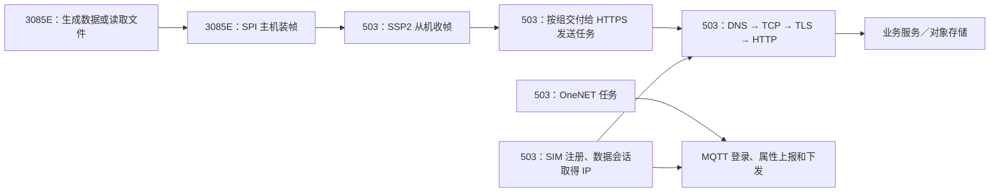

# 从 STM32 到 ATS3085E + UMA503 联网开发

适合已经做过 STM32 外设和 C 开发、第一次读多任务 SDK 和网络代码的人。建议按 8 周、每周 5～7 小时安排。每周以验收题决定是否继续，已经熟悉的部分可以直接做题。

范围是当前 ATS3085E 与 UMA503-V7 的板间通信、蜂窝接入、HTTPS 上传和 OneNET。3085E 以 `D:/ats3085e` 为准，503 以 `D:/UMA503/UMA503-V7_OPENCPU_OC_2025.03.14_1644` 下有 Git 历史的开发工程为准。另一个同名 SDK 可用来找厂商原始 Demo。两边工作区都存在未提交修改，学习笔记请标注依据是 Git 提交还是当前源码。这里的代码定位来自静态阅读，板上练习需要对应版本的配套固件。

## 先认识两条路

同一段录音可能先被切成 **云端上传的 part**，每个 part 在板间又被切成 **SPI 组和 DATA 块**。TCP 还会按自己的机制传输字节流。先把三个边界画出来，再读代码中的 `index`、`offset`、`len`。调试时分别记录 SPI 结果、HTTP 状态码、业务结果。比如收到一组数据、对象存储接受 PUT、业务端确认录音完成，对应三个可独立观察的事件。

## 第 1 周｜会进入两套工程

- **学什么**　把 STM32 CubeIDE 里帮你做的事摊开。CMake 或 Makefile 决定编哪些源文件，编译器把各文件变成 .o，链接器生成 ELF，打包工具生成烧录包。认得 include 路径、条件编译、Kconfig、板级配置、链接脚本和 map。板级外设定义和软件功能开关先各追一个。
- **去哪里看**　3085E 从应用目录的 `CMakeLists.txt`、`prj.conf`、`boards` 进入，工程内 Zephyr 的 VERSION 是 2.7.0，以厂商 SDK 中实际定义为准。503 从 `startup/app_release` 的构建脚本和 `demo/Makefile` 进入，本地资料搜《UMA50X系列 OpenCPU SDK_开发指导V1.0》。已有复盘第 8 节记录板型和打包步骤。 [ATS 应用编译清单](../TAG_ZS3085E_241230/application/bt_watch_no_psram/src/main/CMakeLists.txt) · [503 Demo 编译清单](/D:/UMA503/UMA503-V7_OPENCPU_OC_2025.03.14_1644/startup/app_release/demo/Makefile) · [本地构建复盘](ATS3085E与UMA503_OneNET及HTTPS上传调试复盘_20261119-23.md#build) · [Zephyr 的 Devicetree 和 Kconfig](https://docs.zephyrproject.org/latest/build/dts/dt-vs-kconfig.html)
- **做到什么程度**　能从 Shell 命令找到 C 入口及源文件为何参与编译。条件允许时，在学习副本中改一条启动日志，构建并通过版本标记确认烧上的是新包。能用 ELF 或 map 查一个函数属于哪个目标文件。CMake 语言和链接脚本先学到能看懂现有配置。

## 第 2 周｜补 C 内存、回调和 RTOS

- **学什么**　数组与指针、字节数与元素数、定长整数、位运算、小端序、结构体填充、栈和静态区、缓冲区生命周期。把 STM32 的“中断置标志，主循环处理”推广到“中断通知、任务唤醒、任务消费”。学优先级、栈、信号量、互斥锁、超时和生产者／消费者。DMA 还涉及缓冲区何时可重用、对齐及缓存可见性，先理解所有权，再看优化。
- **去哪里看**　先追 3085E 的 `sfile_wait_ready`，再追 503 的组交付代码和 OneNET 的 `OSATaskCreate`。厂商资料看《OpenCPU 系统通用API》《OpenCPU 内存接口应用API》，Zephyr 文档按 Threads、Interrupts、Semaphores、Mutexes 顺序读。 [ATS READY 等待](/D:/ats3085e/TAG_ZS3085E_241230/application/bt_watch_no_psram/src/main/spi_link_file_host.h:117) · [503 数据组交付](/D:/UMA503/UMA503-V7_OPENCPU_OC_2025.03.14_1644/startup/app_release/demo/spi_link_file_slave.h:152) · [503 OneNET 任务创建](/D:/UMA503/UMA503-V7_OPENCPU_OC_2025.03.14_1644/startup/app_release/demo/onenet_bootstrap.c:378) · [Zephyr 内核服务](https://docs.zephyrproject.org/latest/kernel/services/index.html)
- **做到什么程度**　能用 C 把一个 uint32_t 按小端放进 4 字节再读出来。能指出每个重要缓冲区在哪分配、交给谁、什么时候能写下一组。画出主机线程、503 DMA／收包和网络消费的三条时间线，标出哪里可以等待、哪里会超时。

## 第 3 周｜只把数据送到 503 RAM

- **学什么**　SPI 的 CS、SCLK、MOSI、MISO、CPOL／CPHA 和全双工，READY GPIO 的握手作用，DMA 单次与环形描述符的区别。再学二进制帧的头、长度、载荷、帧校验，最后学控制请求、ACK 匹配、位图补块、BUSY 和整份校验。先读单笔收发，再加双槽和环形 DMA。
- **去哪里看**　从 `spi2ram` 和 `spi2deliver` 的 Shell 入口出发，按 `sfile_exchange → sfile_send_data → sfile_send_body → sfile_control` 找函数，再找 503 `demo_spi.c` 引入的接收实现。《扫盲》的第二篇适合此时对照字节。Git 先看角色对调 `b05dbd4`，再看 `3f15579` 的协议和 `46d8250` 的 BUSY。 [Shell 命令表](/D:/ats3085e/TAG_ZS3085E_241230/application/bt_watch_no_psram/src/main/system_app_shell.c:2001) · [帧协议头](../TAG_ZS3085E_241230/application/bt_watch_no_psram/src/main/spi_link_file_protocol.h) · [503 接收入口](/D:/UMA503/UMA503-V7_OPENCPU_OC_2025.03.14_1644/startup/app_release/demo/demo_spi.c:246) · [扫盲](codex://threads/01a205cf-fc86-7383-8418-5e082b2c870f) · [板间调试复盘](ATS3085E与UMA503_SPI提速与实机调试复盘_20261116-19.md)
- **做到什么程度**　能画出一笔 CS 期间双向时钟和数据，并解释为何一次 MISO 上的内容可能是已经准备好的回执。能从 48,001 B 算出前 100 块占 48,000 B、最后一块 1 B。用配套测试固件和逻辑分析仪观察一笔收发。任选一次缺块或 BUSY，先预测下一帧，再用日志、波形或离线测试验证。 [READY 测试用例](../tests/test_spi_ready_v7.py)

## 第 4 周｜把电脑当成第一台网络设备

- **学什么**　IP 地址、端口、域名与 DNS、客户端／服务端、TCP 与 UDP、socket。会解释 TCP 建连、读写、超时、关闭。TCP 是字节流，一次读取的长度由当时可用数据等因素决定。应用需要用长度、分隔符或协议规则确定消息边界。网关、NAT、IPv4 私网地址学到能理解设备主动连外部服务即可。
- **去哪里看**　Python 官方 `socket` 文档先看例子和 `send`、`recv`，然后对照厂商原版 `demo_socket_net.c` 与《OpenCPU Socket网络通信API》。RFC 9293 可查连接和关闭语义。 [Python socket](https://docs.python.org/3/library/socket.html#example) · [TCP 规范](https://www.rfc-editor.org/rfc/rfc9293.html) · [503 Socket Demo](/D:/UMA503/UMA503-V7_OPENCPU_OC_2025.03.14_1644/startup/app_release/demo/demo_socket_net.c) · [Wireshark 使用手册](https://www.wireshark.org/docs/wsug_html/)
- **做到什么程度**　在 Windows 用 Python 在 `127.0.0.1` 跑 TCP 客户端和服务端，客户端发一小段二进制，服务端每次最多读 3 B，累计到预期长度再输出。抓本机回环流量，找 SYN 与双方端口。把客户端端口参数改到一个无监听的测试端口，记录连接失败和已连接后的读取超时有什么不同。

## 第 5 周｜503 独立联网，逐层建立证据

- **学什么**　SIM 就绪、蜂窝注册、APN、数据上下文（工程常称 PDP）、设备获得 IP、DNS 解析、TCP 连接。AT 是从外部发命令给模组，OpenCPU 是在模组上运行 C 应用。早期 UART+AT HTTP GET 帮你认识状态回包，现有 SPI 上传要追 503 OpenCPU 中真正执行联网的代码。
- **去哪里看**　本地《UMA50X系列 TCP、UDP、SSL应用指导V1.2》和《OpenCPU Socket网络通信API》，对照 503 的联网日志与 `https_connect`。前期 UART 障碍从 3085E Git `740c083` 和接入复盘查，蜂窝注册判断看网络复盘第 4 节的第 03 项。 [UART 接入复盘](UMA503-V7_接入ATS3085E_全程BUG复盘.md) · [503 DNS 和 TCP](/D:/UMA503/UMA503-V7_OPENCPU_OC_2025.03.14_1644/startup/app_release/demo/spi_link_https.c:242) · [LTE 注册复盘](ATS3085E与UMA503_OneNET及HTTPS上传调试复盘_20261119-23.md)
- **做到什么程度**　在自己的开发板和测试环境中，先只验证 503 接入与 socket。整理一张“看到的证据／第一个失败的阶段／下一步看哪里”表，分别写出已注册却没 IP、有 IP 但解析失败、解析成功但连不上三种情况。能解释为什么 PC 上一次请求成功只能证明 PC 那一侧。

## 第 6 周｜HTTPS 与文件上传

- **学什么**　URL 中的主机、端口、路径和查询参数，HTTP 方法、状态码、头、正文、Content-Length 与 chunked。TLS 先学握手、CA、证书链、域名校验、设备时间和随机数作用。能区分 socket 写入、TLS 短写、HTTP 响应和业务状态。加密算法先学用途和边界。
- **去哪里看**　先看 503 `spi_https_open`、`spi_https_write`、`spi_https_finish`，对照本地《OpenCPU HTTP(S)功能应用API》理解 API 层次。HTTP 规范先读请求方法、消息体长度，TLS 看本地网络复盘的证书错误案例。 [503 HTTPS 实现](/D:/UMA503/UMA503-V7_OPENCPU_OC_2025.03.14_1644/startup/app_release/demo/spi_link_https.c:350) · [HTTP 语义](https://www.rfc-editor.org/rfc/rfc9110.html#name-methods) · [HTTP/1.1 消息体长度](https://www.rfc-editor.org/rfc/rfc9112.html#section-6.3) · [curl 手册](https://curl.se/docs/manpage.html)
- **做到什么程度**　先在电脑对自己的 HTTP 测试服务发送一小段正文，能从客户端输出认出方法、头、字节数和状态码。再跟 503 的代码，画出从 DNS 到读响应的路径。用已有日志解释 TLS 校验失败、HTTP 403、HTTP 2xx 但业务还未确认三种情况，分别找到首个应查看的返回值。

## 第 7 周｜OneNET MQTT

- **学什么**　Broker、客户端 ID、Topic、订阅和发布、QoS、Keep Alive、掉线重连、消息回调。理解 OneNET 的属性 JSON 和平台回执属于业务约定。用 PC 和本地测试 Broker 练发布、订阅、断开与重连，再看 503。
- **去哪里看**　先读厂商《OpenCPU MQTT功能应用API》，再看 `onenet_bootstrap.c` 的订阅、上报及状态等待，最后看 `onenet_downlink.c` 如何处理下发。 [503 订阅及属性上报](/D:/UMA503/UMA503-V7_OPENCPU_OC_2025.03.14_1644/startup/app_release/demo/onenet_bootstrap.c:235) · [503 下行处理](/D:/UMA503/UMA503-V7_OPENCPU_OC_2025.03.14_1644/startup/app_release/demo/onenet_downlink.c) · [MQTT 3.1.1 规范](https://docs.oasis-open.org/mqtt/mqtt/v3.1.1/os/mqtt-v3.1.1-os.html)
- **做到什么程度**　能按日志区分已连接、已订阅、已发布和平台已应答。独立解释“在线，为何属性下发没有生效”，指出接下来检查 Topic、接收回调、JSON 字段还是业务回执。

## 第 8 周｜读懂业务上传，练复盘和小改动

- **学什么**　HTTP POST 的业务 init、签名和临时 PUT 地址、分片偏移和长度、complete、限时重试、幂等和恢复。顺着一个逻辑文件 ID 画清成功、断线、回包丢失时设备端和服务端各自记住了什么。理解 CRC 用于检查传输差错，HMAC 用共享密钥做消息认证，TLS 保护网络会话。
- **去哪里看**　先看 `tools/lifeiot_direct.py` 的 PC 参考流程，再看 `tests/test_recording_multipart_p4.py` 的恢复场景，最后读当前工作区的 `p4_upload_run` 和 `spi_link_p4.h`。本地当前工作区里 P4 代码正在演进，复盘中已实测的版本按其版本说明对照。 [PC 参考脚本](../tools/lifeiot_direct.py) · [离线分片测试](../tests/test_recording_multipart_p4.py) · [当前 P4 编排](/D:/ats3085e/TAG_ZS3085E_241230/application/bt_watch_no_psram/src/main/p4_upload.c:228) · [P4 与 SPI 适配](../TAG_ZS3085E_241230/application/bt_watch_no_psram/src/main/spi_link_p4.h)
- **做到什么程度**　能讲清“服务端已经收到 PUT，设备在读响应时断线”该查什么。沿着两个板子的日志找出最后一条成功证据，提出一个可复现的验证。最后在学习副本里独立加一条阶段日志，评估它的运行上下文、打印频率及对时序的影响，然后用原有测试或配套实机证据排查回归。

## 工具和资料怎么用

| 工具 | 什么时候用 | 先掌握的操作 |
|---|---|---|
| Codex 本地读代码 + Git | 从一个命令追到两边实现，复盘旧设计 | 看 `git show --stat b05dbd4`、`git show --stat 46d8250`，再按路径看差异。记录仓库、提交及符号 |
| VS Code C/C++ 或 clangd | C 头文件、宏和调用关系跳转 | 先从现有 VS Code 配置试跳转。若用 clangd，需要实际构建的 `compile_commands.json` 或等效编译参数，使头文件、宏和目标架构一致 |
| 串口终端、逻辑分析仪 | 串口日志和 CS／CLK／MOSI／MISO／READY 时间线 | 给两边日志加同一个会话编号，先对上第一笔事务，再定位首个异常 |
| Python、curl、Wireshark | 在电脑把 TCP 和 HTTP 单独跑通 | 熟悉回环实验、curl 详细输出和 Wireshark 的 Follow TCP Stream |
| Context7 | 查有明确版本的公开库文档 | 作为可选资料插件。厂商 API 和炬芯定制行为从本地 SDK、编译参数和厂商手册取证 |
| 自定义 Codex 教学 Skill | 同一套讲解和验收方法反复用 | 先用下面这段提示词做两课，合适再固化为 Skill |

[clangd 配置说明](https://clangd.llvm.org/installation) · [Wireshark 手册](https://www.wireshark.org/docs/wsug_html/)

### 可直接复制给 Codex 的每课提示词

> 我会 STM32 的 C、GPIO、UART 和 SPI，正在学 RTOS、OpenCPU 和联网。今天只学一个问题，这次从 3085E 的 `app spi2ram` 命令开始。先核对两边 Git 和工作区，再用 STM32 的概念引入，给出入口和到下一层的 3～5 个真实符号，附路径和行号。每一步写清运行上下文、输入输出、缓冲区归属和失败返回。把需要预习的术语控制在 5 个以内，并告诉我对应文档读哪一节。最后给我一个能在 PC 或两块开发板完成的 20 分钟练习，写出可观察的验收标准，先让我预测，再根据我的回答讲解。课程中只读工程。以当前 SDK 为准，区分实际读到的代码、历史实测记录和推断。

### 今天做的第一课

1. 用编辑器打开 3085E 的 Shell 命令表，找到 `spi2ram` 对应的 C 函数，自己把它的参数写成一句话。
2. 跳到 `shell_spi2ram` 和 `sfile_run_generated`，记下测试数据源和块数从哪来，先停在发送逻辑入口。
3. 回答三个问题。谁给 SPI 提供时钟？503 还没准备好时 3085E 在等什么？这个 RAM 模式验收通过时，实际证明了哪一段链路？
4. 用相同方法追两个工作日的历史节点。先看 `b05dbd4` 了解主从分工，再看 `46d8250` 理解为什么收完一组还要等待。

后续扩展可按业务选读炬芯 UI／LVGL、蓝牙音频、503 射频与省电、OTA。眼下可以先把双板上传链路完整走一遍，在每个边界留下日志、波形或测试证据。
