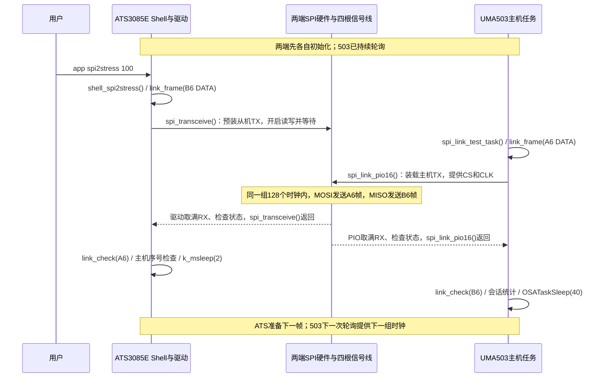

# UMA503-V7 与 ATS3085E SPI 开发全程复盘

整理日期：2026-11-14。适用代码：ATS3085E stress-v7、UMA503 stress-v6，公共线协议为 v6，503 底层传输为 PIO-v5。

本文面向首次接手项目的开发者，按“最终配置 → 开发过程 → 问题证据与修复 → 代码阅读 → 构建烧录 → 验证排错”组织。原两端 `SPI_LINK.md` 的使用、构建和交付说明已并入本文。两仓库 `docs` 下各保留一份相同内容的复盘，方便独立交接；后续修改需同步两份。

**如果你只熟悉 STM32 入门例程，先看[第 24 章执行流程总图](#execution-flow)，再读第 13～23 章，最后回查第 1～12 章。** 教程从你本机的 10-1、10-2、11-1、11-2 原代码出发，不要求先懂 Zephyr、OpenCPU 或 FIFO。第 24 章把开发步骤、两端运行顺序、逐帧交互及 STM32 对照放在一起；正文保留原理和关键代码讲解，完整源码以工程文件为准。

参考结构来自 `D:\ats3085test_备份\UMA503-V7_接入ATS3085E_全程BUG复盘.md`。那份文档主要记录 UART 接入，GPIO53/54、U13、UART 驱动档位等历史结论不能直接移用于这次 GPIO57～60 的 SPI 开发。旧文档第 6.1 节“无法提供完整 SPI”的判断，已被本次 OpenCPU 配置下四线双向通信的实测结果推翻；本文以当前代码与测试证据为准，也不据此推断其他模组版本或原厂 AT 固件具有相同能力。

## 目录

1. [先看结果：现在已经验证了什么](#result)
2. [硬件接线与 SPI 基础](#wiring)
3. [开发阶段和版本关系](#history)
4. [逐项 BUG 复盘](#bugs)
5. [新人阅读代码的顺序](#reading)
6. [16 字节协议与统计判据](#protocol)
7. [503 PIO 寄存器和错误码](#registers)
8. [构建、打包与烧录](#build)
9. [如何复现验证、采集波形](#validation)
10. [证据索引与结论边界](#evidence)
11. [提交 Git 前的文件整理与注释约定](#git)
12. [接手后的开发建议](#next)
13. [从四个 STM32 例程重新认识这次任务](#stm32-start)
14. [FIFO 到底是什么，为什么你以前没遇到](#fifo-lesson)
15. [把 STM32 工程翻译成两套 SDK](#sdk-translation)
16. [第一步：像 MySPI_Init 一样准备 ATS 板级资源](#ats-init-lesson)
17. [第二步：从 SwapByte 到 16 字节收发请求](#buffer-lesson)
18. [第三步：沿调用链读懂 ATS 从机驱动](#ats-driver-lesson)
19. [第四步：把 503 主机看成另一份 MySPI](#uma-master-lesson)
20. [第五步：从 W25Q64 指令升级到双方协议](#protocol-lesson)
21. [补课：任务、锁、寄存器、DMA 与构建](#extra-lesson)
22. [其余改动为什么也必须一起理解](#companion-lesson)
23. [参考学习路线的纠偏与阅读顺序](#learning-review)
24. [两端执行流程、函数调用与 STM32 对照](#execution-flow)

<a id="result"></a>
## 1. 先看结果：现在已经验证了什么

**这组硬件和当前固件已经实现 SPI 双向通信，并通过 100 帧、1000 帧连续校验。** 这不是仅凭某一端打印 `ret=0` 得出的结论：两端分别校验接收数据，再由结束帧交换最终统计；逻辑分析仪导出的双向数据也进行了独立 CRC 检查。

| 项目 | 当前基线 |
|---|---|
| 主机 | UMA503-V7，OpenCPU 应用，SSP2 |
| 从机 | ATS3085E，SPI2，`bt_watch_no_psram` 应用 |
| SPI 模式 | Motorola，Mode 3，CPOL=1、CPHA=1，8 位字 |
| 时钟 | 503 配置 812.5 kHz；波形约 800 kHz，具体以实测为准 |
| 帧与间隔 | 每次 CS 有效期间收发 16 字节，轮询休眠约 200 ms |
| 503 收发路径 | SDK `um_spi_init()` 初始化，`spi_link_pio16()` 直接读写 FIFO |
| 3085E 收发路径 | Zephyr `spi_transceive()`，SPI2 从机专用 CPU FIFO 分支 |
| CRC | CRC16/CCITT-FALSE，覆盖前 14 字节 |
| 当前定位 | 诊断及低速连续通信验证；还没有接入业务文件传输 |

用户提供的 v7 配套实机日志包含：

```text
503，22:05:32.603：
SPI STRESS DONE session=1 result=PASS good=1000/1000 bad=0 seq_err=0 missing=0 idle=0 peer_bad=0 peer_gap=0

3085E，22:05:33.038：
SPI STRESS DONE session=1 local=PASS good=1000/1000 bad=0 master_gap=0 io=0 end_sent=3
```

两端结束时间相差约 0.4 秒是合理的：503 收到第一个 END 即汇总，从机还会继续发送其余 END，最多三次。版本号 v7/v6 不一致也不表示协议不兼容：ATS v7 只额外修复了电池消息处理，双方仍使用相同的 `spi_link_stress_v6.h`。

最快验证方式：等 503 出现 `SPI STRESS READY` 或 `SPI STRESS WAIT`，在 **3085E Shell** 输入 `app spi2stress 100`，等待约 21 秒，检查两端 PASS 和全部错误计数。正常结束后可继续 `app spi2stress 1000`，约 3.5 分钟；无需每轮重启 503。

<a id="wiring"></a>
## 2. 硬件接线与 SPI 基础

### 2.1 接线表

| ATS3085E 引脚 | 3085E 角色 | UMA503 开发板信号 | 信号方向 |
|---|---|---|---|
| GPIO57 | SPI2_SS，硬件片选输入 | PCM_SYNC | 503 → 3085E |
| GPIO58 | SPI2_CLK，时钟输入 | PCM_CLK | 503 → 3085E |
| GPIO59 | SPI2_MISO，从机发送输出 | PCM_DIN | 3085E → 503 |
| GPIO60 | SPI2_MOSI，从机接收输入 | PCM_DOUT | 503 → 3085E |
| GND | 地 | GND | 必须共地 |

这里的“59”沿用本次调试中 GPIO59 的编号，不要脱离板卡原理图把它换算成模组焊盘号。PCM_DIN/PCM_DOUT 是板上丝印或原功能命名，进入 SSP2 复用后作为 SPI 数据线使用。DIN 从 **503 的视角** 表示输入，因此接从机的 MISO 输出；不能因两端命名不同而交换两根数据线。

GPIO57 原来被电机 PWM 占用。本次同时关闭振动设备配置、移除电机对该引脚的分配，并给振动 UI 增加设备为空的保护。GPIO59 使用 `MFP_SPI2`，当前代码将驱动强度设置为 3；实际 SPI 引脚快照可见 `57=3103 58=3103 59=3103 60=3103`。

### 2.2 一帧不是“先发送完，再让对方返回”

503 负责产生 CS 和 CLK，每来一个有效采样时钟，两边各接收一位，同时各发送一位。3085E 必须在主机时钟到来之前准备好 TX FIFO。已经错过的首字节，不能靠事后补写发送缓冲区追回。

```text
503：构造 A6 帧 → 开启 SSP2 → 装入 TX FIFO → 产生时钟 → 读 RX FIFO → 校验 B6 帧
                                      │ 同一组 128 个时钟 │
3085E：构造 B6 帧 → 预装 TX FIFO → 等待 CS/CLK → 收到 A6 帧 → 校验 → 准备下一帧
```

因此 DATA 中的从机错误统计只能反映此前已完成的接收。最后一个 DATA 传完后，再构造 END，才能报告最后一次接收是否出错。503 在时钟结束后读取 FIFO，是取出刚才已经采到的数据，不是额外启动第二次 SPI 事务。

### 2.3 为什么 00/FF 不能单独说明故障原因

- `FF` 表示解码器在相应采样时刻读到的位全为 1；`00` 则全为 0。可能是有效测试图案，也可能是没有输出、悬空/上拉/下拉、接线异常、模式设置错误或没有赶上从机准备窗口。
- 软件缓冲区打印 FF，不等于导线上一定是 FF。必须把同一次 CS 内的波形与软件日志对应起来。
- 单帧命令只准备一次输出。某一帧正确、后面恢复 FF，可能只是命令已经完成。
- 当前 stress 固件未开始会话时把全 FF 作为空闲；已经进入会话后出现 FF 会计入 `idle`，最终严格判失败。

<a id="history"></a>
## 3. 开发阶段和版本关系

历史版本标签来自日志和代码中的诊断标记，不等同于每一步都有独立 Git 提交。旧调试包已在整理中清理，不应再用旧包名判断当前烧入的版本；以启动日志及当前产物为准。

| 阶段 | 主要工作 | 得到的结论或遗留问题 |
|---|---|---|
| 初始四线接入 | 3085E 从机接收可见数据，反向发送常见 FF/00 | 单向接收成功不能证明全双工成功 |
| ATS 预装与 diag-v2 | 释放 GPIO57，配置 GPIO57～60；预装 TX FIFO；修正超时及完成判定 | 消除板级占用和从机驱动中的确定问题 |
| 503 旧 SDK 收发诊断 | A0～AF 主机图案，A5/5A 接收缓冲区预填；持续使用与重初始化对照 | 接口成功返回仍不能解释软件读值与波形不一致 |
| 接线和测量核对 | 同一根线两处测量曾不一致，换线后恢复一致 | 先确认测量通路，再据波形判断软件 |
| 2055/2056 固定图案 | test0 对应 16 个 00，test1 对应 B0～BF | 从机在这些采样事务中确实把数据送上 MISO；503 读数仍有问题 |
| PIO-v4 | 绕过原传输接口，但在 SSP 未使能时写入数据 | 首次传输即 `ret=-103 n=0`，任务停止，方案失败 |
| PIO-v5 | 参考非 DMA 路径，修正使能顺序及 FIFO 控制，加入状态/数量/超时检查 | 固定图案的软件结果与波形吻合，但仍需连续、可检错的测试 |
| stress-v6 | 会话、变化图案、CRC、双向序号、END 最终统计 | 双端 100 帧、1000 帧 PASS |
| ATS stress-v7 | 修复 USB 读卡模式的电池通知及蓝牙未就绪上报 | 再跑 1000 帧 PASS；电池事件再次触发时未再报原错误 |
| 提交前整理 | 清理历史产物、补函数头/逐句注释、对齐注释、整合文档 | 此轮为可读性整理，不改变已验证的通信控制逻辑 |

本次成功来自板级配置、从机驱动、主机收发实现、测量通路及测试判据逐步收敛。不能把整段过程归结为“只是线坏了”“只是驱动强度”“只是用户发晚了”或“已确定是 DMA 缓存错误”。

<a id="bugs"></a>
## 4. 逐项 BUG 复盘

### BUG-01：GPIO57 被原电机功能占用

**现象：** SPI2 计划使用 GPIO57 作为片选，但原板级配置和电机 PWM 也使用这个引脚。

**根因与排查：** 开启 SPI2 只保证外设存在，不能自动消除其他驱动的复用配置。检查 defconfig、`board_cfg.h` 和 `board.c` 后确认冲突。

**改动与理由：** 关闭 `CONFIG_VIBRATOR`/振动驱动配置，板级 `CONFIG_VIBRATOR` 设为 0，移除 GPIO57 的电机 PWM 分配；SPI2 使用 GPIO57～60 的专用复用。振动模块仍可能被 UI 调用，所以 `vibration_start/stop/set_freq` 在设备为空时返回，避免释放引脚后又产生空指针访问。

**验证：** 检查引脚寄存器与 CS 波形；连续通信测试通过。此改动有明确功能代价：该板级构建关闭了原振动功能。后续恢复振动需要重新分配资源，不能直接重新启用 GPIO57 的 PWM。

### BUG-02：从机未充分准备 TX，且超时可能被当作成功

**现象：** 3085E 能接收主机图案，但主机常读到 FF/00，软件返回值不足以说明从机是否完成发送。

**根因与排查：** 从机不能决定外部时钟何时开始。原 CPU 收发流程缺少明确的“先预装、再开始响应”阶段；原超时路径退出循环后仍可能走到返回 0。另一个问题是不能把主机模式下的 BUSY/BC 语义直接当作从机的完成条件。

**改动：**

1. `spi_acts_write_read_data_by_cpu()` 在从机模式下先关闭读写模式，预装不超过 FIFO 容量的发送字节，再开启全双工收发。
2. 收发等待超过约 1 秒返回 `-ETIMEDOUT`，而不是仅打印错误后返回成功。
3. `spi_acts_transfer_data()` 为 SPI2、非 DMA、从机模式建立专用分支，要求有效且等长的双向缓冲区，清除旧错误、开启 FIFO、完成收发后检查 TX FIFO 空及硬件错误。
4. TX 排空额外等待上限约 10 ms。结束时关闭读写与 FIFO；失败时复位，并清空缓存的配置指针，使下次请求重新配置。
5. `transceive()` 每次专用从机请求先重建外设状态。取消驱动文件无条件开启的 `SPI_TEST`，避免启动自测按主机方式干扰外部主机。

**为什么这样改：** 让“准备”“真正完成”“错误退出”都有可观察、可验证的判据。接收到足够字节仍不自动代表发送 FIFO 和错误状态正常。

**验证与边界：** 观察预装状态、TX/RX 数量、引脚快照和 MISO 波形，最终以双向 CRC 连续测试收敛。该专用路径主要验证了 16 字节单块同步收发，不能直接宣布任意长帧、多块异步请求已验证。

### BUG-03：GPIO59 驱动档位与旧 UART 经验混淆

**现象：** 早期沿用“驱动档位填 7”的经验，试图解释反向发送问题。

**排查与改动：** 当前 GPIO59 的设置先用 `~GPIO_CTL_PADDRV_MASK` 清除旧档位，再写 `GPIO_CTL_PADDRV_LEVEL(3)`。SDK 宏的掩码宽度与所核对的数据手册字段定义存在差异，不能只因为宏接受 7 就认定 7 是当前芯片该字段的合法最大值。具体资料索引见第 10 节。

**为什么这样改：** 避免把字段外的位一起带入。SPI 引脚使用当前验证过的 3，保留读回诊断。旧 UART GPIO53 的历史设置未在本次注释整理中改动。

**验证与边界：** SPI 引脚读回及后续收发通过；由于同时存在接线、从机准备和 503 接收路径问题，没有隔离实验能够证明“7 改 3”单独解决了全部故障，也不把档位读回当作模拟电气驱动能力的完整证明。

### BUG-04：同一根线两端的逻辑分析仪结果不一致

**现象：** 通道 5 夹 GPIO59，通道 3 夹 PCM_DIN，按接线应是同一根线，但只有第一段波形一致，后面不同。

**排查：** 先核对实际通道、探头夹点和共地，再检查导线及接触。用户换线后，两处测量恢复一致。这证明此前的测量/连接通路存在问题；仅凭记录不能再细分为某一根探针、接头还是跳线的内部断续。

**为什么不先继续改代码：** 完整且可靠连接的同一电气节点不应长期被测成不同的数字序列。在测量链路未可信前，用两条相互矛盾的波形推导软件时序只会扩大误判。

**拔线问题：** 拔开 GPIO59 与 PCM_DIN 后，两点不再是同一节点。503 输入端可能悬空或被偏置，读 FF/00 不说明从机发送什么。若仍夹在 ATS 的 GPIO59，应同时确认 ATS 已装载发送数据、CS/CLK/GND 仍有效；满足这些条件却测到恒定电平，才继续查从机输出和实际夹点，不能用“503 的接收缓冲区有问题”解释物理引脚没有翻转。

### BUG-05：B0～BF 偶尔出现，其他时间是 FF/00

**现象：** 手工发送 `spi2test1` 后只有一帧符合预期，或者先点击发送再点击采集，抓不到正确图案。

**机制：** 旧 `app spi2test0`/`spi2test1` 是一次性命令，只准备 16 字节，从机等待主机约 1 秒；它不是后台持续发送服务。主机不断轮询时，只有赶上从机已准备的那次事务才有测试图案。

**改进：** 早期先用稳定图案识别线路，之后改为 stress 会话：503 持续等待，3085E 命令触发整轮测试，不再让操作者与启动窗口竞速。抓波形时先启动采集并等待 CS 下降沿触发，再发从机命令。

**证据边界：** 单帧窗口可以解释一部分“偶尔收到”和漏采，却不能解释所有旧故障；尤其 503 已经在第一帧报硬件超时并停止时，再及时发从机命令也无效。

### BUG-06：导线上已经正确，503 软件仍读错

**现象与证据：** `2055.csv` 对应 test0，MISO 有完整 16 个 00；`2056.csv` 对应 test1，MISO 出现 B0～BF。同阶段 503 应用读值仍有 FF 等异常。这个对照将“从机有没有实际输出”和“主机是否把采到的数据正确交给应用”分开了。

**排查：** 503 原来调用 SDK `um_spi_data_transfer()`。使用 A5/5A 预填接收缓冲区以观察覆盖情况，并比较持续使用外设与反复 deinit/init 的结果；这些尝试没有形成稳定的软件接收闭环。

**解决：** 保留 SDK 初始化引脚、时钟和模式；实际传输改为 `spi_link_pio16()`，CPU 直接检查 FIFO、装载与取数，绕过原 DMA 传输调用。该路径有明确的接收数量、状态及超时诊断。

**归因边界：** 可以说“旧 SDK 传输路径存在软件结果与线级证据不一致，PIO 路径规避后通过测试”。不能说已经证明某一个 DMA cache、地址对齐或长度寄存器缺陷。运行底层固件与本地 SDK 资料的版本差异，也是进一步定位厂商内部实现时必须核对的条件。

### BUG-07：首次 PIO-v4 改动本身失败

**现象：** 503 首次 PIO 尝试就报 `ret=-103 n=0`，然后停止；稍后在 ATS 输入命令没有得到期待打印。

**证据：** 日志中主机约 21:11:32 已失败，用户约 21:11:37 才发从机命令。后者确实晚于主机停止，但不能把故障归责为用户发晚；主机自己的第一次传输先失败了。

**原因与修复：** v4 在 SSE=0 时写入 DATAR，并采用不完整的 FIFO 配置。本次 PIO 实现需要参考厂商非 DMA 流程：先配置 FIFO，先使能 SSP，再写 DATAR。v5 同时采用 `FCR=0x000200E7`，读回 TOP/FCR、增加屏障和短暂稳定等待，再有界地写入 16 字节。由于修复涉及多项设置，不能把全部影响归于某一位单独变化。

**重要区别：** ATS 从机“先预装再响应”与 ASR 主机“先使能再写 FIFO”属于不同控制器、不同角色的要求，不是互相矛盾。不能把一个厂商外设的顺序直接照搬给另一个。

**验证：** v5 固定图案阶段记录到的 733 次主机轮询均完成 16 字节收发；其中 33 次从机手工测试与对应图案匹配。轮询序号到 736，中间有串口关闭导致的日志缺段，不能称为完整记录了 736 次。

### BUG-08：固定图案成功不等于连续链路可靠

**现象：** 固定 B0～BF 已能读到，但 `2121.csv` 的采样中仍出现过 MOSI 字节错位图案。一次正确输出不能排除间歇性采样、边沿或帧边界问题。

**改动：** 新增 stress-v6：方向标识、会话号、双向独立序号、变化图案、CRC16、目标数、从机错误统计和 END 帧。

**为什么不能只加 CRC：** CRC 能检查单帧内容，却不能单独说明是否漏掉首帧、中间帧、末帧，或重复计数。主机从期望序号 0 开始统计，END 时补计末尾缺帧；重复/倒序不增加成功数；活动会话内 FF 也计失败。这样才能避免“收到的每一帧都对，但其实漏了很多帧”的假通过。

**验证：** 双端 100 帧和 1000 帧都 PASS；后续 `2210.csv` 两方向各 24 帧的图案、CRC、序号连续性通过。这里只确认后续配置和采样的结果，没有把先前错位的具体电气根因强行归定为某一个软件位。

### BUG-09：没有 END，最后一次接收错误可能无法上报

**问题：** 全双工时，第 N 帧发送的数据在接收第 N 帧之前就已准备。若最后一个 DATA 中上报“截至上一次”的错误数，然后立即结束，最后一次 RX 错误就可能遗漏。

**修复：** 最后一个 DATA 收到并校验后，构造 END，携带最终 `bad + io_errors`、完成数和主机序号缺口。END 最多重复三次；503 用 `last_done` 忽略重复 END，只汇总一次。无 END 或长时间无有效帧，活动会话约 5 秒后 TIMEOUT。

**验证：** 既检查两端 PASS，也检查 END、缺失末帧、重复帧、坏 CRC 等异常统计路径。`local=PASS` 仍不能替代 503 的 `result=PASS`：它主要证明从机接收方向和本地驱动完成情况。

### BUG-10：测试后出现 0x15 和 bluetooth not ready

**现象：** SPI 1000 帧已 PASS，电压/电量变化时另外出现 `error type: 0x15!` 和 `app bluetooth not ready`。

**根因：** `0x15` 是 `MSG_BAT_CHARGE_EVENT`，不是 SPI 错误码。当前 USB 读卡模式的消息循环运行在蓝牙初始化之前，但没有处理这类电池通知；电源管理器又可能过早向尚未就绪的蓝牙应用上报电量。

**ATS v7 改动：**

- `card_reader_mode_check()` 增加该消息分支；电压/容量已由电源管理更新，按通知处理；严重低电事件仍执行系统关机，回调处理保持原流程。
- `_power_manager_work_handle()` 在相应蓝牙功能配置下检查 `bt_manager_is_inited()`，蓝牙未就绪时保留待上报标记，不丢弃更新；后续正常初始化后再上报。其余唤醒锁和低电逻辑继续执行。

**验证：** v7 再次通过双端 1000 帧；22:06:21 电压更新为 4014000 uV、容量更新为 68% 时，未再出现原两类报错。验证重点是“触发同类电池事件后无原错误”，不是只看一段没有电池事件的安静日志。

### BUG-11：烧录了旧应用，或把构建成功误当作交付正确

**风险来源：** `build/app.bin` 与打包目录 `images/app.bin` 可能不是同一版；厂商 `build_app.bat` 最后固定返回 0；完整 ZIP 中还有 system、擦除和 fuse 等项目。

**处理：** 构建后检查日志与新产物，打包显式传入 `-i app=../../../build/app.bin`，核对 ZIP 内 `app.bin` 与当前构建输出相同。本轮应用更新只选择 Group 7 / flash app，保留灰色必需项，不全选擦除或其他镜像。两仓库发布副本放在各自 `artifacts/`，避免在根目录散落多版旧包。

**验证：** 构建、打包完整性检查与实际烧录后的版本打印是三件不同的事。编译通过不等于设备上已经运行新程序。

<a id="reading"></a>
## 5. 新人阅读代码的顺序

### 5.1 先认清两个工程根目录

| 文中缩写 | 本机位置 | 含义 |
|---|---|---|
| A | `D:\ats3085e\TAG_ZS3085E_241230` | ATS SDK 根目录；Git 根目录是其上一级 `D:\ats3085e` |
| U | `D:\UMA503\UMA503-V7_OPENCPU_OC_2025.03.14_1644` | 正在修改和构建的 UMA503 Git/SDK 根目录 |
| P | `U/startup/app_release` | UMA503 应用构建入口 |

不要误进同名但位于 `D:\UMA503-V7_OPENCPU_OC_2025.03.14_1644` 的另一份 SDK。换电脑后路径可以改变，但项目、板级配置和工具链版本要对应。

### 5.2 文件地图

| 文件（相对上述目录） | 阅读重点 | 为什么改 |
|---|---|---|
| `A/application/bt_watch_no_psram/src/main/spi_link_stress_v6.h` | 帧常量、LE 编解码、图案、CRC | 两端共同理解每个字节 |
| `P/demo/spi_link_stress_v6.h` | 与 ATS 文件逐字节一致 | 保证协议不会两端各改各的 |
| `P/app_main/app_main.c` | `app_main_entry()` | 启动链路任务 |
| `P/demo/demo_spi.c` | `spi_link_test_start/task/pio16`、统计结构 | 主机传输与会话判定 |
| `A/application/bt_watch_no_psram/src/main/system_app_shell.c` | `shell_spi2stress()`、命令注册 | 从机启动一轮测试 |
| `A/zephyr/drivers/spi/spi_acts.c` | `transceive()`、`spi_acts_transfer_data()`、CPU 收发 | 从机 FIFO 和真实错误处理 |
| `A/zephyr/boards/arm/ats3085e_dev_watch_ext_nor/board_cfg.h` | `CONFIG_SPI_2`、DMA、振动配置 | 决定设备与路径 |
| 同目录 `ats3085e_dev_watch_ext_nor_defconfig` | SPI、SLAVE、VIBRATOR | 配置编译开关 |
| 同目录 `board.c` | GPIO57～60、GPIO59 档位、电机 PWM | 外设接到实际引脚 |
| `A/application/bt_watch_no_psram/src/launcher/vibration/vibration_ui.c` | 三个振动接口的空设备检查 | 兼容禁用振动的板级构建 |
| `A/application/bt_watch_no_psram/src/card_reader/card_reader_main.c` | `MSG_BAT_CHARGE_EVENT` 分支 | 修复读卡模式电池通知报错 |
| `A/framework/system/power/power_manager.c` | `_power_manager_work_handle()` | 延后蓝牙未就绪时的电量上报 |

建议按下面六步阅读，不必先通读整个厂商 SDK。

### 第一步：协议头，理解“要传什么”

`link_u16()` 和 `link_put16()` 明确采用低字节在前，避免依赖 CPU 本机端序。`link_payload()` 从方向、会话、序号生成可复算的变化值。`link_frame()` 写字段后计算 CRC。`link_check()` 先检查 CRC，再判断方向/类型和图案；会话范围、目标范围、连续性由上层检查。

要分清：CRC 计算顺序、字段的小端存放、SPI 每个字节的位传输顺序是不同层面的约定。不能因为字段低字节在前，就把逻辑分析仪改成 LSB-first。

### 第二步：503 入口，理解“谁在不断发时钟”

```text
app_main_entry()
  └─ spi_link_test_start()             创建任务，静态 4096 字节栈
       └─ spi_link_test_task()         等待约 2 秒，SDK 初始化，检查寄存器模式
            ├─ link_frame(A6, DATA)    主机序号每轮递增
            ├─ spi_link_pio16()       一次 16 字节全双工
            ├─ 检查全 FF / link_check / 会话与序号
            ├─ spi_stress_report()    DONE、TIMEOUT、REPLACED 或 IO_ERROR
            └─ OSATaskSleep(40)       约 200 ms 后继续
```

原来的 `demo_spi_test()` 和回环演示仍保留，但当前入口启动的是 `spi_link_test_start()`。构建中保持 `NO_OC_DEMO`，避免默认演示另起任务同时使用外设。查代码时不要把原来的 1024 字节回环示例误当成当前 16 字节链路测试。

先读任务的初始化和主循环，再读 `SPI_STRESS_STATS`，最后读 PIO 寄存器函数。这样可以先分清“硬件返回错”和“硬件完成但协议校验错”。

### 第三步：3085E Shell，理解“谁发起一轮测试”

```text
app spi2stress [1..1000]
  └─ shell_spi2stress()
       ├─ 解析帧数，默认 100，确认 SPI_2 设备存在
       ├─ 分配非零 session，持有 FULL_WAKE_LOCK
       ├─ 对每个 DATA：构造 B6 → spi_transceive → 校验 A6 → 检查主机序号
       ├─ 每 25 帧打印进度；帧间 k_msleep(2)
       ├─ 构造最终 END，最多发送三次
       └─ 释放唤醒锁，打印 local 判定，返回 Shell
```

`session` 是静态变量，跨命令保留，递增时跳过 0；DATA 序号每轮从 0 开始。主机序号是 16 位，以无符号差值处理 FFFF→0000 回绕，差值为 0 或反向变化记坏帧，正向跳号记 `master_gap`，缺口采用 16 位饱和累计。

为什么同步运行在 Shell 中：当前 ATS 构建 SRAM 已用约 99.66%，不额外创建一个带新栈的测试任务。代价是整轮期间该 Shell 被占用；没有返回命令提示符不代表程序死锁。不要在运行中连续塞多条测试命令。

### 第四步：ATS 驱动，理解“怎么保证从机已经准备好”

从 `spi_transceive()` 进入驱动 `transceive()`，再到 `spi_acts_transfer_data()`，最后到 `spi_acts_write_read_data_by_cpu()`。按以下问题逐项阅读：

| 问题 | 对应代码行为 |
|---|---|
| 为什么每次还要配置？ | 专用 SPI2 从机请求复位外设并清除 `ctx.config`，避免相同配置指针导致跳过实际配置 |
| 为什么要求双向等长？ | 目前每组主机时钟都对应两端各 16 字节；收发长度不等会使完成判据含糊 |
| TX 何时装载？ | 关闭读写模式时先装 TX FIFO，再开启收发 |
| RX 如何结束？ | 从 FIFO 读满请求数量，且 TX 装载数量满足请求 |
| 有多少等待上限？ | CPU 收发约 1 秒；随后 TX 排空约 10 ms |
| 接收完就成功吗？ | 还要查 TX 空、硬件错误；不能忽略错误标志 |
| 出错后怎么办？ | 停止读写/FIFO，复位并使下次重新配置 |

专用处理通过“SPI2 + 非 DMA + 从机”条件限定。其他原 SDK 路径保留，但公共 CPU 函数的真实超时返回和从机预装也应纳入后续 SDK 回归评估。此处日志较多，是保留的诊断手段，后续提速前需要重新评估日志开销。

### 第五步：板级配置，理解“函数为什么会作用在这根线上”

先看 defconfig 是否启用 SPI 和从机，再看 `board_cfg.h` 的 SPI2 实例、DMA=0 和振动关闭，最后看 `board.c` 的 GPIO57～60。最后观察运行日志的 pinmux 快照。仅看源文件某个宏为 1 不足以证明最终固件打开了对应功能，必要时核对构建目录的 `zephyr/.config`。

### 第六步：v7 电源补丁，理解“测试期间的其他日志”

USB 读卡模式提前进入消息循环，因此电池通知可能发生在蓝牙初始化前。阅读 `card_reader_mode_check()` 的消息 switch，再看电源管理的上报条件，能解释为什么 SPI PASS 后仍可能看到无关错误，也能理解为什么修复必须保留低电关机和待上报状态。

### 5.3 修改需求应该落在哪一层

| 新需求 | 首先修改/检查哪里 |
|---|---|
| 调整帧字段或 CRC 范围 | 两份协议头和两端解析，必须同步 |
| 改目标帧数上限 | `LINK_MAX_FRAMES`、Shell 参数范围、16 位字段容量和统计逻辑 |
| 提高 SPI 时钟 | 503 `cfg.freq`、实际波形、ATS 服务能力；只改从机 `.frequency` 无法产生更快时钟 |
| 缩短轮询间隔 | 503 `OSATaskSleep(40)`、ATS 帧间准备与日志成本，同时重跑连续验证 |
| 长帧或业务负载 | 先设计边界/长度/重传，再改双方缓冲、FIFO服务和校验；不能只把 16 改大 |
| 兼容其他板卡 | 两端 pinmux、GPIO 冲突、寄存器/底层固件版本，不照搬地址常量 |
| 解决电池/蓝牙消息 | 对应业务消息循环与电源管理；先确认错误来源，不直接改 SPI |

<a id="protocol"></a>
## 6. 16 字节协议与统计判据

### 6.1 字节布局

多字节字段均为无符号 16 位、小端。当前帧没有可变长度业务载荷。

| 偏移 | 长度 | 字段 | 503 主机帧 | 3085E 从机帧 |
|---|---|---|---|---|
| 0 | 1 | magic，方向 | A6 | B6 |
| 1 | 1 | type | DATA=1 | DATA=1 或 END=2 |
| 2～3 | 2 | session | 0 | 每轮非零会话号 |
| 4～5 | 2 | sequence | 持续递增的轮询序号 | DATA 为 0～target-1；END 为实际完成数 |
| 6～7 | 2 | bad | 0 | DATA 为此前坏帧数；END 汇总坏帧及 IO 错误 |
| 8～9 | 2 | target | 0 | 本轮目标 1～1000 |
| 10～11 | 2 | gaps | 0 | 从机观察到的主机序号缺口 |
| 12～13 | 2 | payload | 根据本帧字段复算 | 根据本帧字段复算 |
| 14～15 | 2 | CRC | 前 14 字节的 CRC | 前 14 字节的 CRC |

图案算法：

```c
payload = (uint16_t)((seq * 40503u + sid * 97u + magic * 257u) ^ 0xa55au);
```

CRC 参数：poly=0x1021，init=0xFFFF，RefIn=false，RefOut=false，XorOut=0；标准字符串 `123456789` 的 CRC 为 0x29B1。CRC 数值也按小端放入帧尾。

### 6.2 为什么现在的波形不再是 B0～BF

固定 B0～BF 是旧诊断版本。stress-v6 每帧包含变化的会话、序号、图案和 CRC，数据不再恒定。`2210.csv` 中一组实际采样如下：

```text
MOSI：A6 01 00 00 38 00 00 00 00 00 00 00 F4 E7 C3 98
MISO：B6 01 02 00 16 00 00 00 E8 03 00 00 68 F5 7A 5F
```

MOSI：主机 DATA，session=0，sequence=0x0038=56，CRC=0x98C3。

MISO：从机 DATA，session=2，sequence=0x0016=22，target=0x03E8=1000，bad/gaps=0，CRC=0x5F7A。主机在用户发命令前已经轮询，所以双方序号不同是正常现象；要检查的是各自连续性。

### 6.3 一轮会话如何判定

503 在尚无活动会话时收到全 FF，累计空闲，不建立会话。收到通过 CRC、图案和字段范围检查的从机帧后，初始化本轮统计，期望序号从 0 开始。首个可见 DATA 若是 3，就记录缺少 0、1、2，不能把 3 当成“正常起点”。

后续序号比期望值大，差值计 `missing`；比期望值小，计 `seq_err` 且不增加 `good`。END 到来再检查实际完成数，并把目标范围内剩余尾帧补计为缺失。每个有效帧更新从机上报的 `peer_bad` 和 `peer_gap`，最终以 END 中的统计为准。

| 3085E 本地字段 | 通过要求 | 说明 |
|---|---|---|
| `local` | PASS | 本地汇总结论 |
| `good` | 目标/目标 | 接收数据校验通过 |
| `bad` | 0 | 主机帧损坏、重复/倒序等 |
| `master_gap` | 0 | 主机序号缺口 |
| `io` | 0 | 从机驱动失败次数 |
| `end_sent` | 大于 0，正常常见 3 | END 底层传输完成次数，不是对端应用确认次数 |

| 503 主机字段 | 通过要求 | 说明 |
|---|---|---|
| `result` | PASS | 必须同时满足所有条件 |
| `good` | 目标/目标 | 独立且顺序有效的 DATA 数 |
| `bad` | 0 | 帧格式、CRC、图案或字段范围异常 |
| `seq_err` | 0 | 重复/倒序 |
| `missing` | 0 | 首部、中间和末尾缺帧 |
| `idle` | 0 | 活动会话中的全 FF |
| `peer_bad` | 0 | 对端接收/IO 错误汇总 |
| `peer_gap` | 0 | 对端观察到的主机序号缺口 |

没有通过校验的数据不用于建立可信会话。没有活动会话时的坏帧计入 `outside_bad`，用于诊断，不自动归入未来一轮。若 503 从未收到任何有效从机帧，它可能一直 WAIT，而不会凭空知道用户已经发过命令；此时必须看 ATS 端的超时结果。

若活动会话被新 session 替换，旧会话输出 REPLACED/FAIL；约 5 秒无有效帧则 TIMEOUT/FAIL。当前诊断协议没有应答重传业务机制；END 的三次重复只提高结束汇总被看见的机会，不等同于通用可靠传输。

<a id="registers"></a>
## 7. 503 PIO 寄存器和错误码

### 7.1 为什么不能混用 SDK 头文件里的两套位定义

当前直接访问 SSP2 基址 `0xD401C000`，使用 `TOP/FCR/IER/DATAR/STATUS` 这一套布局。`hal/SPI/inc/xllp_SSP.h` 中还存在旧的 `SSCR0/SSSR` 定义；例如旧 SSE 在 bit7，当前 TCR_SSE 在 bit0。只按关键词搜到 SSE 就复制掩码，会操作错误位。

| 偏移 | 当前寄存器 | 本次用法 |
|---|---|---|
| 0x00 | TOP/TCR | bit0 为 SSE；保存原模式，仅切换使能 |
| 0x04 | FCR | `0x000200E7`，RAFC、RFT/TFT=7，关闭 DMA 请求和打包 |
| 0x08 | IER | 写 0x30，按该寄存器的屏蔽语义处理错误 IRQ，关闭其他收发/超时 IRQ |
| 0x0C | TIMEOUT | 布局参考；本函数用 OS tick 做软件截止时间 |
| 0x10 | DATAR | 写入 TX 字节；读取会消费 RX FIFO 中的数据 |
| 0x14 | STATUS | RX ready=bit14，TX space=bit6，busy=bit0，TX level=bits11:7 |

初始化后还检查 `(TOP & 0x1FFE) == 0x0CE0`，限定预期的 8 位 Motorola Mode 3 主机配置，并关闭回环。若不满足就停止，避免在不同 SDK 初始化结果上继续盲写寄存器。

历史诊断快照出现过 `TOP=00062CE1`、初始化 `FCR=00020DEF`；进入 PIO 后改为 `000200E7`。状态寄存器会随 FIFO/忙状态改变，不能要求任意时刻读值都等于某一个历史快照。

### 7.2 `spi_link_pio16()` 的严格顺序

1. 把 `received` 和 trace 清零，检查没有忙、TX 残留、RX 残留，且 TX 有空间。
2. 清 SSE，配置 IER/FCR，然后设 SSE。
3. 读回 TOP/FCR，并执行 `dsb`；读回对象不是 DATAR，避免误取走接收数据。
4. `OSATaskSleep(1)`，本 SDK tick 约 5 ms。
5. 进入短临界区，每次确认 TX 有空间后连续写入 16 字节；记录写入数量及状态，然后立即恢复上下文。
6. 在临界区之外轮询 RX，读满 16 字节。等待共享约 20 tick / 100 ms 截止时间。
7. 确认不忙、TX 队列为空且可写，检查没有第 17 个残留 RX 字节。
8. 统一出口保存状态并清 SSE，返回明确结果。

临界区不能覆盖等待 RX 或 OS tick 的循环，否则依赖中断推进的时钟/调度可能被自己阻断。有界的 16 次写入与最长 100 ms 等待应严格区分。

### 7.3 错误码速查

| 返回码 | 直接含义 | 优先检查 |
|---|---|---|
| 0 | 完成一帧，收发数量和结束状态通过 | 继续看协议 CRC/序号，而非直接宣布整个测试 PASS |
| -101 | 开始前有忙、残留或 TX 不可写 | 是否有其他 SSP2 使用者，前次事务是否异常结束 |
| -102 | 写入过程中 TX 无空间 | FIFO 配置、状态位是否匹配当前控制器 |
| -103 | 未在截止时间内读满 16 字节 | 实际 CS/CLK、使能/装载顺序、trace.sent 和 n |
| -104 | RX 已满但 TX/忙状态未按时结束 | 发送队列和外设状态 |
| -105 | 完成 16 字节后还有 RX 数据 | 帧边界、残留、并发访问 |
| -106 | 配置读回不符合预期 | TOP/FCR 布局与实际 SDK/芯片是否一致 |
| -107 | 无法进入上下文临界区 | OS API 状态及调用上下文 |

503 硬件错误后会打印 IO_ERROR，退出、deinit 并挂起任务；当前没有实现自动恢复，排除原因后需重启 503。普通 DONE、WAIT 或会话 TIMEOUT 与硬件停止不是同一种状态，不能一律要求重启。

<a id="build"></a>
## 8. 构建、打包与烧录

以下命令适用于本机 PowerShell。换电脑时先调整根目录和工具链路径。`artifacts` 是本机输出目录，不提交 Git。执行构建不会自动烧录硬件。

### 8.1 ATS3085E 构建

当前工具链为 Actions Zephyr SDK 1.10 中的 GNU Arm Embedded 9-2020-q2（GCC 9.3.1），构建使用 Python 3.9 及现有 West/Ninja 环境。SDK 工具链根目录位于 `C:\Actions\ZEPHYR_SDK\1.10`。

```powershell
$atsRoot = 'D:\ats3085e'
$atsSdk = Join-Path $atsRoot 'TAG_ZS3085E_241230'
$atsPythonDir = 'C:\Users\PC\AppData\Local\Programs\Python\Python39'
$env:ZEPHYR_BASE = Join-Path $atsSdk 'zephyr'
$env:PYTHONDONTWRITEBYTECODE = '1'
$env:Path = "$atsPythonDir;$atsPythonDir\Scripts;" + $env:Path
New-Item -ItemType Directory -Force -Path "$atsRoot\artifacts" | Out-Null
Set-Location -LiteralPath $env:ZEPHYR_BASE
& "$atsPythonDir\python.exe" .\build.py -s *> "$atsRoot\artifacts\build_check.log"
if ($LASTEXITCODE -ne 0) { throw 'ATS 构建失败，请检查 build_check.log' }
Get-Content "$atsRoot\artifacts\build_check.log" -Tail 20
```

特别注意 `ZEPHYR_BASE`：本机可能继承另一套 `D:\ats308b\zephyr` 的环境。必须明确指向当前工程，不能只因当前工作目录正确就假设环境变量也正确。

`zephyr/.build_config` 当前选择如下；首次使用没有该文件时，运行 `python build.py` 按交互选择同一板卡和应用，再使用 `-s`。

```text
BOARD=ats3085e_dev_watch_ext_nor
APPLICATION=bt_watch_no_psram
SUB_APP=
APP_CONF=
```

输出目录：`A/application/bt_watch_no_psram/outdir/ats3085e_dev_watch_ext_nor/`。其中 `zephyr/zephyr.elf`、`zephyr/zephyr.bin` 用于分析，`_firmware/*.fw` 为烧录封装。文件名中的日期会随构建改变，不能写死旧日期后一直拿旧包。

在本次构建成功的前提下，可以收集最新输出：

```powershell
$atsOutput = Join-Path $atsSdk 'application\bt_watch_no_psram\outdir\ats3085e_dev_watch_ext_nor'
$atsFirmware = Get-ChildItem -LiteralPath "$atsOutput\_firmware" -Filter '*.fw' |
    Sort-Object LastWriteTime -Descending | Select-Object -First 1
if (-not $atsFirmware) { throw '没有找到 FW 输出' }
Copy-Item -LiteralPath $atsFirmware.FullName -Destination "$atsRoot\artifacts\ats3085e_spi_stress_v7.fw"
Get-FileHash -LiteralPath "$atsRoot\artifacts\ats3085e_spi_stress_v7.fw" -Algorithm SHA256
```

整理后的重编译通过：FLASH 1481722 B / 1920 KB，SRAM 929712 B / 911 KB（99.66%）。剩余 SRAM 很少，新任务栈、大局部数组、长帧缓存均应先算预算。既有 Kconfig 或工具链提示需结合实际日志阅读；不能将“进程正常结束”替代链接及固件封装成功检查。

### 8.2 UMA503 构建

应用工具链为厂商配套 GCC 9.2.1，位于 `P/app_tools/cross_tools/gcc-arm-none-eabi`。该大目录被忽略，换电脑需恢复同版本工具链；`P/common/lib/um_app.lib` 等厂商预编译依赖必须保留。

```powershell
$umaRoot = 'D:\UMA503\UMA503-V7_OPENCPU_OC_2025.03.14_1644'
$umaApp = Join-Path $umaRoot 'startup\app_release'
New-Item -ItemType Directory -Force -Path "$umaRoot\artifacts" | Out-Null
Set-Location -LiteralPath $umaApp
cmd /d /c build_app.bat *> "$umaRoot\artifacts\build_check.log"
Get-Content "$umaRoot\artifacts\build_check.log" -Tail 25
Get-Item -LiteralPath "$umaApp\build\app.bin", "$umaApp\build\app.elf", "$umaApp\build\app.map"
```

厂商批处理最后固定返回 0，因此还要确认无编译/链接错误、成功提示、产物存在，以及本次修改相关文件确实参与了构建。当前 `app.bin` 为 24416 字节，编译参数含 `-DNO_OC_DEMO`。文件大小只是辅助识别，不是版本证明；改代码后大小可能不变，应结合哈希和启动标记。

### 8.3 UMA503 打包 ZIP

```powershell
Set-Location -LiteralPath "$umaApp\app_tools\download\aboot_common"
& .\aboot-tools\arelease.exe -q -c .\ -I .\images -g `
    -p ASR1605_EVB -v ASR1605_SMS_04MB_OC `
    -i 'app=../../../build/app.bin' `
    "$umaRoot\artifacts\UMA503_SPI_STRESS_V6.zip" `
    *> "$umaRoot\artifacts\package_check.log"
if ($LASTEXITCODE -ne 0) { throw 'UMA503 打包失败' }
Get-Content "$umaRoot\artifacts\package_check.log" -Tail 15
Get-FileHash -LiteralPath "$umaRoot\artifacts\UMA503_SPI_STRESS_V6.zip" -Algorithm SHA256
```

`-i app=...` 是本次打包最关键的参数：明确使用刚编出来的应用，防止打包脚本取到 `images` 中的旧应用副本。发布前还应检查 ZIP 可解压，并核对其内 `app.bin` 与 `P/build/app.bin` 内容相同。

### 8.4 烧录操作

**503：** 在 ASR/UMA50X Aboot 烧写工具选择 `artifacts/UMA503_SPI_STRESS_V6.zip`。这个 ZIP 是完整发布包，不等于必须全量烧录。

| 界面项目 | 本轮应用更新设置 |
|---|---|
| Release package | 当前生成的 stress-v6 ZIP |
| Group 7 / flash / app / app.bin | 勾选 |
| 灰色 Group 0 项 | 保持工具默认必需项 |
| erase bootloader、flash system、erase userdata/nvm/factory、fuse、flash bootloader | 本轮不勾选 |
| Production mode | 不勾选 |
| USB device only / Auto enable for USB | 沿用此次 USB 烧录连接设置 |
| Display log | 开启，查看烧录结果 |
| Action after finished | 若为 No action，完成后手动复位/重新上电运行应用 |

按工具要求让设备进入下载状态后点 Start，等待明确成功，再启动设备查看版本。这里的“只更新 app”以前期已经正常工作的匹配底层固件和分区为前提；新空片或底层版本迁移需另按厂商发布流程处理。不要把两种任务混为一次全选操作。

**3085E：** 使用该板已有的 Actions 烧录流程加载 `artifacts/ats3085e_spi_stress_v7.fw`，不是把 503 ZIP 给 Actions 工具，也不是把裸 `zephyr.bin` 当作同一种封装。现有资料未在本次记录中完整保存 Actions 工具界面和板级进下载动作，因此此处不编造具体按键组合；沿用这块板此前已成功的 FW 烧录方式，完成后重启并检查下面的版本标记。

**版本确认：**

```text
503 启动：SPI LINK stress-v6: PIO-v5 transport, Mode 3, 812.5 kHz
503 就绪：SPI STRESS READY: send app spi2stress 100 on ATS; waiting until started
ATS 执行命令：SPI STRESS v7 start session=... target=...; UMA503 must run stress-v6
```

`SPI2 diag-v2` 是底层驱动诊断标签，出现在 stress-v7 固件里是正常的；不要据此误判整个固件仍是 v2。

<a id="validation"></a>
## 9. 如何复现验证、采集波形

### 9.1 不依赖操作速度的基本验证

1. 确认四根 SPI 线和 GND；两端运行第 8 节匹配版本。
2. 打开两端串口。本次历史上 COM4 常用于 ATS、COM6 常用于 503，但 Windows 端口号会变化，应以启动打印识别设备，不写死端口号。
3. 等 503 打印 READY/WAIT。此时 `idle_ff` 增长可以是正常等待。
4. 在 ATS 输入 `app spi2stress 100` 并回车，只发送一次。命令不在 503 串口输入。
5. 每 25 帧查看进度，约 21 秒后核对两端 DONE、数量及全部错误计数。
6. 再发 `app spi2stress 1000`，等约 3.5 分钟；同样保存两端从 START 到 DONE 的完整日志。
7. 正常完成后再进行下一轮，确认新 session 和独立统计。若 503 已打印 IO_ERROR/task stopped，先排查并重启 503。

当前主机是 stress-v6，因此不要用 `spi2test1` 作为本轮验收命令。旧 `spi2test/spi2test0/spi2test1` 仍保留，需配旧 A0～AF 固定图案主机；与 stress 主机混用会按预期出现协议不匹配，而不是证明线坏了。

### 9.2 逻辑分析仪设置和时序

| 项目 | 本次建议/已用条件 |
|---|---|
| 信号 | CLK=GPIO58/PCM_CLK；CS=GPIO57/PCM_SYNC；MISO=GPIO59/PCM_DIN；MOSI=GPIO60/PCM_DOUT |
| 解码 | SPI，Mode 3，8 bit，MSB-first，CS 低有效 |
| 采样 | 本次截图为 20 MHz，对约 800 kHz CLK 有约 25 倍采样率 |
| 门限 | 本次截图为 0.9 V；换板或电压域时先确认实际 IO 电平及分析仪规格 |
| 触发 | CS 下降沿；捕获窗口包含完整 16 字节和前后空闲 |
| 操作顺序 | 先开始采集/布置触发，再在 ATS 发测试命令 |

Mode 3 的 CLK 空闲为高，首个跳变为下降沿，第二个跳变即上升沿采样。一个 16 字节帧需要 128 个时钟；约 800 kHz 时占用约 160 μs。若看到“10 μs”对应一个字节而非一位，要先看解码行的单位含义。

当前两方向帧大多都不是全 00 或全 FF。正确性应按“方向 → 类型 → 字段 → 图案 → CRC → 序号”逐层核对，不能只看波形是否变得丰富。导出数据时保留时间、通道和原始字节，便于与同一轮串口 session 对照。

### 9.3 日志速查

| 看到什么 | 说明/下一步 |
|---|---|
| 未发命令，503 WAIT 且 idle_ff 增长 | 处于等待，先在 ATS 发 stress 命令 |
| 会话中 idle>0 | 本轮严格连续测试失败；看该次 CS 时 ATS 是否准备好及线是否可靠 |
| ATS 等约 1 秒报超时 | 检查主机是否在轮询、是否已 IO_ERROR 停止，以及 CS/CLK 是否到达 |
| 波形 MISO 正确但 503 软件错 | 对照同一事务，查主机 FIFO/缓冲区/模式和固件版本 |
| 波形 MISO 恒定 | 查 ATS 是否执行/准备、GPIO59 夹点、pinmux、共地与连接；不能直接归咎主机缓冲区 |
| BAD_FRAME / BAD_RX | 保存原始 16 字节、对应波形和两端统计，查 CRC/字段/位错 |
| good 不到目标、missing>0 | 检查首帧、中间帧和 END；不只统计“收到多少正确帧” |
| 电池、电流、温度、PP 或 Thread runtime 打印 | 不是 SPI 通过/失败判据；结合来源和 SPI 统计判断 |
| error type:0x15 / bluetooth not ready | 检查是否仍烧旧 ATS 版本，以及电池消息修复是否在当前构建中 |
| 只有 ATS local=PASS | 还缺主机接收方向证据，必须看 503 result |
| 只有编译成功 | 还缺打包内容、烧录版本和实机通信证据 |

<a id="evidence"></a>
## 10. 证据索引与结论边界

### 10.1 本次实机材料

原始 CSV 位于本机 `C:\Users\PC\Documents`；原始串口文本保存在本次对话附件目录。为使换电脑后的读者仍能理解结论，本文已收录核心帧、日志和判据。原始数据没有全部复制进源码仓库；复现或深挖某个历史边沿问题仍需保留/取得对应原始文件。

| 证据 | 用途 | 可以支持的结论 |
|---|---|---|
| 2010/2017 波形及对话中的通道对照 | 早期 FF、夹点和接线排查 | 测量通路必须先可信；不能单凭这些早期波形判定 DMA 根因 |
| 2055.csv（test0） | 固定全零输出 | 对应事务中从机 MISO 输出 16 个 00 |
| 2056.csv（test1） | 固定 B0～BF 输出 | 对应事务中从机 MISO 已有完整图案 |
| 21:11 的双方日志 | PIO-v4 失败先后顺序 | 主机先 `-103 n=0` 停止，之后从机命令无主机时钟可等 |
| 21:20～21:23 日志、2121.csv | PIO-v5 固定图案阶段 | 软件接收已有稳定样例，但旧采样里仍有错位，不能据此宣称全链路无误 |
| 21:42:30～21:42:51 双方日志 | v6 100 帧 | 双方 100/100，错误为 0 |
| 21:46～21:49 双方日志 | v6 1000 帧与电池问题 | 双方 1000/1000；另有 0x15 和蓝牙未就绪报错 |
| 22:02～22:06 双方日志 | v7 回归 | 双方 1000/1000；再次出现电压/容量变化时没有原报错 |
| 2210.csv | stress 协议独立解码 | 双方各 24 帧；MOSI 序号 56～79，MISO 序号 22～45、session=2、target=1000；格式/图案/CRC/连续性通过 |

关键日志附件的本机索引（目录位于 `C:\Users\PC\.codex\attachments`，文件均为 `Pasted text.txt`）：

| 材料 | 附件目录 ID |
|---|---|
| PIO-v4 503 / ATS | `93dbf33f-4a23-4707-80ba-01af42de9a05` / `7af44be2-a19c-488b-866f-1865c5535ec7` |
| PIO-v5 503 / ATS | `5cdc2086-4c4b-4f84-86f5-a4639af2500f` / `74a2df1d-3fe0-4bcc-9dac-23b44c8fc267` |
| v6 100 帧 503 / ATS | `441896dc-7040-4cc0-9706-9b97d05db360` / `afccc371-2957-4024-8071-537c02265f60` |
| v6 1000 帧 503 / ATS | `f66380ce-a19b-4795-902e-5e58387db6aa` / `0db8f8e6-7499-409e-b0d5-4be42553ca79` |
| v7 配套 503 / ATS | `287ce1ac-e1c1-428d-ace1-88c1eda9acd3` / `ac14d778-77e1-406e-a277-8066ca48d6f2` |

### 10.2 资料与源码依据

| 资料 | 查阅位置/用途 |
|---|---|
| `ATS3085E Datasheet V1.5 20241230.pdf` | GPIO59_CTL 第 15.4.37 节，PDF 第 312～314 页、印刷页 307～309；PADDRV 见 PDF 第 313 页，bits13:12、编码 0～3，bit14 Reserved |
| `A/zephyr/soc/arm/actions/leopard/soc_gpio.h` | SDK 的 `GPIO_CTL_PADDRV_MASK` 使用 `0x7`，与上述表格的两位字段存在差异；当前 SPI 设置清掩码后写 3 |
| `ASR1605 datasheet V1.0.pdf` | SSP 章节、17.4.7 PIO FIFO 传输；本机在 `D:\UMA503-V7 OC资料` |
| `U/hal/SPI/inc/um_spi_drv.h` | SSP2 基址和 TOP/FCR 等寄存器布局 |
| `U/hal/SPI/inc/xllp_SSP.h` | 区分旧 SSCR/SSSR 与当前 TCR/FCR 位定义 |
| `U/umapi/um_spi/inc/um_spi.h` | 主从、时钟、模式、位宽的 SDK 枚举和接口 |
| UMA50X OpenCPU 硬件外设 API、SDK 开发指导、Aboot 使用说明 | 本机 UMA503 资料包内；用于应用初始化、构建及烧录工作流 |

ATS 手册所在资料包位于 `D:\BaiduNetdiskDownload\308B`。查找时以完整文件名和版本定位。GPIO59 的 **编码 3 对应手册 Level 4**，不是“编码 3 就叫 Level 3”；旧 UART 经验中的“7 档”不可据此继续解释为当前手册定义的合法档位。

资料能说明寄存器意图，源码能说明软件实际写了什么，波形能说明引脚发生了什么，接收日志能说明应用最终拿到什么。四者要相互对应，不能互相代替。

### 10.3 软件验证与实机验证分开记录

此前对实际 C 协议代码和提取的主机会话统计逻辑做过 CPU 仿真检查，覆盖：CRC 标准向量、100 个生成帧与独立 CRC 对照、256 个单比特破坏样例、位错、首/中/末帧丢失、坏 CRC、重复、对端最终报错、主机序号缺口、活动时 FF、缺 END 超时、空闲不误判、1000 帧和连续两轮会话，共 16 项结果通过。

这些检查验证协议及状态逻辑，不模拟真实 SSP 时序、接线、电压或中断延迟，也不替代第 10.1 节的实机证据。临时仿真工具依赖本机环境，未作为可移植测试套件提交；正式 CI 建设是后续工作。

本轮注释对齐只调整行尾注释前的空白，并保留函数头说明；对比整理前后的 C token、字符串和注释内容一致。两端重新构建通过，交付包完成完整性核对。**本轮没有自动烧录或新增硬件实测**；上述硬件结论来自此前用户提交的日志和采样。

### 10.4 当前没有证明的事情

- 没有定位到原 SDK DMA 内部某一条具体错误指令或某一个确定缓存缺陷。
- 没有验证最大 SPI 速率、长帧、大吞吐、多任务共享或长期异常恢复。
- 1000 帧零错不等于任何线长、温度、电源条件下都保证零错。
- 当前约每 205 ms 一帧、每方向 16 字节，对应约 78～80 B/s；它是低负载诊断。SPI 线上约 800 kHz 并不意味着应用已达到约 100 kB/s 的原始字节速率。
- 没有实现通用业务封包、文件分片、确认重传或生产级断链恢复。

<a id="git"></a>
## 11. 提交 Git 前的文件整理与注释约定

### 11.1 保留与排除原则

保留实际修改的源码、公共协议头、板级配置和本复盘。厂商预编译 `.a/.lib`、工具程序、资源和底层镜像是构建或运行依赖，不能按扩展名一刀切删除。原 UART 业务和其他 SDK 模块保留，未因本次 SPI 开发而清空。

旧测试 ZIP/FW、`.before_*`、`.bak_nomotor`、散落日志、Python 缓存和依赖本机临时路径的草稿已清理。当前可烧录副本统一放在各仓库 `artifacts/`；哈希、构建日志也放在该目录，由 `.gitignore` 排除。

UMA503 下列五项已从 Git 跟踪中移除，但本机可由构建重新生成并保留：

```text
startup/app_release/app_main/build/app_main.lib
startup/app_release/demo/build/demo.lib
startup/app_release/demo/lcd_drive/build/lcd_drive.lib
startup/app_release/third_party/mbedtls/build/mbedtls.lib
startup/app_release/app_tools/download/aboot_common/images/app.bin
```

它们在提交前可能显示为已暂存删除，这是取消跟踪生成物，不代表删除了厂商唯一可用库。`common/lib/um_app.lib` 等必需依赖仍保留。`SPI_LINK.md` 改为导航入口，只链接本复盘，避免维护两套重复说明。

### 11.2 注释风格

相关函数采用接近 STM32 库函数的函数头：`@brief` 写作用，`@param` 逐个说明参数与输入/输出约束，`@retval` 说明返回值，`@note` 记录硬件独占、超时或使用前提。

```c
/**
  * @brief  将 16 位字段写为小端字节序。
  * @param  p 指向至少 2 个可写字节。
  * @param  n 待写入的字段值。
  * @retval 无。
  */
```

行尾注释规则：同一相关函数的注释统一到该函数最长代码行之后，保留至少 4 个空格；`return`、分支和多行调用的行尾注释也纳入同一列。宏定义、结构体成员、SPI2 引脚组分别统一对齐。对齐用空格，避免编辑器 Tab 宽度改变后错列。独立的段落注释和函数头保持原有位置，不人为推到代码右边。

本次处理 11 个 C/H 文件、50 组、488 处行尾注释。范围是本轮 SPI 及配套修复涉及的函数/声明，不对整个 SDK 做无关格式化。两份协议头保持逐字节一致。

### 11.3 提交前检查

分别在两个 Git 根目录查看：

```powershell
git status --short
git -c core.whitespace=cr-at-eol diff --check
git diff --stat
git diff --cached --stat
```

这些 SDK 源文件原本使用 CRLF，当前仓库 `core.autocrlf=false`。检查命令显式接受行末 CR，避免把每行的 Windows 换行误报为尾随空白；该参数只作用于这一次命令，不修改用户的 Git 配置。暂存后同样可加 `--cached` 检查。

检查新协议头和复盘已纳入预期提交范围，构建产物没有混入；审阅上述五项生成物的取消跟踪。注释整理没有替用户执行 commit 或 push。既有工作区改动（例如编辑器设置）需按实际提交意图审阅，不能把全部差异都当成新 SPI 功能。

构建有时会重写字体静态库的归档元数据。此次比较归档成员确认对象内容一致后消除了这类无关差异；后续遇到类似情况，先比较库成员和内容，不可直接覆盖可能含真实变更的库。

<a id="next"></a>
## 12. 接手后的开发建议

先复现当前 100/1000 帧双端 PASS，保存版本、哈希、接线照片和完整日志，作为下一阶段基线。之后一次只改变一个关键条件，才能区分“协议改坏了”和“提高负载后暴露时序问题”。

| 阶段 | 应完成的工作 | 验收重点 |
|---|---|---|
| 保持基线 | 当前 16 字节、约 200 ms 轮询，两轮独立会话 | 双向 CRC、序号、END、全部计数 |
| 接业务数据 | 定义帧头、版本、长度、命令、序号、载荷、CRC和错误响应 | 长度边界、错帧重同步、幂等与重传规则 |
| 提升速率 | 逐步缩短间隔/提高时钟，减少诊断输出，测 CPU 与 FIFO 服务延迟 | 不只看吞吐，还看 CRC、丢帧、占用和功耗 |
| 减少忙等 | 评估 IRQ/DMA 或 ready 握手，核对实际底层固件/SDK版本 | 可恢复错误、线程安全、长帧服务能力 |
| 产品化 | 明确接口所有权、启动/停止/复位流程、掉线恢复与资源预算 | 多次重启、断线、噪声、电源变化和长期运行 |

若再出现 FF/00，按这个顺序缩小范围：**版本 → 接线/共地 → CS/CLK → 从机准备与 pinmux → 同一事务的 MISO/MOSI → FIFO/应用读值 → CRC/会话统计**。不要跳过中间证据，直接重写整个驱动。

<a id="stm32-start"></a>
## 13. 从四个 STM32 例程重新认识这次任务

### 13.1 先纠正例程编号，避免从错误的类比开始

本节实际核对了以下目录中的代码，而不是按一般教程猜测：

```text
D:\BaiduNetdiskDownload\STM32入门教程资料\程序源码\程序源码\STM32Project-有注释版
├─ 10-1 软件I2C读写MPU6050
├─ 10-2 硬件I2C读写MPU6050
├─ 11-1 软件SPI读写W25Q64
└─ 11-2 硬件SPI读写W25Q64
```

11-2 的 `Project.uvprojx` 明确选择 `STM32F103C8`。本文对 STM32 缓冲结构的说明专指这份 F103 例程，不概括所有 STM32 系列。

| 例程 | 你写的底层是什么 | 谁产生线上的时序 | 外部芯片帮你做了什么 |
|---|---|---|---|
| 10-1 | GPIO 拉 SCL/SDA，自己实现起止和 ACK | CPU 逐步改 GPIO | MPU6050 已实现 I²C 从机及内部寄存器 |
| 10-2 | 配 I2C2，再等 EV5/EV6/EV8 等事件 | STM32 I²C 控制器 | 同上 |
| 11-1 | GPIO 拉 SS/SCK/MOSI，逐位读 MISO | CPU 逐步改 GPIO | W25Q64 已实现 SPI 从机及 Flash 指令 |
| 11-2 | 配 SPI1，等待 TXE/RXNE，读写 DR | STM32 SPI 控制器 | 同上 |
| 本次 | 503 主机收发实现 + ATS 从机驱动和应用 | 503 SSP2 控制器 | 没有 W25Q64 替我们处理另一端，双方软件都由我们准备 |

因此，本次不是把 `MySPI_Init()` 换个名字这么简单。你以前只负责“控制 STM32，让一个现成 SPI 设备按手册回应”；这次要同时负责“主机何时发、从机何时准备、两边怎样理解数据、失败怎样发现”。

### 13.2 从你熟悉的 main 开始，而不是从寄存器地址开始

11-2 的应用顺序可以压缩为下面这段教学摘录：

```c
W25Q64_Init();
W25Q64_ReadID(&MID, &DID);
W25Q64_SectorErase(0x000000);
W25Q64_PageProgram(0x000000, ArrayWrite, 4);
W25Q64_ReadData(0x000000, ArrayRead, 4);
```

你不需要在 `main()` 中知道每个时钟边沿。`W25Q64.c` 负责设备指令，`MySPI.c` 负责交换字节，标准库再负责操作 STM32 寄存器。你已经接触了分层，只是文件少、名字熟悉，所以没有特别注意这件事。

当前工程也是分层：

```text
STM32 应用：main → W25Q64_ReadData → MySPI_SwapByte → 标准库 → SPI1 寄存器

503 应用：app_main_entry → 创建 spi_link 任务 → 构造协议帧
                                           → spi_link_pio16 → SSP2 寄存器

ATS 应用：Shell 收到 app spi2stress → shell_spi2stress → 构造协议帧
                                         → spi_transceive → Actions 驱动 → SPI2 寄存器
```

两套 SDK 的“层”不必数量相同。503 当前直接寄存器收发函数写在应用文件里，所以它实际上承担了部分底层驱动职责；ATS 则在厂商驱动中修复从机路径。位置不同，但它们最终都必须读写硬件。

### 13.3 11-1 和 11-2 究竟替换了什么

11-1 的 `MySPI_SwapByte()` 逐次写 MOSI、拉高 SCK、读 MISO、拉低 SCK，循环 8 次。没有配置 SPI1，也没有向 SPI1 数据寄存器写入，所以没有用到 SPI 控制器的硬件缓冲。

11-2 的同名函数却只有这几个关键动作：

```c
uint8_t MySPI_SwapByte(uint8_t ByteSend)
{
    while (SPI_I2S_GetFlagStatus(SPI1, SPI_I2S_FLAG_TXE) != SET);
    SPI_I2S_SendData(SPI1, ByteSend);
    while (SPI_I2S_GetFlagStatus(SPI1, SPI_I2S_FLAG_RXNE) != SET);
    return SPI_I2S_ReceiveData(SPI1);
}
```

八次位移和八组时钟没有消失，而是交给了硬件。`W25Q64_ReadID()` 仍然能调用同一个 `MySPI_SwapByte()`，这就是接口稳定、底层实现可替换的好处。本次 PIO 替换原 SDK 收发，也是在改“怎样交换数据”，上层仍然可以使用同一帧协议。

注意软件 SPI 示例中“上升沿移出/下降沿移入”的个别中文注释与实际采样动作不严谨：代码是在拉高 SCK 后读取 MISO。理解模式时应结合实际动作和从机要求，不把注释当成比代码和波形更高的证据。当前教学没有修改这些 STM32 示例。

### 13.4 读 Flash 时，你其实已经在做全双工

11-2 的 `W25Q64_ReadID()` 先发 JEDEC ID 指令，再连续调用 `MySPI_SwapByte(W25Q64_DUMMY_BYTE)` 读 ID。为什么“读”还要发一个 dummy 字节？因为主机需要产生时钟；同一组时钟既推出 MOSI，也采样 MISO。

| 事务阶段 | MOSI 在发什么 | MISO 的数据怎么处理 |
|---|---|---|
| 发送 JEDEC ID 指令 | 告诉 W25Q64 要执行什么 | 该阶段返回值被程序丢弃 |
| 第一个 dummy 字节 | 主要为了提供 8 个时钟 | 保存为 MID |
| 第二、第三个 dummy 字节 | 继续提供时钟 | 保存为 DID 高、低字节 |

所以“先发命令，后读结果”是 **W25Q64 设备协议规定的分阶段含义**，不是 SPI 硬件变成了先单向发送、再单向接收。本次 A6 与 B6 在整帧中都有意义，双方都保留接收结果，所以全双工更明显。

W25Q64 的擦除、编程等待忙，是它内部 Flash 操作的状态。STM32 SPI 的 TXE/BSY，是 STM32 本地串行控制器的状态。这是两个不同设备、两个不同层面的“忙”，不能混为同一个标志。

### 13.5 I²C 两个示例可以帮你理解什么

10-1 和 10-2 上层都在做“指定 MPU6050 寄存器，写入或读取值”，变化的是底层如何完成总线事务。硬件版的 `I2C_CheckEvent()` 相当于把软件版逐边沿操作变成了等待硬件状态。

这个分层思路可以迁移到 SPI，但 I²C 的地址、ACK、重复起始和开漏线特性不能直接套到 SPI。SPI 没有自动提供相同意义的每字节 ACK；`ret=0` 通常只说明本地驱动完成了操作，不天然说明对端应用理解并接受了命令。这就是本次另外加入 CRC、序号和双端统计的原因。

<a id="fifo-lesson"></a>
## 14. FIFO 到底是什么，为什么你以前没遇到

### 14.1 先把四种经常被叫作“缓冲”的东西分开

FIFO 是 First In, First Out，即先写进去的数据先被取出。本次讨论的是 SPI 控制器内部的硬件队列，不是另写了一个 C 语言循环数组。

| 名称 | 在哪里 | 谁使用它 | 例子 |
|---|---|---|---|
| 软件数组 | CPU 可访问的 RAM | 应用和 CPU/DMA | `uint8_t tx[16]`、`rx[16]` |
| TX/RX 硬件缓冲或 FIFO | SPI/SSP 外设内部 | CPU/DMA 和外设硬件 | TX 队列中待发字节、RX 队列中已收字节 |
| 移位寄存器 | 串行控制器内部 | 外设时钟逻辑 | 把一个字节按位推出/采进引脚 |
| CPU cache | CPU 与 RAM 访问路径 | CPU 缓存机制 | 可能与 DMA 一致性有关，但不是 SPI FIFO |

你把 `tx[0]=0xA6` 写进数组，只是改了 RAM，尚未把 A6 交给外设。CPU 执行 `DATAR=tx[0]` 或 `spi->txdat=*wbuf++` 后，数据才进入相应外设的发送通路。

同理，物理 MISO 已有波形，不保证软件 `rx[]` 已经被正确填好；还必须经历采样、RX 硬件缓冲、CPU/DMA 取数和数组写入。

### 14.2 F103 例程没有多项 FIFO，但并不是没有硬件缓冲

这颗 STM32F103 的 SPI 采用发送缓冲、接收缓冲和移位寄存器。`SPI_DR` 的同一个地址，写操作进入发送缓冲，读操作取出接收缓冲；不是普通 RAM 那样“写进去什么，再读出来就是什么”。本机英文 RM0008 Rev 17 的第 25.3 节、页 702/710，以及第 25.5.4 节、页 746 可查到这个结构；ST 官方也提供 [RM0008 参考手册](https://www.st.com/resource/en/reference_manual/rm0008-stm32f101xx-stm32f102xx-stm32f103xx-stm32f105xx-and-stm32f107xx-advanced-armbased-32bit-mcus-stmicroelectronics.pdf)。

```text
F103 发送：ByteSend → 写 SPI_DR → Tx buffer → 移位寄存器 → MOSI
F103 接收：MISO → 移位寄存器 → Rx buffer → 读 SPI_DR → ByteReceive

本次发送：tx[] → CPU 写数据入口 → TX FIFO [第0项、第1项、…] → 移位 → 输出引脚
本次接收：输入引脚 → 移位采样 → RX FIFO [第0项、第1项、…] → CPU 读数据入口 → rx[]
```

F103 的 `TXE` 说明发送缓冲可以接收下一项；`RXNE` 说明接收缓冲已有数据可读。它们就是你以前已经在处理的缓冲状态，只是没有多项队列的深度、阈值等概念。

特别注意：TXE 表示本地发送缓冲空，可以是数据刚转入移位寄存器后就成立，不等于最后一位已经走完导线。这个区分也适用于理解本次“装完 TX”“TX FIFO 空”“整个事务结束”为什么要分别看待。

### 14.3 为什么单字节阻塞代码把这些细节隐藏起来了

你的 11-2 一次调用只允许一项数据在应用层往前走：

```text
写 1 字节 → 等 RXNE → 取走 1 字节 → 返回调用者 → 才开始下一次调用
```

作为主机，STM32 在不继续提交数据时可以暂时不产生下一组时钟。CPU 不必在一次调用中维护“已写 7 项、已收到 5 项、队列还剩几项”的复杂计数。

现在批量处理 16 字节：CPU 可能先装入多项，硬件同时开始移动；应用的“已写入”与硬件的“已发送完”不再同步。这要求显式管理 `sent`、`received`、FIFO 空/满和结束状态。

**FIFO 不是因为用了 RTOS 才产生，也不是因为用了 DMA 才产生。** 它是芯片设计时已有的硬件资源。CPU 轮询、中断处理程序和 DMA 都可以为同一个 FIFO 搬运数据。换到带多项 FIFO 的其他 STM32 控制器，也需要按对应手册理解同类问题。

### 14.4 用四个字节走一遍 FIFO

以下是说明顺序的假想小队列，不是本次硬件的深度配置。设 TX 待发数据为 A0、A1、A2、A3：

| 时刻 | CPU 做什么 | TX 队列/移位发生什么 | RX 侧发生什么 |
|---|---|---|---|
| t0 | 写 A0、A1、A2、A3 | 保持先进先出顺序；硬件可能边装边取 A0 | 尚未有完整字节 |
| t1 | 可以观察状态 | A0 的 8 位移出 | 对端同一时刻送来的 B0 入 RX 队列 |
| t2 | 读数据寄存器 | TX 继续发 A1 | 读出的应是 B0，不是刚写的 A3 |
| t3 | 再读一次 | TX 继续推进 | 若 B1 已到且 RX 非空，则取出 B1 |
| 结束 | 核对数量和状态 | 确认发送按当前控制器规则完成 | 共取走 B0～B3，且没有多余数据 |

重复读同一个 MMIO 地址，每次可能拿到下一个队列元素。这就是为什么不能随意 `printf("data=%x", DATAR)` 来“看一眼寄存器”：这次调试读取也会把数据消费掉。读 TOP 或 STATUS 是观察控制/状态；读 DATAR 是执行取数操作。

### 14.5 容量、阈值、帧长、寄存器宽度不是一回事

这份概念区分很重要，参考学习路线中的“FIFO 深度 7/7”应纠正为“RFT/TFT 阈值字段填 7”。

| 概念 | 它回答的问题 | 本次例子 |
|---|---|---|
| FIFO 容量/深度 | 硬件最多暂存多少项？ | ATS 驱动使用 `SPI_FIFO_LEN=64` 作为上限；并不是本帧要发 64 字节 |
| 阈值字段 | 到什么队列状态发服务请求/中断？ | 503 `RFT(7)`、`TFT(7)`；编码与实际触发条件须看对应定义 |
| 线上的字宽 | 每项串行发送多少位？ | 当前为 8 bit |
| 帧长度 | 一次应用事务收发多少字节？ | 当前为 16 字节 |
| CPU 访问宽度 | CPU 以多宽的总线操作访问寄存器？ | `volatile uint32_t` 是 32 位访问，不意味着线上必发 32 位 |
| 打包/字节次序 | 多个小样本如何放入一次宽访问？ | 当前路径按一个字节一个入口写，未使用批量打包优化 |

503 的 `0x000200E7` 可拆为 `1<<17`、`7<<5`、`7`。这能解释字段编码，不能据此推出“FIFO 只能装 7 字节”，也不能从状态字段有 5 位就断言 FIFO 一定有 32 项。本地 ASR 手册的通用 SSP 章节使用了部分旧寄存器命名，并描述非打包场景的 16 个位置；SDK 当前 TCR/FCR 布局须另外对照。本实现只承诺已核对并实测的 16 字节路径，不借此推断所有 SSP 变体的深度。

### 14.6 为什么从机比你以前写主机更容易暴露问题

你以前让 STM32 做主机，它决定什么时候开始移位。本次 ATS 是从机，即使它还在执行其他任务，503 也可能拉低 CS 并开始打时钟。

以约 800 kHz 为例，一个位周期约 1.25 μs，一个字节约 10 μs。如果等收到“开始”后才临时调度线程、构造 16 字节帧，再写 TX，前面的时钟已经过去了。因此 ATS 的关键改动是：**先构造帧、预装 FIFO，再等待主机时钟。**

空 FIFO 遇到主机时钟会输出什么，依控制器而定，不能承诺一定 FF 或一定 00；RX 装满还不及时取数会有溢出风险。FIFO 给软件留出一定服务余量，但不是无限缓存，也不是“有 FIFO 就不会丢数据”。

本次约 200 ms 的轮询间隔只是让实验容易观察、给从机准备留下时间，没有一根 ready 线保证绝不发生竞争。第一帧可能被错过，因此统计必须检测首帧缺失；这是协议判据存在的实际原因。

<a id="sdk-translation"></a>
## 15. 把 STM32 工程翻译成两套 SDK

### 15.1 你已经会的东西，在这里叫什么

| STM32 例程里的概念 | ATS3085E 对应位置 | UMA503 对应位置 |
|---|---|---|
| Keil 工程里添加 `.c` | CMake/各目录构建文件选源文件 | `P/Makefile` 的目录和 `P/demo/Makefile` 的 SRC_FILES |
| 工程预定义宏 | Kconfig、defconfig、生成 `.config`，以及厂商板级宏 | `P/config/common/app_cflag.txt` 等构建宏 |
| GPIO 初始化 | `board.c` 的 pinmux 表和板级初始化 | `um_spi_init()` 配合 SDK 的端口配置 |
| RCC 开时钟 | 驱动初始化中的 `acts_clock_peripheral_enable()` | SDK 初始化负责所需时钟 |
| `SPI_InitTypeDef` | 应用 `struct spi_config`；驱动还有独立的静态板级配置 | `UM_SPI_CONFIG_S` |
| `SPI1` 寄存器指针 | 应用拿设备对象；驱动拿真正的寄存器基址 | SDK 端口号 `UM_SPI_ID_2`，PIO 内使用 SSP2 基址 |
| `MySPI_SwapByte()` | 同步 `spi_transceive()` 及其底层实现 | `spi_link_pio16()` 批量收发 |
| `W25Q64.c` 指令含义 | `shell_spi2stress()` 和协议头 | 主机任务的帧构造、解析和统计 |
| `main()` 的无限循环 | 系统已有多个线程，测试在 Shell 线程中同步执行 | 自己创建 `spi_link` 任务执行循环 |
| OLED 显示 | Shell/log 输出 | `um_uart_print()` 输出 |

这里的对应是帮助理解职责，不表示接口可以直接替换。尤其 `struct device *` 不是 `SPI_TypeDef *`；把设备对象强转成寄存器指针会读写错误地址。

### 15.2 为什么在 ATS 看不见 main 调 MySPI_Init

SDK 会按初始化等级调用注册函数。当前板级代码有：

```c
SYS_INIT(board_early_init, PRE_KERNEL_1, 5);
```

`board_early_init()` 内调用 `acts_pinmux_setup_pins(board_pin_config, ARRAY_SIZE(board_pin_config))`。因此修改 pinmux 表后，并不需要在 Shell 命令开头再手工初始化 GPIO。

SPI 驱动底部通过 `SPI_ACTS_DEVICE_INIT(2)` 展开静态配置、运行数据和 `DEVICE_DEFINE(...)`，注册名为 `CONFIG_SPI_2_NAME` 的设备。设备初始化函数 `spi_acts_init()` 负责外设时钟、复位等工作。

可以把启动后的设备表理解成系统预先登记的设备清单。应用查询这个清单使用设备，而不是每次从零创建外设。实际登记由编译和链接生成，不是运行时凭字符串随意造一个 SPI2。

### 15.3 设备对象有哪几部分

在这份 SDK 中，后续会用到设备对象的 `name`、`config`、`data`、`api`：

| 成员 | 直观解释 | SPI2 示例 |
|---|---|---|
| name | 这台设备的名字 | `"SPI_2"` |
| config | 板级固定资料 | 寄存器基址、clock_id、reset_id、是否用 DMA |
| data | 驱动运行中会改变的状态 | 当前请求、缓冲位置、同步对象等 |
| api | 一组实际执行函数的入口 | `transceive`、`release` 等函数指针 |

`device_get_binding(CONFIG_SPI_2_NAME)` 做的是查找 **已就绪的** 设备。如果没编进来、名称不对或初始化未成功，可能得到 NULL，因此需要 `if (!dev)`。它不是“第一次调用才开启 SPI 时钟”的函数。

### 15.4 为什么 UMA503 的文件这么多，却不是每个都会编进 app.bin

当前 `P/Makefile` 明确列出 `app_main`、`third_party/mbedtls`、`demo/lcd_drive`、`demo`，并链接 `common/lib/um_app.lib`。`P/demo/Makefile` 明确列有 `demo_spi.c`。这能证明我们修改的链路实现会进入应用构建。

磁盘上存在 `hal/`、`umapi/` 或 `cust_src/`，不代表当前应用构建会重新编译这些目录，也不代表它们在任何构建模式下都绝对不能改。判断顺序应当是：构建入口 → Makefile 源文件/子目录清单 → 链接库 → map 中实际来源。

例如当前 map 的 `custom_main` 来自 `common/lib/um_app.lib(main.o)`。它是链接进 app 的预编译对象，不能简单说“搜不到源码，所以一定在 cp.bin”。应用入口地址会随构建改变，学习时应认函数名和对象来源，而不是背一份旧地址。

<a id="ats-init-lesson"></a>
## 16. 第一步：像 MySPI_Init 一样准备 ATS 板级资源

### 16.1 STM32 那一串初始化，在 ATS 被拆开了

11-2 的 `MySPI_Init()` 同时做四件事：开启 GPIO/SPI 时钟、配置 GPIO、配置 SPI 模式、使能 SPI。ATS 把它们分到板级、设备注册和每次传输配置中。这是新手感觉“找不到初始化”的主要原因。

| 应完成的事 | 当前改动/已有框架 | 不完成会怎样 |
|---|---|---|
| 把 SPI 驱动编入固件 | defconfig：`CONFIG_SPI=y`、`CONFIG_SPI_SLAVE=y` | API/驱动支持不足，设备或从机能力不可用 |
| 创建 SPI2 实例 | board_cfg：`CONFIG_SPI_2=1` | 查询不到 `SPI_2` |
| 选 CPU 路径 | board_cfg：`CONFIG_SPI_2_USE_DMA=0` | 仍可能进入原 DMA 分支 |
| 把控制器连到引脚 | board.c：GPIO57～60 复用到 MFP_SPI2 | 控制器内部正常，但外部正确引脚没有信号 |
| 释放片选引脚 | 禁用振动、移除 PWM57 | 另一个驱动可能把该脚重新配置走 |
| 开时钟并复位 | 已有 `spi_acts_init()` | 寄存器/外设逻辑不可正常工作 |
| 设主从、极性、相位、字宽 | 命令中的 config，经 `spi_acts_configure()` 写硬件 | 双方采样和发送规则不一致 |

对应源码是板级目录中的 `ats3085e_dev_watch_ext_nor_defconfig`、`board_cfg.h` 和 `board.c`；文件位置见第 5.2 节。

### 16.2 defconfig 与 board_cfg.h 为什么都有开关

defconfig 是给配置系统的默认选项，语法如 `CONFIG_SPI=y`；构建系统再生成实际 `.config` 和 C 可见配置。`board_cfg.h` 则是这份厂商 SDK 使用的板级 C 宏，语法如 `#define CONFIG_SPI_2 1`。

两者都参与构建，但不是同一种文件。在源码里看见 `#if IS_ENABLED(CONFIG_SPI_2)` 时，值为 0 会关闭分支；在一般 C 代码中 `#ifdef SOME_MACRO` 只看是否定义，定义为 0 仍然算“已定义”。读厂商宏时要顺着实际判断方式看，不能只数名字出现几次。

### 16.3 PIN_MFP_SET 为什么相当于你熟悉的 GPIO_AF

STM32 的 PA5 既可以普通 GPIO，也可以作为 SPI1_SCK；你用 `GPIO_Mode_AF_PP` 接到硬件外设。ATS 的 MFP 是 Multi-Function Pin，即选择引脚复用功能。

`PIN_MFP_SET(GPIO_58, SPI_MFP_CFG(MFP_SPI2))` 是把 GPIO58 配到相应 SPI2 功能。这个宏位于数组初始化表里，先形成配置项，启动阶段再由 `acts_pinmux_setup_pins()` 执行；不是 CPU 执行到宏文字所在行就立即写寄存器。

当前 GPIO59 的表达式可以分三步读：

```c
SPI_MFP_CFG(MFP_SPI2) & ~GPIO_CTL_PADDRV_MASK
/* 保留 SPI2 相关设置，清除已有驱动档位字段。 */

/* 再 OR 入： */
GPIO_CTL_PADDRV_LEVEL(3)
```

`& ~mask` 是清选定位，`| value` 是设置选定位。完整表达式位于 `board.c` 的 GPIO59 配置项。它不改变 MOSI/MISO 方向协议，而是配置引脚输出能力。编码 3 与手册 Level 4 的关系见第 10 节。

### 16.4 为什么配置 SPI 顺带改了振动 UI

如果只禁用电机驱动，UI 仍可能调用 `device_get_binding("VIBRATOR")`。返回 NULL 后继续调用驱动就有问题。因此三处振动函数增加空指针保护，这和 STM32 初始化一个可选外设失败后“不再调用它的读写函数”是同一类资源管理问题。

这不是 SPI 算法的一部分，却是把 SPI 接入已有产品时必须处理的功能冲突。这三处处理位于 `vibration_ui.c`，各函数的注释说明了设备不存在时的行为。

<a id="buffer-lesson"></a>
## 17. 第二步：从 SwapByte 到 16 字节收发请求

### 17.1 先用你能直接写出的形式理解目标

假如在 STM32 上扩展为交换 16 字节，最直观的写法是：

```c
/* 教学伪代码：表达功能，不是本次修改后的实际函数。 */
MySPI_Start();
for (int i = 0; i < 16; ++i) {
    rx[i] = MySPI_SwapByte(tx[i]);
}
MySPI_Stop();
```

当前 `spi_transceive()` 和 `spi_link_pio16()` 都在完成类似的“一次有边界的双向交换”，只是使用不同的硬件和批量处理方式。**ATS 是从机，因此不能照抄这段代码主动调用 Start/Stop 去控制片选。** 它提交缓冲区后等待 503 提供 CS/CLK。

### 17.2 为什么 `tx[]` 外面还套了 spi_buf 和 spi_buf_set

ATS 命令中的实际结构如下，摘录时仅省略了右侧解释注释：

```c
uint8_t tx[LINK_FRAME_SIZE], rx[LINK_FRAME_SIZE];
struct spi_buf tx_buf = { .buf = tx, .len = sizeof(tx) };
struct spi_buf rx_buf = { .buf = rx, .len = sizeof(rx) };
struct spi_buf_set tx_set = { .buffers = &tx_buf, .count = 1 };
struct spi_buf_set rx_set = { .buffers = &rx_buf, .count = 1 };
ret = spi_transceive(dev, &config, &tx_set, &rx_set);
```

按由内到外理解：

| 对象 | 保存了什么 | 没有做什么 |
|---|---|---|
| `tx[16]` | 真正要发送的 16 个字节 | 写数组不会直接发到线上 |
| `tx_buf` | 数据起始地址 + 长度 16 | 没有再复制一份 16 字节数据 |
| `tx_set` | 指向缓冲描述的地址 + 描述数量 1 | count=1 不是只发 1 字节 |
| `spi_transceive()` | 使用上述描述完成一次请求 | API 名称本身不表示用 DMA，也不表示已经得到对端确认 |

这里 `.len` 是字节长度，`.count` 是缓冲块数量。SDK 接口允许描述多个块，是为通用驱动预留的能力；当前专用路径测试的是一个连续 16 字节块，不代表所有多块组合都已验证。

`&config` 是配置对象的地址，`&tx_set` 是集合描述的地址，`.buffers=&tx_buf` 又指向单块描述，`.buf=tx` 最终指向实际字节。沿这个链条看，便不会把“很多指针”误以为“系统复制了很多份数据”。

### 17.3 为什么局部数组现在可以，异步方式却要小心

当前调用是同步的：`spi_transceive()` 返回后，本次操作才结束，命令函数尚未退出，局部 `tx/rx` 仍有效，所以可以继续校验。

如果改用异步接口，让驱动后台继续用数组，而函数提前返回，局部栈空间可能已经被其他代码覆盖。这时不仅需要“等待一个回调”，还要设计缓冲区的存活时间、谁能修改、何时可以复用。`static`、堆内存或固定缓冲池是不同选择，不应随手把所有数组都改成 static；共享同一数组还会带来并发问题。

### 17.4 把 SPI 配置逐项翻译回 STM32

| 当前配置 | STM32 11-2 中相近概念 | 本次差异 |
|---|---|---|
| ATS `SPI_OP_MODE_SLAVE` | `SPI_Mode_Master/Slave` | ATS 取 Slave；你的教程取 Master |
| ATS `SPI_MODE_CPOL` | `SPI_CPOL_High` | 当前空闲高，教程空闲低 |
| ATS `SPI_MODE_CPHA` | `SPI_CPHA_2Edge` | 当前第二边沿采样，教程第一边沿 |
| ATS `SPI_WORD_SET(8)` | `SPI_DataSize_8b` | 都是 8 位字 |
| ATS `.frequency=812500` | 主机分频配置对应的速率意图 | 从机线上实际时钟来自 503；此字段不是产生时钟的开关 |
| 503 `cfg.freq=UM_SPI_CLK_812_5KHZ` | `SPI_BaudRatePrescaler_*` | 由主机侧实际配置时钟来源/分频 |
| 当前硬件片选 | 教程 PA4 手工拉低/拉高 | 不能再由 ATS 自己模拟输出 CS |

Mode 0 与 Mode 3 不必争论哪个“更正确”。正确条件是两端配置及器件要求一致。教程为 W25Q64 选择 Mode 0，本次两端使用 Mode 3；这是当前配置，不能把教材那两行参数不加判断地复制过去。

### 17.5 Shell 命令不是一条发往 SPI 线上的字符串

`app spi2stress 100` 由串口 Shell 解析为命令和参数。`SHELL_CMD(...)` 把命令名映射到 C 函数，最终进入 `shell_spi2stress(sh, argc, argv)`，再把参数转成数字、构造二进制帧。

因此 SPI 线上不会出现字符 `a p p 空格 s p i...`。就像你在 STM32 的 `main()` 中调用 `W25Q64_ReadData()`，函数名本身不会发到 Flash 上，线上发送的是 0x03 等实际指令字节。

`system_app_shell.c` 的命令相关改动分为四块：

1. 增加条件编译和所需头文件，只在 SPI2 从机支持启用时编译这些命令。
2. `spi2test_run()` 完成旧版单次交换：根据 `send_pattern` 准备 00 或 B0～BF，接收应为 A0～AF，逐字节比较并打印。
3. `shell_spi2test0()`、`shell_spi2test1()` 是入口包装，`ARG_UNUSED()` 表明参数按接口传入但此函数不使用；不是忽略了本应校验的业务字段。
4. `shell_spi2stress()` 是当前连续测试；底部 `SHELL_CMD` 将四个命令名注册到对应函数。`spi2test` 和 `spi2test0` 指向同一个零图案处理入口。

旧命令保留是为了复现历史诊断，不应与当前 stress 主机混用。

<a id="ats-driver-lesson"></a>
## 18. 第三步：沿调用链读懂 ATS 从机驱动

### 18.1 `spi_transceive()` 到底跳到了哪里

在本地 `zephyr/include/drivers/spi.h` 中，实际分派核心是：

```c
const struct spi_driver_api *api =
    (const struct spi_driver_api *)dev->api;
return api->transceive(dev, config, tx_bufs, rx_bufs);
```

这不是递归，而是调用一个函数指针。`spi_acts.c` 的 `spi_acts_driver_api` 把 `.transceive` 绑定到 `spi_acts_transceive()`，后者调用共享内部函数 `transceive(..., false, NULL)`；`false` 表示本次同步形式，NULL 表示没有传异步通知对象。

把这一步想成 STM32 标准库统一收一个 `SPI1/SPI2` 参数，根据对象找到不同外设；Zephyr 在此基础上进一步把“哪个芯片的驱动函数”也放进了对象。

```text
shell_spi2stress
  → spi_transceive / z_impl_spi_transceive    通用接口与 API 分派
  → spi_acts_transceive                      Actions 同步入口
  → transceive                              锁、配置、缓冲、块循环、释放
  → spi_acts_transfer_data                   当前块的专用从机逻辑
  → spi_acts_write_read_data_by_cpu          实际读写 FIFO
```

这些层不是都由本次新写的。通用分派和原有框架已经存在，本次修改主要集中在后三层的从机路径。对应改动位于 `spi_acts.c`，不能误以为整个 Zephyr SPI 子系统都是新实现。

### 18.2 三种容易混淆的“配置/状态”

| 名字 | 谁提供 | 内容和用途 |
|---|---|---|
| `struct spi_config config` | 应用命令 | 本次需要从机、Mode 3、8 位等传输参数 |
| `struct acts_spi_config *cfg` | 板级设备实例 | SPI2 寄存器、clock/reset ID、DMA 开关等固定信息 |
| `struct acts_spi_data *data` 及 `data->ctx` | 驱动维护 | 当前配置指针、收发位置、剩余长度、锁/同步状态 |

`ctx` 是 context，意为一次驱动操作的上下文，不是另一个硬件外设。`ctx->tx_buf` 指向当前要发的位置，更新它只是软件记账，不会单独产生时钟。

### 18.3 进入 transceive：先保证这次请求有自己的完整状态

这一层做的工作与 STM32 例程相当于“准备本次参数、启动一次完整事务、结束后清理”，但增加了已有系统下的串行访问控制。

| 顺序 | 代码动作 | 初学者应理解的原因 |
|---|---|---|
| 1 | 取 `dev->config`、`dev->data` 和寄存器指针 | 从设备对象找到真正的硬件与运行状态 |
| 2 | `spi_context_lock(...)` | 不让另一个规范调用者同时修改本控制器上下文 |
| 3 | 专用条件下打印旧寄存器和四个 pinmux | 留下“请求开始时”的状态，打印并不修复线路 |
| 4 | `acts_reset_peripheral()` | 为本轮诊断请求清掉外设残留状态 |
| 5 | `data->ctx.config=NULL` | 告诉软件不能继续认为旧配置已在硬件中有效 |
| 6 | `spi_acts_configure()` | 把本次参数重新写进控制寄存器 |
| 7 | `spi_context_buffers_setup(..., 1)` | 建立当前收发位置；这里的数据单位为 1 字节 |
| 8 | 循环调用 `spi_acts_transfer_data()` | 处理描述中的数据，失败即退出 |
| 9 | `spi_context_release(..., ret)` | 报告结果并按框架释放状态 |

为什么复位后还要 `config=NULL`？原驱动会比较当前配置是否已经使用过。如果硬件刚被复位，而软件缓存仍认为同一个配置指针有效，就可能跳过重新写寄存器。硬件状态和软件记录必须同时更新。

这里打印 GPIO 寄存器但不直接把每个引脚重写一遍，是为了观察真正的资源冲突，而不是在每次请求中强行夺回某个可能被其他功能使用的脚。启动时解决归属，运行时观察状态，这是两个步骤。

### 18.4 进入 transfer_data：真正执行前先限定场景

新增分支只在 `clock_id==CLOCK_ID_SPI2`、`flag_use_dma==0`、当前操作为从机时触发。因为这是为本次 SPI2 CPU 从机联调做的处理，不能拿这一套结束判据替换所有 SPI 控制器和主机模式。

分支先检查 TX/RX 缓冲指针和等长条件，再执行：

```c
/* 教学摘录：完整变量、日志及退出路径见 spi_acts.c。 */
spi->status = SPI_STATUS_ERR_MASK;
spi->ctrl |= SPI_CTL_RX_FIFO_EN | SPI_CTL_TX_FIFO_EN;
ret = spi_acts_write_read_data_by_cpu(spi, ctx->tx_buf, ctx->rx_buf, chunk_size);
```

第一行是按该硬件规则清旧错误，不能把它理解为“往状态里制造错误”；有些状态位是写 1 清除，与普通 RAM 赋值语义不同。第二行开启两个 FIFO。第三行才真正执行收发。

完成后等待 TX_EMPTY，设置约 10 ms 的上限，再检查硬件错误标志。错误转为 `-EIO` 或 `-ETIMEDOUT`，关闭读写模式及 FIFO，失败时复位并使配置缓存失效。只有成功时才用 `spi_context_update_tx/rx()` 推进缓冲区，避免失败的字节被软件当成已完成。

### 18.5 进入 CPU 函数：这是你熟悉的 TXE/RXNE 循环的扩展

变量先按用途记：

| 变量 | 意义 |
|---|---|
| `wbuf` / `rbuf` | 下一项发送数据地址 / 下一项接收数据存放地址 |
| `len` | 本块收发总字节数，当前测试为 16 |
| `tx_len` | 已经装入 TX 通路的字节数，不是对端成功收到数 |
| `rx_len` | 已从 RX FIFO 取出并写入数组的字节数 |
| `preload_before/after` | 预装前后的状态快照 |
| `cycle` | 本轮等待的硬件计数起点，用于超时 |

预装段的主要结构：

```c
if (spi->ctrl & SPI_CTL_MS_SEL_SLAVE) {
    spi->ctrl &= ~SPI_CTL_WR_MODE_MASK;
    while (tx_len < len && tx_len < SPI_FIFO_LEN &&
           !(spi->status & SPI_STATUS_TX_FULL)) {
        spi->txdat = *wbuf++;
        tx_len++;
    }
}
spi->ctrl = (spi->ctrl & ~SPI_CTL_WR_MODE_MASK) | SPI_CTL_WR_MODE_READ_WRITE;
```

`*wbuf++` 按 C 运算规则先取当前指针指向的字节，再让指针前进；不是给这个字节加 1。每次赋给 `txdat` 都是一笔外设写入。对这次 16 字节请求，允许在有空间时提前装完整帧，然后才开启读写模式。

主循环继续按 TX 未满补写、RX 非空取数；当前预装已装满请求时，不需要再补 TX，但仍必须等 RX 的 16 个字节到齐。`while (rx_len<len || tx_len<len)` 中是 OR：任何一个方向没处理完，都不能正常返回。

发送补充条件里保留的 `tx_len < rx_len + SPI_FIFO_LEN - 2` 是原驱动的服务节奏限制，不应理解成新的协议字段。它和 FIFO 满标志一起约束填充；当前短帧已经预装，因此不是此次最终通过的唯一决定因素。

当等待超过约 1 秒，直接 `return -ETIMEDOUT`。这比教材中“Timeout-- 到 0 就 break，函数仍无错误返回”更严格：调用者能够明确知道请求没有完成。因为主机时钟由外部决定，缺线或主机停止时必须有这条退出路径。

### 18.6 为什么不用一个 BUSY 标志解决所有结束问题

“TX 数组已搬完”“TX FIFO 空”“串行移位完成”“RX 已取满”“对端校验通过”是五个层次。不同芯片的 BUSY、计数寄存器含义也可能只在某种角色有效。

ATS 本次从机路径不能用主机专属的 BC/BUSY 语义代替完成判据，所以采用实际 RX 数量、TX_EMPTY 和错误状态组合。503 是另一套控制器的主机，收尾则同时看 BUSY、TX level、TX space 和额外 RX。这不是命名统一就能互换的位定义。

移除 `#define SPI_TEST` 也是这个文件的重要修改：原测试函数会在初始化时配置主机事务。现实接线已经有 503 主机，启动阶段再执行一段主机自测可能干扰总线。保留 `#ifdef SPI_TEST` 下的原代码但默认不启用，不等于它仍在运行。

<a id="uma-master-lesson"></a>
## 19. 第四步：把 503 主机看成另一份 MySPI

### 19.1 先读启动，再读寄存器

`app_main.c` 新增声明和调用：

```c
extern void spi_link_test_start(void);

/* 在原有 app_main_entry() 内启动测试任务： */
spi_link_test_start();
```

`extern` 在这里告诉编译器函数由其他编译单元提供，不会创建线程，也不会执行 SPI。真正的函数在 `demo_spi.c`；构建将两个对象链接起来。

`spi_link_test_start()` 定义一个静态、按 `uint64_t` 对齐的 4096 字节任务栈，再用 `OSATaskCreate()` 指定句柄、栈、大小、优先级 80、名字、入口和参数。优先级数值的高低语义须按具体 OS 规则判断，不能默认数字越大越优先。

创建任务只是让入口函数由调度器运行。入口 `spi_link_test_task(void *arg)` 先用 `(void)arg` 表明不使用参数，初始化状态，再进入永久轮询。它不是在 `app_main_entry()` 中直接跑完 1000 帧再返回。

### 19.2 503 的 MySPI_Init 对应哪些语句

`UM_SPI_CONFIG_S cfg={0}` 先清零未显式设置的字段，随后填写 8 位、Motorola、CPOL=1、CPHA=1、小端枚举、812.5 kHz、Master。调用 `um_spi_init(UM_SPI_ID_2,&cfg)` 后检查返回值和实际 TOP 配置。

可以对应到 STM32 的 `SPI_InitStructure.xxx=...; SPI_Init(SPI1,&SPI_InitStructure);`。区别在于 SDK 还替应用处理了模组的端口/底层接口，当前代码必须核对这个初始化结果是否与直接寄存器路径匹配。

`.endian` 的 SDK 枚举不能替代协议里的字节排列说明，也不能代替逻辑分析仪 bit order 设置。帧中的 little-endian 是由 `link_put16()` 明确实现，不能把结构体内存直接传出去后期待双方编译器恰好相同。

### 19.3 寄存器宏其实与你的 SPI1->DR 很像

本次宏是：

```c
#define LINK_SSP_REG(off) (*(volatile uint32_t *)(0xD401C000u + (off)))
```

拆开读：基址加偏移得到目标寄存器地址；转成指向 32 位 volatile 数据的指针；最外层 `*` 让表达式代表该地址的读写。

```c
LINK_SSP_REG(0x10) = tx[i];
/* 相当于“向 SSP2 的数据寄存器写一个样本”。 */

rx[(*received)++] = (uint8_t)LINK_SSP_REG(0x10);
/* 相当于“取出一个 RX 样本，存入数组，然后增加接收数量”。 */
```

STM32 标准库的 `SPI_I2S_SendData()` 核心也是写 `SPIx->DR`，`SPI_I2S_ReceiveData()` 核心也是读它。你以前并非没用寄存器，只是访问被库函数名字包住了。

### 19.4 把 pio16 与 SwapByte 一段一段对上

| STM32 SwapByte 的动作 | 503 pio16 中相应动作 | 为什么这里更多 |
|---|---|---|
| 等 TXE | 检查 TX_SPACE 和初始 BUSY/TX/RX 状态 | 批量事务要排除前次残留 |
| SPI 已由 Init 使能 | 每次清 SSE 配置 FIFO，再开启 SSE 并读回 | 当前诊断路径按每帧重建有边界的状态 |
| 写一个 DR | 临界区内逐项写 16 次 DATAR | 保持当前帧的装载连续性 |
| 等 RXNE | 循环等 RX_READY，取满 16 项 | 现在 RX 队列可能积累多项 |
| 读 DR 并返回 | 核对 TX 结束、无额外 RX，统一清理返回 | 需要区分数量满足和事务正常收尾 |
| 教程循环无截止时间 | 每次等待检查 tick 截止时间 | 外设/连线异常时要能够返回错误 |

这个函数位于 `demo_spi.c`，函数名为 `spi_link_pio16()`。按下面的步骤阅读，可以把每一段与上述表格对应，而不是背十六进制常量。

**步骤一：输出参数初始化。** `*received=0` 表示尚未读到字节；清空 `trace` 保证提前失败时打印的不是未初始化内存。`end_status` 用于给调用者保留退出状态。返回值用来表示成功/错误，输出参数用来带回额外信息，和 `W25Q64_ReadID(&MID,&DID)` 的思路相同。

**步骤二：检查起点。** 若 BUSY、TX level 或 RX ready 表示已有未处理事务，就返回 -101。这条早退还没有接管外设，不按后面的正常传输清理路径强行重写所有状态；调用者会停止任务。否则保存 `control = TOP & ~SSE`，保留模式，只把使能关掉。

**步骤三：配置与使能。** 写 IER/FCR，设置 SSE，读回 TOP 和 FCR，再执行 `dsb`。读回不符合预期返回 -106。为什么先开再写，而 ATS 先预装？两种硬件的要求不同；不能用一台外设的执行顺序推导另一台必然相同。v4 的失败已在 BUG-07 中记录。

**步骤四：短临界区装载。** 先休眠 1 tick，再记录超时起点并进入上下文锁。循环每次检查 TX_SPACE，写当前字节、增加 `trace.sent`。没有空间就设置 -102 并停止装载；无论是否写满，已成功加锁的路径都会执行解锁。不要从循环中直接 return 而忘记恢复上下文。

**步骤五：接收在恢复中断之后进行。** `while (*received<16)` 中每次看到 RX_READY 才读数据入口。计数是 CPU 真正取出的数量，不是主机写入的数量。超过 20 ticks 置 -103 并跳到统一出口。

**步骤六：检查末尾。** RX 已取满后，还要等 BUSY/TX level 消退和 TX 可写，否则 -104；再发现 RX_READY 则 -105，说明多出数据或边界异常。主机总共提交了 16 项，不应该悄悄接受多余字节。

**步骤七：统一出口。** `done:` 是普通 C 标签，`goto done` 用于集中保存状态、关闭 SSP 和返回结果，避免每个错误分支各复制一套清理代码。`control` 在进入这些路径前已赋值；不要把这个模式照抄到变量未初始化的代码里。

### 19.5 两个结构体不是协议中的原始字节

`SPI_LINK_TRACE` 保存一次硬件操作的 `sent/enabled_top/queued_status`，方便定位写了多少以及外设是否进入预期状态。它不发送给 ATS。

`SPI_STRESS_STATS` 保存主机跨多帧的会话统计，如 `active/session/target/next/good/bad/seq_error/missing/idle/peer_bad/peer_gap/last_tick`。它同样不直接作为 SPI 帧发送；只有协议头定义的字段才编码进 `tx[]`。

一个结构体用于“本次硬件发生了什么”，另一个用于“这一轮通信好不好”。把二者分开能避免看到一个 `ret=0` 就误认为 1000 帧业务已经通过。

### 19.6 永久轮询函数的每条分支在处理什么

主循环先构造 A6 帧，`master_seq++` 每次轮询推进；再将 RX 数组交替填为 A5/5A。这不是发往线路的内容，而是便于发现数组未覆盖的观察手段。然后调用 PIO、累计 `polls`，首帧或失败时打印 trace。

接下来只有三类主要情况：

- **PIO 失败：** 如果已有活动会话，报告 IO_ERROR/FAIL，退出循环，deinit，挂起任务。硬件残留不能当作普通空闲继续无限重试。
- **收到全 FF：** 增加总空闲计数；若会话已经 active，还增加本轮 idle。空闲轮询不是一个合法 CRC 帧。
- **收到其他内容：** 先校验 CRC/图案及字段范围；坏帧计入 active 的 bad 或会话外 outside_bad。有效帧才参与会话状态更新；重复 END 被忽略。

新 session 到来时，若旧 session 尚未完成，就给旧会话 REPLACED/FAIL，再清统计建立新会话。DATA 用序号推进，END 汇总并回到 READY。循环末尾检查约 5 秒超时，空闲每 25 次轮询打印摘要，再睡 40 ticks。

`spi_stress_report()` 只负责统一打印已有统计和传入的 pass 结果，不独立重新完成 CRC 检查。看到这个函数时应回到调用点看 pass 是怎样算出来的。

<a id="protocol-lesson"></a>
## 20. 第五步：从 W25Q64 指令升级到双方协议

### 20.1 为什么 W25Q64 例程没有自己发明 magic/session/END

不是 W25Q64“不需要协议”，而是它的厂商已定义：0x9F 读 JEDEC ID、0x03 读数据、0x02 页编程、0x06 写使能等。你写 `W25Q64.c` 是执行现成协议，Flash 芯片负责识别命令、处理地址、忙状态和返回数据。

现在两个可编程设备之间没有一个现成的 W25Q64 指令解析器。我们必须约定“16 个字节每个表示什么”和“什么时候算测试完成”。`spi_link_stress_v6.h` 就承担这份约定，双方各保留一致副本。

| 教材里的设备层概念 | 本次诊断协议对应概念 | 不应误解为 |
|---|---|---|
| W25Q64_Ins.h 中的命令常量 | LINK_DATA / LINK_END / 方向常量 | SPI 硬件自动识别的保留字 |
| 发送地址高/中/低字节 | link_put16 编码字段 | 编译器自动决定线上字节顺序 |
| 读状态确认 Flash 忙结束 | END 汇总及两端统计 | 只看本地 TX FIFO 空就证明对端成功 |
| 读回数组比对 | CRC、图案、序号、计数 | CRC 正确就代表没丢任何帧 |

### 20.2 公共头文件的每个函数都在做什么

公共头文件为两端的 `spi_link_stress_v6.h`；这里按学习顺序逐个解释其中全部六个函数。

**包含保护和常量。** `#ifndef/#define/#endif` 防止同一个编译单元重复包含造成重定义。`stdint.h` 提供 `uint8_t/uint16_t`，明确字段宽度。`LINK_FRAME_SIZE=16` 是本协议帧长；A6/B6 区分方向；DATA/END 区分数据与汇总；`LINK_MAX_FRAMES=1000` 是当前测试范围。

**`link_u16(p)`。** 把 `p[0]` 当低 8 位，把 `p[1]` 左移 8 位再合并。假设字节是 `E8 03`，得到 0x03E8，即 1000。返回的是数值，内存里并没有凭空多出第三个字节。

**`link_put16(p,n)`。** 先写低 8 位，再写 `n>>8`。避免用 `*(uint16_t *)p=n` 依赖 CPU 端序或地址对齐。和 STM32 例程手动拆 24 位 Flash 地址类似，只是那个设备协议选择高字节先传，本协议选择低字节先传。

**`link_crc16(p,n)`。** 从 FFFF 起算，每个字节先异或到 CRC 高 8 位，再执行 8 次移位/多项式迭代，最后返回 16 位结果。它是普通 C 软件计算，没有自动启用两颗芯片的 SPI 硬件 CRC。

STM32 教程填写 `SPI_CRCPolynomial=7` 只是初始化字段，示例没有据此完整启用并执行硬件 CRC 事务；本次更不能把那个 7 拷进函数来替代 0x1021。CRC 算法还包括初值、反射、最终异或和覆盖范围，只比较“多项式”一个参数不够。

**`link_payload(magic,sid,seq)`。** 根据方向、会话和序号生成一个随帧变化且可重算的 16 位值。它不是随机数，也不是加密。变化图案比恒定 00/FF 更容易暴露内容未更新、取旧缓冲等问题，但不能保证侦测所有可能错误；完整判据仍要结合 CRC 和序号。

**`link_frame(...)`。** 逐字段写入 16 字节数组，最后计算前 14 字节的 CRC 并存入 14～15。必须先填内容再算 CRC，否则校验的是旧数据。它只造帧，不操作 GPIO、SPI 或任务。

**`link_check(p,magic)`。** 先验证 CRC，不通过返回 -1；方向/类型不对返回 -2；变化图案不符返回 -3；通过返回 0。它不检查缓冲区是否真的有 16 字节、不知道这轮期望序号，所以长度和会话范围、连续性仍由上层保证。这种小函数边界让协议编码和状态管理各自清楚。

### 20.3 shell_spi2stress 从入口到退出逐段读

这段命令位于 `system_app_shell.c` 的 `shell_spi2stress()`。按下列顺序对照，不必先记住所有变量名：

1. **建立固定配置和单帧数组。** Mode 3、8 位从机，准备 TX/RX 描述和统计变量。`static uint16_t session` 在函数退出后仍保留值，下一次命令递增；它不代表后台任务一直运行。
2. **校验用户参数。** 默认 100；最多一个数量参数；`strtoul(...,&end,10)` 后检查空串、尾随字符和 1～1000 范围。不能让 `100abc` 被安静地当成 100。
3. **取得设备、分配会话。** 找不到 SPI_2 返回 `-ENODEV`，参数错返回 `-EINVAL`；session 回绕到 0 时跳过保留值 0。
4. **打印开始并持有唤醒锁。** `FULL_WAKE_LOCK` 防止测试期间系统进入不兼容的休眠状态；不是互斥锁，也不会直接禁止中断。
5. **每轮先造 DATA。** 序号用 `i`，target 用请求值，bad/gaps 是之前已经确认的统计。
6. **预填接收数组并传输。** A5 是 RAM 中的观察图案；`spi_transceive()` 负返回记 IO 错误并跳出 DATA 循环，不能按成功帧解析。
7. **底层成功后累计 completed。** completed 表示底层完成次数，再用 CRC/方向/类型及主机专属字段应为 0 的要求检查内容。最多打印前三个坏帧详情，避免无限刷屏。
8. **对有效主机帧检查序号。** 首个有效主机帧作为相邻比较起点，因为主机可能早已空闲轮询；后续 16 位差值为 1 正常，0 表示重复，反向变化记错，正向缺口累计并饱和到 65535。
9. **进度与让出 CPU。** 每 25 个 completed 打印一次；`k_msleep(2)` 让线程暂时休眠，再准备下一帧。
10. **最后造 END。** 无论 DATA 循环是正常做完还是中途失败，都把当前完成数、最终错误和 gaps 编码到 END；中途失败不会因此变成 PASS。
11. **重复 END。** 最多三次，底层失败即停止；`tail_ok` 记录已完成的发送次数。它不是对端应用返回的 ACK。
12. **释放锁并汇总。** requested 数量完成、bad/gaps/io 全零且至少一个 END 完成，才本地 PASS，否则返回 `-EIO`。随后仍需检查 503 的接收判定。

### 20.4 为什么需要 END：用两帧测试演示“最后一个错误”

假设 target=2：

| 事务 | ATS 发出的统计 | 同时收到什么 | 事务结束后 ATS 才知道什么 |
|---|---|---|---|
| DATA 0 | bad=0 | 主机帧正常 | bad 仍为 0 |
| DATA 1 | bad=0 | 主机帧 CRC 错 | bad 应增加到 1，但这一帧早已发出 |
| END | bad=1，completed=2 | 主机继续提供时钟 | 503 终于能收到最后一次 RX 错误的统计 |

如果不发 END，503 可能只看到两个 B6 DATA 的 CRC 都正确，又看到它们里的 bad 都是 0，从而漏掉最后一个主机→从机错误。这是当前“整帧预先构造”的全双工时序问题，不是打印速度问题。

这也解释了为什么当前协议不在同一帧里即时返回“刚刚收到的这整帧命令的处理结果”。若将来做命令响应，可以设计下一次事务取结果、分阶段时钟或 ready 通知；不能要求软件在尚未完整接收前就准备好依赖整帧校验的结果。W25Q64 的硬件解析器能在一个 CS 内分阶段处理既定指令，与当前一次性预装 16 字节的实现不同。

### 20.5 主机统计为什么从期望序号 0 开始

假如从机计划发 0、1、2、3，主机实际收到 1、2、3：三帧 CRC 都可以正确，但第一帧丢了。`next=0` 时收到 seq=1，就有 `missing += 1-0`；不能因为“这是我收到的第一帧”而默认它就是完整开始。

如果收到 0、1、1、2、3，第二个 1 小于期望序号，记 `seq_error`，不再加 good。否则重复帧可能把 good 堆到目标数，造成假通过。

如果收到 0、1 后直接 END，END 时还要将 `target-next` 补进 missing。若 END 完全不来，也必须超时 FAIL，不能仅凭已收到的部分 DATA 都正确就通过。

### 20.6 CRC、协议正确和业务成功是三个层次

CRC 验证“当前这串字节与携带的校验值相符”；范围/图案/序号验证“它符合本协议并处于预期位置”；业务返回值才能验证“某个实际业务动作成功”。这次还没有文件写入或网络上传业务，所以当前 PASS 是链路测试结论。

CRC 不是身份认证，可能存在碰撞；有意构造的错误可以重新计算 CRC。后续如果传控制命令或敏感数据，应按业务另设计认证、授权或完整性措施，而不是把测试 CRC 当成安全协议。

<a id="extra-lesson"></a>
## 21. 补课：任务、锁、寄存器、DMA 与构建

### 21.1 裸机 while(1) 与 RTOS 任务

STM32 示例的 `main()` 初始化后执行测试，再空转 `while(1)`。你主要考虑这一条执行流程。当前系统还在运行电池管理、UI、蓝牙、串口和其他服务，线程之间由调度器分配 CPU 时间。

RTOS 任务可以先理解为“有自己的栈和执行位置的一条函数流程”。它不意味着多核同时执行，也不意味着任意时刻运行时间都有保证。任务被高优先级任务或中断打断后，硬件 SPI 仍可能继续收发。

这正是 FIFO、临界区、缓冲生命周期和资源独占必须明确的原因：硬件时间与 CPU 调度时间不是同一件事。

### 21.2 三种等待，代价完全不同

| 等待方式 | 示例 | CPU 在这段时间做什么 |
|---|---|---|
| 忙轮询 | 教程等 TXE/RXNE；当前 FIFO while 循环 | 执行反复读状态的指令；可能被允许的中断/高优先级工作打断 |
| 线程休眠 | `OSATaskSleep(40)`、`k_msleep(2)` | 当前线程暂时不运行，CPU 可运行其他就绪线程 |
| 等同步事件 | 中断完成后唤醒等待线程的设计 | 当前任务阻塞，硬件/中断推进操作；本次 PIO 并未改成这种模式 |

“阻塞 API”只说明调用者不立刻得到完成结果，内部可能忙轮询，也可能睡眠等待。当前 ATS CPU 从机在等待主机时钟时会轮询，可能耗费远多于线上 160 μs 的 CPU 时间；不能因为每帧仅 16 字节就认定 CPU 占用可忽略。

主机 40 ticks 休眠约 200 ms，另有 1 tick 稳定等待、传输和日志，所以实测间隔约 205 ms。tick 是操作系统节拍单位，不是固定跨平台的毫秒；本工程约 5 ms/tick。`k_msleep(2)` 的参数明确以毫秒表达，不能直接与 `OSATaskSleep(2)` 视为同样时长。

### 21.3 这里的三个“锁”不要混起来

| 名字 | 目的 | 不保证什么 |
|---|---|---|
| `spi_context_lock()` | 规范使用该驱动的请求之间串行访问 | 不能阻止另一段代码绕过驱动直接写同一寄存器 |
| `OSAContextLock()` | 本地 API 文档写明禁止中断和抢占，短时间保护写入连续性 | 不能用于长时间等待；不能替代长期设备归属管理 |
| `FULL_WAKE_LOCK` | 让系统保持测试所需的唤醒状态 | 不保证线程不可抢占，也不是数据互斥锁 |

本次上下文锁只包住 16 次有界 TX 写入，接收轮询在解锁后。若把等待 tick 超时的循环也放到禁止中断区域，系统 tick 可能无法按预期推进，还会拖延其他实时工作。因此“为了稳定就全程关中断”不是可靠方案。

互斥锁、禁止抢占和禁止中断是不同机制。读具体 API 文档比凭名称猜行为更重要；这也是参考 AI 文档中需要纠正的地方。

### 21.4 volatile、内存屏障和读回各解决什么

`volatile` 告诉编译器这次寄存器访问具有外部可见效果，不能当成普通不变变量随意省略访问。例如状态位由硬件改变，循环不能只在最初读一次。

但 volatile 不是线程互斥，不会自动清理 DMA cache，也不保证一切 CPU/总线顺序。当前代码的 `__asm__ volatile("dsb" ::: "memory")` 包含处理器同步屏障和编译器内存约束，配合读回使能/配置，约束寄存器操作顺序及完成；它不能证明远端已经收到数据，更不能修复松动的导线。

读回 TOP/FCR 回答“配置是否是预期值”；STATUS 回答“外设当前状态怎样”；读 DATAR 则会消费 RX 数据。访问同是一个 C 右值表达式，硬件副作用却不同。

### 21.5 PIO、IRQ、DMA 与 FIFO 是四个不同问题

| 方案 | 谁搬数据 | 何时决定搬 | 与 FIFO 的关系 |
|---|---|---|---|
| CPU 轮询 PIO | CPU | 循环检查状态 | CPU 写/读 FIFO |
| 中断驱动 PIO | CPU | FIFO 状态触发中断 | 中断处理函数服务 FIFO |
| DMA | DMA 控制器 | 外设请求和 DMA 配置 | DMA 在 RAM 与 FIFO 入口间搬运 |
| FIFO | 它本身不是软件搬运方案 | 硬件存储队列及状态规则 | 为上述方法提供暂存和服务余量 |

所以“硬件 SPI”不等于“DMA SPI”；你的 STM32 11-2 本来就是硬件 SPI + CPU 轮询。本次 PIO 也不是软件 bit-bang，SCK 仍由 SSP2 硬件生成。

如果以后改 DMA，需要核对的不仅是一个使能位：RAM 地址、长度、外设访问宽度、地址是否递增、请求源、突发长度、FIFO 阈值、缓存一致性和结束/取消流程都有关。某些支持 cache 的处理器上还要处理 CPU 与 DMA 看到的内存是否一致；这是一般知识，并不是本次原 SDK 故障已经证实的原因。

DMA 并非无法诊断：它也有剩余计数、错误状态和完成中断。当前选择 PIO 是因为我们能在应用中明确核对该传输过程并绕开旧路径的不一致，不能据此宣称“小包不能用 DMA”或“DMA 只能整包失败、看不到中间状态”。

### 21.6 为什么 8 位线上传输，却用 uint32_t 访问寄存器

CPU 的内存映射寄存器访问宽度与串行样本宽度由不同配置决定。`LINK_SSP_REG(0x10)=tx[i]` 将一个 8 位值扩展后做 32 位 MMIO 写，当前 SSP 配置按 8 位样本发送它。

改变 C 指针类型为 `uint8_t *` 不等于正确地“优化成 8 位 SPI”；外设总线可能要求特定访问方式。反过来，一次写入 32 位寄存器也不表示自动发送了四个字节。必须同时看总线访问规则、数据位宽和打包配置。

### 21.7 为什么有时看起来“源码改了，固件没变”

从 STM32 的 Keil 工程迁移到 SDK 构建，要建立四个阶段的对应：

```text
.c/.h + 配置 → 编译为 .o → 链接为 .elf（同时生成 .map）
                                  → 提取/封装为 .bin/.fw/.zip → 烧入设备
```

`.h` 本身通常不是独立编译单元，但被 `.c` 包含后影响结果；`.lib/.a` 是对象集合，可能包含你本次生成的对象，也可能是厂商预编译对象；`.map` 用来确认最终链接了哪个符号、来自哪个对象和占了多少内存。

如果某个 `.c` 没在构建源清单内，改它可能不影响当前目标。若新 app.bin 已生成但打包取了旧 images/app.bin，设备仍运行旧代码。若只重新打包没有烧录，也一样不会改变运行中的版本。第 8 节的构建与显式打包参数就是为避免这些层次混淆。

### 21.8 调试时区分四种“成功”

1. **构建成功：** 代码能编译链接封装。
2. **本地传输成功：** 驱动处理了请求数量且未检测到指定硬件错误。
3. **双向协议测试成功：** 双方数据、序号、CRC 和最终统计满足约定。
4. **产品业务成功：** 实际业务达成目标，还需业务结果和性能等验证。

本次已具备前三层的既有验证证据，但不是“高速业务文件传输已经完成”。理解这些层次，比记住所有寄存器缩写更能帮助你独立排错。

<a id="companion-lesson"></a>
## 22. 其余改动为什么也必须一起理解

### 22.1 电池消息：从顺序调用思维转到事件处理思维

在 STM32 简单主循环中，你可能直接判断电压，再调用显示或关机函数。已有 SDK 往往由电池模块产生消息，另一个应用消息循环消费它。

`struct app_msg` 可以先理解成“事件种类 + 事件细节 + 相关参数”。本次 `msg.type` 为 `MSG_BAT_CHARGE_EVENT` 时，`msg.cmd` 再区分是否严重低电。二者与 SPI 帧的 magic/type 不是同一个命名空间，0x15 也不是串行控制器状态码。

`card_reader_main.c` 增加 `sys_manager.h`，提供系统关机声明；真实设备分支包含 `drivers/power_supply.h`，提供电池事件定义。在读卡模式的 switch 中处理电池通知：严重低电调用 `system_power_off()`；普通更新不再落到未知事件错误；保留消息循环后续的既有回调和其他事件处理。

这段改动位于 `card_reader_main.c`，原因是读卡模式可能运行在蓝牙初始化之前。不能用“所有未知消息都忽略”隐藏问题，因为其他未知消息仍可能代表真实程序错误。

### 22.2 为什么蓝牙没就绪时不直接 return

`power_manager.c` 原本在 `battary_changed` 置位后立即处理并清标志。本次把处理条件改为：有变化，并且在 HFP 启用时蓝牙已经初始化。

若蓝牙尚未就绪，先不进入这段处理，待上报标志仍为 1。函数后面的电源、唤醒锁和低电逻辑继续运行。下一次周期执行且蓝牙就绪时，再清标志并报告。

这叫“保留待处理状态并延后执行”，不等于丢弃事件，也不等于卡在 while 里等待蓝牙。条件编译和条件表达式位于 `power_manager.c` 的 `_power_manager_work_handle()`。

### 22.3 注释、忽略规则和串口时间戳

函数头、逐句注释和注释列对齐只帮助阅读，不改变编译后的控制流程。审阅 Git 差异时也可能看到原有非 SPI 代码的注释间距变化；不能把这些行都误认为新的算法。

两份 `.gitignore` 只决定哪些未跟踪文件默认不进入 Git，不会让编译器停止使用本机文件。已跟踪生成物需要另外从索引取消跟踪，因此会有那五项已暂存删除。厂商唯一预编译库不能因为扩展名是 `.lib` 就删除，见第 11 节。

`.vscode/settings.json` 的时间戳格式改动影响串口工具显示，帮助对应两端事件；它不改变芯片 SPI 时钟。这是辅助调试配置，不能从中推导它是本次 SPI 修复的核心因素。

### 22.4 此次教学补充没有再改变固件代码

本轮只整理本复盘，并同步两工程中的同名文件。第 24 章根据当前源码整理执行流程，实际 `.c/.h`、构建参数及硬件连接未因撰写教程改变。文档调整不需要重新编译；第 10 节已明确此前实机及整理构建的验证范围。

<a id="learning-review"></a>
## 23. 参考学习路线的纠偏与阅读顺序

### 23.1 如何使用另一份 AI 文档

参考了用户提供的 `C:\Users\PC\Doubao\chats\2026-11-11\new-chat-3\UMA503_框架分析与学习路线.md`。它有助于建立应用/驱动层的全景，但以下说法需要收紧或纠正，本文不把它当作权威手册：

| 参考文档表述/容易形成的理解 | 本次代码和资料支持的解释 |
|---|---|
| RFT/TFT=7 表示 FIFO 深度 7/7 | 是阈值字段编码，容量是另一件事 |
| OSAContextLock 只是关抢占 | 本地 API 注释明确为禁止中断和抢占，解锁恢复上下文 |
| v4 只是静默丢第一帧 | 日志明确有 -103、n=0 和停止；不能称为没有报错 |
| 曾经一定误读 DATAR 才修好 | 当前代码特意避免读 DATAR 回验配置；这条防错原则不等于已证明历史某版确实有这项错误 |
| 503 从机一定不可用，所以角色必须反过来 | 当前采用并验证了 503 主机、ATS 从机；尚不能据此概括所有 SDK/模组的从机能力 |
| DMA 只适合大包、无法观察中间状态 | 是否适合取决于驱动与配置；DMA 也有诊断手段，本次没有定位其内部唯一根因 |
| app 层以外目录绝对不能改；cust_src 都进 app.bin | 是否参与当前构建由 Makefile、对象和库决定，不能按目录名一刀切 |
| custom_main 属于 CP，固定入口地址可长期使用 | 当前 map 表明它来自应用链接库；地址随构建变化 |
| NO_OC_DEMO 让全部原 demo 源码不编译 | 当前宏阻止相应默认启动调用，不等于所有 demo 函数都未编译或不可被其他入口调用 |
| demo 不会有笔误、比手册永远可靠 | 示例本身可有注释错误或简化的超时处理；应交叉检查代码、手册、波形和实测 |
| 16 字节很短，所以 PIO CPU 成本很低 | 从机可能忙等外部时钟很久；线上时长不是 CPU 等待时长 |
| 把 -101～-107 当 9 个错误码 | 这一区间实际是 7 个，不需要死记，按失败阶段查即可 |
| 标称高频可直接折算为本板能达到的吞吐 | 原始时钟字节率不是应用吞吐；当前只验过这一组配置 |

上述纠偏是帮助你建立证据意识，不需要把另一份文档全部丢弃。学框架时先识别“代码中能直接看到”“手册说明”“经验猜测”“已实测”四种说法，避免把猜测背成结论。

### 23.2 推荐按五遍阅读，而不是一次读完所有 SDK

| 遍次 | 只解决一个问题 | 要打开的材料 | 能说明白什么算读懂 |
|---|---|---|---|
| 第一遍 | 一个字节怎样走到线上？ | STM32 11-1/11-2 MySPI，第 13～14 章 | 数组、DR、缓冲、移位、引脚各在什么位置 |
| 第二遍 | 初始化为什么分散？ | 第 15～16 章、板级 defconfig/board_cfg.h/board.c | 配置、设备实例、时钟、pinmux 和请求参数各由谁负责 |
| 第三遍 | 一次从机请求如何完成？ | 第 17～18 章、spi_acts.c/system_app_shell.c | 沿 API 跳转到寄存器，指出预装、取数和错误出口 |
| 第四遍 | 主机做了什么？ | 第 19 章、app_main.c/demo_spi.c | 对照 SwapByte 解释每段 PIO 与任务循环 |
| 第五遍 | 为什么这次 PASS 可信？ | 第 20 章、spi_link_stress_v6.h、已有日志 | 解释 CRC、双向序号、END、缺帧与会话边界 |

再读第 21～22 章理解已有产品环境下的并发、电源和交付。需要查具体历史故障时回到第 4 章，而不是在所有源码之间来回跳。

### 23.3 这次开发流程与 STM32 的最终对应

```text
你以前的流程                          这次对应的实际工作
选 SPI 引脚并初始化 GPIO             释放 GPIO57、核对 pinmux、接四线与共地
开 SPI 时钟、配置模式                启用设备 + SDK 初始化 + 每次请求配置
写 MySPI_SwapByte                    修复 ATS CPU 从机路径、实现 503 PIO16
写 W25Q64_Read/Write                 定义 link_frame/check 和双端会话处理
main 调函数并在 OLED 看结果          启动主机任务、Shell 发测试、双端日志和波形核对
下载程序再观察                       构建 → 核对打包 app → 烧录 → 版本打印 → 连续验证
```

新增知识主要来自三个变化：硬件支持多项 FIFO；你同时负责主从两端；程序运行在已有多任务产品中。你以前学会的时钟、模式、收发寄存器和分层函数仍然适用，只需把“单字节、单主循环、现成从机”的假设逐个换成当前实际条件。

<a id="execution-flow"></a>
## 24. 两端执行流程、函数调用与 STM32 对照

本章用于先建立整体认识，再按函数名阅读源码。**503 是一直轮询的主机；3085E 启动时先准备设备，收到 Shell 命令才准备一轮测试数据。两端各自运行，并没有一个函数跨芯片调用另一端的函数；它们通过 CS、CLK、MOSI、MISO 配合。**

建议先看 24.1 的对照表，再分别沿 24.3、24.4 的树状图走一遍，最后用 24.5 把两端放到同一条时间线上。树中的父子关系表示调用或该函数内部的处理步骤；方括号中的文字是说明，不是另一个 C 函数。

### 24.1 一张表看懂整个过程

下表每一行是相近的职责，不表示两颗芯片必须同时执行这一行。

| 阶段 | STM32 11-2：你熟悉的做法 | UMA503：本次主机 | ATS3085E：本次从机 |
|---|---|---|---|
| ① 进入应用 | `main()` | 平台进入 `app_main_entry()` | SDK 启动板级/设备和已有应用、Shell；不是新写一个裸机 main |
| ② 初始化引脚/外设 | `W25Q64_Init()` → `MySPI_Init()` → GPIO/RCC/SPI 标准库 | `spi_link_test_task()` 中调用 `um_spi_init()` | 启动阶段 `board_early_init()` 配 pinmux，`spi_acts_init()` 开时钟和复位 |
| ③ 决定什么时候运行 | main 中直接调用读写函数 | `spi_link_test_start()` 用 `OSATaskCreate()` 创建持续轮询任务 | 用户输入 `app spi2stress 100`，Shell 调用 `shell_spi2stress()` |
| ④ 准备要发的数据 | `W25Q64_ReadData()` 组织命令、地址和 dummy 字节 | `link_frame()` 生成 A6 DATA，主机序号持续递增 | `link_frame()` 生成 B6 DATA，会话号非零、序号从 0 开始 |
| ⑤ 把数据交给控制器 | `MySPI_SwapByte()` → `SPI_I2S_SendData()` | `spi_link_pio16()` 将 16 字节写入 SSP2 TX FIFO | `spi_transceive()` 经 Actions 驱动预装 SPI2 TX FIFO |
| ⑥ 线上交换 | STM32 主机产生时钟；W25Q64 硬件响应 | SSP2 主机提供 CS/CLK，发送 MOSI、采样 MISO | 等待外部 CS/CLK，发送 MISO、采样 MOSI |
| ⑦ 把收到的数据取回 | 等 RXNE → `SPI_I2S_ReceiveData()` | `spi_link_pio16()` 轮询 RX FIFO，读满 16 字节后返回 | `spi_acts_write_read_data_by_cpu()` 取满 RX，驱动检查收尾后返回 |
| ⑧ 判断数据是否正确 | 应用显示 ID 或对比写入/读回数组 | `link_check()` + 会话/序号统计，检查 B6 帧 | `link_check()` + 主机字段/序号检查，检查 A6 帧 |
| ⑨ 继续下一帧 | 应用再次调用读写函数 | `OSATaskSleep(40)` 后继续轮询 | `k_msleep(2)` 后准备下一个 DATA，直到目标数量 |
| ⑩ 结束一轮 | `MySPI_Stop()` 结束总线事务；业务函数返回 | 收到有效 END，`spi_stress_report()` 输出 DONE，再回到等待 | 最后一次 DATA 校验后生成 END，最多发送 3 次，输出本地 DONE 并返回 Shell |

STM32 示例中“W25Q64 如何回应”由芯片硬件完成，你不必写它的源码。本次右侧这一整列，就是过去被现成从机芯片替你完成、现在需要自己实现的部分。

### 24.2 开发时按什么顺序把 SPI 接进工程

这是**修改工程的顺序**，不是 CPU 运行时的调用链。尤其 `CONFIG_*`、`SYS_INIT`、`DEVICE_DEFINE` 和 `SHELL_CMD` 等配置/注册机制，不应当成逐帧执行的普通函数。

| 开发顺序 | STM32 的对应工作 | 本次修改/接入位置 | 最终产生的运行效果 |
|---|---|---|---|
| 1. 确认主从和引脚 | 选 SPI1、PA4～PA7，查器件接线 | 503 主机；ATS GPIO57～60 对接 PCM_SYNC/CLK/DIN/DOUT | 明确谁提供时钟、谁提前准备输出 |
| 2. 让外设可用且不冲突 | 加入标准库，开启 GPIO/SPI 时钟，配置复用 | ATS defconfig、`board_cfg.h`、`board.c`；关闭振动/PWM57占用 | 启动时得到可查询的 SPI_2 设备，信号映射到正确引脚 |
| 3. 建立基本收发函数 | 实现 `MySPI_SwapByte()` | ATS 修改 `spi_acts.c` 从机 CPU 路径；503 在 `demo_spi.c` 增加 `spi_link_pio16()` | 两端能完成一次 16 字节全双工交换，失败有返回码 |
| 4. 定义数据含义 | 编写 `W25Q64.c`，遵守设备命令手册 | 两份 `spi_link_stress_v6.h` 定义帧、图案和 CRC | 双方对同一组字节有一致解释 |
| 5. 接入应用入口 | 在 main 中调用设备函数 | 503 `app_main_entry()` 启动任务；ATS 注册 `shell_spi2stress()` | 主机自动运行，从机由命令启动一轮测试 |
| 6. 验证并处理系统联动 | 显示结果、处理错误 | 双端统计、END、波形核对；振动空设备保护及电池消息修复 | 不仅证明字节传过来，也能发现丢帧和已有功能冲突 |

这样看，本次没有另造一种 SPI：仍是先初始化、再收发、再解释数据。新增的复杂度主要来自双方都需要编程，以及已有 SDK 的设备注册和多任务环境。

### 24.3 UMA503：从应用启动到一轮测试完成

主要文件：`P/app_main/app_main.c`、`P/demo/demo_spi.c`、`P/demo/spi_link_stress_v6.h`。`P` 的实际位置见第 5.1 节。

```text
平台进入 OpenCPU 应用
└─ app_main_entry()                               [app_main.c，已有入口中新增调用]
   └─ spi_link_test_start()                       [demo_spi.c，新建的启动函数]
      ├─ 准备静态 4096 字节任务栈
      └─ OSATaskCreate(..., spi_link_test_task, ...)
         └─ 调度器开始运行 spi_link_test_task()    [之后由任务独立执行]
            │
            ├─【一次初始化】
            │  ├─ 填写 UM_SPI_CONFIG_S            [主机、Mode 3、8 位等]
            │  ├─ OSATaskSleep(400)               [启动后等待约 2 秒]
            │  ├─ um_spi_init(UM_SPI_ID_2, &cfg)   [SDK 初始化 SSP2]
            │  ├─ 读取 TOP/FCR/STATUS，检查配置
            │  └─ um_uart_print(...)              [打印 READY]
            │
            └─【永久轮询 for (;;)】
               ├─ link_frame(tx, A6, DATA, ...)   [生成本轮主机帧]
               ├─ memset(rx, A5或5A, ...)         [预填 RAM，便于观察覆盖情况]
               ├─ spi_link_pio16(tx, rx, ...)     [一次硬件收发，内部见下树]
               ├─ 判断收到的 16 字节
               │  ├─ 全 FF → 累计空闲/会话内 idle
               │  └─ 非 FF → link_check(rx, B6)
               │     ├─ 不合法 → 累计 bad 或 outside_bad
               │     └─ 合法 → 解析会话、目标、序号和对端统计
               │        ├─ 新会话 → 清统计，打印 START
               │        ├─ DATA → 检查缺帧/重复，增加 good 等计数
               │        └─ END → spi_stress_report("DONE", ...)
               │                 记录 last_done，重复 END 不再汇总
               ├─ 检查活动会话超时 → 必要时报告 TIMEOUT
               ├─ 空闲时定期打印 WAIT
               └─ OSATaskSleep(40) → 返回永久轮询开头
```

其中真正相当于你以前 `MySPI_SwapByte()` 的，是这条调用内部的硬件操作；它现在一次处理 16 字节：

```text
spi_link_pio16()
├─ 清 received/trace；读取 STATUS，拒绝残留或忙状态
├─ 保存模式并关闭 SSE；配置 IER/FCR
├─ 开启 SSE；读回 TOP/FCR；dsb；OSATaskSleep(1)
├─ OSAContextLock()
│  └─ 循环 16 次：检查 TX_SPACE → 写 DATAR → 累计 sent
├─ OSAContextUnlock()                            [随后等待不再关中断]
├─ 轮询 RX_READY → 读 DATAR → 填 rx[]，直到收到 16 字节
├─ 检查 TX 排空/不忙，确认没有额外 RX 数据
└─ done：保存结束状态，关闭 SSE，返回 0 或负错误码
```

上图是正常运行路径。`um_spi_init()` 失败会挂起任务；模式检查或硬件收发失败会进入停止处理，后者退出时 `um_spi_deinit()`、`OSATaskSuspend()`。普通 DONE 则**不会销毁任务**，主机继续轮询，等待用户下一轮命令。

### 24.4 ATS3085E：启动准备设备，命令触发从机收发

主要文件：板级 `board.c/board_cfg.h/defconfig`、`system_app_shell.c`、`spi_acts.c` 和公共协议头。与 SPI 无关的系统启动步骤在图中省略；系统其他线程仍会并发运行。

**第一段：启动准备，只负责让 SPI2 可以被使用。**

```text
编译/链接时的配置与注册                         [不是 CPU 逐帧执行的函数]
├─ defconfig：启用 SPI、SLAVE，禁用振动
├─ board_cfg.h：SPI2=1、USE_DMA=0、VIBRATOR=0
├─ SYS_INIT(board_early_init, PRE_KERNEL_1, 5)
└─ SPI_ACTS_DEVICE_INIT(2) → DEVICE_DEFINE(...) 注册 SPI_2
                         │
                         ▼
系统启动时按初始化阶段执行
├─ board_early_init()                            [board.c]
│  └─ acts_pinmux_setup_pins(board_pin_config, ...)
│     └─ 应用 GPIO57～60 的 SPI2 引脚配置
├─ spi_acts_init(dev)                            [spi_acts.c，设备初始化]
│  ├─ 初始化驱动所需同步状态
│  ├─ acts_clock_peripheral_enable(...)
│  ├─ acts_reset_peripheral(...)
│  └─ 初始化可用的 SPI 上下文
└─ 已有应用/Shell 运行，等待命令
   [此时并未自动执行一轮 spi2stress，也未持续准备 B6 数据]
```

**第二段：收到命令后，应用准备数据并发起请求。**

```text
用户在 ATS 串口输入 app spi2stress 100
└─ Shell 根据 SHELL_CMD 注册找到 shell_spi2stress()
   ├─ 解析 argc/argv，确认数量 1～1000
   ├─ device_get_binding("SPI_2")                [查询已初始化设备，不是创建新设备]
   ├─ 递增 session；建立 spi_config 与 TX/RX 缓冲描述
   ├─ sys_wake_lock(FULL_WAKE_LOCK)
   │
   ├─【按 requested 次执行 DATA 循环】
   │  ├─ link_frame(tx, B6, DATA, ...)           [序号从 0 开始]
   │  ├─ memset(rx, 0xA5, ...)
   │  ├─ spi_transceive(dev, &config, &tx_set, &rx_set)
   │  │  └─ 进入下方的驱动调用树，预装 TX 并等待主机时钟
   │  ├─ 返回成功后，link_check(rx, A6)
   │  ├─ 检查主机字段及序号，更新 completed/bad/gaps
   │  ├─ 每 25 帧 shell_print(...) 输出进度
   │  └─ k_msleep(2) → 准备下一个 DATA
   │
   ├─ link_frame(tx, B6, END, ...)               [包含最后一次 RX 校验结果]
   ├─ 最多 3 次 spi_transceive(...) 发送 END
   ├─ sys_wake_unlock(FULL_WAKE_LOCK)
   ├─ shell_print(...) 输出 local=PASS/FAIL
   └─ 返回 Shell，等待下一条用户命令
```

上树将准备工作按职责归组，精确的局部变量声明位置以源码为准。DATA 中途 IO 失败会提前结束 DATA 循环，再按当前结果尝试发送 END；并不是每条失败路径都还能完成目标数量。

**第三段：每次 `spi_transceive()` 在驱动内部经过哪些函数。**

```text
spi_transceive(dev, config, tx_set, rx_set)       [应用调用的通用 API]
└─ z_impl_spi_transceive()                       [zephyr/include/drivers/spi.h]
   └─ dev->api->transceive(...)                  [函数指针分派]
      └─ spi_acts_transceive()                   [绑定到 Actions 驱动]
         └─ transceive(..., false, NULL)         [同步请求内部入口]
            ├─ spi_context_lock(...)
            ├─ SPI2 CPU 从机条件下：
            │  ├─ 读取/打印控制器及 pinmux 状态
            │  ├─ acts_reset_peripheral(...)
            │  └─ data->ctx.config = NULL       [硬件复位后取消软件配置缓存]
            ├─ spi_acts_configure(...)          [写入从机、Mode 3、8 位等模式]
            ├─ spi_context_buffers_setup(...)   [记录缓冲位置和长度]
            ├─ spi_acts_transfer_data(...)      [本次一个 16 字节块]
            │  ├─ 检查双向缓冲有效且等长
            │  ├─ 清旧错误、开启 TX/RX FIFO
            │  ├─ spi_acts_write_read_data_by_cpu(...)
            │  │  ├─ 关闭读写模式，先预装 TX FIFO
            │  │  ├─ 开启 READ_WRITE
            │  │  ├─ 等主机 CS/CLK；按状态补 TX、取 RX
            │  │  └─ 收发数量满足则返回；约 1 秒超时返回错误
            │  ├─ 检查 TX_EMPTY 和硬件错误
            │  ├─ 关闭读写/FIFO；错误时复位并取消配置缓存
            │  └─ 成功时 spi_context_update_tx()/spi_context_update_rx()
            ├─ 按上下文确认请求数据是否处理完
            └─ spi_context_release(...)，返回 ret
               └─ 回到 shell_spi2stress() 校验 rx[]
```

这里 `spi_transceive()` 并没有跳到 503 的 C 函数里。它在 ATS 本地等待外部时钟；503 独立运行的 `spi_link_pio16()` 驱动主机硬件，才让这个等待有条件完成。任意一端只准备数组而没有完成对应硬件动作，都不能形成一次有效交换。

### 24.5 把两端放在同一条时间线上

下图画的是正常会话中的一帧 DATA。503 在用户发命令前已经轮询；全 FF 的空闲过程省略。两边返回函数的先后仅用于排版，不保证真实线程调度顺序。



若 Markdown 阅读器不能显示 Mermaid，按下面六步读即可：

| 时间阶段 | 3085E 做什么 | 503 做什么 | 两端靠什么衔接 |
|---|---|---|---|
| 1. 等待开始 | 等用户命令 | 任务持续轮询；没有活动会话时全 FF 可为空闲 | 用户决定何时在 ATS 开始一轮 |
| 2. 准备 DATA | `link_frame()` 后进入驱动预装从机 TX | 生成主机 DATA，按轮询节奏调用 PIO | 不是靠两边同时点击发送 |
| 3. 实际交换 | 外部时钟到来时，硬件输出/采样 | 主机硬件产生 CS/CLK，同时输出/采样 | 同一组时钟，两条数据线同时工作 |
| 4. 取数校验 | 驱动返回后校验 A6、累计主机序号情况 | PIO 返回后校验 B6、累计从机会话情况 | 两端分别校验各自 RX，不共用一个结果 |
| 5. 下一帧 | 睡约 2 ms，再准备下一帧并等待 | 睡约 200 ms，再启动下一次轮询 | 间隔给从机准备留时间，但不是硬件 ready 握手 |
| 6. 最终 END | 最后一次 DATA 校验后生成 END，最多发送 3 次 | 每次仍提供轮询时钟；首次有效 END 汇总，重复 END 去重 | END 将从机最终 RX 错误统计传到主机 |

503 的 DONE 可能先打印，ATS 还在发送剩余 END；这是预期流程。正常结束后主机继续 WAIT/READY，从机返回 Shell。必须同时看到本轮 `local=PASS` 与 `result=PASS` 才符合当前双向验证要求。

### 24.6 哪些是新增，哪些是接入已有 SDK

| 部分 | 本次实际做了什么 | 新人阅读时的重点 |
|---|---|---|
| ATS 设备框架、通用 SPI API、初始化注册机制 | 沿用 SDK；不是本次重写 | 理解“谁替我调用初始化”和“API 如何找到驱动”即可 |
| ATS 板级文件 | 修改 SPI2 开关、引脚、DMA 选择及冲突资源 | 对照 STM32 的工程选项、RCC 和 GPIO 初始化 |
| ATS `spi_acts.c` | 修改已有驱动的从机预装、完成判定、超时及复位路径 | 对照 STM32 `MySPI_SwapByte()` 的 TXE/RXNE 循环，再看批量和从机差异 |
| ATS `system_app_shell.c` | 增加测试函数和命令注册 | 对照 main 中调用设备函数，但现在由串口命令触发 |
| UMA503 `app_main.c` | 在已有入口增加任务启动调用 | 找到应用真正从哪里进入新增代码 |
| UMA503 `demo_spi.c` | 增加任务、PIO 收发和会话统计 | 新增收发函数承担了类似 MySPI 底层的职责，原 SDK 初始化继续使用 |
| 双端协议头 | 新增统一的编码/校验函数 | 对照 W25Q64 的设备指令层，只是现在协议由双方共同定义 |
| 振动及电源消息补丁 | 处理接入已有产品后的资源/事件问题 | 它们不是每个 SPI 字节都要经过的调用层，不应硬塞进收发调用树 |

### 24.7 按图找源码的最短路线

1. **先看初始化：** ATS 打开 `board.c` 的 `board_early_init()`，再看 `spi_acts.c` 的 `spi_acts_init()`；503 看 `spi_link_test_task()` 中的 `um_spi_init()`。
2. **再看一帧怎么发：** ATS 从 `shell_spi2stress()` 找到 `spi_transceive()`，沿 24.4 的树进入 CPU FIFO 函数；503 直接读 `spi_link_pio16()`。
3. **再看数据是什么：** 打开任一端 `spi_link_stress_v6.h` 的 `link_frame()` 和 `link_check()`，结合第 6 节字段表。
4. **最后看为什么结束：** ATS 查看 DATA 循环之后的 END 构造和本地判定；503 查看 `LINK_END` 分支与 `spi_stress_report()`。

第一遍沿正常路径阅读即可；第二遍再追超时、坏帧和 IO_ERROR。这样先能说明白“数据怎样完成一次往返”，再理解“某一步失败时怎样退出”。
