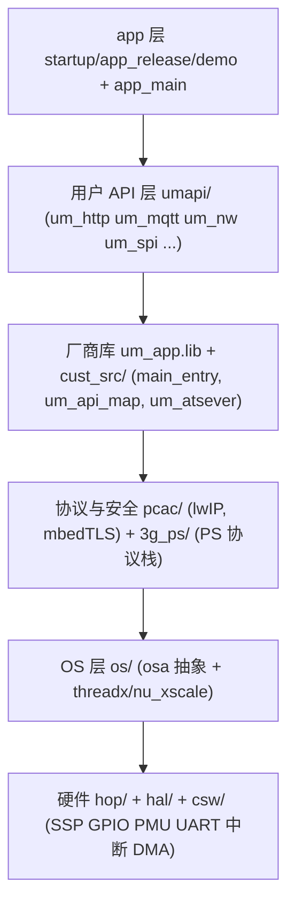
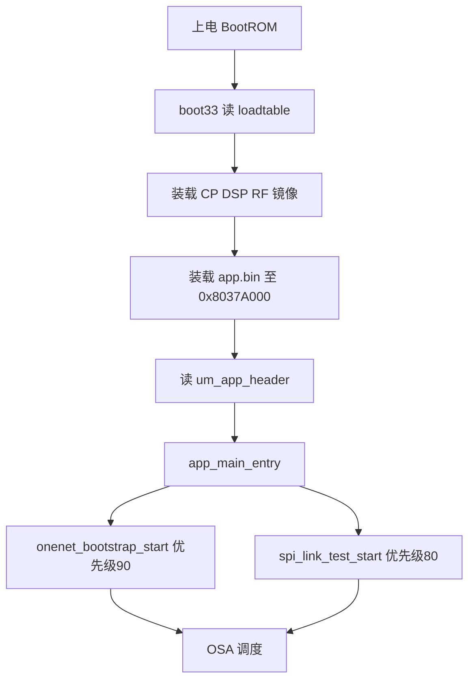

# UMA503（ASR1605 OpenCPU）架构导读

本文讲清楚 UMA503-V7 这颗模组上"你的程序活在哪里、怎么被叫起来、能碰什么、内存怎么分"。起点是上电，终点是你自己写的 `demo/` 应用任务。所有路径以 `D:\UMA503\UMA503-V7_OPENCPU_OC_2025.03.14_1644` 为根，数值取自当前实机构建产物（2026-11-26 的 `app.bin`、`app.map`）。读者按 STM32 的方式理解，所以每个概念都给出对应关系。

## 一、先建立整体印象

**503 不是单片机，是一颗自带 4G 协议栈的模组，你的代码是模组里的一个"客人程序"。**  
STM32 上你拥有整片 Flash、整块 SRAM 和全部外设；503 上你只拿到一小块代码区和 32 KB 数据区，其余 RAM、射频、协议栈都归模组固件所有。  
你能做的事，必须走它开放的接口（`um_*` 头文件 + `um_app.lib`），不能直接写它的私有寄存器。

**它同时扮演两个角色。**  
对 3085E 来说它是 SPI 从机加 4G 通道；对云端来说它是一台有 IMEI、有 MQTT/HTTPS 能力的设备。  
所以 503 的架构重点从来不是"跑多快"，而是"两块芯片的分工边界画在哪里"。

| 维度 | ATS3085E | UMA503-V7 |
|---|---|---|
| 芯片 | Actions 3085E，应用处理器 | ASR1605（CraneLRH），CAT1 模组 |
| 操作系统 | Zephyr | Nucleus（经 OSA 封装） |
| 你的程序形态 | 整机固件，你几乎拥有全部资源 | OpenCPU 应用 `app.bin`，跑在模组内部 |
| 初始化方式 | 编译期注册表 + 链接器排序 | `app_main_entry()` 里手工调用 + 创建任务 |
| 配置方式 | Kconfig + 设备树 + `board_cfg.h` | `app_cflag.txt` 变体清单 + 链接脚本 + 头文件宏 |
| 拿手的事 | 录音、屏幕、UI、本地文件 | 注网、TLS、HTTP、MQTT、断网重连 |

一句话记：**3085 是"有手有脚的业务端"，503 是"有嘴有耳朵的通信端"。**

## 二、五层软件栈

**从上往下只有五个层次，看懂每层"谁写的、你能不能改"就不会乱。**  
最上面是你的应用层，中间三层是厂商预编译的库和源码，最下面是硬件抽象。



| 层 | 目录 | 内容 | 你能否修改 |
|---|---|---|---|
| 硬件 | `hop/` `hal/` `csw/` | SSP（就是 SPI）、GPIO、PMU、DMA、中断控制器 | 不能，只能读头文件理解寄存器语义 |
| OS | `os/osa` `os/nu_xscale` `os/threadx` | OSA 统一封装 + Nucleus 移植层 | 不能改，但能用 `OSATaskCreate` 等 |
| 协议 | `pcac/lwipv4v6` `pcac/mbedTLS` `3g_ps` | TCP/IP、TLS、蜂窝附着与承载 | 不能改，能调用 |
| 厂商接口 | `umapi/*` + `common/lib/um_app.lib` | `um_*` 函数声明 + 实现库 | 不能改，按头文件调用 |
| 应用 | `startup/app_release/` | `app_main`、`demo/*.c` | 全部归你 |

**关键认知：`umapi/` 里绝大多数目录只有 `inc`，没有 `src`。**  
实现都在 `common/lib/um_app.lib` 里，所以"函数点进去看不到实现"是正常现象，不是代码丢了。  
定位实现要用 `app.map` 反查归档和成员，例如 `spi_https_open` 落在 `demo.lib` 的 `spi_link_https.o`。

## 三、内存地图：这是最容易踩坑的地方

**当前镜像走 XIP 模式，代码在 Flash 里原地执行，RAM 只有 32 KB 可用。**  
`app_cflag.txt` 同时带 `RUN_XIP_MODE`、`OC_XIP_SUPPORT`，`makefile.mk` 据此选 `app_linkscript_single_sim_xip.ld`，并把 `APP_CODE_IN_PSRAM_SIZE=0x00008000` 传给链接器。

| 区域 | 起始地址 | 长度 | 放什么 |
|---|---|---|---|
| Flash（`flash`） | `0x8037A000` | `0x80000`（512 KB） | `um_app_header`、`.initdata`、`.text` 常量与代码 |
| RAM（`ram`） | `0x7E040800` | `0x8000`（32 KB） | `.data` 初值变量、`.bss` 未初始化变量 |

**实机 `app.map` 的实际占用。**  
`.data` 从 `0x7E040800` 起 9,024 B，加载地址 `0x8037A020`；`.bss` 从 `0x7E042B40` 起 20,000 B；`.text` 从 `0x8037C380` 起 209,536 B。  
数据区合计 29,024 B，占 32 KB 的 88.6%，剩下约 3.7 KB。代码占 Flash 约 42%。

**两个和性能直接相关的细节。**  
链接脚本把 `.spi_crc.text`、`.spi_dma.text` 塞进 `.data`，等于 SPI 热路径的代码在启动时被拷进 RAM 执行，避开 Flash XIP 取指的等待。  
`LDFLAGS` 里有一组 `--wrap=_malloc_r --wrap=_free_r`，标准库的 `malloc` 被重定向到 SDK 的堆实现，所以 10 KB 的任务栈能分配成功，而它并不占用这 32 KB 窗口。

**记住一条硬约束：往 `.bss` 里加数组要按字节算账。**  
48,000 B 的组缓冲如果放静态变量，直接撑爆 RAM；所以它必须走动态分配，或者干脆不驻留、流水处理。  
申请 32 KB 以上的静态缓冲前，先看 `app.map` 里的 `__ram_end`。

## 四、启动链：从 boot33 到你的任务

**整条链很短：BootROM → boot33 → CP 镜像 → loadtable → app.bin → `app_main_entry()`。**  
模组固件自己不叫"main"，它按 `loadtable.h` 里定义的分区表组织镜像；你的 `app.bin` 只是表里的一项。

1. **BootROM 拉起 boot33，按 loadtable 决定镜像怎么搬。**  
   `loadtable.h` 把头部、版本区、RW 压缩区、符号表、功能字分成五块。  
   版本区里明确写 `execute_mode`，取值只有 `XIP` 和 `PSRAM` 两种；当前构建是 XIP。  
   同一张表里还有 `cp_exec_addr`、`cp_load_addr`、`dsp`、`rf`、`nvm`、`factory_a/b` 等地址，说明模组是多镜像协同。

2. **Flash 基址是 `0x80000000`，你的应用区从 `0x8037A000` 开始。**  
   `variable_def.mk` 写死 `APP_CODE_XIP_FLASH_ORIGIN=0x008037A000`、长度 `0x80000`。  
   这个偏移是 2 MB Flash 里预留给你的一段，不是从头开始。

3. **链接脚本在 Flash 头部放 32 字节的应用头。**  
   `EXTERN(um_app_header)` 与 `.rodata.um_app_header` 说明入口信息由链接器固定放在 `0x8037A000`，启动时先被读到。  
   随后 `.data` 初值排在 `0x8037A020`，`.text` 在 `0x8037C380`，`ASSERT` 在链接阶段就拦住 Flash 或 RAM 溢出。

4. **厂商库装载镜像后回调 `app_main_entry()`。**  
   这个回调已经在可用的线程上下文里，所以里面直接 `OSATaskCreate` 是安全的。  
   它做两件事：先 `onenet_bootstrap_start()`，再 `spi_link_test_start()`，之后才轮到可选 demo 分支。  
   `cust_src/main_entry/src/main_entry.c` 里的 `Opencpu_Entry()` 是空函数，不要误以为是入口。

5. **两个常驻任务从这一刻开始并行。**  
   `spi_link`：优先级 80，静态栈 4,096 B，独占 SSP2。  
   `onenet_boot`：优先级 90，`malloc` 10,240 B 栈，负责注网、UTC、MQTT。  
   两个任务都在等外部事件，CPU 大部分时间空转，这是 503 省电的基础。



## 五、任务与调度：5 ms 一格的时间刻度

**OSA 是 Nucleus 之上的一层薄封装，你只该用它，不该碰 Nucleus 原生 API。**  
`os/osa/inc/osa.h` 定义统一的任务、信号量、队列、定时器接口，底下按 `PLAT_USE_THREADX`、`PLAT_USE_ALIOS` 等宏切换实现；本配置是 `OSA_NU_XSCALE`，落在 `os/nu_xscale`。  
`os/nu_xscale/inc/nucleus.h` 有 55 KB，是原厂 RTOS 头文件，日常不需要看。

**本目标一个 tick 是 5 ms。**  
`demo_spi.c` 的头部说明和 `onenet_bootstrap.c` 里的 `#define SECOND 200u` 都指向这个值。  
这决定了两件事：任何 `OSATaskSleep(1000)` 等于 5 秒；SPI 侧的对间空档里，只要逻辑走到"等一个 tick"，就是 5 ms 起跳。

| 任务 | 入口 | 优先级 | 栈 | 主要职责 |
|---|---|---|---|---|
| `spi_link` | `spi_link_test_task` | 80 | 4 KB 静态 | SSP2 从机收发、读 READY、组缓冲、文件交付 |
| `onenet_boot` | `worker` | 90 | 10 KB 动态 | 等注网、等 UTC、建 MQTT、处理绑定属性 |
| SSP 收发 | SDK 内部 | 中断/驱动层 | — | FIFO、DMA 描述符、缓存维护 |
| 网络 | SDK 内部 | 未知 | — | lwIP、mbedTLS、模组协议栈任务 |

**优先级数字越小越高，这是 Nucleus 的规矩。**  
优先级 80 的 SPI 任务高于 90 的 MQTT 任务，意味着 SPI 收包能抢占网络处理；这对"主机不能被 503 拖住"有利。  
代价是网络任务在长 TLS 运算中被频繁打断，所以网络吞吐别指望靠调优先级解决。

## 六、应用怎么和模组说话：两个方向的通道

**方向一：你的代码调 SDK，走编译期符号解析。**  
`um_http.h`、`um_mqtt.h`、`um_nw.h`、`um_spi.h` 这些头文件声明函数，实现在 `um_app.lib`。  
调用形式就是普通 C 函数，链接时定死地址，没有运行时开销。

**方向二：模组（或外部主机）反过来调你的代码，走运行期映射表。**  
`cust_src/um_api_map/src/um_user_api_map.c` 里有一张表，放进 `DDR_USER_API_TABLE` 段：

```c
um_open_api_list v_user_api_table[] __attribute__((used, section("DDR_USER_API_TABLE"))) =
{
    {0x1DA1EFAC, (void*)um_user_api_map_test},   /* 函数名哈希 → 函数指针 */
};
```

`um_open_api_list` 只有两个字段：`int hash` 和 `void *api_ptr`。  
模组侧按函数名算出同一个哈希值，就能调到你的 C 函数，你的代码地址不需要预先告知它。  
这就是 OpenCPU 的"接口映射"：编译期你不认识对方，运行期靠一张表互相握手。

**方向三：AT 命令直接进你的代码。**  
`cust_src/um_atsever/src/um_atsrv.c` 用 `utlDEFINE_STRING_AT_PARAMETER` 注册参数，用 `ATRESP(atHandle, ATCI_RESULT_CODE_OK, ...)` 回包。  
主机串口敲 `AT+UMTEST=...`，执行的是你写的函数。  
**这是 503 排障的主要入口**，和 3085 的 Zephyr Shell 是两种不同风格的"命令行"。

| 通道 | 谁发起 | 机制 | 典型用途 |
|---|---|---|---|
| `um_*` 调用 | 你的应用 | 链接期符号解析 | 注网、HTTP、MQTT、SPI 配置 |
| API 映射表 | 模组固件 | `DDR_USER_API_TABLE` 哈希查表 | 让模组回调你的自定义能力 |
| AT 命令 | 外部串口 | AT 解析器注册 | 现场调试、产测、状态查询 |

## 七、构建：一条批处理跑完的事

**入口是 `build_app.bat`，不是 `make` 也不是 IDE。**  
它把 `PATH` 重设成"系统目录 + 工程自带 gnumake + 工程自带 arm-none-eabi"，然后用 `gnumake -j6` 编顶层 `Makefile`，输出同时写进 `app_buildlog.log`。

1. **顶层 `Makefile` 只做三件事：读变体、列目录、加库。**  
   `VARIANT_LIST := $(shell type config/common/app_cflag.txt)` 把整行特性清单变成一个变量。  
   `COMMPILE_DIRS` 列出 `app_main`、`third_party/cjson`、`third_party/mbedtls`、`demo/lcd_drive`、`demo` 五个子构建。  
   `DEFAULT_LIBS += common/lib/um_app.lib` 负责解析所有 `um_*` 调用。

2. **`app_cflag.txt` 是这套 SDK 的"Kconfig"。**  
   一行空格分隔的宏名，同时决定链接脚本、内存布局和编译宏。  
   当前清单里的关键项：`OPENCPU_SUPPORT`、`UMA503_V_OC_SUPPORT`、`OC_XIP_SUPPORT`、`RUN_XIP_MODE`、`CRANELRH_SUPPORT`、`CRANEL_4MRAM`、`SINGLE_SIM`、`CAT1ONLY_THIN`、`NO_OC_DEMO`。  
   `NO_OC_DEMO` 就是"别启动原厂那套演示"，否则会和你的 SPI 任务抢 SSP2。

3. **`makefile.mk` 按变体选链接脚本和内存参数。**  
   `OC_XIP_SUPPORT` 命中就走 `app_linkscript_single_sim_xip.ld`，并补 `--defsym` 把 Flash 起点、长度、RAM 大小交给链接器。  
   `APP_CODE_IN_PSRAM_SIZE` 在文件里被赋值五六次，靠"后赋值覆盖先赋值"实现按型号定制，阅读时要看最后生效的那一处。  
   若该值仍是 `0x0`，`$(error ...)` 会在解析阶段直接停下，不会生成半成品。

4. **链接与提取。**  
   `LD` 一次产出 `app.elf` 并带 `-Map` 生成 `app.map`，`--whole-archive` 保证厂商库里的入口不会被裁掉。  
   `objcopy -O binary` 从 ELF 提取 `app.bin`，当前 219,136 B。  
   打包成 `aboot` 可烧写的 ZIP 是另一个步骤，产物按习惯归档到 `artifacts\`。

**构建成功不等于镜像正确，三个数要对上。**  
`app.map` 里的 `__ram_end` 不能顶到 `0x7E048800`；`app.bin` 不能超过 512 KB 的应用区；`complied_lib.txt` 里应能看到 `demo`、`app_main` 等本次参与的子库。

## 八、我们项目在 503 上长出来的模块

**503 原厂带的是 demo，我们现在这套是"多出来的应用层"。**  
它们都在 `startup/app_release/demo/` 下，编译进 `demo.lib`，靠 `app_main_entry` 的两个启动函数挂上任务。

| 模块 | 文件 | 层级 | 职责 |
|---|---|---|---|
| SPI 任务总入口 | `demo_spi.c` | 应用 | 创建 `spi_link` 任务，按宏选择 PIO/单槽/双槽实现 |
| 双槽描述符环 | `spi_link_dma_circular.h` | 应用 | A→B→A 两张 RX/TX 描述符，READY 授权，BLOCK/PAIR 握手 |
| 普通 DMA 从机 | `spi_link_dma_slave.h` | 应用 | 单槽接收、缓存维护、边界检查 |
| 文件/组协议 | `spi_link_file_slave.h` `spi_link_file_protocol.h` | 应用 | 480 B 正文、100 块组、位图补发、CRC16/CRC32 |
| 唤醒与探针 | `spi_link_wake.h` `spi_link_ready.h` | 应用 | 活动探针、GPIO 令牌、等待兜底 |
| 网络交付 | `spi_link_https.c/.h` | 应用 | 非阻塞 socket + mbedTLS 上传组数据 |
| OneNET 会话 | `onenet_bootstrap.c` `onenet_downlink.c` | 应用 | 注网等待、MQTT 登录、属性下行 |
| 诊断 | `spi_link_diag.h` `spi_link_dma_audit.h` `spi_link_circular_profile.h` | 应用 | 计数、审计、分段计时 |

**读这几个文件的正确顺序：`app_main_entry` → `spi_link_test_start` → `spi_link_test_task` → `spi_link_dma_circular.h` → `spi_link_file_slave.h` → `spi_link_https.c`。**  
这条线就是 3085E 的数据如何在 503 里变成一次 HTTPS 上传。

## 九、和 3085E 的架构对照

**两套系统的最大差别在"谁决定初始化顺序"。**  
Zephyr 把每个驱动写成一条报名记录，链接器按阶段和优先级排序，内核从头扫到尾。  
503 是 `app_main_entry()` 里两行调用，谁先谁后写在代码里，和你写 STM32 的 `main()` 一样直白。

| 概念 | ATS3085E | UMA503 |
|---|---|---|
| 启动入口 | `z_cstart()` → `bg_thread_main()` → `main()` | `app_main_entry()` |
| 驱动初始化 | `SYS_INIT` / `DEVICE_DEFINE` + 链接段 | 任务内部调 `um_xxx_init()` |
| 配置 | Kconfig + 设备树 + `board_cfg.h` | `app_cflag.txt` + 链接脚本 + 头文件宏 |
| 引脚 | `board_pin_config[]` 静态表 | `um_gpio_api.h` 逐个配置 |
| 命令行 | Zephyr Shell 独立线程 | AT 命令解析器 + 串口日志 |
| 任务 API | `k_thread_create` / `k_sem` | `OSATaskCreate` / `OSASemaphoreCreate` |
| 时间粒度 | 1 ms tick | 5 ms tick |
| 代码位置 | Flash XIP + PSRAM | Flash XIP，数据只有 32 KB |
| RTOS | Zephyr | Nucleus（OSA 封装） |

**注意一个思维转换。**  
3085 上"加个文件就能编进去"；503 上新增源文件必须先进 `demo/Makefile` 的编译列表，否则 `app.map` 里搜不到，运行时直接链接失败或功能静默缺失。

## 十、四个容易卡住的点

1. **把 503 当单片机用，直接申请大缓冲。**  
   32 KB 里 88.6% 已被占用，48 KB 组缓冲不可能静态驻留。  
   先查 `app.map` 的 `__ram_end`，再决定用堆还是用流水处理。

2. **以为 `umapi/` 里没有 `src` 就是没实现。**  
   实现都在 `um_app.lib`，用 `app.map` 反查归档成员才能定位。  
   反过来，改 `umapi/*.h` 里的声明而库里实现不一致，症状是编译过、运行崩。

3. **拿 1 ms 的直觉去估 503 的时序。**  
   tick 是 5 ms，"睡 1 个 tick"就是 5 ms。  
   SPI 对间空档实测 6 ms 量级时，先分清是硬件传输、任务唤醒，还是等待兜底。

4. **改 `app_cflag.txt` 后没清干净就重编。**  
   链接脚本和内存参数都由这一行决定，变体切换后旧 `build/` 里的中间产物可能还在。  
   换变体先 `build_app.bat clean`，再核对日志里的 `-T` 指向哪份 `.ld`。

## 十一、一句话收束

**503 的架构可以背成四句话：**  
代码在 Flash 里 XIP 执行，数据只有 32 KB 窗口。  
OSA 封住 Nucleus，任务靠 `OSATaskCreate` 手工拉起来。  
和模组打交道有两条路：调 `um_*`，或被它的 API 表/AT 命令反向调用。  
构建由 `build_app.bat` 一条命令决定，变体清单 `app_cflag.txt` 是真正的总开关。
</content>
</file_path>
