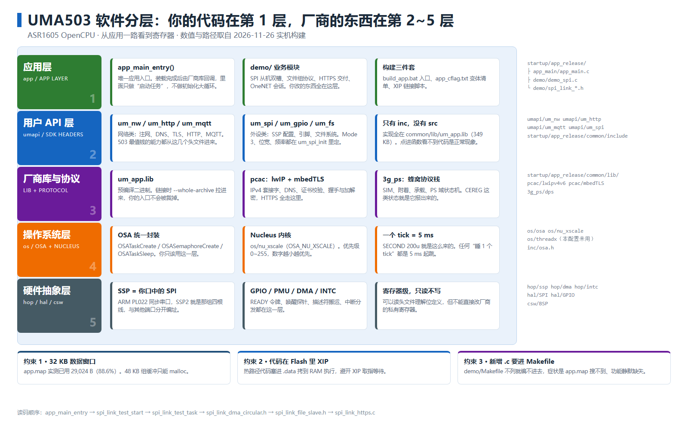
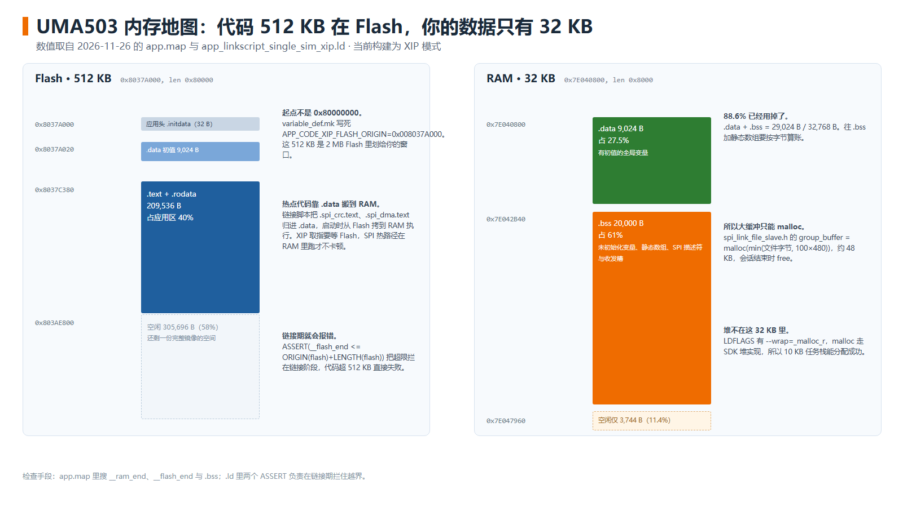
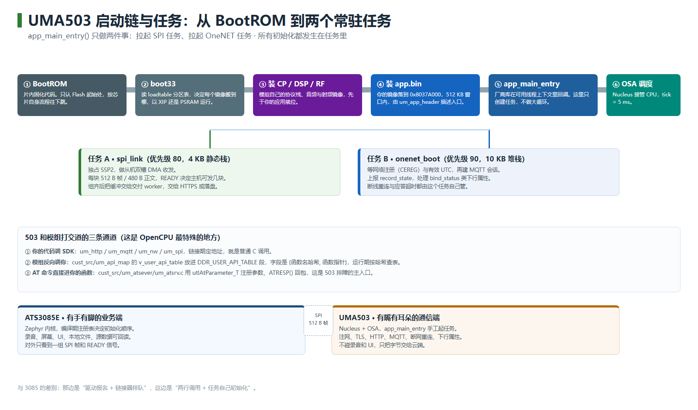
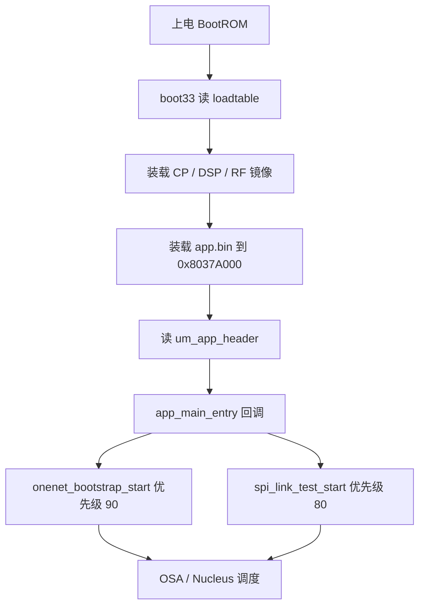
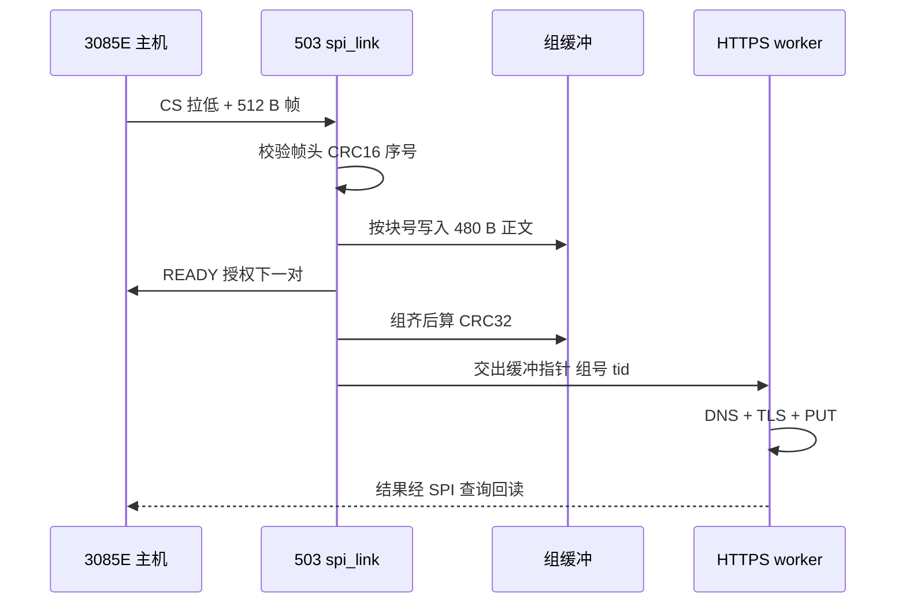

# UMA503（ASR1605 OpenCPU）架构讲解

这份资料讲的是"你的程序在 UMA503 里到底怎么活着"。起点是上电，终点是你自己写的 `demo/` 任务，中间路过内存、任务、通道、构建四件事。读者按 STM32 的方式理解，所以每个概念都给对应关系。源码根是 `D:\UMA503\UMA503-V7_OPENCPU_OC_2025.03.14_1644`，所有数字取自 2026-11-26 那次实机构建（`app.bin` 219,136 B、`app.map` 904,619 B）。

配三张图：**图 1 软件分层**、**图 2 内存地图**、**图 3 启动链与任务**。矢量源在同目录 `diagrams\uma503_layer.html` 等文件里，改字改色改完用 Edge 无头模式重渲染即可，不会像 PNG 那样失真。



## 一、先建立整体印象

**503 不是单片机，是一颗自带 4G 协议栈的模组，你的代码是模组里的"客人程序"。**  
STM32 上你拥有整片 Flash、整块 SRAM 和全部外设；503 上你只拿到 512 KB 代码区和 32 KB 数据区。  
射频、协议栈、大块 RAM 都归模组固件，你能做的必须走它开放的接口。

**它同时扮演两个角色。**  
对 3085E 它是 SPI 从机加 4G 通道；对云端它是一台有 IMEI、能跑 MQTT/HTTPS 的设备。  
所以 503 的架构重点不是"跑多快"，而是"两块芯片的分工边界画在哪里"。

| 维度 | ATS3085E | UMA503-V7 |
|---|---|---|
| 芯片 | Actions 3085E，应用处理器 | ASR1605（CraneLRH），CAT1 模组 |
| 操作系统 | Zephyr | Nucleus，经 OSA 封装 |
| 程序形态 | 整机固件 | OpenCPU 应用 `app.bin` |
| 初始化 | 编译期注册表 + 链接器排序 | `app_main_entry()` 手工调用 |
| 配置 | Kconfig + 设备树 + `board_cfg.h` | `app_cflag.txt` + 链接脚本 + 头文件宏 |
| 强项 | 录音、屏幕、UI、本地文件 | 注网、TLS、HTTP、MQTT、断网重连 |

一句话记：**3085 是有手有脚的业务端，503 是有嘴有耳朵的通信端。**

## 二、五层软件栈：哪层能改，哪层只能读

**从上往下五层，看懂"谁写的"就不会白费劲去找实现。**  
第 1 层归你，第 2~5 层是厂商的源码和预编译库。

| 层 | 目录 | 内容 | 能否修改 |
|---|---|---|---|
| 1 应用层 | `startup/app_release/` | `app_main_entry`、`demo/*.c` | 全部归你 |
| 2 用户 API 层 | `umapi/*`、`common/include` | `um_nw`、`um_http`、`um_mqtt`、`um_spi` 等声明 | 不能改，只能调用 |
| 3 厂商库与协议 | `common/lib/um_app.lib`、`pcac/`、`3g_ps/` | 实现库、lwIP、mbedTLS、蜂窝协议栈 | 不能改 |
| 4 操作系统层 | `os/osa`、`os/nu_xscale` | OSA 统一封装、Nucleus 移植层 | 不能改，能用 |
| 5 硬件抽象层 | `hop/`、`hal/`、`csw/` | SSP、GPIO、PMU、DMA、中断 | 不能改，可读头文件 |

**第一个反直觉点：`umapi/` 里大多数目录只有 `inc`，没有 `src`。**  
实现全在 `common/lib/um_app.lib`（349,784 B），所以"函数点进去看不到实现"是正常现象。  
定位实现只能反查 `app.map`，例如 `spi_https_open` 落在 `demo.lib` 的 `spi_link_https.o`。

**第二个反直觉点：SSP 就是你口中的 SPI。**  
SSP 是 ARM PL022 同步串口模块的正式名字，503 的 `SSP2` 等于 3085 那边的 `SPI2`。  
同一件事两个叫法，看代码时不要当成两个硬件。

## 三、内存地图：32 KB 是硬天花板

**当前构建走 XIP：代码在 Flash 里原地执行，数据只有 32 KB 窗口。**



1. **Flash 窗口从 `0x8037A000` 开始，长 512 KB。**  
   `variable_def.mk` 写死 `APP_CODE_XIP_FLASH_ORIGIN=0x008037A000`、`APP_CODE_XIP_FLASH_LENGTH=0x0000080000`。  
   这 512 KB 是 2 MB Flash 里划给你的，不在 `0x80000000` 起点。

2. **头部 32 字节是应用头，接着是 `.data` 初值，然后才是代码。**  
   链接脚本用 `EXTERN(um_app_header)` 把入口信息固定在 `0x8037A000`。  
   `.data` 加载地址 `0x8037A020`，`.text` 从 `0x8037C380` 起，实测 209,536 B，占应用区 40%。

3. **RAM 从 `0x7E040800` 起，只有 `0x8000`。**  
   `.data` 9,024 B，`.bss` 20,000 B，合计 29,024 B，占 88.6%。  
   剩 3,744 B，`app.map` 里的 `__ram_end` 就是这条线的终点。

4. **两个和性能直接相关的安排。**  
   链接脚本把 `.spi_crc.text`、`.spi_dma.text` 归进 `.data`，启动时从 Flash 拷到 RAM 执行，避开 XIP 取指等待。  
   `LDFLAGS` 带 `--wrap=_malloc_r`，`malloc` 被重定向到 SDK 堆，所以 10 KB 任务栈和 48 KB 组缓冲都不占这 32 KB。

5. **大缓冲只能动态申请，这不是风格问题而是硬约束。**  
   `spi_link_file_slave.h` 的 `group_buffer = malloc(min(文件字节数, 100 × 480))`，约 48 KB，会话结束时 `free`。  
   往 `.bss` 里塞一个 48 KB 静态数组，链接期就会撞上 `ASSERT(__ram_end <= ORIGIN(ram)+LENGTH(ram))`。

## 四、启动链：七个阶段，两次跳转

**BootROM → boot33 → CP/DSP/RF → app.bin → 应用头 → `app_main_entry()` → OSA 调度。**





1. **boot33 按 `loadtable.h` 决定每个镜像的去向。**  
   版本区里写着 `execute_mode`，取值只有 `XIP` 和 `PSRAM` 两种，当前是 XIP。  
   同一张表还管理 `cp_exec_addr`、`dsp`、`rf`、`nvm`、`factory_a/b`、FOTA 包，说明模组是多镜像协同。

2. **你的镜像只是表里的一项。**  
   装载完成后，厂商库在可用的线程上下文里回调 `app_main_entry()`，所以函数里直接 `OSATaskCreate` 是安全的。  
   `cust_src/main_entry/src/main_entry.c` 的 `Opencpu_Entry()` 是空函数，别把它当入口。

3. **入口只做两件事：起任务，然后返回。**  
   先 `onenet_bootstrap_start()`，再 `spi_link_test_start()`，最后按宏启动可选 demo。  
   `app_cflag.txt` 里的 `NO_OC_DEMO` 就是"别启动原厂演示"，否则会和你的 SPI 任务抢 SSP2。

4. **两个常驻任务从这一刻开始并行。**  
   `spi_link`：优先级 80，静态栈 4,096 B，独占 SSP2。  
   `onenet_boot`：优先级 90，`malloc` 10,240 B 栈，负责注网、UTC、MQTT。  
   两个任务平时都在等事件，CPU 大部分时间空转，这就是 503 低功耗的基础。

## 五、任务与调度：5 ms 一格

**OSA 是 Nucleus 之上的一层薄封装，你只该用它。**

`os/osa/inc/osa.h` 定义统一的任务、信号量、队列、定时器接口，底下按 `PLAT_USE_THREADX`、`PLAT_USE_ALIOS` 等宏切实现；本配置是 `OSA_NU_XSCALE`，落在 `os/nu_xscale`。  
`os/nu_xscale/inc/nucleus.h` 有 55 KB，是原厂 RTOS 头文件，日常不需要看。

| 任务 | 入口 | 优先级 | 栈 | 职责 |
|---|---|---|---|---|
| `spi_link` | `spi_link_test_task` | 80 | 4 KB 静态 | SSP2 从机、READY 授权、组缓冲、交付 |
| `onenet_boot` | `worker` | 90 | 10 KB 堆 | 等注网、等 UTC、建 MQTT、处理下行 |
| SSP 收发 | 中断与驱动层 | — | — | FIFO、DMA 描述符、缓存维护 |
| 网络 | SDK 内部 | 未知 | — | lwIP、mbedTLS、协议栈任务 |

**一个 tick 是 5 ms，这是所有时序判断的刻度。**  
`onenet_bootstrap.c` 里 `#define SECOND 200u` 就是证据。  
所以 `OSATaskSleep(1000)` 等于 5 秒；SPI 侧"等一个 tick"直接就是 5 ms 起跳，对间空档实测 6 ms 量级时要先分清是传输、唤醒还是兜底等待。

**优先级数字越小越高，这是 Nucleus 的规矩。**  
80 的 SPI 任务高于 90 的网络任务，SPI 收包能抢占网络处理，代价是长 TLS 运算会被反复打断。

## 六、三条通道：和模组对话的三种方式

这是 OpenCPU 最特殊的地方，也是和 3085"全部自己写"差别最大的一处。

| 通道 | 谁发起 | 机制 | 典型用途 |
|---|---|---|---|
| `um_*` 调用 | 你的应用 | 链接期符号解析 | 注网、HTTP、MQTT、SPI 配置 |
| API 映射表 | 模组固件 | `DDR_USER_API_TABLE` 哈希查表 | 让模组回调你的自定义能力 |
| AT 命令 | 外部串口 | AT 解析器注册 | 现场调试、产测、状态查询 |

1. **方向一：你调 SDK，就是普通 C 调用。**  
   `um_http.h`、`um_mqtt.h`、`um_nw.h`、`um_spi.h` 声明函数，实现在 `um_app.lib`。  
   链接时定死地址，运行时没有查表开销。

2. **方向二：模组反过来调你，靠一张表。**  
   `cust_src/um_api_map/src/um_user_api_map.c` 把 `{函数名哈希, 函数指针}` 放进 `DDR_USER_API_TABLE` 段。  
   模组侧按函数名算出同一个哈希值就能调到你，你的地址不需要预先告知它。

   ```c
   /* 用户自定义接口映射：编译期双方互不认识，运行期靠这张表握手 */
   um_open_api_list v_user_api_table[] __attribute__((used, section("DDR_USER_API_TABLE"))) =
   {
       {0x1DA1EFAC, (void*)um_user_api_map_test},   /* 函数名哈希 → 函数指针 */
   };
   ```

3. **方向三：AT 命令直接进你的函数。**  
   `cust_src/um_atsever/src/um_atsrv.c` 用 `utlDEFINE_STRING_AT_PARAMETER` 注册参数，用 `ATRESP()` 回包。  
   主机串口敲 `AT+UMTEST=...`，执行的是你写的代码。  
   **这是 503 排障的主入口**，对应 3085 的 Zephyr Shell。

## 七、构建：一条批处理跑完的事

**入口是 `build_app.bat`，不是 `make`，也不是 IDE。**

1. **脚本先重设工具链，再调 `gnumake -j6`。**  
   `PATH` 被改成"系统目录 + 工程自带 gnumake + 工程自带 arm-none-eabi"。  
   普通构建把 stderr 并入 stdout 写进 `app_buildlog.log`，脚本自身固定返回 0，所以**必须看日志和 `app.bin` 时间戳**才能判断成败。

2. **顶层 `Makefile` 只做三件事：读变体、列目录、加库。**  
   `VARIANT_LIST := $(shell type config/common/app_cflag.txt)` 把整行特性清单变成变量。  
   `COMMPILE_DIRS` 列五个子构建：`app_main`、`third_party/cjson`、`third_party/mbedtls`、`demo/lcd_drive`、`demo`。  
   `DEFAULT_LIBS += common/lib/um_app.lib` 负责解析所有 `um_*` 调用。

3. **`app_cflag.txt` 是这套 SDK 的"Kconfig"。**  
   一行空格分隔的宏名，同时决定链接脚本、内存布局和编译开关。  
   当前关键项：`OPENCPU_SUPPORT`、`UMA503_V_OC_SUPPORT`、`OC_XIP_SUPPORT`、`RUN_XIP_MODE`、`CRANELRH_SUPPORT`、`CRANEL_4MRAM`、`SINGLE_SIM`、`CAT1ONLY_THIN`、`NO_OC_DEMO`。

4. **`makefile.mk` 按变体选脚本，靠"后赋值覆盖"实现型号定制。**  
   `OC_XIP_SUPPORT` 命中就走 `app_linkscript_single_sim_xip.ld`，并补 `--defsym` 传 Flash 起点、长度、RAM 大小。  
   `APP_CODE_IN_PSRAM_SIZE` 在文件里被赋值五六次，阅读时必须找到最后生效的那一处。  
   若它仍是 `0x0`，`$(error ...)` 会在解析阶段直接停下。

5. **链接一次产出三个文件，再打包成 aboot ZIP。**  
   `LD` 生成 `app.elf` 并带 `-Map` 产出 `app.map`，`--whole-archive` 保证厂商库入口不被裁掉。  
   `objcopy -O binary` 从 ELF 提取 `app.bin`，当前 219,136 B。  
   打包 ZIP 是另一步，产物按习惯归档到 `artifacts\`（构建包一律进这里）。

**构建成功不等于镜像正确，四个数要对上。**  
`app.map` 的 `__ram_end` 不能顶到 `0x7E048800`；`__flash_end` 不能超过 `0x803FA000`；`app.bin` 不比上次突然缩水；`complied_lib.txt` 里能看到本次参与的子库。

## 八、我们项目在 503 上长出来的模块

**原厂带的是 demo，这套是我们自己加的应用层。**

| 模块 | 文件 | 职责 |
|---|---|---|
| SPI 任务入口 | `demo/demo_spi.c` | 创建 `spi_link`，按宏选 PIO/单槽/双槽实现 |
| 双槽描述符环 | `spi_link_dma_circular.h` | RX/TX 各两张描述符，A→B→A，READY 授权 |
| 单槽 DMA | `spi_link_dma_slave.h` | 接收、缓存维护、边界检查 |
| 组与文件协议 | `spi_link_file_slave.h`、`spi_link_file_protocol.h` | 480 B 正文、100 块组、位图补发、CRC16/CRC32 |
| 唤醒与令牌 | `spi_link_wake.h`、`spi_link_ready.h` | 活动探针、GPIO 令牌、等待兜底 |
| 网络交付 | `spi_link_https.c` | 非阻塞 socket + mbedTLS，把组数据 PUT 出去 |
| OneNET 会话 | `onenet_bootstrap.c`、`onenet_downlink.c` | 注网等待、MQTT 登录、属性下行 |
| 诊断 | `spi_link_diag.h`、`spi_link_dma_audit.h`、`spi_link_circular_profile.h` | 计数、审计、分段计时 |

**读码顺序固定这一条线：**  
`app_main_entry` → `spi_link_test_start` → `spi_link_test_task` → `spi_link_dma_circular.h` → `spi_link_file_slave.h` → `spi_link_https.c`。  
这条线就是"3085E 的数据如何在 503 里变成一次 HTTPS 上传"。



## 九、和 3085E 的架构对照

**最大差别在"谁决定初始化顺序"。**  
Zephyr 让每个驱动在编译期"报名"，链接器按阶段和优先级排序，内核扫表调用。  
503 是 `app_main_entry()` 里两行调用，顺序写在代码里，和你写 STM32 的 `main()` 一样直白。

| 概念 | ATS3085E | UMA503 |
|---|---|---|
| 启动入口 | `z_cstart()` → `bg_thread_main()` → `main()` | `app_main_entry()` |
| 驱动初始化 | `SYS_INIT` / `DEVICE_DEFINE` + 链接段 | 任务内部调 `um_xxx_init()` |
| 配置 | Kconfig + 设备树 + `board_cfg.h` | `app_cflag.txt` + 链接脚本 + 头文件宏 |
| 引脚 | `board_pin_config[]` 静态表 | `um_gpio_api.h` 逐个配置 |
| 命令行 | Zephyr Shell 独立线程 | AT 命令解析器 + 串口日志 |
| 任务 API | `k_thread_create` / `k_sem` | `OSATaskCreate` / `OSASemaphoreCreate` |
| 时间粒度 | 1 ms tick | 5 ms tick |
| 代码位置 | Flash XIP + PSRAM | Flash XIP，数据仅 32 KB |
| RTOS | Zephyr | Nucleus（OSA 封装） |

**一个实操差异：503 新增 `.c` 必须先进 `demo/Makefile` 的编译列表。**  
不列就编不进去，症状是 `app.map` 搜不到符号、功能静默缺失，而不是编译报错。

## 十、后续开发：改动落点对照

| 你想做的事 | 改哪个文件 | 怎么验证 |
|---|---|---|
| 提高 SPI 吞吐 | `spi_link_dma_circular.h`、`spi_link_wake.h` | `app spi2rampair 300` 看 kB/s 与对间空档 |
| 改帧长或块数 | `spi_link_file_protocol.h`、`spi_link_block.h` | 3085 侧同步改，跑 99/100/101 块边界 |
| 换云端接口 | `spi_link_https.c` | 看 HTTP 状态、服务器收件长度与摘要 |
| 加下行命令 | `onenet_downlink.c`、`onenet_bootstrap.c` | AT 口看 MQTT 收包计数与应答码 |
| 加新外设 | `um_gpio_api.h` 对应 `um_*` 封装 | 先看 `app.map` 里符号是否真的链进来 |
| 抄一份新变体 | `app_cflag.txt` + `variable_def.mk` | 日志里核对 `-T` 指向哪份 `.ld` |
| 查内存是否够 | `build/app.map` | 搜 `__ram_end`、`__flash_end`、`.bss` |

**改动前先确认一件事：这段代码跑在哪个任务里。**  
`spi_link` 里阻塞会拖慢 READY，`onenet_boot` 里阻塞会拖慢重连，两边的容忍度不一样。  
涉及共享缓冲时，谁写、谁读、什么时候可以覆盖，必须在注释里写清楚。

## 十一、四个容易卡住的点

1. **把 503 当单片机，直接申请大缓冲。**  
   32 KB 里 88.6% 已被占用，48 KB 组缓冲只能 `malloc`。  
   加静态数组前先看 `app.map` 的 `__ram_end`。

2. **以为 `umapi/` 没有 `src` 就是没实现。**  
   实现都在 `um_app.lib`，用 `app.map` 反查归档成员才能定位。  
   改了头文件声明而库里实现不一致，症状是编译过、运行崩。

3. **拿 1 ms 的直觉去估 503 时序。**  
   tick 是 5 ms，"睡 1 个 tick"就是 5 ms。  
   实测 6 ms 量级的空档，先分清是线上传输、任务唤醒，还是等待兜底。

4. **换 `app_cflag.txt` 变体后没清就重编。**  
   链接脚本和内存参数都由这一行决定，旧 `build/` 里的中间产物可能还在。  
   换变体先 `build_app.bat clean`，再核对日志里的 `-T`。

## 十二、术语速查

| 术语 | 一句话 | 出处 |
|---|---|---|
| OpenCPU | 模组开放自己的 CPU 给第三方跑应用，不必外挂主控 | `OPENCPU_SUPPORT` |
| SSP | ARM PL022 同步串口，就是 SPI 硬件 | `um_spi_init(SSP2, ...)` |
| XIP | 代码在 Flash 原地执行，靠缓存取指 | `RUN_XIP_MODE`、`OC_XIP_SUPPORT` |
| OSA | 厂商做的 RTOS 统一封装层 | `os/osa/inc/osa.h` |
| Nucleus | 底层 RTOS，优先级 0~255，数字越小越高 | `os/nu_xscale` |
| CEREG | 协议栈报出的网络注册状态，注网完成的判据 | `onenet_bootstrap.c` |
| READY | 503 告知主机"还能再发几块"的授权信号 | `spi_link_ready.h` |
| 组缓冲 | 一组 100 块、约 48 KB 的接收缓冲，交付与补发都靠它 | `spi_link_file_slave.h` |
| aboot | 模组烧录工具，吃打包后的 ZIP | `aboot-tools-*` |

## 十三、四句话背下来

**代码在 Flash 里 XIP 执行，数据只有 32 KB 窗口。**  
**OSA 封住 Nucleus，任务靠 `OSATaskCreate` 手工拉起来。**  
**和模组打交道三条路：调 `um_*`、被 API 表反向调用、AT 命令进门。**  
**构建由 `build_app.bat` 一条命令决定，`app_cflag.txt` 才是真正的总开关。**
</content>
</file_path>
